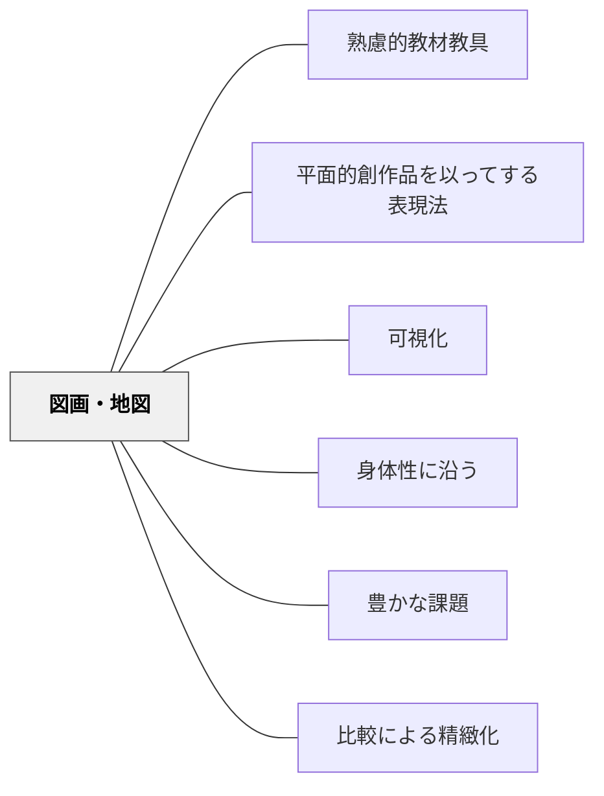

# 図画・地図

**このパタンが完成を助ける大きなパタン**：[[パタン/熟慮的教材教具]]・[[パタン/可視化]]

> 図・絵・写真・地図・グラフを、見て読む教育材料として選び、手渡す。

## 背景（Context）

図・グラフ・地図・絵・写真などの平面の表現は、言葉だけでは伝わりにくい空間の関係・量の関係・仕組みを一度に見せる。教科書・地図帳・資料集・新聞のグラフなど、教室にはすでに多くの図がある。

岩井の教育材料のパタンの目録では、「図画、地図」は「本」「実物（具体物）」「半具体物」と並んで、教師が用意する材料の種類の一つとして挙がっている。同じ目録には、牧口常三郎の分類による [[パタン/平面的創作品を以ってする表現法]]（図画、地図など）も別に挙がっている。本Wikiでは二つを書き分ける。本パタンは**見て読む材料**の側、平面的創作品は**子どもが描いて表す**側である（2026-11-14 岩井裁定）。

## 問題（Problem）

図や地図を挿絵のように扱うと、子どもは見過ごすか、眺めるだけで終わる。凡例・方位・縮尺・軸・目盛りといった読み方の約束を知らなければ、図がそこにあっても、そこから情報を取り出せない。

## 力のかたち（Forces）

- 図は関係を一目で見せるが、読み方の約束を知る人にしか見えない
- 本物の地図や統計のグラフは情報が多く、そのままでは入口が見つからない
- 教科書の図は整っているが、だれかが選んで作った図である。何を描き、何を省いたかは図の外にある
- デジタル地図・統計グラフなど、形式は増え続けている

## 解決（Solution）

**単元のねらいに合う図・地図・グラフを選んで手渡す。読み方の約束を一つずつ確かめてから、問いを手がかりに情報を取り出す。読み取ったことは、言葉にして確かめ合う。**

**近いパタンとの見分け**：図・地図・グラフを、見て読む材料として選び、読み方を確かめながら情報を取り出すのが本パタン。子どもが自分で描いて表すのは [[パタン/平面的創作品を以ってする表現法]]、見えないものを見えるようにする大きな考え方は [[パタン/可視化]]。教材・教具の表は [[パタン/熟慮的教材教具#近いパタンとの見分け|熟慮的教材教具]] にある。

**例：地図帳で県の地図を読む**（社会・4年）
1. 凡例・方位・縮尺を、地図の端で先に確かめる。
2. 「県庁所在地からいちばん近い大きな川はどれか」「山地が多いのは県のどの方角か」と問い、子どもは地図から答えを探す。
3. 見つけた答えを、地図のどの記号から言えるかと一緒に話す。

---

**例：棒グラフを読む**（算数・3年）
1. 表題・横の軸・縦の軸を声に出して読む。
2. 一目盛りがいくつを表すかを確かめる。
3. いちばん多いもの、いちばん少ないもの、二つの差を読む。
4. 「このグラフからは言えないことは何か」も話す（調べていない日・場所のことなど）。

## 結果（Consequences）

- 図・地図・グラフから情報を取り出す力が育つ。社会・算数・理科をまたいで使える
- 図の読み方の約束が、子どもが自分で描くときの約束にもなる
- 注意点：読むだけで終わると、表す力はつかない。読んだ図をまねて自分で描く場面を、[[パタン/平面的創作品を以ってする表現法]] として組み合わせる
- 注意点：図は作った人の選択でできている。何が描かれていないかを問う時間も、ときどき取る

## 関連パタン

- [[パタン/熟慮的教材教具]] — 親パタン
- [[パタン/平面的創作品を以ってする表現法]] — 子どもが描いて表す側（牧口の表現法）。本パタンは見て読む材料の側
- [[パタン/可視化]] — 概念を図で示す

- [[パタン/身体性に沿う]] — 描く・貼る身体的操作が空間認識を深める
- [[パタン/豊かな課題]] — 図画地図を核にした豊かな課題設計
- [[パタン/比較による精緻化]] — 地図・図の比較が概念の精緻化を促す

## クラスター図

## Actionable Insight

- 次の単元で使う教科書の図・グラフを一つ選び、読み方の約束（凡例・軸・目盛り・方位など）を最初の5分で子どもと確かめる
- 図を見せるときに「この図から言えることを一つ」「この図からは言えないことを一つ」の二つを問う
- 教室に地図帳・地図・グラフの実物を置き、授業の中の問いで実際に開く場面を、週に一度は用意する

## 出典

- [[文献/熟慮的教育材料のパターンリスト（動画記録）]]
