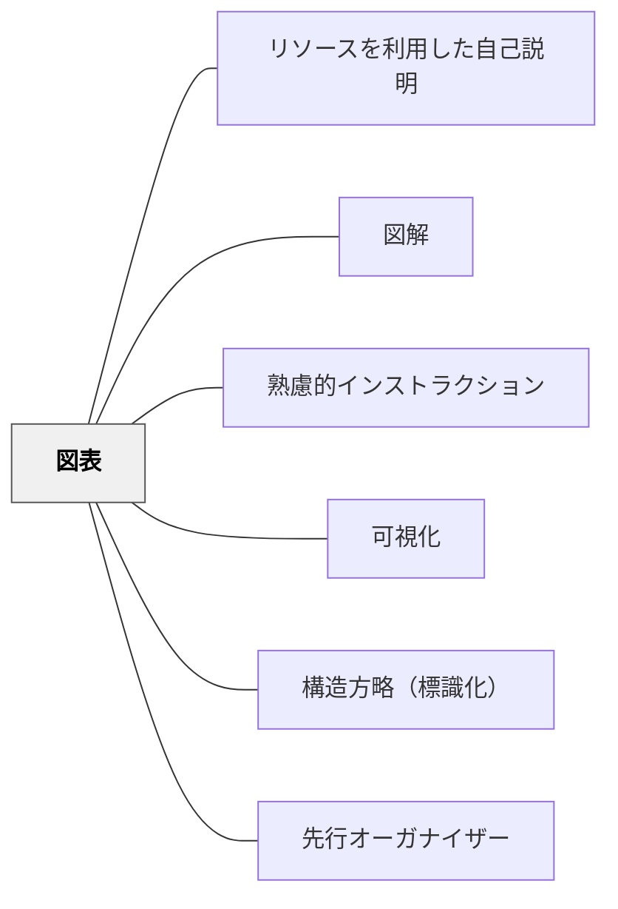

# 図表

**このパタンが完成を助ける大きなパタン**：[[パタン/熟慮的インストラクション]]・[[パタン/可視化]]

> 表・グラフ・チャートで構造化された視覚情報を提示し、関係・比較・変化を一目で把握できるようにする。

## 背景（Context）
言語による説明は線形であるため、複数の要素の関係・比較・変化を同時に提示することが難しい。表・グラフ・チャートなどの図表は、複雑な情報を構造化して一覧できる形にすることで、言語では伝えにくい関係性・パターン・差異を視覚的に把握させる。

## 問題（Problem）
数値・カテゴリ・関係性を言葉だけで説明すると、受け手は情報を順番に処理しなければならず、全体像の把握に時間がかかる。特に複数の要素を比較したり変化の傾向を伝えたりするとき、言語説明だけでは理解の精度と速度が下がりやすい。

## 力のかたち（Forces）
- 図表は情報の概覧には優れるが、文脈や解釈は言語説明が必要
- データの選択・可視化の方法が受け手の解釈を左右する
- シンプルな図表は複雑な図表より理解が早い
- 受け手のリテラシーによって図表の種類（棒グラフ・折れ線・マトリクスなど）を選ぶ必要がある

## 解決（Solution）
**比較・関係・変化・分類を伝えたいとき、表・グラフ・フローチャート・マトリクスなど適切な種類の図表を選び、言語説明と組み合わせて提示する。**
図表は言語説明の補完として使い、必ず「この図表が示していること」を言語で解説する。項目・単位・タイトルを明記し、受け手が自力で読めるように設計する。過度な装飾を避け、伝えたい情報に焦点を絞ったシンプルな図表にする。授業での板書図表は学習者がノートに写しやすいシンプルさを保つ。

**近いパタンとの見分け**：指示・説明の表では、本パタンの見分けの問いは「比較・変化・分類を、表・グラフ・マトリクスで一目でわかるようにしているか」。全体の表は [[パタン/熟慮的インストラクション#近いパタンとの見分け|熟慮的インストラクション]] にある。

### 研究の裏づけ

> **研究の裏づけ（2026-11-02）**：図は、学ぶ内容と関係のあるものに絞る。学ぶ内容と関係のない面白い写真や話（「誘惑的な細部」）を教材に足すと、学びが下がることが多く、その大きさは研究をまとめると小〜中くらいとされる。大学生など248人の実験（Kienitz ほか 2023）では、雷のでき方の教材に関係のない写真と話を足すと、学んだことの再生が下がった（応用には差なし）。「試験に関係ない」と伝えると、差は消えた。学習者が飾りを大事なものと思い込み、そのまわりに理解を組み立てることが原因とする（結果・考察、大人の1つの実験）。出典：[[文献/面白いが関係のない絵や話が学びを下げるのはなぜか、どうすれば防げるかを確かめる（Kienitzほか2023）]]。

> **研究の裏づけ（2026-11-02）**：誘惑的な細部のメタ分析（Sundararajan 2018、54研究・5,111人、中学生〜大学生）では、関係のない面白い情報を足すと、学んだ直後の学びが下がった（g = −0.43）。細部を文と絵など二つの形で見せると −0.73 で、一つの形（−0.35）の約2倍の悪影響だった。本文から離して置くと悪影響は小さめだった（有意な差ではない）。ただし公表の偏りが疑われ、同じ共著者の悪影響のとても大きい6研究を除くと −0.28 になる。後の時点の影響は分からない（pp. 14–16, 24, 36）。出典：[[文献/面白いが関係のない絵や話が学びを下げる効果を、54の研究から確かめる（Sundararajan2018）]]。

> **研究の裏づけ（2026-11-02）**：飾りがすべて悪いわけではない。図の中の物そのものに顔をつける、心地よい色を使う、という情報をほとんど増やさない工夫のメタ分析（Brom ほか 2018、33集団・2,924人、主に大学生）では、記憶 0.39・理解 0.32・応用 0.33 と学びが上がり、内発的な意欲も上がった（0.26）。関係のない面白い要素を足す「誘惑的な細部」とは別物とされる。小学生のデータは少なく、ほとんどが15分以下の学習の直後のテストである（pp. 3, 9, 38–42）。出典：[[文献/教材の絵に顔をつけ、心地よい色を使うと、学びと意欲は上がるかを確かめる（Bromほか2018）]]。

## 結果（Consequences）
- 複雑な関係・比較・変化が視覚的に一目で把握できるようになる
- 言語説明と図表の組み合わせにより、多様な認知スタイルに対応できる
- 受け手の情報処理の負荷が下がり、説明の理解速度と精度が向上する

## クラスター図

## Actionable Insight

- 比較・分類を説明するとき「言葉の前に表を先に見せる」——視覚的な全体像が先にあることで、続く言語説明の理解速度と精度が上がる
- 「今日学んだ3つの概念を自分でマトリクス表にまとめてみよう」を授業の終わりに課す——表の作成が理解の構造化と自己評価を兼ねた活動になる
- 「この図表が示していることを1文で言うと？」を授業中に問いかける習慣をつける——図表読解の言語化がデータリテラシーの基盤として育つ

## 出典

- 一つの教育のパタン・ランゲージ（岩井輝久）

## 関連パタン
- [[教科/算数・数学で使うパタン]]
- [[パタン/リソースを利用した自己説明]]
- [[パタン/図解]]
- [[パタン/熟慮的インストラクション]] — 親パタン
- [[パタン/可視化]] — 情報を見える形にする全般
- [[パタン/構造方略（標識化）]] — 構造を明示する方略
- [[パタン/先行オーガナイザー]] — 全体構造を先に示す
- [[文献/面白いが関係のない絵や話が学びを下げるのはなぜか、どうすれば防げるかを確かめる（Kienitzほか2023）]] — 関係のない飾りの絵や話が学びを下げる効果と、その防ぎ方
- [[文献/面白いが関係のない絵や話が学びを下げる効果を、54の研究から確かめる（Sundararajan2018）]] — 関係のない飾りの絵や話の悪影響のメタ分析
- [[文献/教材の絵に顔をつけ、心地よい色を使うと、学びと意欲は上がるかを確かめる（Bromほか2018）]] — 図に顔や心地よい色を加える工夫が学びと意欲を上げるメタ分析

## このパタンが働く実践

| 実践パタン | どのように図表が働くか |
|------------|------------------------|
| [[実践/カエルの算数：勝ちやすさを表で考えよう]] | 2つのサイコロの和の組み合わせを表に整理し、勝ちやすさを読み取る |
| [[教材/カエルの算数ゲームボード]] | ゲームの結果を、サイコロの組み合わせ表へ移して考えられるようにする |
| [[実践/個別支援級の複式算数：重さと面積をわたり・ずらしで学ぶ]] | 重さの関係を線分図で整理したり、単位の関係を表にまとめたりして考える |
