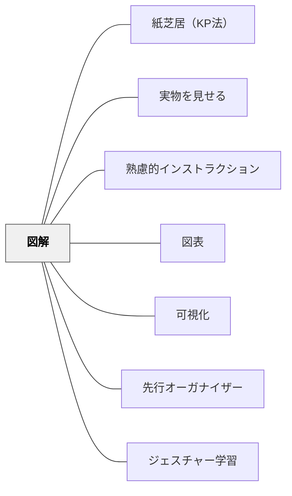

# 図解

> 図・イラスト・矢印・マップで概念や関係を視覚的に示し、空間的な理解を深める。

## 背景（Context）
人間の認知はマルチモダールであり、言語情報と視覚的・空間的情報は異なる経路で処理される。図解（ダイアグラム・マインドマップ・概念図・フローなど）は、言語では捉えにくい「関係性」「構造」「プロセス」を空間的に表現する。マルチメディア学習理論（マイヤー）では、言語と図を組み合わせた説明は単独より理解が深まることが示されている。

## 問題（Problem）
概念の関係・プロセスの流れ・システムの構造は、言語だけでは一次元的な説明にとどまりやすい。「AはBとCから構成され、DはAを経てEになる」という関係を言語だけで理解するには高い認知的負荷がかかる。言語説明のみでは空間的な配置・ネットワーク・階層を把握しにくい。

## 力のかたち（Forces）
- 図解は言語説明と組み合わせることで効果が最大化される
- 手書きの図解でも印刷物と同等以上の学習効果がある
- 図解の複雑さと受け手の理解レベルのバランスが重要
- 学習者に図解を作らせることで、理解の構造化が促される

## 解決（Solution）
**概念・関係・プロセス・構造を伝えるとき、矢印・囲み・位置関係などを使った図解（ダイアグラム・マインドマップ・概念図・フロー図）を言語説明と組み合わせて提示する。**
板書で図解を「描きながら」説明することで、受け手は情報の生成過程を追いながら理解できる。学習者自身に図解を描かせることで、理解を構造化する活動になる。図解に言語ラベルを付けることで、視覚情報と言語情報が統合される。デジタルツール（スライド・ホワイトボードアプリ）も活用できる。

### 研究の裏づけ

> **研究の裏づけ（2026-11-01）**：教師が作った概念地図を見て学ぶ場合、Nesbit と Adesope（2006）では、言葉の力の低い学習者で 0.44 の効果があり、高い学習者では差がなかった（研究は少数）。中心の考え（0.60）が細部（0.20）より覚えやすくなった。後継のメタ分析（Schroeder ほか 2018）では、地図を見て学ぶ効果は4〜12年生で大きく、大学生では小さかった（研究は少数）。著者らは、名詞・動詞・名詞の短い文の形が、読み書きの苦手な学習者にも近づきやすいことを理由の候補に挙げる（2006 pp. 432–434／2018 著者稿 pp. 22–23, 27）。出典：[[文献/概念地図を作る・見ることの効き方を、比べた相手と学習者で確かめる（NesbitとAdesope2006）]]・[[文献/概念地図のメタ分析を研究を増やして確かめ直す（Schroederほか2018）]]。

> **研究の裏づけ（2026-11-01）**：Pashler ほか（2007）は、図には言葉の説明を図の該当箇所のすぐそばに添え、写実的な絵より、要点を示す図式的な絵のほうがよいことがあるとする（根拠 moderate、pp. 13–15）。デジタルゲームのメタ分析（Clark ほか 2016）でも、見た目が単純な図式のゲームのほうが、写実的なゲームより効果が大きかった（ほかの特徴をそろえると差は有意の手前）。出典：[[文献/Organizing Instruction and Study to Improve Student Learning（Pashler et al., 2007）]]。

## 結果（Consequences）
- 複雑な関係・構造・プロセスが視覚的に把握しやすくなる
- 多様な認知スタイルを持つ学習者への対応力が高まる
- 学習者が図解を作る活動が、理解の深化と自己説明を促す

## クラスター図

## Actionable Insight

- 板書で「完成した図を見せる」のではなく「描きながら説明する」——生成過程を一緒にたどることで学習者は情報の組み立て方そのものを学ぶ
- 説明の後に「この関係を自分で図解してみよう」と1〜2分で手描きさせる——図解の再現が理解の確認と構造化を同時に行う最速の方法になる
- 学習者が描いた図解を数枚並べて「どれが一番わかりやすいか」をクラスで話し合う——図解の比較が「何が本質か」を共同発見する場になる

## 出典

- 一つの教育のパタン・ランゲージ（岩井輝久）

## 関連パタン
- [[パタン/紙芝居（KP法）]]
- [[パタン/実物を見せる]]
- [[パタン/熟慮的インストラクション]] — 親パタン
- [[パタン/図表]] — 数値・比較の視覚化との区別
- [[パタン/可視化]] — 情報を見える形にする全般
- [[パタン/先行オーガナイザー]] — 全体構造を先に図解で示す
- [[パタン/ジェスチャー学習]] — 空間的関係を身体で示す
- [[文献/概念地図を作る・見ることの効き方を、比べた相手と学習者で確かめる（NesbitとAdesope2006）]] — 教師が作った地図は、言葉の力の低い学習者にとくに効く
- [[文献/概念地図のメタ分析を研究を増やして確かめ直す（Schroederほか2018）]] — 研究を増やした後継のメタ分析。作る 0.72・見る 0.43
- [[文献/Organizing Instruction and Study to Improve Student Learning（Pashler et al., 2007）]] — 図に言葉を添え、図式的な絵で要点を示す
