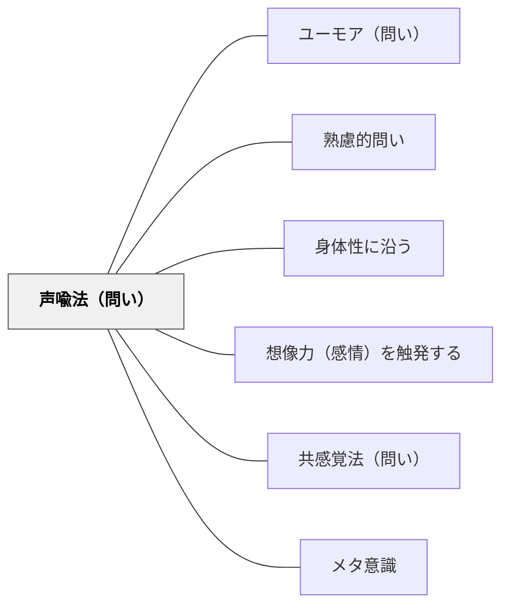

# 声喩法（問い）

**このパタンが完成を助ける大きなパタン**：[[パタン/熟慮的問い]]

> オノマトペを足して問いを情緒的にする

## 背景（Context）
声喩法（オノマトペの使用）は、音の響きによって感覚や情動を直接的に喚起する言語表現である。日本語はとりわけオノマトペが豊富であり、思考や感情の状態を音で描写することができる。問いにオノマトペを組み込むことで、学習者の感覚的・情緒的な回路を開き、抽象的なテーマへの接続を助ける。

**原典では**：安斎（2021）は声喩法を「光の色を変える」タイプのレトリックの最後に置き、「擬音語や擬態語などの特徴的な音の表現を用いたテクニック」で「オノマトペ」とも呼ぶと説明する（第5章 MANNERS 18、Kindle版 84%）。使いどころは、問いが堅苦しく、相手の論理的な回答を誘発しそうな場合であり、オノマトペという「調味料」で味付けをする感覚で「ちょい足し」するとよいという（同、85%）。例として「来期の事業戦略は？」を「来期のガンガン攻めていくための事業戦略は？」に、「この技術のポテンシャルは？」を「この技術のきらりと光るポテンシャルは？」に言い換え、ほんの少し加えるだけで問いの情緒的な印象を増せると述べる（同）。原典の例はいずれも、問いの中の一語にオノマトペを添える形である。

**岩井の講話では**：安斎の本の一覧として「オノマトペを足して質問を情緒的にする」と読み上げている（30:14）。

## 問題（Problem）
問いが概念的・論理的な言葉だけで構成されると、学習者は感情を切り離した「正しい答え」を探そうとする。思考の手触りや感情の質感を問いに盛り込む手段がなければ、学習者の内的体験が議論から排除されてしまう。特に内省や創造的思考を促したいときに、論理的な言葉だけでは不十分なことがある。

## 力のかたち（Forces）
- 感情的・感覚的表現 vs 概念的・論理的表現
- 問いの親しみやすさ vs 厳密さ
- 個人の内的体験 vs 共有可能な言語
- 問いの遊び心 vs 問いの深刻さ

## 解決（Solution）
「ぐるぐると考えてみると、何が出てきそう？」「もやもやしている部分はどこ？」「この問題にパチンとはまる答えがあるとしたら？」のように、思考や感情の状態をオノマトペで描写した問いを使う。特に停滞感を打破したいとき、あるいは子どもが感情を安心して表せる場をつくりたいときに有効である。

---

**例：かたい問いにオノマトペを一つ足す**（算数・3年）
1. わり算の文章題を解いた後の振り返りで、「今日の学習でわかったことは？」と問う代わりに、「今日の学習で『すっきり』したことと、まだ『もやもや』していることは？」と問う。
2. 子どもはノートを二つに分け、「すっきり」と「もやもや」に一つずつ書く。
3. 「もやもや」に書かれたことのうち、多くの子に共通するものを次の時間の始めの問いにする。

---

**例：観察の問いに様子を表す言葉を足す**（理科・3年）
1. こん虫の観察の前に、「バッタの体のつくりを調べよう」に加えて、「バッタは、どこを『ぴょん』と動かして跳ぶのだろう？」と問う。
2. 子どもは観察カードに跳ぶ前と跳んだ後の様子を描き、動いた部分に印をつける。
3. 印をつけた部分を、「頭・むね・はら」のどこにあるかで分け、あしがむねについていることを確かめる。

**近いパタンとの見分け**：問いの型の表では、本パタンの見分けの問いは「オノマトペを足して、感覚に訴えているか」。全体の表は [[パタン/熟慮的問い#近いパタンとの見分け|熟慮的問い]] にある。

## 結果（Consequences）
- 学習者が感情と思考を統合して問いに向き合えるようになる
- 問いの雰囲気が和らぎ、発言のハードルが下がる
- 内的状態の言語化を促し、メタ認知が深まる

- 注意点：オノマトペは問いの中の一語に「ちょい足し」する程度にとどめる。足しすぎたり他のレトリックと重ねたりすると、問いの意図がかえって見えにくくなる（安斎 2021、第5章）。

## 関連パタン
- [[パタン/ユーモア（問い）]]
- [[パタン/熟慮的問い]] — 親パタン
- [[パタン/身体性に沿う]] — 感覚・身体的直感を学びに引き込む上位パタン
- [[パタン/想像力（感情）を触発する]] — オノマトペの問いが感情・想像力を動かす
- [[パタン/共感覚法（問い）]] — 五感全般に翻訳して問う兄弟パタン
- [[パタン/メタ意識]] — 内的状態の言語化がメタ認知を促す

## クラスター図

## Actionable Insight

- 「もやもやしている部分はどこ？」「ぐるぐると考えてみると何が出てきそう？」というオノマトペの問いを議論の停滞場面で使う——感情と思考を統合して問いに向き合えるようになる
- 「この問題にパチンとはまる答えがあるとしたら？」と問うことで発言のハードルが下がる——問いの雰囲気が和らぎ参加しやすくなる
- 内省の時間に「今どんな感じ？ぞわぞわ・わくわく・もやもやどれ？」とオノマトペで感情を引き出す——内的状態の言語化がメタ認知を促す

## 出典
- [[文献/熟慮的問いのパターンリスト（動画記録）]]

- 安斎勇樹（2021）『問いかけの作法 チームの魅力と才能を引き出す技術』ディスカヴァー・トゥエンティワン 第5章 MANNERS 18「レトリック（B-4）声喩法」 — Kindle版 84〜85% で確認。[[文献/問いかけの作法（安斎勇樹）]]
- 岩井輝久（年不明）『熟慮的問いのパターンリスト』［動画］ https://youtu.be/WivskVtxG34 — 2026-11-13 に文字起こしで確認（30:14）
