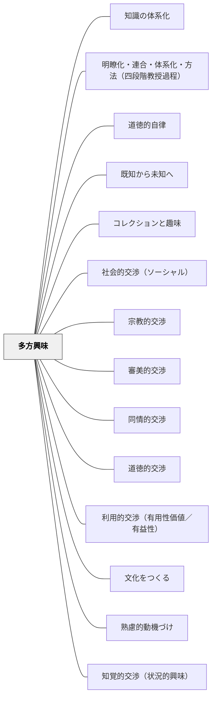

# 多方興味

> 優れた教師は、ビッグメッセージをもっている。

## Pattern Connection

### ヘルバルト（1806）教育学綱要統合——六種興味論の直接の源泉

本パタンの「多方興味」は、牧口常三郎が「ヘルバルト教育学の興味の六種類を修正して地理学に応用した」ものを、さらにパタン化したものである。したがってヘルバルトの六種興味論（§83）は、本パタンの直接の歴史的源泉である。

**ヘルバルトの六種興味と牧口の六種興味の対応**：

| ヘルバルト（1806） | 牧口の修正版 | 内容 |
|---|---|---|
| 経験的（empirisch） | 知覚的 | 対象の直接的な経験・感覚への興味 |
| 思弁的（spekulativ） | 研究的 | 因果・法則・原理への探究 |
| 美的（ästhetisch） | 審美的 | 美・形式・表現への関心 |
| 同情的（sympathetisch） | 同情的 | 他者への共感・人間理解 |
| 社会的（sozial） | 社会的 | 社会・共同体への関心 |
| 宗教的（religiös） | 宗教的 | 存在・意味への根本的関心 |

- **補強された点**：ヘルバルトは六種すべてが「一人ひとりに等しく発現することは期待できないが、集団として見れば必ず六種すべてを見いだす」と述べた。教師に六種の興味を設計する責任があるのは、個人の偏りを集団の多様性で補うためである。
- **一面性への警告**：「一種の興味だけが過度に発達すると人格の発達を妨げる」——授業設計で特定の興味型（例：思弁的のみ・知覚的のみ）に偏ることへの警告。
- **教師の多面性が先**：「教師みずからの多面性ある興味が生徒のうちに同種の興味を植えつける力の尺度である」（§63）——教師が六種の興味を持つことが設計の前提。
- **波及するパタン**：[[パタン/道徳的交渉]] — 社会的・同情的・宗教的興味の育成；[[パタン/省察]] — §117「教師もまた絶えず学び続けねばならない」；[[文献/教育学綱要（ヘルバルト）]] — 本統合の出典

---

### Dewey（1916）

Deweyの *Democracy and Education* Ch.10「Interest and Discipline」は、ヘルバルト→牧口の多方興味論と同じ問い——「なぜ学習者は学ぶのか」——に対する、もう一つの体系的な答えである。両者は異なる系譜から出発しながら、「真の興味を育てることが教育の核心」という点で収束する。

- **既存パタンとの関連**：多方興味の6種類（知覚的・研究的・審美的・同情的・道徳的・宗教的）は、学習者が世界と交渉する多様なチャンネルを分類したもの。DeweyのInterest論はこの「交渉」の質——本物か糖衣か——を問う補完的な視点を加える。
- **補強された点**：牧口の「興味は巧みに類化作用を誘導するより生ず」という命題に、Deweyの「真の関心 vs. 偽の関心」という判別軸が加わる。学習者を動機づけているのが内側から育った関心なのか、外から貼り付けた面白さなのかを見分ける基準になる。

**Deweyの関心（Interest）の3意味**

| 意味 | 説明 |
|---|---|
| 継続的活動への従事 | 何かに取り組み続けている状態 |
| 物事が個人に触れる点 | 自分と素材が交わっている場所 |
| 没頭・吸収される状態 | 自分と活動が同一化している状態 |

> "Interest, concern, mean that self and world are engaged with each other in a developing situation."（Ch.10）

**真の関心 vs. 偽の関心（糖衣）**

| | 真の関心 | 偽の関心（糖衣） |
|---|---|---|
| 構造 | 素材と学習者の力・目的が自然に連結 | 外から面白さを貼り付けている |
| 動機の所在 | 内側（活動そのものへの従事） | 外側（報酬・罰・教師の期待） |
| 結果 | 活動が続く。発展する | 刺激が切れると止まる |
| 注意 | 一つにまとまる | 分かれる（divided attention, Ch.13） |

「分かれた注意（divided attention）」——Dewey は Ch.13 で「二心（double-mindedness）」とも呼ぶ。建前で関与しながら内側は離脱している状態——は、多方興味の視点で見れば「交渉の表面だけを動かして、深層では接続していない」状態に対応する。

- **他のパタンへの波及**：[[パタン/熟慮的動機づけ]]（Deweyの関心論と多方興味を共に参照）・[[パタン/知覚的交渉（状況的興味）]]・[[パタン/研究的交渉]]——多方興味の6種のうち2種がすでにパタン化されており、Deweyの関心論はそれぞれに「本物の交渉を生んでいるか」という問いを加える。

---

### J.S. ミル（1867）大学教育について——「文科と理科の両輪」という補完的根拠

ミルのセント・アンドルーズ大学就任講演（1867年）は、多方興味の「なぜ多方面が必要か」という問いに対して、ヘルバルト・牧口とは独立した別系統からの歴史的根拠を与える。

- **補強された点**：ヘルバルトの六種興味論（§83）が「人間の興味の分類」として多方興味を基礎づけるなら、ミルは「どの方面を切り捨てても人格形成が不完全になる」という負の側面から同じ論理を補強する。自然科学のみを教えれば文学的感受性が育たない。文学のみを教えれば科学的方法（観察・推論）が育たない。
- **「科学の教育とは方法の教育である」**：ミルは自然科学の目的を「結果そのものを覚えること」ではなく「観察・推論の方法そのもの」を学ぶことだと述べた。これは多方興味の「研究的交渉」（因果・法則への探究）の本質と一致する。
- **「感情の陶冶」という第三の柱**：ミルは知的教育・道徳的教育に加え、詩・芸術を通じた「感情の陶冶」を第三の教養として位置づけた。これは多方興味の「審美的交渉」（美・形式・表現への関心）を「余暇」ではなく「人格形成の柱」として再定置する根拠となる。
- **「全領域の地図」という体系化の視点**：ミルは、大学の役割を知識の体系化に見る人々の見解を紹介し、その内容として「いわば知識の全領域の地図を作りあげること」を挙げた（ミル自身は、知識がすでに他の場所で獲得されていることが前提だと留保している）。多方興味は「個々の興味のカタログ」ではなく、学習者が世界と交渉する多様なチャンネルの体系として設計されるべき。
- **補強するパタン**：[[パタン/専門以前の人間形成]] — 多方面の人間形成が専門化に先行する；[[パタン/審美的交渉]] — 感情の陶冶を教育目標として位置づける
- **波及するパタン**：[[文献/大学教育について（J.S.ミル）]] — 本統合の出典

---

## 背景（Context）

　多方興味は、人間の興味（交渉）のパタンであり、教育設計の基本的なパタンである。

## 問題（Problem）

　教育設計の、教育教材の基本的な視点を欠くために軽重を付けられず、網羅的で無味乾燥な教育になっている。

授業設計が特定の興味チャンネル（例：知覚的な観察や思弁的な探究）に偏ると、別の型の興味を持つ学習者は動機づけられないまま学びに入れない。「網羅的で無味乾燥な教育」になるか、一部の子どもだけが動機づけられる偏りが生まれる。ヘルバルトが警告したように、「一種の興味だけが過度に発達すると人格の発達を妨げる」——多方を視野に入れない設計が、その教科でしか動機づけられない学習者を生む。

## 力のかたち（Forces）

- 教育者の意図と学習者の実態のギャップ
- 個々の状況に応じた柔軟な対応の必要性
- 経済性（無駄なコスト・苦しみを省く）の原理

## 解決（Solution）

**近いパタンとの見分け**：動機づけ・興味の表では、本パタンの見分けの問いは「教育設計の全体が、一つの型の興味に偏っていないか」。全体の表は [[パタン/熟慮的動機づけ#近いパタンとの見分け|熟慮的動機づけ]] にある。

キーワード　多方興味　観念類化作用

「教授の目的は興味にあり。智識其物を授くるよりは、これより生ずる愉快と奮励にあり」牧口常三郎

学習の楽しさや興味を引き出すことに成功したら、被教育者は、自ずと学び続けるようになる。いかに被教育者の学ぶ喜び、興味を引き出せるか。

「興味は巧みに類化作用を誘導するより生ず。類化作用は児童各自の自動によりて行はる。此点より見るときは、よく生徒をして自動し奮励するを得せしむれば、夫れ丈教師の教授は不要に属す。 蓋ぞ殊更に華美の外観的教授を要せんや。児童をして自ら教授に奮進せしめんとせば、即類化作用を軽快ならしめんとせば、旧観念と新観念の連絡点を明瞭たらしめざるべからず」牧口常三郎

多方興味の視点で教育材料を分析、設計し、既習（既知）と未知へのつながりが明確になるようにすることによって、自ずと推理と理解（観念類化作用）が起きて、学習の喜びや興味を引き出すことになる。

ここでは多方興味という教育パタンを紹介する。ここで紹介する多方興味は、ヘルバルト教育学の「興味の六種類」を牧口常三郎が修正して地理学に応用したものを、さらに教育パタンとして修正したものである。

　ヘルバルト教育学の「興味の六種類」について、湯原元一（１８９２）から引用する。

＝＝＝

　　第一　智力上の興味

　　第二　感情上の興味

而して更に智力上の興味、感情上の興味を別つて左の六者となす。

　　第一　経験的興味（Empirical interest)

　　第二　研究的興味（Speculative interest）

　　第三　審美的興味（Aesthetical interest)

　　第四　同情的興味（Sympathetical interest)

　　第五　社交的興味（Social interest)

　　第六　宗教的興味（Religious interest)

　右六種中第一より第三に至るは智力上の興味に属し、第四第五は感情上の興味に属す、智力感情二者に両属するものは第六の宗教的興味とす。

＝＝＝

斎藤正二（２０１０）のよれば、牧口常三郎は、この六種の興味を修正したものを地理学（『人生地理学』）の枠組みとして利用した。そして、牧口は、自然環境に対する人間の精神的交渉を地理学のテーマとして、各個人の多方的交渉を次のように分類した。

知覚的交渉（１）

利用的交渉（２）

科学的交渉（３）

審美的交渉（４）

道徳的交渉（５）

以上、経験として大別

同情的交渉（６）

公共的交渉（７）

宗教的交渉（８）

以上、交際として大別し、八つに分類した。牧口は、ヘルバルト教育学の興味の六種類に「利用的交渉（２）」と「道徳的交渉（５）」の二つを加えて修正していることがわかる。

ヘルバルト教育学→牧口常三郎の地理学→教育のパタン・ランゲージという流れで、牧口の八つの交渉をヘルバルト教育学の多方興味に戻して、八種の興味のパタンがあるとしてみた。この八種の興味（交渉）を意識し教育設計することで、被教育者の興味と視点を涵養できると考える。

つまり、次の通りである。

・知覚的興味

・利用的興味

・研究的興味

・審美的興味

・道徳的興味

・同情的興味

・社会的興味

・宗教的興味

利便性から科学的交渉→研究的興味（狭い意味での自然科学よりも広い研究的興味の意味で）、公共的交渉→社会的興味と名前を他と比べて広い意味の言葉に変えてみました。

この八種の興味のパタンは、牧口の八種の精神的交渉をベースとしているので、牧口の『人生地理学』から、八種の精神的交渉の説明を引用する。

＝＝＝

一、知覚的交渉

前例の野外に於ける子女及び常人の観察の如きは、この種の交渉に属せり。此等の人々の外界に対する観察は、単にその複雑多趣なるに奇異の念を起し、進んで其名称を尋ぬる位に留まりて、甚だ浅薄軽浮なるが故に、他の多少深厚なる交渉に対比すれば、之を又別に通俗的若くは見聞的の交渉と名くるを得べし。さはいへ此種の交渉は決して軽視すべきものにあらず。蓋し之れ他の高尚なる心の作用の基礎をなすものにして、従つて更に濃厚なる他種交渉の端緒たると以てなり。若し夫れ小閑を得るに乗じて日常営々たる単調無趣味の生活をなしつつ都門の俗塵を脱し、暫らく一身を緑陰水辺の静境に転じて、意のむかふ所に恣（ほしいまま）にせんか、吾人の心思は周辺より肉薄し来る所の、山水、風光、風俗、慣習等の新鮮奇異なるに恍惚として宛がら仙郷に在るが如くになるべし。即ち之れ、吾人の心界が、従来のものと全く一変して、新鮮の多趣なる外界現象に驚駭したるものにして、心意は此等新奇の現象に挑発せられ、不知不識（しらずしらず）、此現象に注目し、之を観察し、之を経験し、依て以て、心中に一段の新智識を加ふるなり。即ち従来昏睡の状態にありし心意が夫等の為めに醒起し傾注して、茲に智的交渉を遂げたるものなり。斯くて吾人の心意は之を以て停滞せず、更に他の心状に移ると同時に心界の欠乏を満足せしめたる愉快を喚起し、尚ほ此愉快を継続せんとするを常とす。所謂好奇心と称するもの是なり。

二、利用的交渉

前例の農夫が収穫を求むるに心思を労するが如き、商人が相場の上がり下りに苦慮するが如きは、等しく各自の生存の為めに、外界を利用せんとする点に於て一致し、同時に前後の他の交渉と区別せらるべきものなるを以て仮りに利用的交渉と名づくるを得べし。尤も利用に相対したる反面の、人間の生存に毀害を与ふるものを排除し、忌避することも、全く同種類の心の作用と見るを得べきものなれば、此意味を含蓄せしめんが為めには、利害的交渉と云ふを適当とせんか。ともあれ、此種の交渉は外界、殊に地と人類との関係の最も重要なるものなれば吾人は等閑に附すべからざる所のものなり。造化は人類を生存せしむるに当りて、其生存上に有利の事物のみを提出せず。中には有害の事物を混じて之を苦め之を殺傷するものの如し。此が為めに人間は造化の此の警鐘に啓発せられ自己の経験と、祖先伝来とにより得たる標準（法則）によりて此を判断し、利者を好み、害者を恐れ利害を愛し、害者を悪み、遂に前者に就きて後者を避け、前者を使用し後者を棄抛し、前者を増大せしめ、後者を滅亡せしむるの働作に及ぶ。吾人が依て生命の維持する実業上の働作は、即ち直接の利害的交渉なり。

三、科学的交渉

吾人の心意は啻に現象の新奇に警醒せられ、之を見聞し、之を経験するに留まらず、少しく発達したるものにありては、更に此等の多種複雑なる事物相互の間に、神秘幽玄の関係ある事に驚愕し、進んで其因果的関係の理を探求し、考察せざるを得ざるに至る。是れ実に外界現象相互の間に存する幽妙不可思議なる関係が、吾人の心意を驚起せしめ、吾人の心意は之によりて啓発せられ、之を推究し、之を考察し、異同を弁別し、等差を比較し、茲に於て此等同種類の全躰を包括する概念を構成し、全般の事実に通する相関の理を発見し、依て以て推究的交渉を遂ぐ。此種の交渉は一切の科学成立の基礎にして、学者は常に各々得意とする方面の奇異に警醒せられ、先づ之を経験し、観察し、進んで其間に存する相互の理法を考究し、此等の理法を綜合し、統括し、以て一科の学を構成す。斯くて学者は此種の興味に刺戟せられ、誘導せられ、其専攻の学に熱注し、専心し、寝食を忘れ、命を惜まず。現今の発達は其結果たる也。啻に学者のみならず。所謂機敏なる実業家、英才なる処世家等も、詮じ来れば、悉く此種の交渉を時々刻々実際の局に当りつゝある間に、最も多く重ねたる結果に外ならざるなり。

四、審美的交渉並に道徳的交渉

外見が人間の心意に対する交渉は、啻に上述の如き殺風景にして又没趣味の実用的若くは科学的関係に留まらず。複雑にして多趣なる外界現象が、多様の変化ある内に於て、現象相互の間に全躰と部分、部分と部分等が夫々調和、均一、斉整を保ち、又能く全躰の目的に適応すること等は、吾人の感官を刺戟し興奮し、以て吾人の称賛を博せんとするものゝ如し。而して此の如く刺激せられ、興奮せられて、認識したる吾人は、性来の天真爛漫たる性情に照し、善悪及美醜の標準によりて判断し、以て此に感動す。是によりて吾人の心情は、純潔となり清浄となる。而して欺く感動せられたる吾人の心情は、詩に詠し、歌に唱し、布帛を画き、石片に刻み、将た道徳的に歎賞し、之を愛玩し、以て美的及び道徳的交渉をなす。吾人が人間界の善を賛美するは自然界に於ける天然の美、若しくは技術の美を歎賞すると同一の心の作用に属せり。唯だ道徳的の美（即善）の場合に於ては、理想は美術に於けるが如く画布若しくは石片によりて表されず、行動云為によりて表はさるるを異る所とす。

・・・・・・・・・・・・・・・・・・・・・・

五、同情的交渉

吾人が日常、父母、兄弟朋友、及び隣人と交わるに当り、此等諸人の顔色言動によりて表はさるる苦楽悲歓は吾人の心情を動かし、吾人をして惻隠の心を惹起せしむる如きは此種の交渉の最も著しきものとす。斯の如き場合に於いて発動せらるゝ心情は之れを同情と名づける。吾人若しすくしく注意するときは此種の交渉は単り個々の人々に於てなさるゝのみならず。人類以外の禽獣に対しても、草木に対しても等しくなさるるを観るべし。或は吾人が平常接近する牛馬雞犬等の困難に瀕するを見るとき、恰かも人間に於けると等しく憐憫の情を起すがごときは即ち此が例となすを得べし。尚お吾人注意を継続するときは、此種の交渉が単り以上の有情物に対してのみに限られずして、往々金石器物等全く無生の物に対しても為さるゝを観るべし。前例の久闊の帰省者が郷土の山川原野に対しても恰かも旧誼の友人に対するが如き愛情を注ぐが如きは此事実を説明するに足る。或は吾人の永く愛玩し親炙したる所のものに対しては終に一種の情的関係を生じ、恰かも有情の物に於けるが如く之を離し之を毀つに忍びず。或は有名なる歴史上の遺物若くは遺跡等の滅絶を歎じ之を永く保存せんとする如きは、之れ皆な無生の物に対し一種の交渉をなせるものなり。去れば同情的交渉は吾人の接触せる個人若くは物躰を吾人と一致せるものとして、若くは同類のものとして倶に苦楽を共にし身を以て其物躰の境遇に置き替ふる如くするにあり。

六、公共的交渉

吾人若し衆個人の集合躰たる社会を認識するときは恰も吾人と個人との間に置けると同様の交渉が其社会と吾人との間に於てなさるるを認むるを得べし。此交渉によりて吾人は其社会に隷属し、其恩恵に浴し其社会が受くる運命を共に享受しつつ生活するものなることを知り、従つて吾人の生活は吾人身のみにて為し得るものにあらずして共に社会を形成する全躰の員数が暗々の裏に至大の幇助をなしつゝあるを感ず。是に於て最初各個躰に飲み発動せる同情は大に拡大せられて社会全躰に向けらるゝに至流。所謂公共心なるものは其結果にして公益の精神、愛郷の念、愛国心、人道等の所謂公徳の基礎を形成するものなり。

七、宗教的交渉

吾人は以上の経験及交際に由りて自然界の事物及び其現象の多端複雑なるが間に、自ら全躰に調和と均斉とを存し、総て正確なる法則の其間に存するを観察し、又人類の歴史を探り其運命を究むるに於て、穏顕変化極まりなき状態の間にありて、自ら整然たる秩序の存ずるあるを見、此等のことは到底人力の如何ともすべからざるを感得するによりて、吾人は他の一切の万物と共に或る高等なる勢力に覊絆せらるゝものなりとの感情を起し。此理会すべからざるもの、及び運命に対しては吾人の勢力は非常に微弱なりと感じ、不知不識、懼畏と敬虔とは胸中に溢れ集まるに至る。此等の交渉によりて吾人の宗教心は喚起せらるゝなり。（『牧口常三郎全集』第一巻、p３１〜p３６）

＝＝＝

知覚的交渉が他の交渉の端緒となっている。斎藤正二（２０１０）よれば、人間と自然環境との交渉の仕方が、このように七つ（もしくは八つ）あるという主張は、地理学思想史において牧口常三郎の独創的見解に属すると指摘されている。この地理学の精神的交渉を、八つの興味があるとして、教育のパタン・ランゲージに構成し教育設計に活用していく。

**多方興味で教育設計に軽重をつけることで、被教育者の興味を涵養せよ。**

多方興味は、動機づけのパタンでもある。

多方興味の視点で既知の観念について質問したり説明したりすることで、興味を引き出すことができたり、既知の観念を分解できたりする。多方興味の視点で教育材料や既知の観念を分析し、既知から未知へのつながりを明確にすれば、自動の観念類化作用から理解を促し、興味を引き出すことができる。

観念類化作用というのはヘルバルト教授学の用語で、観念を類化(=同化)する、つまり既知の観念から未知の観念を理解することである。

例えば、猫。

猫は、触るとふわふわしている（知覚的興味）。

猫は、ペットとして飼うことで、ネズミや害虫を退治してくれるかもしれない（利用的興味）。

猫は、食肉目ネコ科ネコ属に分類される（研究的興味）。

猫は、可愛いと思う（審美的興味）。

その猫には、飼い主や子猫、他の動物を助ける行動が見られた（道徳的興味）。

猫が、美味しそうにえさを食べていて、私も嬉しい（同情的興味）。

その猫は、私の家族である（社会的興味）。

猫も、スピノザの哲学から考えると、私と同様に神の現れである（宗教的興味）。

このように分解した猫の観念を統合すれば、さらに猫の観念が明確になり、猫を理解できるようになる。さらに興味は、涵養される。

多方興味と観念類化作用（既知から未知へ）を活用した作文教育について伊藤貴雄（２０１０）を参照。

参考資料

伊藤貴雄（２０１０）「牧口常三郎の教授法」『創価教育』第３号

斎藤正二(2010)『牧口常三郎の思想』第三文明社

牧口常三郎（１９８３）『牧口常三郎全集第１巻』第三文明社

湯原元一（１８９２）『普通教授新論』金港堂書籍会社

（以上、岩井の原稿「教育のパタン・ランゲージ 集約」から。wiki のページは原稿の途中で切れ、別のパタン「文化をつくる」の原稿の終わりが混じっていたため、2026-11-13 に原稿どおりに戻した。混じっていた部分は [[パタン/文化をつくる]] に移した。）

---

**教師の手立て**：単元設計の際に八種の興味の視点でチェックし、偏りを補完する活動を加える。知覚的（観察・実物接触）・利用的（役に立つ・使う）・研究的（法則探究・比較）・審美的（美・表現・鑑賞）・道徳的（善い行い）・同情的（他者の物語・共感）・社会的（協働・発表・貢献）・宗教的（全体の調和・生き方の根本）の8種のうち、当初の設計に含まれていない種類を1〜2つ加える。例：理科の天気学習なら「観察（知覚的）＋法則の発見（研究的）」に「地域の人と天気の関係を聞く（社会的・同情的）」活動を1つ加えると、より多くの子どもが動機づけられる入口を持てる。

## 結果（Consequences）

- 学習者の力能（なしうる力）が増大する
- パタンの圧縮による教育の経済性が実現する
- 関連パタンと重ね合わせることで効果が高まる

## 関連パタン
- [[パタン/知識の体系化]]
- [[パタン/明瞭化・連合・体系化・方法（四段階教授過程）]]
- [[パタン/道徳的自律]]
- [[パタン/既知から未知へ]]
- [[パタン/コレクションと趣味]]
- [[パタン/社会的交渉（ソーシャル）]]
- [[パタン/宗教的交渉]]
- [[パタン/審美的交渉]]
- [[パタン/同情的交渉]]
- [[パタン/道徳的交渉]]
- [[パタン/利用的交渉（有用性価値／有益性）]]

- [[パタン/文化をつくる]]
- [[パタン/熟慮的動機づけ]]
- [[パタン/知覚的交渉（状況的興味）]]
- [[パタン/研究的交渉]]
- [[パタン/好奇心から多方興味へ]]
- [[パタン/内発的動機づけ]]
- [[パタン/専門以前の人間形成]] — 多方面の教養が人間形成の核心——ミル（1867）の自由主義的教養論との接続
- [[文献/大学教育について（J.S.ミル）]] — 「文科と理科の両輪」・「感情の陶冶」の歴史的根拠

## クラスター図

## Actionable Insight

- 学習者がどんなことに関心があるか1人ひとり把握し、それを読み物選択や作文テーマの選択肢に組み込む——多様な興味への対応が全員を学びに引き込む
- ミニレッスンを設計するとき「このクラスの子はどんな世界を持っているか」を問う——学習者の現実に接続した教材が動機づけの核になる
- 学習者が自分の好きなことを発表・紹介する機会を定期的に設ける——互いの興味を知ることがコミュニティと学びの多様性を育てる

## 出典

岩井輝久「岩井輝久『一つの教育のパタン・ランゲージ』」（2026-04-29 vault収録）
Herbart, J. F. (1806). *Allgemeine Pädagogik aus dem Zweck der Erziehung abgeleitet*. → [[文献/教育学綱要（ヘルバルト）]]
