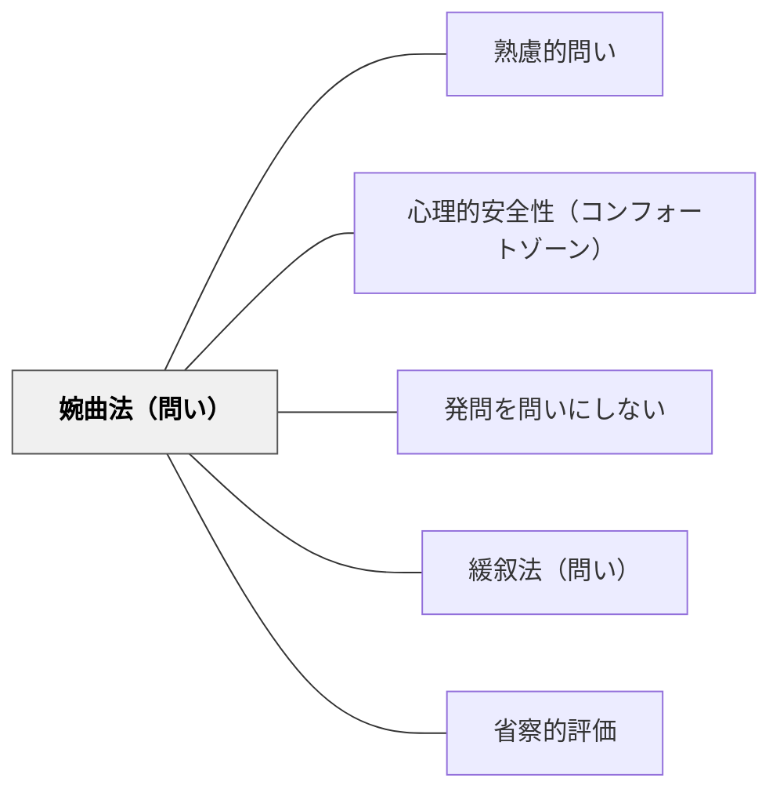

# 婉曲法（問い）

**このパタンが完成を助ける大きなパタン**：[[パタン/熟慮的問い]]

> 露骨にネガティブな表現をオブラートに包んだ問い

## 背景（Context）
婉曲法（ユーフェミズム）は、直接的に言うと不快・不適切・過激に聞こえる事柄を、間接的・柔らかな表現で言い換える修辞技法である。問いに婉曲表現を用いることで、批判・否定・失敗・葛藤などの繊細なテーマを安全に取り上げることができる。心理的安全性の低い場や、感情的に負荷の高いテーマを扱う授業で特に有効である。

**原典では**：安斎（2021）は婉曲法を「光を和らげる」タイプのレトリックの一つとし、「露骨な表現を濁して、あえて曖昧に表現するテクニック」と定義する（第5章 MANNERS 20、Kindle版 85%）。一般には、恐怖や不快感を強く与える言葉やタブーをぼかすために使われる（同）。原典が問いの文脈で強調するのは、組織の役割や立場の違いによって、ある人に馴染みのある言葉が別の人にはネガティブに感じられることがある、という点である（同）。たとえば経営チームには身近な「経営危機」「赤字」が、現場のメンバーには自分の人生に脅威をもたらす恐ろしい言葉に感じられうるので、現場向けのアジェンダでは「オンライン時代に適応するために、自社プロダクトにどんな新機能が必要か？」のように言い換える例が示される（同）。問いかけで仲間を傷つけては本末転倒なので、投げかける前に相手の視点に立って言葉が強すぎないかを確かめるよう勧めている（同、p.222、86%）。

**岩井の講話では**：安斎の本の一覧として「露骨にネガティブな表現はオブラートに包む」と読み上げている（30:25〜30:32）。

## 問題（Problem）
ネガティブなテーマや批判的な問いを直接的に投げかけると、学習者が防衛的になるか、あるいは発言を控えてしまうことがある。「なぜ失敗したのか？」という問いは、責任追及のように受け取られやすい。ファシリテーターが問いの表現に無自覚でいると、意図せず心理的安全を損なってしまう。

## 力のかたち（Forces）
- 問いの正直さ vs 心理的安全
- 批判の明確化 vs 関係性の維持
- ネガティブな経験への直視 vs 間接的な接近
- 問いの深さ vs 学習者の受容可能性

## 解決（Solution）
**近いパタンとの見分け**：問いの型の表では、本パタンの見分けの問いは「きつい言い方を、やわらげて問うているか」。全体の表は [[パタン/熟慮的問い#近いパタンとの見分け|熟慮的問い]] にある。

「うまくいかなかった部分はどこでしょう？」（→「なぜ失敗したのか？」の婉曲）、「もう少し工夫できたとしたら、どのあたり？」（→「どこが悪かったか？」の婉曲）のように、批判や否定を間接的に問う。表現を柔らかくしつつも、問いの意図（改善・反省・批判的思考）は保持することが重要である。

---

**例：教師には見慣れた言葉を、子ども向けに言い換える**（学級活動・高学年）
1. 学級の生活目標を振り返る時間に、教師が使い慣れた「問題行動」「ルール違反」といった言葉を、そのまま問いに入れていないかを確かめる。
2. 「この一か月のルール違反を減らすには？」ではなく、「この一か月で、みんなが気持ちよく過ごせなかった場面はどんなときだった？」と問う。
3. 子どもは場面だけを付箋に書き（だれがしたかは書かない）、黒板で似た場面ごとにまとめる。
4. まとめた場面ごとに「次の一か月、どうすれば気持ちよく過ごせるか」を話し合う。

---

**例：テストの振り返りの問いを和らげる**（算数・4年）
1. 単元テストを返した後、「どこを間違えましたか？」と問う代わりに、「もう一度解けるなら、どの問題で、どこを変えてみたい？」と問う。
2. 子どもは一問を選び、最初の解き方と、変えてみたい解き方をノートに並べて書く。
3. 変えてみたい点が似ている子どうしで集まり、どこで考えが分かれたかを話し合う。

## 結果（Consequences）
- 心理的安全が高まり、ネガティブな経験や意見が語りやすくなる
- 批判的思考が防衛反応なく促される
- 感情的に負荷の高いテーマを扱う場の雰囲気が和らぐ

- 注意点：ある言葉が強すぎるかどうかは、問い手ではなく受け手の立場で決まる。教師には見慣れた言葉（「問題行動」「遅れ」など）が子どもや保護者には強く響くことがあるので、投げかける前に受け手の視点で言葉を見直す（安斎 2021、第5章 MANNERS 20）。

## 関連パタン
- [[パタン/熟慮的問い]] — 親パタン
- [[パタン/心理的安全性（コンフォートゾーン）]] — 婉曲表現が心理的安全を生む学習環境の設計
- [[パタン/発問を問いにしない]] — 問いの表現を変えて防衛反応をなくす関連手法
- [[パタン/緩叙法（問い）]] — 二重否定で留保を許容する兄弟パタン
- [[パタン/省察的評価]] — 失敗・改善を問う場面で婉曲法が安全な自己評価を促す

## クラスター図

## Actionable Insight

- 「なぜ失敗したのか？」の代わりに「うまくいかなかった部分はどこでしょう？」と婉曲に問う——心理的安全が高まりネガティブな経験が語りやすくなる
- 「どこが悪かったか？」の代わりに「もう少し工夫できたとしたら、どのあたり？」と問う——批判的思考が防衛反応なく促される
- 感情的に負荷の高いテーマを扱う授業で意図的に婉曲表現を選ぶ——問いの表現を変えるだけで場の雰囲気が和らぐ

## 出典
- [[文献/熟慮的問いのパターンリスト（動画記録）]]

- 安斎勇樹（2021）『問いかけの作法 チームの魅力と才能を引き出す技術』ディスカヴァー・トゥエンティワン 第5章 MANNERS 20「レトリック（C-2）婉曲法」 — Kindle版 85〜86% で確認。[[文献/問いかけの作法（安斎勇樹）]]
- 岩井輝久（年不明）『熟慮的問いのパターンリスト』［動画］ https://youtu.be/WivskVtxG34 — 2026-11-13 に文字起こしで確認（30:25〜30:32）
