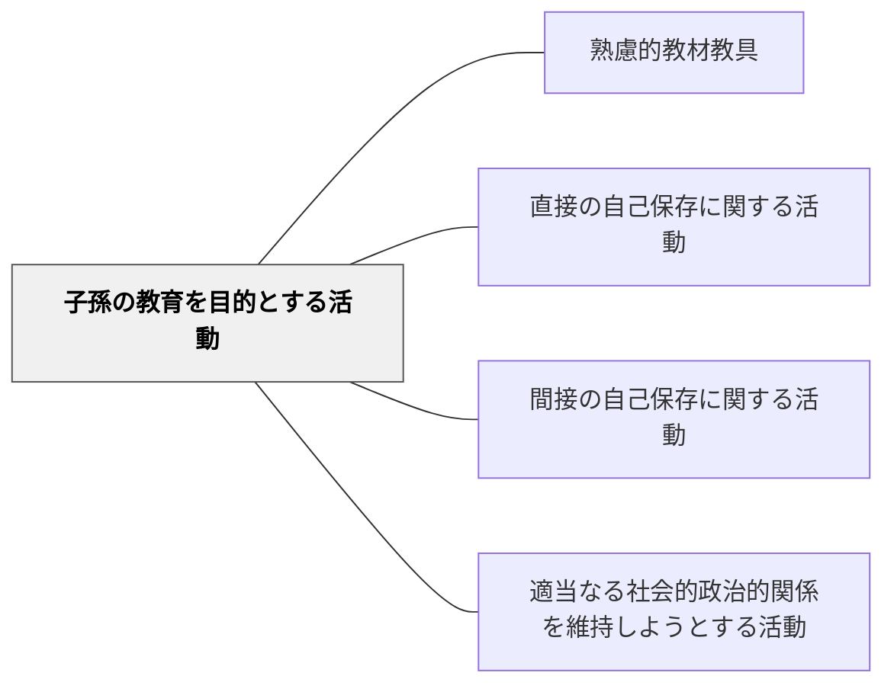

# 子孫の教育を目的とする活動

**このパタンが完成を助ける大きなパタン**：[[パタン/熟慮的教材教具]]

> 次の世代を育てるための知識——育児・教育そのものが重要な学習内容。

## 背景（Context）

ハーバート・スペンサーの活動分類の第三項目。育児法・子育て・教育学など、次世代を育てることを目的とした活動に関する知識。家庭科・道徳・養護・教職課程などの教育内容がここに含まれる。

**原典では**：スペンサーの論文「いかなる知識が最も価値あるか」（1859年）は、人間の生活を成り立たせる主な活動を、重要さの順に五つに分けた。本項はその第3で、原文は “those activities which have for their end the rearing and discipline of offspring”。スペンサーは五つのどれについても、最も価値ある知識は「科学（Science）」だと結論した。

牧口常三郎は『創価教育学体系』第4巻で、この五要素を「教材の選択論上、今でも一顧せざるを得ない貴重なる文献」と評し、第3を「子孫の教育を目的とする活動＝親としての生活準備＝育児法心理学等」と訳している。

## 問題（Problem）

子育て・養育に関する知識が「家庭の問題」として学校教育から切り離されてきた。

## 力のかたち（Forces）

- 育児・養育の知識は全ての人に関わる普遍的な価値
- 家庭科・保健での扱いはあるが体系化が難しい

## 解決（Solution）

**育児・子育て・次世代の養育に関する知識を家庭科・道徳・保健などで意識的に教育材料として位置づける。**

**近いパタンとの見分け**：教材・教具の表では、本パタンの見分けの問いは「次の世代を育てる知識（育児など）につながる教材か」。全体の表は [[パタン/熟慮的教材教具#近いパタンとの見分け|熟慮的教材教具]] にある。

**例：一年生のお世話**（特別活動・高学年）
一年生のお世話係として、相手の年齢に合わせた声のかけ方や手伝い方を考え、うまくいった関わり方を記録して次の係に渡す。

---

**例：赤ちゃんのころを調べる**（生活科・家庭科）
自分が小さかったころのことを身近な大人から聞き、育ててもらったことを振り返る。家庭の事情に配慮し、聞く相手は家族に限らず、写真や資料がなくても取り組めるようにする。

## 結果（Consequences）

- 次世代育成の意識が早期から育つ
- 子育ての知識が生活に生きる

- 注意点：スペンサーは五つを重要さの順に並べたが、順位をそのまま時間配分にすると、教育の幅が狭くなる

## 関連パタン

- [[パタン/熟慮的教材教具]] — 親パタン
- [[パタン/直接の自己保存に関する活動]] — スペンサーの第一活動カテゴリ（身体的自己保護の知識）
- [[パタン/間接の自己保存に関する活動]] — スペンサーの第二活動カテゴリ（生計を立てる知識）
- [[パタン/適当なる社会的政治的関係を維持しようとする活動]] — スペンサーの第四活動カテゴリ（市民的知識）

## クラスター図

## Actionable Insight

- 家庭科・保健・道徳の授業で「子どもの育ちに必要なこと」を一問立てて考えさせる——育児・養育が「自分にも関わる普遍的なテーマ」であることへの気づきが学習の切実性を高める
- 「あなたが将来子どもを育てるとしたら、一番大切にしたいことは何か」を1文書かせる——次世代育成への意識が早期に芽生え、学習の意味が現実につながる
- 子どもの発達に関するケーススタディや写真・映像を1つ導入に使う——具体的な子どもの姿が教科内容への感情的関与を生む

## 出典

- ハーバート・スペンサー（知識の分類）
- [[文献/熟慮的教育材料のパターンリスト（動画記録）]]

- Spencer, H. (1911). What knowledge is of most worth? In *Essays on education and kindred subjects* (pp. 1–44). J. M. Dent.（初出1859年。Project Gutenberg 版 #16510 で原文を確認）
- 牧口常三郎（2007）『創価教育学体系』第4巻（聖教文庫、第8刷のデジタル版）第二章「教科構造論」— 2026-11-13 に該当箇所の原文を確認。[[文献/創価教育学体系 4（牧口常三郎）]]
