# 学習のための評価（A4L）

**このパタンが完成を助ける大きなパタン**：[[パタン/フィードバック]]

> 成績は学習を証明するが、学習を育てない。「今どこにいるか」と「どうすればギャップを埋められるか」を学習者自身が知ることが、評価の本来の仕事だ。

## [Pattern Connection]

**研究からの補足：相互評価の設計と実施条件を確かめる（Topping1998）**

Topping（1998, pp. 250–252, 265–267）は、形成的・総括的な目的、教師評価への追加・代替、匿名性などを区別して設計する。本パタンへのWiki側の適用案として、「何をよくするための評価か」「誰が何を見て、いつ直すか」を活動前に示し、評価後に実際の修正を確かめる。相互評価という形式だけでA4Lが成立したとは扱わず、導入時の練習や教師の支援に必要な時間も見込む。 出典：[[文献/相互評価の設計と実施条件を確かめる（Topping1998）]]。

Boaler（2016）*Mathematical Mindsets* Ch.8「成長マインドセットのための評価」は、Butler（1988）の診断的コメント研究とフィンランドの評価実践を引きながら、従来の「証明のための評価」から「学習のための評価（Assessment for Learning = A4L）」への転換を具体的な手法とともに提示する。

- **既存パタンとの関連**: [[パタン/形成的評価]] がA4Lの理論的基盤を提供する。本パタンは「算数における形成的評価の具体的実装」として位置づけられ、手法レベルで形成的評価を補完する
- **補強された点**: Butler研究（成績+コメント = 成績のみと同等の動機低下）という反直観的な知見が、「コメントを添えればよい」という誤解を解く。成績がコメントの効果を打ち消すという構造を理解することで、評価設計が根本から変わる
- **修正・拡張された点**: 評価の改善は「フィードバックの質を上げる」だけでは不十分——成績付けの構造（100点スケール・宿題の点数化・最初の課題の評価）を見直す必要がある。「どう返すか」より「何を評価対象にするか」の設計が先
- **他のパタンへの波及**: [[パタン/間違いや失敗から学ぶ文化]] を「再提出を許可する」という仕組みで制度化する。[[パタン/成長マインドセット]] が「努力で伸びる」という信念ならば、A4Lはその信念を評価構造として実装する

**Kallick & Stiggins（in Senge et al., 2000/2012）*Schools That Learn* — Assessment AS Learning への拡張**

BoalerがAssessment FOR Learning（学習のためのフィードバック構造）を提示するのに対し、KallickとStiggins（in Senge et al.）は**Assessment AS Learning（学習そのものとしての評価）**という第3のモデルを付け加える。3段階の評価モデル全体：

| モデル | 機能 | 主な担い手 |
|---|---|---|
| **OF Learning（証明）** | 学習が完了したことを確認・記録する | 教師・制度 |
| **FOR Learning（ナビゲーション）** | 「今どこにいるか」を知り、ギャップを埋める | 教師→学習者 |
| **AS Learning（学習そのもの）** | 振り返りの行為自体が認知を深める | 学習者自身 |

- **補強された点**：Boalerの枠組みは「教師が設計するフィードバック構造」（診断的コメント・再提出許可・成績改革）に焦点を当てる。Kallick/Stigginsはその先を問う——「評価を受け取った学習者が自分で何をするか」という生徒側の主体的なメタ認知プロセスこそ評価の核心とする。
- **修正・拡張された点**：「フィードバックが動機に及ぼす影響」（Butler研究）から「評価プロセスが認知構造に及ぼす影響」へ。フィードバックの受け取り方だけでなく、「学習者が自分で評価する力」を育てることが目的になる。
- **他のパタンへの波及**：[[パタン/学習する学校]] の「メンタルモデル」ディシプリンと連結する——自分の学習過程を観察・修正できる能力は、組織学習においても個人学習においても本質的な力である。[[パタン/到達レベルの自己評価]] がAS Learningの「I can ステートメント」と直接接続する。

---

## 背景（Context）

多くの教室では、評価とは「学習が終わったことを証明するためのもの」として設計されている。テスト・成績・通知表はいずれも、学習の完了確認として機能する。しかしこの構造では、評価は学習を促進せず、学習を終わらせる。

フィンランドでは学校でテストをほぼ行わない——それでもPISAで世界最高水準を維持している。「テストをしないから学力が下がる」というのは、テストが学習を生み出すという誤解に基づいている。

## 問題（Problem）

成績を受け取った生徒はその数字しか見ない。コメントを添えても、成績が一緒にあればコメントは読まれない（Butler, 1988）。成績のみを受け取った生徒は動機が低下し、コメントのみを受け取った生徒は動機も学習成果も向上する。しかし成績+コメントは成績のみと同等の動機低下をもたらす——数字がコメントの効果を打ち消す。

加えて、100点スケールの成績は格差を拡大する設計になっている。いくつかの課題をそれぞれ100点として扱い、未完成・未提出・不合格を0点にすると、A・B・C・D の間はそれぞれ10点なのに D と F の間は60点になり、課題を1つ出さなかっただけで A から D に落ちることがある（Reeves, 2006。Boaler, 2016, Ch.8）。Reeves は間隔の等しい4点スケールを勧める。宿題を成績に含めることは、家庭環境の格差を学力格差として可視化してしまう。

## 力のかたち（Forces）

- 生徒は評価から「自分の学習についての情報」より「自分の価値についての判断」を読み取る傾向がある
- 教師が詳細なコメントを書くことは時間コストが高く、持続が難しい
- 「再提出を許可する」「最初の課題を評価しない」という設計変更は、カリキュラムの進度管理と緊張する
- 保護者・管理職は「成績のない評価」に不安を持つことがある

## 解決（Solution）

**評価を「学習証明ツール」から「学習ナビゲーションツール」に設計し直す。**

**近いパタンとの見分け**：子ども自身が「何を学んでいるか・今どこか・どう埋めるか」に答えられるよう評価を設計するのが本パタン。教師が理解をつかんで指導を直す側は [[パタン/形成的評価]]、子どもが成長を語る記録と対話の側は [[パタン/省察的評価]]。評価の系列の全体の表は [[パタン/形成的評価#近いパタンとの見分け|形成的評価]] にある。

A4L（Assessment for Learning）の基本フレームは3段階：

1. **自分が何を学んでいるかを知る**（What am I learning?）
2. **今どこにいるかを知る**（Where am I now?）
3. **ギャップを埋める方法を知る**（How do I close the gap?）

この3段階を授業の中に組み込むことが、A4Lの核心である。

---

### 具体的手法9つ

Boaler（2016, Ch.8）が挙げる9つ。どれも A4L の3段階のうち1と2（何を学んでいるか・いまどこにいるかを知る）を助ける。

**1. 自己評価（Self-Assessment）**
学んでいる数学をはっきり書いた文（内容の例「平均値と中央値の違いと、それぞれをいつ使うべきかがわかる」、数学的な取り組み方の例「問題が難しくてもあきらめずに続けられるようになった」）を生徒に渡し、学んだことと、まだ取り組む必要があることを考える。単元の始めにこうした文を受け取ると、生徒は学びの全体像に目を向けるようになる。自分の理解を評価すると、生徒は驚くほど正確で、過大にも過小にも見積もらないという研究がある（Black et al., 2002）。

**2. 相互評価（Peer Assessment）**
自己評価と同じくはっきりした基準を使い、自分ではなく友だちの作品を評価する。生徒は友だちからの批判や提案のほうが受け入れやすく、友だちどうしは伝わりやすい言い方で話すため、効果が高い。Boaler のお気に入りは「二つの星と一つの願い」（Two Stars and a Wish）——友だちの作品から、よくできた点を2つ、よくなる点を1つ選ぶ。

**3. 振り返りの時間（Reflection Time）**
授業の終わりに振り返りの時間をとる。問いの例（Exhibit 8.4）：今日取り組んだ大きな考えは何だったか／今日何を学んだか／今日どんなよい考えをもったか／今日学んだことをどんな場面で使えるか／今日の学習についてどんな疑問があるか／この授業から考えた新しい考えは何か。

**4. 信号（Traffic Lighting）**
赤・黄・緑の3色で、わかっている・一部わかっている・もっと取り組む必要がある、を示す。たとえば色の違う紙コップを机に置き、止まって復習してほしい生徒は赤、進みが速すぎると感じる生徒は黄を出す。緑のテーブルに考えを全体へ説明してもらう教師もいる。教師は単元の終わりでなく授業の最中に、手遅れになる前に自分の授業へのフィードバックを得られる。コップの代わりに、ラミネートした色紙をリングでまとめたものも使える。

**5. ジグソーグループ（Jigsaw Groups）**
グループで、ある現象・新しい方法・興味深い読み物の「専門家」になり、そのあとグループを組み替えて、どのグループにも違う専門の人がいる形にし、専門家として互いに教え合う。うまくいくには少なくとも4つの専門分野が必要（32人・8グループの例が Figure 8.6）。

**6. Exit Ticket（出口チケット）**
授業の終わりに、その授業での学びについて書く紙を渡し、教室を出る前に書いて教師に渡す。生徒にとってはもう一度振り返る機会になり、教師にとっては生徒の学びと次の授業の手がかりになる。

**7. オンラインフォーム（Online Forms）**
授業の最中にオンラインフォームに書き込み、考えを教師のコンピュータに送る。ふだん口で発言しない生徒も、オンラインなら考えを出しやすい。振り返りを送る、何かに投票する、ほかの生徒に見えない形で赤・黄・緑を教師に示す、などに使える。

**8. 落書き（Doodling）**
脳の異なる経路を使うときに最も力強い学びが起きる（Ch.4）ので、理解したことを言葉で書くだけでなく、スケッチ・漫画・落書き（doodle）で示すよう求める（Figure 8.7）。数学の考えを描いた見事な例として Vi Hart の動画を勧める。

**9. 生徒が問題とテストを作る（Students Write Questions and Tests）**
自分で問題を考えたり、ほかの生徒のための評価（テスト）を作ったりする。よい問いを書くことで、何が大事かに目が向き、創造的に考えられる。生徒は数学のテストを作る役目をとても楽しむ。

（再提出の許可は手法ではなく、下の「成績付けの6つの改善」の1つめ。）

**診断的コメント（Diagnostic Comments）**
上の9つは A4L の1と2を助ける。3（いまの位置から行くべき位置への差を埋める方法を知る）には、教師が生徒の作品に診断的コメントを返すことが、ほかのどの方法よりも効果が高いと Boaler は書く。前向きに、成長のメッセージをこめて言葉を返す。成績なしで返す。Butler研究が示した通り、コメントのみが動機と成果の両方を高める。

---

### Ellen Crews 教師の「Show What You Can Do」ルーブリック

California の教師Ellen Crewsは成績をつけることをやめ、4軸の自己評価ルーブリックに移行した。

| 軸 | 内容 |
|---|---|
| **粘り強さ（Perseverance）** | 困難な問いに取り組み続けたか |
| **多重表現（Multiple Representations）** | 複数の方法・形式で表現したか |
| **期待の明確さ（Clear Expectations）** | 求められていることを理解して取り組んだか |
| **成果物（Product）** | 最終的に何を産み出したか |

この枠組みは「正解したかどうか」ではなく「学習者としてどう機能したか」を評価の軸にする。

---

### 成績付けの6つの改善

Boaler（2016, Ch.8）が、成績を付けなければならないときにも公平に付け、成長のメッセージを伝え続けるために挙げる6つ。

1. **出し直しをいつも認める** — どの課題やテストも、出し直して高い成績を得られるようにする。学習を大事にしているという、成長マインドセットの究極のメッセージになる
2. **成績は管理職に渡すが、生徒には渡さない** — 学期の途中で成績が求められても、生徒に渡す必要はない。生徒には、よくする方法を口頭や診断的な書き言葉で返す
3. **多次元で成績を付ける** — 手続きの問題の正誤だけでなく、問いを出す・いろいろな形で数学を示す・推論し正当化する・互いの考えの上に積み上げる、などを記録して評価する
4. **100点スケールを使わない** — A・B・C・D の間はそれぞれ10点なのに、D と F の間は60点ある（Reeves, 2006）。そのため、課題を1つ出さなかっただけで A から D に落ちることがある。Reeves は、間隔の等しい4点スケール（A＝4、B＝3、C＝2、D＝1、F＝0）を勧める
5. **授業の初めのころの課題を最終成績に入れない** — 成績はその授業で学んだことを示すべきで、それ以前に学んできたことを示すものではない
6. **宿題を（出すとしても）成績に入れない** — 宿題は教育で最も不公平な慣行の一つ（Ch.6）で、成績に入れるとストレスが増え、不公平な結果が出やすくなる

---

### Assessment AS Learning — 振り返りスパイラル（Kallick & Stiggins, in Senge et al., 2000/2012）

A4L（学習のためのフィードバック）をさらに深めた第3のモデル：**評価の行為そのものが学習を生む**。

**振り返りスパイラルの5段階**（Kallick & Stiggins）：

1. **計画する（Plan）**：「何を学ぶか・どう進めるか」を自分で明確にする
2. **行動する（Act）**：計画に基づいて学習を進める
3. **観察する・振り返る（Study / Reflect）**：「何が起きたか・なぜそうなったか」を内省する
4. **行動を修正する（Modify Actions）**：振り返りから得た気づきを次の行動に反映させる
5. **目標を再訪する（Revisit Goals）**：達成状況を踏まえて目標そのものを問い直す

このスパイラルは「教師が評価する」のではなく、**「学習者が自分の学習を評価し、その評価行為が次の学習を生む」**という循環として設計される。Traffic Lights（信号機）やExit Ticketは教師が情報を得るためのツールだが、振り返りスパイラルは生徒が自分のために行うメタ認知実践である。

**「I can」ステートメント**

学習目標を「〜を理解する」という教師・カリキュラム言語ではなく、「私は〜ができる」という学習者言語で書き直す。

- 教師言語：「分数の加算を理解する」
- 学習者言語：「私は分母が異なる分数を足すことができる。なぜそうするかを言葉で説明できる」

「I can」ステートメントは自己評価の基準を学習者自身が持てるようにする。授業の終わりに「今日、私はこれができるようになったか？」という問いが生徒の内側から湧き上がるようになる。AS Learningの実装として、単元の最初に「I can」リストを作り、授業ごとに自分で確認するプロセスが有効である。

---

### 「私はあなたを信じているから、このフィードバックをしています」（Cohen & Garcia, 2014）

Cohen & Garcia（2014）の実験では、高校の英語の授業で数百人の生徒が作文を書き、全員が教師から批判的な診断的フィードバックを受け取った。そのうち半数のフィードバックの下にだけ、「私はあなたを信じているから、このフィードバックをしています」（"I am giving you this feedback because I believe in you."）という一文が足された。教師はだれが一文を受け取ったか知らず、ほかに違いはなかったが、一文を受け取った生徒は1年後に有意に高い成績を取った。効果は、教師から大切にされていないと感じがちな有色人種の生徒で特に大きかった。

ただし Boaler は、全員の作品にこの一文を書き足すことは勧めない。本心でないと受け取られ、逆効果になるからだ。この結果を紹介するのは、教師の言葉と、生徒についての信念の力を強調するためで、とくに遅い子・意欲が見えにくい子・つまずいている子に、前向きな信念と期待をふだんの言葉で伝え続けるよう勧める（Boaler, 2016, Ch.9）。

この一文は「このフィードバックはあなたへの投資であり、あなたが成長できると思っているから書いた」という関係性のメッセージを伝える。決まった一文を機械的に添えるのでなく、同じメッセージをその子に向けたふだんの言葉で診断的コメントとともに伝えると、コメントが「批判」ではなく「信頼」として届きやすい（本Wikiの読み）。

---

### Butler 研究の原数値と、レビュー側からの補正（Black & Wiliam, 1998）

Boaler が引く Butler（1988）は、ブラックとウィリアム（1998）の系統的レビューでも中心的な証拠として扱われている。原論文に近い数値を押さえておくと、本パタンの主張の強さと限界がはっきりする。

- 対象は**11歳のイスラエルの子ども48名**、3セッション。**コメントのみ**群は得点が**約3分の1上昇**し、その水準を維持した。**評点＋コメント**群は3セッションを通じて**有意に低下**、評点のみ群も低下した。
- Butler（1987）は、イスラエルの五・六年生200名（各条件50人を分析）を対象に**コメント／評点／称賛／フィードバックなし**の4条件を比べた。評価なしで取り組んだ3回めの課題の成績と興味は、成績の上位・下位のどちらでも**コメントの群が最も高かった**。称賛の群は「うまくいった」と感じる度合いがいちばん高かったのに、興味も成績も1回めより下がった。原典の帰属の分析では、**称賛と評点はどちらも注意を「自分の能力」に向けた**（よく引かれる「コメント群だけが1標準偏差高い」は Black と Wiliam 1998 の要約の言い方）——ここは「褒めればよい」という誤解を解く上で重要である。
- 興味の測定では、**低達成の子どもだけが、評点を含むどの条件でも興味を損なわれた**。高達成の子どもは3条件すべてで高い興味を保った。**害は苦しい子に集中する**。

レビュー側からの補正も二点、そのまま受け取っておきたい。

第一に、Butler の実験は**生態学的妥当性を欠く**——通常のカリキュラムの一部でもなく、担任が実施したものでもない。ブラックとウィリアム自身がそう明記したうえで、それでも通常の教室に重要な教訓を与えると論じている。「フィンランドはテストをしないのに PISA が高い」といった対比も含め、**単一の事例を根拠に制度を語らない**ほうが本パタンは強くなる。

第二に、レビューの結論は「**唯一の最適モデルは立ち現れてこない**。立ち現れるのは一組の**導きの原理**であり……各教師が**自分自身のやり方で**自分の実践に組み込まねばならない」（p.62）である。本パタンが並べる9つの手法や「成績付けの6つの改善」は、順に実施すべき手順書ではなく、選んで組み合わせる原理の一覧として読むのが正しい。

なお、Butler の知見を単独の実務パタンとして取り出したものが [[パタン/評点なしで返す（コメントだけの一巡）]] である。

---

## 結果（Consequences）

- 生徒が成績の数字ではなく、自分の理解状況に注目するようになる
- 教師が「何点か」ではなく「どこが理解できていてどこが次の課題か」という言語で評価を語るようになる
- 「間違い = やり直し」ではなく「間違い = 次の学習の手がかり」という文化が生まれる
- 低ステータスの生徒が「評価される恐怖」より「学習のナビゲーション」として評価を活用し始める

## 関連パタン
- [[文献/評点・コメント・ほめ言葉・何も返さないの4つの返し方で、子どもの注意の向き・興味・成績がどう変わるかを確かめる（Butler1987）]] — 原典：コメント・評点・ほめ言葉・なしの4条件。ほめ言葉も評点と同じく注意を自分の能力に向けた
- [[パタン/数学ワークショップ]]
- [[パタン/チェックイン（Checking In）]]

- [[パタン/形成的評価]] — A4Lの理論的基盤。本パタンは算数における具体的実装
- [[パタン/成長マインドセット]] — A4Lは成長マインドセットを評価構造として実現する。「まだできない」を「どうすればできるか」に変換する
- [[パタン/フィードバック]] — 診断的コメントの理論的基盤。「どこまでできている・次は何が必要か」の言語化
- [[パタン/間違いや失敗から学ぶ文化]] — 再提出文化の前提。間違いが学習の材料になる制度設計
- [[パタン/自己選択自己決定]] — 生徒が自己評価で自分の学習を判断し、次の行動を選ぶ主体者になる
- [[パタン/到達レベルの自己評価]] — 信号機自己評価・Show What You Can Doとの接続
- [[パタン/学習する学校]] — AS LearningのメタコグニションはSengeのメンタルモデル・ディシプリンと連結する
- [[文献/Mathematical Mindsets（Boaler）]] — 一次資料。Ch.8に詳細
- [[文献/Schools That Learn（Senge et al.）]] — KallickとStigginsのAssessment AS Learningの一次資料
- [[パタン/再提出を許す（リトライ・サイクル）]] — 「成績付けの6つの改善」第1項「再提出の許可」を独立パタンとして展開した実装
- [[パタン/評点なしで返す（コメントだけの一巡）]] — 「診断的コメント」を Butler の原数値から独立パタンとして取り出したもの
- [[パタン/見取ったあとの手を決めておく（データ利用のルール化）]] — Exit Ticket や信号機で得た情報を、その場の判断でなく事前のルールで使う
- [[パタン/進歩の傾きを見る（水準ではなく変化率）]] — 「今どこにいるか」を点ではなく軌跡で捉える
- [[概念/自我関与と課題関与（フィードバックが向ける先）]] — 評点・称賛が効かずコメントが効く理由を説明する軸
- [[文献/Assessment and Classroom Learning（Black & Wiliam）]] — Butler 研究を含む証拠の系統的レビュー。本パタンの実証的裏づけ（Black & Wiliam, 1998）

---

- [[概念/教授学的契約（やり過ごしの均衡）]] — 評価の目的を変えることは「正当な活動」の範囲を変えること
- [[パタン/聴き方を変える（評価的・解釈的・解釈学的）]] — 評価を学習の一部として運用する立場が、教師の聴き方という最小単位に現れたもの

- [[概念/形成的評価の5つの戦略（3×3の枠組み）]] — 診断的コメント・Exit Ticket・再提出が、それぞれどの戦略の実装かを位置づける枠組み
- [[パタン/偶発の瞬間を活かす（コンティンジェンシー）]] — A4L の各実践が「進路の分かれる点」としてどこに置かれるかの設計
- [[文献/Developing the Theory of Formative Assessment（Black & Wiliam, 2009）]] — A4L の実践群に統一的な論理を与えた理論篇（Black & Wiliam, 2009）
- [[文献/ロイス・サドラーによる形成的アセスメント論の検討（石田智敬, 2021）]] — A4L が理論的支柱としたサドラー本人が、A4L の潮流に距離を置いている。その論理を追った文献（石田, 2021）
- [[パタン/質の根拠を見えるようにする（伝えることからの脱却）]] — 規準の事前共有（フィードフォワード）そのものへの異議。A4L の前提を問い直す
- [[文献/相互評価の設計と実施条件を確かめる（Topping1998）]] — 相互評価の目的と運用を明確にし、学習改善に使われたかを見る。

## クラスター図

```mermaid
flowchart LR
    ne5ada6e7bf92e381aee3819fe38281e381aee8a995e4bea1efbc8841344cefbc89["学習のための評価（A4L）"]
    ne695b0e5ada6e383afe383bce382afe382b7e383a7e38383e38397["数学ワークショップ"]
    ne38381e382a7e38383e382afe382a4e383b3efbc88436865636b696e6720496eefbc89["チェックイン（Checking In）"]
    ne5bda2e68890e79a84e8a995e4bea1["形成的評価"]
    ne68890e995b7e3839ee382a4e383b3e38389e382bbe38383e38388["成長マインドセット"]
    ne38395e382a3e383bce38389e38390e38383e382af["フィードバック"]
    ne99693e98195e38184e38284e5a4b1e69597e3818be38289e5ada6e381b6e69687e58c96["間違いや失敗から学ぶ文化"]
    ne887aae5b7b1e981b8e68a9ee887aae5b7b1e6b1bae5ae9a["自己選択自己決定"]
    ne588b0e98194e383ace38399e383abe381aee887aae5b7b1e8a995e4bea1["到達レベルの自己評価"]
    ne5ada6e7bf92e38199e3828be5ada6e6a0a1["学習する学校"]
    ne5868de68f90e587bae38292e8a8b1e38199efbc88e383aae38388e383a9e382a4e383bbe382b5e382a4e382afe383abefbc89["再提出を許す（リトライ・サイクル）"]
    ne8a995e782b9e381aae38197e381a7e8bf94e38199efbc88e382b3e383a1e383b3e38388e381a0e38191e381aee4b880e5b7a1efbc89["評点なしで返す（コメントだけの一巡）"]
    ne8a68be58f96e381a3e3819fe38182e381a8e381aee6898be38292e6b1bae38281e381a6e3818ae3818fefbc88e38387e383bce382bfe588a9e794a8e381aee383abe383bce383abe58c96efbc89["見取ったあとの手を決めておく（データ利用のルール化）"]
    ne980b2e6ada9e381aee582bee3818de38292e8a68be3828befbc88e6b0b4e6ba96e381a7e381afe381aae3818fe5a489e58c96e78e87efbc89["進歩の傾きを見る（水準ではなく変化率）"]
    ne881b4e3818de696b9e38292e5a489e38188e3828befbc88e8a995e4bea1e79a84e383bbe8a7a3e98788e79a84e383bbe8a7a3e98788e5ada6e79a84efbc89["聴き方を変える（評価的・解釈的・解釈学的）"]

    ne5ada6e7bf92e381aee3819fe38281e381aee8a995e4bea1efbc8841344cefbc89 --- ne695b0e5ada6e383afe383bce382afe382b7e383a7e38383e38397
    ne5ada6e7bf92e381aee3819fe38281e381aee8a995e4bea1efbc8841344cefbc89 --- ne38381e382a7e38383e382afe382a4e383b3efbc88436865636b696e6720496eefbc89
    ne5ada6e7bf92e381aee3819fe38281e381aee8a995e4bea1efbc8841344cefbc89 --- ne5bda2e68890e79a84e8a995e4bea1
    ne5ada6e7bf92e381aee3819fe38281e381aee8a995e4bea1efbc8841344cefbc89 --- ne68890e995b7e3839ee382a4e383b3e38389e382bbe38383e38388
    ne5ada6e7bf92e381aee3819fe38281e381aee8a995e4bea1efbc8841344cefbc89 --- ne38395e382a3e383bce38389e38390e38383e382af
    ne5ada6e7bf92e381aee3819fe38281e381aee8a995e4bea1efbc8841344cefbc89 --- ne99693e98195e38184e38284e5a4b1e69597e3818be38289e5ada6e381b6e69687e58c96
    ne5ada6e7bf92e381aee3819fe38281e381aee8a995e4bea1efbc8841344cefbc89 --- ne887aae5b7b1e981b8e68a9ee887aae5b7b1e6b1bae5ae9a
    ne5ada6e7bf92e381aee3819fe38281e381aee8a995e4bea1efbc8841344cefbc89 --- ne588b0e98194e383ace38399e383abe381aee887aae5b7b1e8a995e4bea1
    ne5ada6e7bf92e381aee3819fe38281e381aee8a995e4bea1efbc8841344cefbc89 --- ne5ada6e7bf92e38199e3828be5ada6e6a0a1
    ne5ada6e7bf92e381aee3819fe38281e381aee8a995e4bea1efbc8841344cefbc89 --- ne5868de68f90e587bae38292e8a8b1e38199efbc88e383aae38388e383a9e382a4e383bbe382b5e382a4e382afe383abefbc89
    ne5ada6e7bf92e381aee3819fe38281e381aee8a995e4bea1efbc8841344cefbc89 --- ne8a995e782b9e381aae38197e381a7e8bf94e38199efbc88e382b3e383a1e383b3e38388e381a0e38191e381aee4b880e5b7a1efbc89
    ne5ada6e7bf92e381aee3819fe38281e381aee8a995e4bea1efbc8841344cefbc89 --- ne8a68be58f96e381a3e3819fe38182e381a8e381aee6898be38292e6b1bae38281e381a6e3818ae3818fefbc88e38387e383bce382bfe588a9e794a8e381aee383abe383bce383abe58c96efbc89
    ne5ada6e7bf92e381aee3819fe38281e381aee8a995e4bea1efbc8841344cefbc89 --- ne980b2e6ada9e381aee582bee3818de38292e8a68be3828befbc88e6b0b4e6ba96e381a7e381afe381aae3818fe5a489e58c96e78e87efbc89
    ne5ada6e7bf92e381aee3819fe38281e381aee8a995e4bea1efbc8841344cefbc89 --- ne881b4e3818de696b9e38292e5a489e38188e3828befbc88e8a995e4bea1e79a84e383bbe8a7a3e98788e79a84e383bbe8a7a3e98788e5ada6e79a84efbc89

    classDef hub fill:#f0f0f0,stroke:#555,color:#000,font-weight:bold
    class ne5ada6e7bf92e381aee3819fe38281e381aee8a995e4bea1efbc8841344cefbc89 hub
```

## Actionable Insight

- **今週の算数授業の最後に**: 「Exit Ticket：今日学んだ1つのこと」を紙に書かせる（3分）。翌日の授業の冒頭でいくつかを読み上げ、「みんなの理解を確認できた」と伝えるだけで文化が変わり始める
- **次に課題を返すとき**: 成績だけでなく「ここまでできています・次はここを」の一言コメントを添える。点数なしで返してみる。生徒がコメントを読むかどうかを観察する
- **信じていることを言葉で添える**: 決まった一文を全員にそのまま添えるのではなく、その子を信じていることを自分の言葉で書き添える（Cohen & Garcia, 2014 を、Boaler は全員への同じ一文の書き足しは逆効果になりうるとしたうえで、この趣旨で紹介する）。特に普段自信がない子への課題返却で試す
- **制度設計として**: 次の算数単元で「1回だけ再提出を許可する」と宣言する。「最初の提出が最終版でない」という前提が、間違いを学習材料にする文化の入口になる
- **Assessment AS Learning の実装として**: 単元の冒頭に「私は〜ができる」という「I can」リストを学習者と一緒に作る。単元の最後に同じリストを見返し、「できるようになったこと」を自分で確認する——教師が採点するのではなく、学習者が自分で証人になる
- **振り返りスパイラルの導入として**: 算数の授業の最後2分で「今日の目標に対して、今自分はどこにいるか？」を一言書かせる。Plan（目標）→ Act（学習）→ Study（振り返り）の最小サイクルを毎日繰り返すことで、メタ認知が習慣になる

## 出典

Boaler, J. (2016). *Mathematical Mindsets: Unleashing Students' Potential Through Creative Math, Inspiring Messages and Innovative Teaching*. Jossey-Bass.

Kallick, B., & Stiggins, R. (2000/2012). Assessment as Learning. In P. Senge, N. Cambron-McCabe, T. Lucas, B. Smith, J. Dutton, & A. Kleiner, *Schools That Learn* (Updated and Revised ed.). Crown Business.

Butler, R. (1988). Enhancing and undermining intrinsic motivation: The effects of task-involving and ego-involving evaluation on interest and performance. *British Journal of Educational Psychology*, 58(1), 1–14.

Cohen, G. L., & Garcia, J. (2014). Educational theory, practice, and policy and the wisdom of social psychology. *Policy Insights from the Behavioral and Brain Sciences*, 1(1), 13–20.

Black, P., & Wiliam, D. (1998). Assessment and classroom learning. *Assessment in Education: Principles, Policy & Practice, 5*(1), 7–74.

Butler, R. (1987). Task-involving and ego-involving properties of evaluation. *Journal of Educational Psychology*, 79, 474–482.

Boaler, J., & Staples, M. (2008). Creating mathematical futures through an equitable teaching approach. *Teachers College Record*, 110(3), 608–645.

> 「成績のみを受け取った生徒は動機が低下した。コメントのみを受け取った生徒は動機も成果も向上した。成績とコメントの両方を受け取った生徒は——成績のみと同等の動機低下を示した」——Butler (1988) の要約

> 「私はあなたを信じているから、このフィードバックをしています」——Cohen & Garcia (2014) の研究で使われた一文。高校の英語の作文への批判的なフィードバックに、半数だけこの一文を足した実験で、一文を受け取った生徒は1年後に有意に高い成績を取った（Boaler, 2016, Ch.9）
