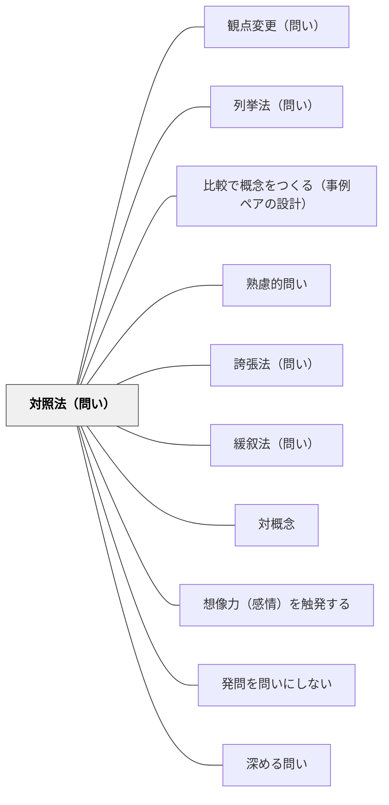

# 対照法（問い）

**このパタンが完成を助ける大きなパタン**：[[パタン/熟慮的問い]]・[[パタン/想像力（感情）を触発する]]

> 対をなすメッセージを添えて、問いを際立たせる（「〇〇か、それとも〇〇か？」と二つを並べて問う形もある）

## 背景（Context）
対照法（アンチテーゼ）は、対立する概念・立場・事例を並置することで、それぞれの意味を際立たせる修辞技法である。問いの形で用いると、学習者は二つの極の間で自分の考えを位置づけることを迫られ、思考が活性化される。二項対立の提示は単純化のリスクも伴うが、議論の焦点を作るうえで強力な手法である。

**原典では**：安斎（2021）は、問いの文言を整える「レトリック」を三つのタイプに分け、対照法を「光の量を足す」タイプ（問いの前提や特定の箇所の印象を強める技法）の一つに置く。対照法は「メインの主張とは正反対の主張を対比させることで、メインの主張を際立たせるテクニック」であり、正反対でなくても、近い構造の文を対で並べる「対句法」も含む（第5章 MANNERS 14、Kindle版 83%）。問いに使うときは、問いの前に対照的な一句（対照句）を添える形をとる。たとえば「競合他社は、価格競争を選んだ。私たちが取るべき事業戦略とは？」では、対照句があることで「じゃあ、私たちは何を選ぼうか？」という方向性が生まれると説明される（同）。対照句はまた、不明点の焦点をはっきりさせる働きや、「急いでやるべきこと」と並べて「じっくりやるべきこと」に意識を向け直す働きももつ（同）。

**岩井の講話では**：安斎の本のレトリックの一覧を読み上げ、対照法を「対をなすメッセージを添えて質問を際立たせる」技法とし、「対比表現みたいな感じ」と言い換えている（29:21〜29:53）。

## 問題（Problem）
問いが一方向的であると、学習者は既存の枠組みの中でしか考えない。特定の前提を疑わせたいとき、「〇〇とは何か？」という単一方向の問いでは緊張感が生まれにくい。対比する概念を明示しなければ、問いの輪郭が曖昧になって議論が拡散してしまう。

## 力のかたち（Forces）
- 対立の明確化 vs 複雑さへの過度の単純化
- 議論の焦点化 vs 中間地点の無視
- 問いの鋭さ vs 学習者への圧迫感
- 二項対立の提示 vs 多元的な視点の育成

## 解決（Solution）
原典の対照法は、「競合他社は、価格競争を選んだ。私たちが取るべき事業戦略とは？」のように、問いの前に対照的な一句を添えて問いを際立たせる。対立する二つを並べて問う次の形は、その応用である。

「自由か、それとも秩序か？」「競争か、それとも協力か？」のように、対立する概念の組み合わせを問いの軸として設定する。その際、どちらかが正解だという印象を与えず、「どちらの要素が今の状況に必要か」「どちらに重きを置くべきか」という問いの形にすることで、単純化を避けながら思考の緊張を生み出す。

---

**例：対照句を添えて、物語の読みの焦点を変える**（国語・4年）
1. 物語の学習で、場面ごとの人物の気持ちを読み取った後、黒板に「人物の気持ちは、たくさん話し合った。」と一文書く。
2. その下に「では、気持ちが変わったきっかけは、どの一文だろう？」と問いを書く。前の一文が対照句になり、子どもは「気持ちそのもの」から「変わり目」へ目を移す。
3. 子どもは教科書に線を一本だけ引き、隣と見せ合ってから、選んだ理由を一言ずつ言う。
4. 終わりに、対照句がない場合の問い（「気持ちが変わったきっかけは？」）と並べて、「前の一文があると、何を考えればよいかがわかりやすい」かを子どもに聞いてみる。

---

**例：急ぐことと、じっくりやることを分ける**（学級活動・高学年）
1. 学期のはじめの学級会で「すぐに決めなければならないことは、係や当番など、たくさんあります。」と前置きする。
2. 続けて「では、一学期かけてじっくり取り組みたいことは何だろう？」と問う。
3. 子どもは付箋に一つずつ書き、黒板の「すぐ決めること」「じっくりやること」の二つの欄のどちらかに貼る。
4. 「じっくりやること」の欄に集まった付箋から、学級の目標の候補を二、三選ぶ。

**近いパタンとの見分け**：対になる概念を軸に問うのが本パタン。同じと違いを並べるのは [[パタン/比較（問い）]]、対立を超える第三の考えを問うのは [[パタン/弁証法（ジンテーゼを問う）]]。問いの系列の全体の表は [[パタン/熟慮的問い#近いパタンとの見分け|熟慮的問い]] にある。

## 結果（Consequences）
- 概念の輪郭が明確になり、議論の焦点が定まる
- 学習者が自分の立場を表明しやすくなる
- 対立する視点の共存について深く考えるきっかけになる

- 注意点：対照法は二者択一を迫る技法とは限らない。原典の対照法は、問いの前に対照句を添えて、問いのほうを際立たせる使い方が中心である。また、レトリックを何重にも重ねると問いの意図が伝わりにくくなるので、一度聞いて意図がわかるかを確かめる（安斎 2021、第5章 MANNERS 21「着飾りすぎない、シンプルな問いかけも忘れない」）。

## 関連パタン
- [[パタン/観点変更（問い）]]
- [[パタン/列挙法（問い）]] — 並べることで強調する兄弟パタン
- [[パタン/比較で概念をつくる（事例ペアの設計）]] — 「1つだけ違う」2事例で概念をつくる。本パタンは対立する二極で議論の焦点をつくる
- [[パタン/熟慮的問い]] — 親パタン
- [[パタン/誇張法（問い）]] — スケールを大きくして印象を強める兄弟パタン
- [[パタン/緩叙法（問い）]] — 留保で断定を和らげる兄弟パタン
- [[パタン/対概念]] — 対照法は対概念を使った問いかけの実践形
- [[パタン/想像力（感情）を触発する]] — 修辞的問いが感情・想像力を動かす上位パタン
- [[パタン/発問を問いにしない]] — 修辞の形で問いの圧力を柔らげる関連手法
- [[パタン/深める問い]] — 修辞技法が表面的な応答を防ぎ思考を深める

## クラスター図

## Actionable Insight

- 「自由か、それとも秩序か？」のように対立する概念を問いの軸として設定する——概念の輪郭が明確になり、学習者が自分の立場を表明しやすくなる
- どちらかが正解だという印象を与えず「どちらに重きを置くべきか」という形で問う——単純化を避けながら思考の緊張を生み出す
- 対立する問いを提示した後、「中間地点はあるか？」という問いを続ける——二項対立を超えた多元的な視点への探究が生まれる

## 出典
- [[文献/熟慮的問いのパターンリスト（動画記録）]]

- 安斎勇樹（2021）『問いかけの作法 チームの魅力と才能を引き出す技術』ディスカヴァー・トゥエンティワン 第5章 MANNERS 14「レトリック（A-4）対照法」 — Kindle版 83% で確認。[[文献/問いかけの作法（安斎勇樹）]]
- 岩井輝久（年不明）『熟慮的問いのパターンリスト』［動画］ https://youtu.be/WivskVtxG34 — 2026-11-13 に文字起こしで確認（29:21〜29:53）
