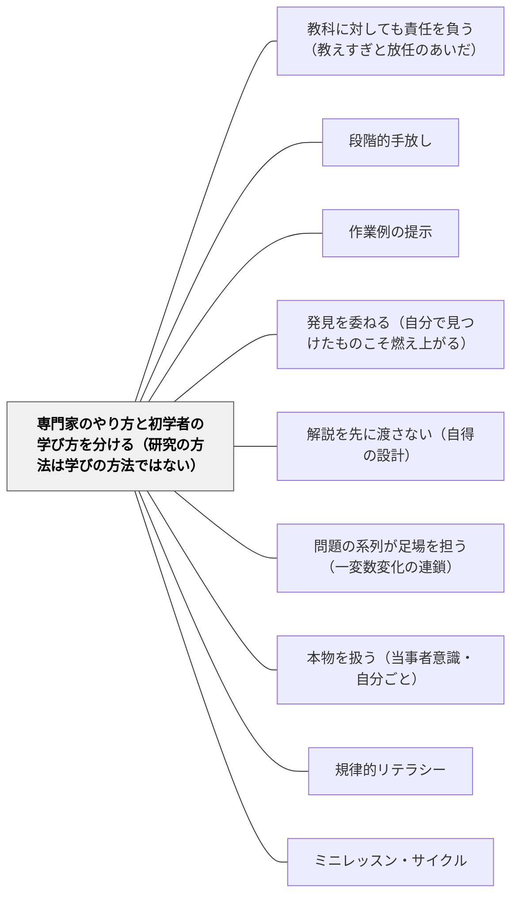

# 専門家のやり方と初学者の学び方を分ける（研究の方法は学びの方法ではない）

> 科学者は実験し、歴史家は史料を読み、作家は書き直す。だからといって、子どもが科学者と同じように実験すれば科学を学べるとは限らない。専門家のやり方を学ぶことと、専門家のやり方で学ぶことは違う。初学者には、専門家が長期記憶に持っている知識がまだない。

## [Pattern Connection]

**原典補足（2026-10-15）：足場かけのある探究学習を捉える（HmeloSilverほか2007）**

Hmelo-Silverほかは、PBL・ILに支援の乏しい発見学習と異なる実装があると応答する（pp. 99–102）。既存の「示してから使う」授業案を保持しつつ、探究の途中に説明やモデルを入れる設計も比較対象に置く。どちらか一方が全場面で正しいと裁定する資料ではない。 出典：[[文献/足場かけのある探究学習を捉える（HmeloSilverほか2007）]]。

[[文献/Why Minimal Guidance During Instruction Does Not Work（Kirschner, Sweller & Clark, 2006）]] は、発見学習・探究学習・問題基盤学習の背後に、一つの仮定があると指摘した。**その学問の手続き（研究者のやり方）にもとづく経験によって、知識をもっともよく獲得できる**という仮定である（p. 76）。

著者らはこれを、学問を**探究として**教える（研究の過程そのものを教育内容にする）ことと、学問を**探究によって**教える（研究の過程を新しい内容を学ぶ方法として使う）ことの混同だとする（p. 78）。そして、その職業を実践する熟達者としての研究者と、その学問に新しく入った初学者としての生徒を区別しないことが、この考えの誤りだと書く（p. 79）。

> The practice of a profession is not the same as learning to practice the profession. (p. 83)
>
> ある職業を実践することは、その職業を実践することを学ぶことと同じではない。

- **このWikiでの位置**：このWikiには「本物を扱う」「教科固有の読み方」「探究」の側のパタンが多い（[[パタン/本物を扱う（当事者意識・自分ごと）]]・[[パタン/規律的リテラシー]]）。どれも方向として正しい。本パタンはそこに、**その本物のやり方を、新しい内容を学ぶ唯一の方法にしない**という歯止めを足す
- **[[パタン/教科に対しても責任を負う（教えすぎと放任のあいだ）]] との関係**：あちらはブラックとウィリアムの議論から、放任は教師の責任の放棄だとする。本パタンは同じ問題を、初学者と熟達者の認知の違いから論じる
- **論文の性格について**：本論文は一つの立場からの論争の書であり、探究学習や問題基盤学習の側からの反論も出ている。本パタンは「探究をやめよ」ではなく「探究を何のために使うかを分けよ」として書く

---

## 背景（Context）

理科では「科学者のように実験しよう」、社会では「歴史家のように史料を読もう」、国語では「作家のように書き直そう」と、専門家の営みを授業に持ち込むことが勧められる。専門家の営みは本物であり、子どもの意欲を引き出し、その教科らしい考え方に触れる機会をつくる。

一方で、専門家がそのやり方で成果を出せるのは、その領域についての膨大な知識を長期記憶に持っているからである。チェスの熟達者は、実戦の盤面なら一瞬見ただけで再現できるが、でたらめな盤面では初心者と差がない（Kirschner et al., 2006, p. 76）。専門家のやり方は、その知識の上に立っている。

## 問題（Problem）

**新しい内容を、専門家のやり方（探究・実験・調査）だけで学ぶ形にすると、初学者は探索に作業記憶を使い切り、学ぶべき内容が長期記憶に残らない。** 専門家にとっては知識を使う作業でも、知識のない初学者にとっては、手がかりのない探索になる。

論文は次のように書く。探究型の指導では、学習者が問題空間を探索する。探索は作業記憶に重い負荷をかけ、しかもその負荷は長期記憶の知識の蓄積に役立たない（p. 77）。医学部の問題基盤学習の研究では、臨床の事例の中で学んだ基礎知識を、その事例から切り離して使うことが難しかった（p. 83）。

## 力のかたち（Forces）

- **本物のやり方は意欲を引き出す**：専門家の営みに触れることは、子どもを当事者にし、その教科の面白さを伝える
- **初学者には知識の土台がない**：専門家のやり方が効くのは、長期記憶の知識が探索を導くからである。その知識がない段階では、同じやり方が探索の負荷になる
- **楽しいことと学べることは別**：指導の少ない活動を選んだ能力の低い学習者は、楽しんだが学ぶことは少なかった（Clark, 1982; p. 82）
- **知識がつけば、指導は邪魔になる**：熟達が進むと、作業例のような強い指導はかえって負担になる（熟達化反転効果, p. 80）。だから「ずっと教える」も正解ではない

## 解決（Solution）

**授業の中で、「専門家のやり方を学ぶ時間」と「新しい内容を学ぶ時間」を分ける。新しい内容は、作業例や手本で何をどうするかを示して学び、専門家のやり方（探究・実験・調査）は、学んだ知識を使う場面として置く。知識がつくにつれて、探究に任せる部分を広げる。**

手順は三つ。

1. **その時間の目的を一つに決める**：今日は「新しい内容（概念・手続き）を学ぶ」のか、「学んだことを使って探究のやり方を学ぶ」のか
2. **新しい内容は示してから**：初めて出会う概念や手続きは、作業例・手本・教師の考え声（Think Aloud）で示す（[[パタン/作業例の提示]]）
3. **探究は、使える知識がついてから広げる**：探究の場面では、すでに学んだ知識を手がかりにできるようにする。手がかりが足りない子には、途中で短く教える

---

### 具体例①：理科の実験——「確かめる実験」と「探す実験」

5年の「振り子のきまり」で、いきなり「振り子の往復する時間は何で決まるか、自由に調べよう」と投げると、子どもは糸の長さ・おもりの重さ・振れ幅をばらばらに変え、何が効いているか分からなくなることが多い。条件を一つだけ変えて他をそろえる（条件制御）という、科学者には当たり前のやり方を、まだ持っていないからである。

分けると次のようになる。

- **新しい内容を学ぶ時間**：条件制御の考え方を、教師が一つの例（糸の長さだけを変える）でやってみせる。「何を変えて、何をそろえたか」を板書で確かめる
- **探究のやり方を学ぶ時間**：その考え方を使って、子どもが「おもりの重さ」「振れ幅」を自分で調べる。今度は手がかりがあるので、探索が学びにつながる

---

### 具体例②：国語の書き直し——作家のやり方を「学ぶ」と「使う」

「作家のように推敲しよう」と言っても、何をどう直せばよいかを知らない子には、推敲は「字のまちがいを直す」作業になりがちである。

- **新しい内容を学ぶ時間**：教師が自分の下書きを見せ、「ここは同じ言葉が続いているので言い換える」「ここは場面が飛んでいるので一文足す」と、直し方を声に出して示す（[[パタン/ミニレッスン・サイクル]]）
- **使う時間**：子どもが自分の文章で、示された直し方の一つを試す。慣れてきたら、直し方を自分で選ぶ

ワークショップ型の授業は、明示的に教えるミニレッスンと、個別の支えを持つ。これは論文の言う「最小限の指導」ではなく、両方の時間を一つの授業に組み込んだ形と読める。

---

### 具体例③：算数——問題の系列は「示す」の一つの形

[[パタン/解説を先に渡さない（自得の設計）]] は解き方を説明しないが、基本原形から一か所ずつ変わる問題の系列（[[パタン/問題の系列が足場を担う（一変数変化の連鎖）]]）と、比べる先の指さしで、子どもの探索を強く導く。これは、手がかりのない自由な探索ではなく、**設計された系列による指導**の一種と読める（wiki 側の整理であり、論文が述べていることではない）。

ただし、系列の最初の問題が子どもの既有知識から遠すぎれば、系列は手がかりにならず、探索の負荷になる。そのときは、第1層の指さしを待たずに短く示す。

---

### 特別支援の視点

作業記憶に負担のかかりやすい子にとって、手がかりのない探索は、学びより先に混乱を生みやすい。新しい内容は、手順を一つずつ見せ、手元に残る形（手順カード・見本の写真）で示す。探究の場面では、変える条件を一つに絞り、記録の枠を用意しておく。「自分で見つける」経験は、知識の土台を固めたあとの、小さな範囲から始める。

## 結果（Consequences）

**利点**

- 新しい内容が長期記憶に残りやすくなり、探究の場面でその知識を手がかりにできる
- 探究が「何をしていいか分からない時間」ではなく、学んだことを使う時間になる
- 熟達に応じて探究に任せる範囲を広げるので、慣れた子が強い指導に退屈することも減る

**注意点・リスク**

- **探究そのものを軽んじる口実にしない**：論文が問題にするのは、探究を新しい内容を学ぶ**唯一の方法**にすることである。探究のやり方を学ぶこと、探究の意欲を育てることの価値は別にある
- **論争の一方の声である**：本論文の主張には、探究学習や問題基盤学習の側から、それらも実際には多くの足場かけを含むという反論が出ている（Hmelo-Silver et al., 2007。本文の論点と足場かけの例を確認し、上記の補足に接続）。どちらか一方を教室の唯一の原理にしない
- **発見の所有感は別の価値**：自分で見つけたことは強く記憶に残り、意欲を生む（[[パタン/発見を委ねる（自分で見つけたものこそ燃え上がる）]]）。論文はこの動機の価値を扱っていない。効率と動機のどちらを優先するかは、場面ごとに判断する

## 関連パタン
- [[文献/足場かけのある探究学習を捉える（HmeloSilverほか2007）]] — 最小限の指導への批判と、支援付き探究への応答を並べて読む。

- [[パタン/教科に対しても責任を負う（教えすぎと放任のあいだ）]] — 放任は責任の放棄という同じ問題を、教科の本質の側から論じる
- [[パタン/段階的手放し]] — 知識がつくにつれて任せる範囲を広げる。熟達化反転効果がその根拠になる
- [[パタン/作業例の提示]] — 新しい内容を示す方法。初学者には作業例が探索より効く
- [[パタン/発見を委ねる（自分で見つけたものこそ燃え上がる）]] — 発見の所有感という動機の価値。本パタンと緊張しつつ、場面で使い分ける
- [[パタン/解説を先に渡さない（自得の設計）]] — 設計された系列による指導は、自由な探索とは違う。系列が手がかりにならないときは短く示す
- [[パタン/問題の系列が足場を担う（一変数変化の連鎖）]] — 外からの指導を、説明ではなく問題の並びで行う形
- [[パタン/本物を扱う（当事者意識・自分ごと）]] — 本物の課題は意欲を引き出す。そのやり方を、新しい内容を学ぶ唯一の方法にしない
- [[パタン/規律的リテラシー]] — 教科固有の読み方を学ぶことは「探究として教える」にあたる
- [[パタン/ミニレッスン・サイクル]] — 明示的に教える時間と、使う時間を一つの授業に組み込む形

## クラスター図

## Actionable Insight

- 次に探究や調べ学習を計画するとき、その時間の目的が「新しい内容を学ぶ」のか「学んだことを使って探究のやり方を学ぶ」のかを、指導案に一行で書いてみる
- 「自由に調べよう」の前に、使ってほしい考え方（条件をそろえる、史料の出どころを確かめる、など）を一つ、教師がやってみせる時間を5分取る
- 子どもが楽しそうに活動しているときこそ、終わりに「今日、何が分かった？」を一文で書いてもらい、学んだことが残っているかを確かめる

## 出典

Kirschner, P. A., Sweller, J., & Clark, R. E. (2006). Why minimal guidance during instruction does not work: An analysis of the failure of constructivist, discovery, problem-based, experiential, and inquiry-based teaching. *Educational Psychologist, 41*(2), 75–86.

> "The constructivist description of learning is accurate, but the instructional consequences suggested by constructivists do not necessarily follow." (p. 78)
>
> 学びについての構成主義の記述は正確である。しかし構成主義者が示す教え方の結論は、必ずしもそこから出てこない。

> "The practice of a profession is not the same as learning to practice the profession." (p. 83)
