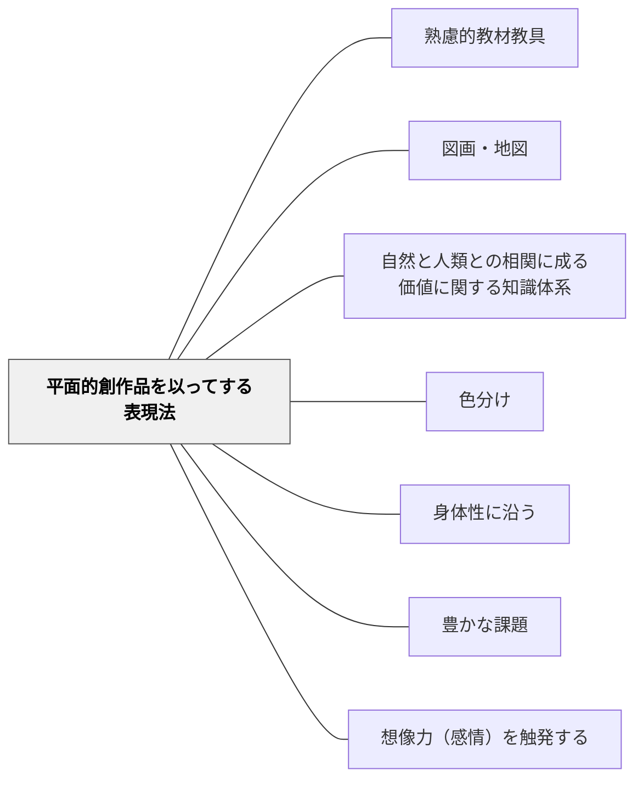

# 平面的創作品を以ってする表現法

**このパタンが完成を助ける大きなパタン**：[[パタン/熟慮的教材教具]]

> 絵・図・地図——平面的な視覚表現で価値を表現し伝える。

## 背景（Context）

牧口常三郎の表現法分類の第三項目。絵画・スケッチ・地図・グラフ・デザインなど、平面上での視覚的表現活動。図工・美術・社会科（地図）・算数（グラフ）など多くの教科に関わる。

**原典では**：「3、平面的創作品を以てする表現法。図画、地図等＝技能と其の知識」（『創価教育学体系』第4巻 第二章第五節）。地図がここに入っている点が要で、図画と地図を「平面に表す技能」として一つに見ている。（牧口の分類全体は [[文献/創価教育学体系 4（牧口常三郎）]] の「2-2」にまとめた。）

本Wikiでは、子どもが**描いて表す**側を本パタンに、教師が用意して子どもが**見て読む**図・地図を [[パタン/図画・地図]] に書き分ける（2026-11-14 岩井裁定）。

## 問題（Problem）

「絵を描く」が評価対象から外れると、視覚的表現力と空間的認識が育ちにくい。

## 力のかたち（Forces）

- 視覚的表現は言語では伝えにくい関係・構造を伝える
- 描くプロセスが観察力・注意力を育てる

## 解決（Solution）

**近いパタンとの見分け**：子どもが絵・図・地図・グラフを自分で描いて表すのが本パタン。用意した図・地図を見て読むのは [[パタン/図画・地図]]。教材・教具の表では、本パタンの見分けの問いは「図画・地図など、子どもが平面の作品を描いて表しているか」。全体の表は [[パタン/熟慮的教材教具#近いパタンとの見分け|熟慮的教材教具]] にある。

**絵・図・地図・グラフを描く活動を教育材料として意図的に設計し、視覚的表現力と空間的認識を育てる。**

**例：手描きの校区地図**（社会・3年）
通学路を記号で描き、友だちの地図と比べて、足りない情報（方位・目印・距離）を書き足す。描き直すたびに、地図の約束ごとが自分のものになる。

---

**例：観察のスケッチに書き込む**（理科・中学年）
見たままを描き、気づいたことを矢印と短い言葉で書き込む。言葉だけの記録と比べて、何が伝わりやすかったかを話す。

## 結果（Consequences）

- 観察力・視覚的表現力が育つ
- 概念の視覚的理解が深まる

- 注意点：上手に描くことが目的になると、描くのが苦手な子が観察や表現から離れる。目的に合わせて、写真や型紙を使う手も残す

## 関連パタン

- [[パタン/熟慮的教材教具]] — 親パタン
- [[パタン/図画・地図]] — 見て読む材料の側。本パタンは子どもが描いて表す側（牧口の表現法四分類の一つ）
- [[パタン/自然と人類との相関に成る価値に関する知識体系]] — 上位分類
- [[パタン/色分け]] — 視覚的色彩による表現

- [[パタン/身体性に沿う]] — 絵を描く・地図を作る身体的活動が理解を深める
- [[パタン/豊かな課題]] — 平面的創作を核にした豊かな課題設計
- [[パタン/想像力（感情）を触発する]] — 創作が感情・想像力を引き出す

## クラスター図

## Actionable Insight

- 算数・社会・理科の授業で「今日学んだことを絵や図で表してみよう」を1回取り入れる——描く行為が観察力・空間的認識・言語では伝えにくい理解を同時に育てる
- 描くプロセスを「観察力と注意力の育成」として意識的に位置づけ時間を確保する——「絵が上手い下手」でなく「描きながら考える」ことに価値を置くメッセージが学習者の参加を広げる
- 描いた図を、友だちに説明する道具として使い、発表して比べ合う——描いたものを言葉と結びつけることで、平面の表現が理解の深まりにつながる

## 出典

- 牧口常三郎（1972）『牧口常三郎全集第4巻 創価教育学体系 上』聖教新聞社

- 牧口常三郎（2007）『創価教育学体系』第4巻（聖教文庫、第8刷のデジタル版）第二章「教科構造論」— 2026-11-13 に該当箇所の原文を確認。[[文献/創価教育学体系 4（牧口常三郎）]]
