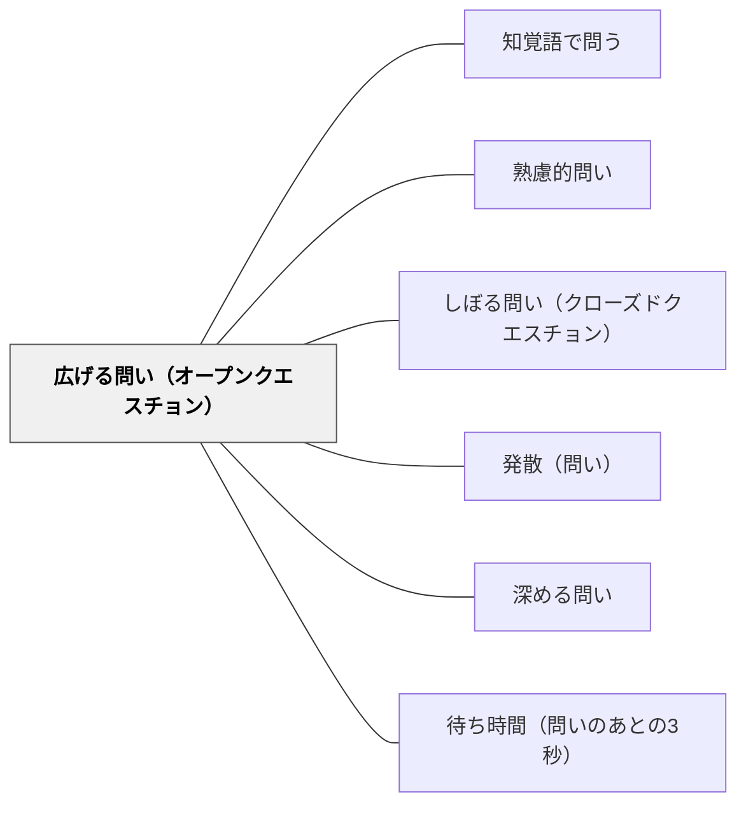

# 広げる問い（オープンクエスチョン）

**このパタンが完成を助ける大きなパタン**：[[パタン/熟慮的問い]]

> 多様な答えを引き出す開放的な問いで、探索・発散・創造的思考を促す。

## 背景（Context）
一つの正解を求める問いだけでは、学習者の多様な視点や創造的思考が引き出せない。オープンな問いは、様々な経験や考え方を持つ学習者全員が参加でき、思考の多様性と豊かさを生み出す。

**原典では**：土居（2026）は「オープンクエスチョン」という語は使わないが、問いの広さを二つの面から論じている。一つは発問の機能で、長崎（2010）が発問を、確認や収束の役割を果たす「小さな発問」と、「思考の拡散や深化の役割を果たす『大きな発問』」とに分けていることを紹介している（第1章2「発問の機能を使い分ける」、Kindle版 17/204頁表示）。

もう一つは、問いの広さと答えやすさの関係である。原典は、「どんなことを思いましたか。」と感想をぼんやり問うのと、「あなたが最も印象に残った場面はどこですか。」と問うのとでは答えやすさが大きく異なり、「子ども達は、抽象的に問われると、どのように考え、どのように答えたらいいかわかりにくくなります」と述べる（第2章7「具体的に問う」、Kindle版 70/204）。「筆者の考えに対してどう思う？」も、自分の言葉で説明するのは「特に学習が苦手な子ども達にとって難しい」とする（第3章5、Kindle版 111/204）。

そのうえで原典は、広い問いを捨てるのではなく、子どもが育つにつれて広い問いへ移っていく道筋を描く。教師の工夫を減らしていく「発問のグラデーション」の最上段は「発問をなくす。あるいは『どう思った？』など感想を聞いていくのみ」である（第4章2、Kindle版 135/204）。「具体的に問う」工夫を減らすと「抽象的に問う」ことになり、たとえば道徳で「主人公の行動は思いやりがあると言えますか。」を「主人公の行動についてどう思いますか。」に変える（第4章4、Kindle版 142/204）。選択肢を二つにしぼる工夫を減らすと、それまで出されようがなかった考えも出るようになり、考えるのも議論するのも難しくなるが「その分広がりもある授業になり得る」という（第4章5、Kindle版 145/204）。広げる問いは、ここでは学級の育ちに合わせて段階的に手渡していくものとして扱われている。

**岩井の講話では**：「絞るとクローズドクエスチョン」に対して「広げるとオープンクエスチョン」とし、「いろんな答えが考えられる」問いだと説明している（講話 18:52〜19:06）。

## 問題（Problem）
閉じた問いに慣れた学習者は、「正解がある」という前提で思考し、自由に考えることをためらう。オープンクエスチョンなしでは、探索的・発散的な思考が育たず、創造性が発揮される機会が失われる。

## 力のかたち（Forces）
- 多様な答えが出ることで、視点の多様性が可視化される
- 正解・不正解がないため、学習者が安心して参加できる。ただし答えの範囲が広いほど、どう考えどう答えるかがわかりにくくなり、学習が苦手な子には入りにくい面もある（土居 2026）
- 発散した思考を後で収束させるプロセスが学びになる
- 教師も予測できない答えが出ることが、対話の面白さになる

## 解決（Solution）
**近いパタンとの見分け**：問いの型の表では、本パタンの見分けの問いは「答えの範囲を決めずに、多様な答えを引き出しているか」。全体の表は [[パタン/熟慮的問い#近いパタンとの見分け|熟慮的問い]] にある。

「この物語を読んでどう感じた？」「もし自分だったらどうする？」「この問題には他にどんな解き方があると思う？」「なぜ人々はこの出来事を大切にするのだろう？」などと、一つの正解がない問いを投げかける。答えを評価せず「他には？」と続けて広げることで、発散的思考を促す。

---

**例：選択肢の問いから「どう思う？」へ、学期をかけて広げる**（道徳・高学年、筆者の主張を読む国語の説明文でも同じ手順）
1. 年度の初めは「主人公の行動は思いやりがあると言えますか。言えませんか。」のように、視点と選択肢を示して問う。選んだ理由をノートに書く。
2. 理由が書けるようになってきたら、選択肢を外して「主人公の行動について、どう思いますか。」と問う。
3. 広げた問いのあとは、「出てきた考えを、似ているもの同士で分けてみよう」と、発散したものを子どもが自分たちで整理する時間をとる。
4. 子どもから問いや論点が出てくるようになったら、「ここまで読んで、何を話し合いたい？」と、問いそのものを子どもに委ねる。
（原典 Kindle版 135、142、187/204 の段階づけをもとにした手順）

---

**例：二択の「枠」を外して広げる**（体育・ボール運動「ルールの工夫」）
1. はじめは「ボールを増やしてはいけません」などの枠を示したうえで、「どんなルールの工夫をすると、みんながサッカーを楽しめるかな？」と問う。
2. 枠の中で工夫が出せるようになったら、次の単元では枠を一つ外して同じ問いを出す。
3. 枠を外したことで出てきた新しい案を板書し、「この案だと、ゲームはどう変わりそう？」と、試す前に予想を話し合う。
4. 実際に試し、楽しめたかどうかを振り返る。
（原典 Kindle版 123、145/204 をもとにした手順。2〜4は Wiki 側の組み立て）

## 結果（Consequences）
- 多様な視点が生まれ、クラス全体の思考が豊かになる
- 学習者が自分の考えを自由に表現する習慣が育つ
- 創造的・探索的な思考力の基盤が形成される

- 注意点：答えの範囲が広い問いほど、学習が苦手な子にとっては「どう考え、どう答えたらいいか」がわかりにくくなる（土居 2026）。学級の育ちを見取りながら、限定した問いから段階的に広げる。

## 関連パタン
- [[パタン/知覚語で問う]]
- [[パタン/熟慮的問い]] — 親パタン
- [[パタン/しぼる問い（クローズドクエスチョン）]] — 対になる問いの形式
- [[パタン/発散（問い）]] — さらに広げる
- [[パタン/深める問い]] — 広げた後に深める
- [[パタン/待ち時間（問いのあとの3秒）]] — 多様な応答を待つ問いほど待ち時間の効果が大きい

## クラスター図

## Actionable Insight

- 閉じた問いの後に「他に考え方はありますか？」と開放的な問いを1つ追加する——多様な答えが出る空間をつくるだけで発散的思考のスイッチが入る
- 授業の冒頭に「今日のテーマについて、どんなことが気になりますか？」と問う——正解のない問いが学習者の関心と自由な思考を引き出す
- 学習者の答えに対して「他の人はどう思う？違う考えは？」と続ける習慣をつける——「他には？」を続けることで視点の多様性がクラス全体に可視化される

## 出典
- [[文献/熟慮的問いのパターンリスト（動画記録）]]

- 土居正博（2026）『自分で考え、学べる子を育てる！ 発問の技術』学陽書房（初版・電子書籍版） — 第1章「発問の機能を使い分ける」、第2章「発問自体への工夫② 具体的に問う」、第3章「選択肢を入れる」「前提条件を整える」、第4章「発問のグラデーション」「発問自体や発問セット指示への工夫を減らす」「工夫を減らすときに注意すること」。頁は Kindle 版の表示（204頁中）
- 長崎伸仁（2010）『新国語科の具体と展望』メディア工房ステラ — 土居（2026）による紹介で確認（原典未確認）
- 岩井輝久（年不明）『熟慮的問いのパターンリスト』［動画］ https://youtu.be/WivskVtxG34 — 2026-11-13 に文字起こしで確認（18:52〜19:06）
