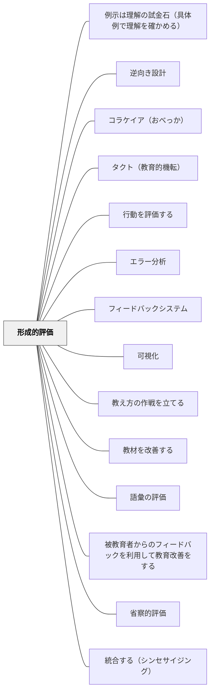

# 形成的評価

**一文でいうと**：学習の途中で理解やつまずきを見取り、その場で指導と学習を調整する。

---

## [Pattern Connection]

**研究からの補足（2026-10-20）：子どもの算数の考え方を指導判断に生かす（Carpenterほか1988公開稿）**

Carpenterほか（1988公開稿, pp. 11–13, 40–43）を踏まえたWiki側の適用案として、「観察した方略」「まだ確かめていないこと」「次に出す問い」を一組で残す。正答の予測と方略の予測を区別し、聞き取った情報が次の指導判断に使われたかを確認する。 出典：[[文献/子どもの算数の考え方を指導判断に生かす（Carpenterほか1988公開稿）]]。

**研究からの補足（2026-10-19）：相互評価の設計と実施条件を確かめる（Topping1998）**

Topping（1998, p. 255）は、受け手がフィードバックを行動に移す必要を述べる。さらに、現在の作品を直すのか次の課題に生かすのかを明確にするよう求める（p. 266）。本パタンへのWiki側の適用案として、相互評価の後に一つの修正を選ぶ時間を置き、修正前後を同じ観点で比べる。助言の交換回数や教師の点数との一致だけを学習改善の証拠にしない。 出典：[[文献/相互評価の設計と実施条件を確かめる（Topping1998）]]。

**研究からの補足（2026-10-18）：足場かけの調整と手放しを確かめる（van de Polほか2010）**

原典は形成的評価を、応答に合う支援のための診断的活動に位置づける（p. 275）。Wiki側の適用案として、「見取ったこと→支援の変更→その後の応答」を一組で記す。教師が支援を変更した事実だけで学習改善を判定せず、学習者側の成果も確かめる（p. 286）。 出典：[[文献/足場かけの調整と手放しを確かめる（van de Polほか2010）]]。

**研究からの補足（2026-10-17）：次の学びへの準備として転移を捉える（BransfordとSchwartz1999）**

原典は、利用する資料を選び、再び類題に取り組む動的評価の試作を論じる（公開著者稿pp. 30–33）。Wiki側の適用案として、誤答を採点するだけでなく、どの説明で考えが変わったかを確かめて次の援助を選ぶ。形成的評価全体の効果を測った研究とは区別する。 出典：[[文献/次の学びへの準備として転移を捉える（BransfordとSchwartz1999）]]。

**原典補足（2026-10-14）：授業を支える指導原則（Rosenshine2012）**

「質問はありますか」への沈黙だけで進まず、説明・要約・応答から全員の理解を確認する（p. 16）。授業案として短い一問への全員の回答を集め、次の例や教え直しに使う。 出典：[[文献/授業を支える指導原則（Rosenshine2012）]]。

**原典補足（2026-10-14）：学習者に合わせる足場かけ（Woodほか1976）**

指導者には課題の構造と学習者の遂行についての二つの見立てが必要だと論じる（p. 97）。本Wikiでは、観察を支援選択へつなぐ補助線として読む。形成的評価そのものの効果を測定した研究ではない。 出典：[[文献/学習者に合わせる足場かけ（Woodほか1976）]]。

**原典の接続（2026-10-14）**：想起テストによる長期保持（RoedigerとKarpicke2006）を参照し、想起による学習効果と証拠による指導調整を分けるための補足を本ページに加えた。

**原典の接続（2026-10-14）**：認知的関与を捉えるICAP（ChiとWylie2014）を参照し、成果物から実際の認知的関与を確かめるための補足を本ページに加えた。

**カント（1787）統合：**

- **哲学的基盤の提供**：カントの「物自体（Ding an sich）は認識できず、現象のみが認識対象になる」という洞察が、形成的評価を**哲学的に必然のもの**にする根拠を与える。教師が直接見えるのは常に「現象」——学習者の発言・書いたもの・テストの答え——であり、学習者の「理解そのもの（物自体）」には決して直接アクセスできない。
- **なぜ一回の確認では不十分か**：正解を書いた、というのは一つの現象に過ぎない。「なぜそうなるか説明して」「別の例を作って」「図で表して」と異なる形の現象を重ねることで、初めて理解の全体像（物自体に近い何か）に近づける。
- **誤答の扱い**：「間違い＝理解できていない（物自体）」という判断も早計。誤った現象の背後には多様な物自体——真の誤概念、一時的な混乱、読み間違え——が潜む。だからこそ「なぜこう考えたの？」という問いかけが不可欠。
- **波及するパタン**：[[パタン/コペルニクス的転回（認識論）]] — 学習者の認識は「物自体」ではなく、認識形式を通じた「現象」として現れる。この認識論的謙虚さが学習者中心設計の根拠となる。

→ 出典：[[文献/純粋理性批判 1（カント、中山元訳）]]

**Black & Wiliam（1998）統合：**

この論文がこのパタンに与えたのは、定義・核心・そして強い留保の三つである。

- **定義——「テストの種類」ではなく「情報が使われること」**：「教師によって、および／またはその生徒たちによって行われるすべての活動であって、彼らが従事している教授・学習活動を**修正するためのフィードバックとして用いられる**情報を提供するもの」（pp.7-8）。主体に**学習者自身が含まれる**こと、そして情報が**実際に使われて教授と学習が変わる**ことが要件である。テストを増やしても、結果が行動を変えなければ形成的ではない。
- **核心は二つの行為の連鎖**：「第一は、望ましい目標と自分の現在の状態との間の**ギャップを学習者が知覚すること**。第二は、そのギャップを埋めるために**学習者がとる行動**である」（p.20）。教師のフィードバックは第一を助けうるが、第二を起こすのは学習者しかいない。だから「学習者を**行動への呼びかけの受動的受け手**と見なすのは誤りである」。
- **形成的か総括的かは「機能」で決まる**：比較には三つの様式がある（p.53）。①等価性（同じか違うか）②距離（基準にどれだけ足りないか）③**診断**（そこに到達するために私は何をする必要があるか）。形成的機能を果たすのは③のときだけである。評価は**目的においては形成的でも、機能においては形成的でない**ことがありうる——ここが実務で最も見落とされる。
- **強い留保——周辺的な追加としては成立しない**：「形成的評価の革新は教室作業の**周辺的変化としては扱えない**」（p.16）。それは相互作用の質に関わり、相互作用の質は教育方法の核心にあるからである。政策節の結論も同じ——「立ち現れるのは一組の**導きの原理**であり……必要とされる教室実践の変化は**周辺的ではなく中心的**であり、各教師が**自分自身のやり方で**自分の実践に組み込まねばならない」（p.62）。この Wiki がパタン・ランゲージの形式をとることの、外からの裏づけになっている。
- **効果量の読み方**：Fuchs & Fuchs（1986）で0.70（Black と Wiliam 1998 の要約による。原典は未確認。主に軽度の障害のある子どもの研究で、評価は週2〜5回）、マスタリー・ラーニングで0.82、フィードバック全般（Kluger & DeNisi 1996）で0.41（Black と Wiliam の要約では0.40）。ただし政策節の「効果量0.7」の例証は「**もし全国規模で達成できたなら**」という条件法で書かれている（p.61）。条件節を落として引用しないこと。なお本文冒頭で挙げているハッティの0.9前後という値は、対象範囲の異なる別のメタ分析に由来する——形成的評価の効果量は、何を形成的評価と数えるかで大きく動く。

→ 出典：[[文献/Assessment and Classroom Learning（Black & Wiliam）]]

**Black & Wiliam（2009）統合：**

同じ二人が11年後に書いた理論篇は、定義そのものを書き換えた。1998年版が「情報がフィードバックとして用いられること」だったのに対し、2009年版はこうである——「**教室における実践が形成的であるのは、生徒の達成についての証拠が引き出され、解釈され、教師・学習者・その仲間によって、指導の次の一歩についての決定——引き出された証拠がなかったならば下していたであろう決定より、よりよい、またはより良く根拠づけられている見込みが高い決定——を下すために用いられる、その程度においてである**」。

- **形成的か否かは二値ではなく「程度（to the extent that）」である**：「この授業は形成的評価をやったか」という問いの立て方自体が誤っている。程度を上げ下げできる変数として扱う。
- **焦点は「決定」にある**：意図に置けば「証拠を集めたが使わなかった」場合まで形成的になってしまい、「実際に学習を改善した」を要求すれば**反事実を確立せねばならず実際上不可能**になる。だから確率的な定式（よりよい**見込みが高い**）を取る。
- **「よりよい、または、より良く根拠づけられた」の後半が実務を救う**：見取った結果、**最初から意図していた手立てがやはり最善だと分かる**ことがある。行動は変わらないが、証拠に根拠づけられたものになる。**見取ったうえで何も変えなかったことは失敗ではない**。
- **偶発の瞬間（moments of contingency）**：形成的評価とは、学習過程の調整のために指導における「偶発の瞬間」を作り出し活かすことである。**焦点は狭いが影響は広い**——その瞬間の作り方は教材設計・カリキュラム・教育方法・心理学・認識論のすべてを巻き込む。同期（授業中のリアルタイム）だけでなく非同期（出口パス・宿題・**前年度の記録**）も含む。→ [[パタン/偶発の瞬間を活かす（コンティンジェンシー）]]
- **5つの鍵となる戦略**：三つの問い（どこへ向かうか／今どこにいるか／どう行くか）× 三人の主体（教師・仲間・学習者）。「活動のリスト」のままにしておくと**表面的採用（superficial adoption）**の危険がある。→ [[概念/形成的評価の5つの戦略（3×3の枠組み）]]
- **代替ではなく包含**：自己調整学習モデルも認知加速もダイナミック・アセスメントも、**形成的アプローチの代替物ではなく、そのすべてが形成的アプローチを含んでいる**。異なるのは上流の課題設計と包括的な学習目標のほうである。したがって**上流の計画が好適な文脈を用意していなければ、形成的評価は栄えない**——形成的評価を「授業中の技」としてだけ導入する試みが失敗する理由がここにある。

→ 出典：[[文献/Developing the Theory of Formative Assessment（Black & Wiliam, 2009）]]

---

## 使いどころ・使いすぎ注意

| 観点         | 内容                                     |
| ------------ | ---------------------------------------- |
| 使いどころ   | 授業途中で見取り、調整したいとき。       |
| 使いすぎ注意 | 見取りが多すぎると、活動の流れが切れる。 |

> 評価は学習を終わらせるためではなく、学習を育てるためにある。

## 背景（Context）

教育における評価には大きく二つの目的がある。一つは学習の結果を確認・認定すること（総括的評価）、もう一つは学習の途中で情報を得て改善に活かすこと（形成的評価）だ。形成的評価は「学習のための評価（Assessment for Learning）」とも呼ばれ、学習者の成長を支援する機能をもつ。

ジョン・ハッティのメタ分析研究では、形成的評価は効果量0.9前後という非常に高い学習効果を示しており、学習成果に対する最も影響力の大きい実践の一つとして位置づけられている。

## 問題（Problem）

多くの教育現場では、評価が学習の「終わり」にのみ行われ、学習が完了した後で成績や評点が与えられる。この構造では、評価の結果が次の学習サイクルに活かされないまま、新しい単元へと移行してしまう。

学習者は自分が「どこで間違えたのか」「どうすれば良くなるのか」を理解しないまま評価を受け取り、改善の機会を失う。また教師も、学習者の理解状況を学習中に把握できないため、指導の軌道修正が遅れる。

## 力のかたち（Forces）

- 学習の途中でフィードバックを受けることで、誤概念や誤りを早期に修正できる
- 形成的評価には追加の時間と労力が必要で、カリキュラムの進度と緊張関係が生まれることがある
- 形成的評価が効果をもつためには、その情報を学習改善に実際に活用する文化と仕組みが必要

## 解決（Solution）

どの評価のパタンを使うかで迷ったら、下の「[[#近いパタンとの見分け|近いパタンとの見分け]]」の表を見る。

> **原典による補足：意図した活動と実際の活動（2026-10-14）**：ChiとWylie（2014, p. 238）は、教師が意図した関与と学習者が実際に行った関与を区別し、成果物を分析して確かめるよう提案する。「概念地図を作らせた」だけでは生成が起きたと判定できない。Wiki側の適用案として、与えた説明と子どもの成果物を比べ、追加された関係や根拠を見て、次の問いや支援を選び直す。出典：[[文献/認知的関与を捉えるICAP（ChiとWylie2014）]]。

授業・単元・学期の進行中に、継続的に学習者の理解状況を把握し、それを学習改善に活かす仕組みを設計する。具体的な実践として、授業中の口頭確認（挙手・ミニホワイトボード・終わりの質問）、ピアフィードバック、自己評価チェックリスト、短い確認テスト、授業終了時の振り返りメモ（「今日学んだこと・まだわからないこと」）などがある。

重要なのは、形成的評価によって得られた情報を、教師が指導の修正に、学習者が自分の学習の修正に実際に使うことだ。情報収集だけに終わり、改善行動につながらなければ形成的評価の機能は果たされない。

### 研究の裏づけ

> **研究の裏づけ（2026-11-01）**：宿題の答えから問題ごとの正答率とよくある誤答の一覧を作って教師に渡し、教師がそれで次の授業で取り上げる問題を決める研修とコーチの訪問を組み合わせた無作為化比較（Roschelle ほか 2016、米国の7年生43校）では、学年末のテストで 0.18 SD 高かった。著者は、頻度の低い中間テストを使った手立てには効果のない研究が多いのに対し、返しが毎日で課題の水準であり、教師が情報を読み取って使う準備があることを、効く条件として挙げる（pp. 2, 7–10）。出典：[[文献/宿題にその場で正誤と手がかりを返し、誤答の集計を教師に渡すと、だれが伸びるかを確かめる（Roschelleほか2016）]]。

> **研究の裏づけ（2026-11-02）**：子どもの手も、見取りの対象になる。言葉とは違う考えを身振りで表している子は、その課題の指導から学びやすく、教師は訓練なしでも身振りの中の考えを読み取れるという研究がある（Novack・Goldin-Meadow 2015, 1節・5節）。出典：[[文献/子どもが手で身振りをすると、算数の新しい考えが生まれるかを確かめる（Goldin-Meadowほか2009・NovackとGoldin-Meadow2015）]]。

> **研究の裏づけ（2026-11-11）**：（教師の報告・根拠は弱い）米国ヴァーモント州の取り組みでは、5年生に「1/12 と 7/8 の和にいちばん近いのは、20、8、1/2、1 のどれか」と問うと、通分してたし算は正しくできるのに、分母や分子の大きさを見て 20 や 8 を選ぶ子がいた。ある教師は「和の値がどのくらいかを尋ねることは、思いつきもしなかった」と語った。教師たちは、答えの正誤だけでなく、子どもが学習の道筋のどこにいるかを作業から読み、分数の大きさと数直線を毎日の授業に入れた（pp. 35–38）。比べて効果を測ったものではない。出典：[[文献/子どもの考えが学年をまたいでどう育つかの道筋を、教育課程・評価・指導の土台にできるかを、算数の研究から整理する（Daroほか2011）]]。

## 近いパタンとの見分け

評価のパタンは、何のための評価か、どんなねらいか、規準をどうつくり・見せ・使うか、子どもが自分でどう確かめるか、で分かれる。評価を設計する順に並べる。

| 迷いどころ | パタン | 見分けの問い |
| --- | --- | --- |
| 何のための評価か | **形成的評価（本ページ）** | 学習の途中で理解をつかみ、教師が指導を直すための評価か |
| 何のための評価か | [[パタン/学習のための評価（A4L）]] | 子ども自身が「何を学んでいるか・今どこか・どう埋めるか」に答えられるよう、評価を設計しているか（子どもの側の三つの問い） |
| 何のための評価か | [[パタン/総括的評価]] | まとまりの終わりに到達を確かめ、その結果を次の設計の材料にしているか |
| 何のための評価か | [[パタン/評定（成績評価）]] | 認定・証明のための記号か。学習の途中の返しには使わない |
| 何のための評価か | [[パタン/省察的評価]] | 観察記録・ポートフォリオ・カンファリングで、子どもが自分の成長を語る評価の文化があるか |
| ねらいの種類 | [[パタン/おきまりの学習のねらい]] | 全員が必ず達成する基礎の目標を、チェックリストで確かめているか |
| ねらいの種類 | [[パタン/多様に想定される学習のねらい]] | 正解が一つでない目標で、複数の優れた実例を示して多様な達成を認めているか |
| ねらいの種類 | [[パタン/主要概念で評価する]] | 最も大切な概念に、最も高い配点をしているか |
| ねらいの種類 | [[パタン/テストを作成する]] | 教材より先に評価問題を作って、目標をはっきりさせているか |
| 規準をつくる | [[パタン/達成規準の共同構築]] | 子どもと一緒に「何ができればよいか」を言葉にしているか |
| 規準をつくる | [[パタン/実例を比べて分析する]] | よい例・ふつうの例・直しが要る例を並べ、違いを言葉にしているか（共同構築の主な方法） |
| 規準をつくる | [[パタン/振り返りでのねらいの共同構築]] | 学習のあとの気づきから、次のねらいをつくっているか |
| 規準をつくる | [[パタン/脱文脈化された達成規準]] | この問題だけでなく、どこでも使える規準に言い換えているか |
| 規準をつくる | [[パタン/批判的評価]] | 規準そのものが何を大切にし、何を見落としているかを、子どもと問い直しているか |
| 規準を見えるようにする | [[パタン/ルーブリック]] | 観点×レベルの表に、各レベルの作品例を複数添え、子どもが自分の現在地を知る地図にしているか（旧「達成レベルの役割」を統合） |
| 規準を見えるようにする | [[パタン/作品例を集める]] | 各レベル・多様なスタイルの作品例を、ライブラリとしてためているか |
| 規準を見えるようにする | [[パタン/悪い実例を示す]] | 明らかに質の低い例から、「なぜよくないか」を考えて規準を引き出しているか |
| 規準を見えるようにする | [[パタン/不備のある実例を示す]] | ほぼよいが一つ足りない例で、「何が足りないか」を考えているか |
| 規準を見えるようにする | [[パタン/間違いがある達成規準を示す]] | 矛盾やあいまいさを含む規準を直す活動で、規準の読み方を育てているか |
| 授業中に規準を使う | [[パタン/潜在規準と顕在規準（規準の浮き沈み）]] | 今この作品で見る規準を前に出し、当たり前になったら背景に戻しているか |
| 授業中に規準を使う | [[パタン/一つ又はそれ以上の成功規準に焦点化し最も良い学習物を探し改善案を示す]] | 今日見る規準を一つに絞り、最もよい作品を全員で探して改善案を考えているか |
| 授業中に規準を使う | [[パタン/授業中に学習パートナーが協働して成功を確認し改善案を示す]] | ペアで規準を使い、よい点二つと改善案一つを返し合っているか |
| 授業中に規準を使う | [[パタン/評価的専門性を渡す（ギルド知識のダウンロード）]] | 質を見る目そのものを子どもに渡す道筋を、指導の中に設計しているか |
| 自分で確かめる | [[パタン/到達レベルの自己評価]] | 規準を使って自分の作品を評価し、そのあと教師の評価と比べているか |
| 自分で確かめる | [[パタン/自己テスト]] | 成績に関係のない小テストを自分で採点し、自分の理解の地図をつくっているか |
| 自分で確かめる | [[パタン/テストを繰り返す]] | 思い出す練習として、くり返しテストしているか（記憶を強める） |
| 自分で確かめる | [[パタン/ポートフォリオファイル]] | 作品を時系列で並べ、成長を言葉にしているか |
| 認める | [[パタン/ゴールドスター]] | 優れた行動や作品を、公の場で称えているか |

**混同しやすい組**：
- 本ページ・[[パタン/学習のための評価（A4L）]]・[[パタン/省察的評価]]：三つとも学習の途中の評価である。本ページは教師が理解をつかんで指導を直す側、A4L は子ども自身が三つの問いに答えられるようにする側、省察的評価は、子どもが自分の成長を語る記録と対話の側に重心がある。
- [[パタン/総括的評価]] と [[パタン/評定（成績評価）]]：総括的評価は、終わりに到達を確かめること。評定は、それを記号で表すこと。総括的評価の結果は、記号にせずに次の設計に使うこともできる。
- [[パタン/悪い実例を示す]]・[[パタン/不備のある実例を示す]]・[[パタン/間違いがある達成規準を示す]]：何を見せるかが違う。明らかに質の低い作品、ほぼよいが一つ足りない作品、欠陥のある規準。最初に規準を引き出すなら悪い例、規準をある程度つかんだら不備のある例、規準の読み方を育てるなら間違いのある規準、と使い分ける。
- [[パタン/達成規準の共同構築]]・[[パタン/実例を比べて分析する]]・[[パタン/振り返りでのねらいの共同構築]]：共同構築が目的、実例の比較はその主な方法、振り返りでの共同構築は、学習のあとでねらいを更新する時期の違い。
- [[パタン/到達レベルの自己評価]]・[[パタン/自己テスト]]・[[パタン/テストを繰り返す]]：自己評価は規準に照らして作品を見ること、自己テストは理解の状態を知ること、テストを繰り返すは思い出す練習で記憶を強めること。
- [[パタン/潜在規準と顕在規準（規準の浮き沈み）]] と [[パタン/一つ又はそれ以上の成功規準に焦点化し最も良い学習物を探し改善案を示す]]：前者は「規準は一度に全部使えない」という考え方、後者はそれを授業で行う手立て。
- [[パタン/おきまりの学習のねらい]] と [[パタン/多様に想定される学習のねらい]]：正解が一つの目標はチェックリストで確かめ、正解が多様な目標は複数の実例で認める。

**緊張**：[[パタン/ルーブリック]] と [[パタン/評価的専門性を渡す（ギルド知識のダウンロード）]]：サドラーは後期に、記述欄だけのルーブリックは質の概念が育つのを妨げうると論じた。見分けは、**ルーブリックの言葉だけで質を伝えようとしているか、複数の作品を比べて「同じ質だ」と判断する経験を添えているか**である。添えているならルーブリックは地図として働き、言葉だけなら書式に終わる。

### 系列の中の小さなまとまり（2026-11-13 追加）

上の表に入れなかった、授業の中で理解を読み取り、手を打つためのパタン（前に決めておくこと、読む・聴くこと、読んだあとの手、評価そのものを確かめること）を、まとまりごとに並べる。

| 迷いどころ | パタン | 見分けの問い |
| --- | --- | --- |
| 授業の前に決めておく | [[パタン/予想される反応を先に書く（応答の幅を絞る）]] | 起こりうる子どもの反応と、それぞれへの返し方を、前の晩に絞っておいたか |
| 授業の前に決めておく | [[パタン/偶発の瞬間を活かす（コンティンジェンシー）]] | 子どもの応答で授業が分かれる点を、1時間に少しだけ、前もって決めて置いたか |
| 授業の前に決めておく | [[パタン/最適なギャップ（願望水準の交渉）]] | 目標と今の差を、遠すぎず近すぎない大きさに設計しているか |
| 授業中に読む・聴く | [[パタン/聴き方を変える（評価的・解釈的・解釈学的）]] | 子どもの言葉を、自分の期待に合うかではなく、その子が何を考えているかとして聴いているか |
| 授業中に読む・聴く | [[パタン/理解のしるしを読む（fit と match）]] | 正解を、理解の証拠とすぐにみなさず、慣習にたまたま合っただけではないかを確かめているか |
| 授業中に読む・聴く | [[パタン/例示は理解の試金石（具体例で理解を確かめる）]] | 子どもが自分で具体例をつくれるかで、理解を確かめているか |
| 授業中に読む・聴く | [[パタン/チェックイン（Checking In）]] | 独立読書の時間に、毎日全員に短く声をかけ、読書のゾーンにいるかを確かめているか |
| 読んだあとの手 | [[パタン/誤概念の組み替え（素朴概念を資源にする）]] | 誤概念を消す相手ではなく、「どこまでは正しいか」を一緒に確かめ直す資源として扱っているか |
| 読んだあとの手 | [[パタン/補充機構の常設化（匡救設計）]] | つまずいた子が戻ってこられる補充の仕組みを、いつも置いてあるか（戸田城外） |
| 読んだあとの手 | [[パタン/教科に対しても責任を負う（教えすぎと放任のあいだ）]] | 子どもの声を受け止めつつ、その子が入っていく教科の筋にも責任をもって手を入れているか |
| 評価そのものを確かめる | [[パタン/その過程が本当に働いたかを確かめる]] | 課題が狙った考え方が、子どもの中で実際に働いたかを、解いている最中を見て確かめているか（Messick） |
| 評価そのものを確かめる | [[パタン/語彙の評価]] | 「定義を書け」のままにせず、語を使えるかを測る評価に変えているか |

**この表の中で混同しやすい組**：
- [[パタン/予想される反応を先に書く（応答の幅を絞る）]] と [[パタン/偶発の瞬間を活かす（コンティンジェンシー）]]：前者は反応の幅と返し方を前もって絞る。後者は、授業が分かれる点そのものを少数だけ決めて置く。
- [[パタン/理解のしるしを読む（fit と match）]] と [[パタン/例示は理解の試金石（具体例で理解を確かめる）]]：前者は正解を理解の証拠と見なす前に疑う。後者は、例をつくれるかという別の証拠を取りに行く。
- [[パタン/聴き方を変える（評価的・解釈的・解釈学的）]] と [[パタン/答えの出どころを推し量る（誤答の解釈）]]：前者は聴く構えそのものを変える。後者は、見当外れに見える答え一つの出どころを推し量る。
- [[パタン/チェックイン（Checking In）]] と [[パタン/1対1の面談]]・[[パタン/チェックイン・チェックアウト（行動支援）]]：チェックインは毎日・短く・全員。1対1の面談は5〜10分の面談。チェックイン・チェックアウトは、名前は似ているが、朝と放課後に行動の目標を確かめる行動支援で、別物。

## 結果（Consequences）

> **原典による補足：記憶への効果と指導調整への利用（2026-10-14）**：RoedigerとKarpicke（2006）は、結果を教師が指導変更に使う効果とは別に、想起する活動自体の長期保持への効果を実験した。Wiki側の整理として「思い出すことによる学習」と「得た証拠を次の判断に使う形成的評価」を区別する。一つの小テストが両方を担う場合もあるが、記憶への効果があるだけで自動的に形成的評価になるわけではない。出典：[[文献/想起テストによる長期保持（RoedigerとKarpicke2006）]]。

- 学習者が自分の理解状況をリアルタイムで把握でき、自己調整学習が促進される
- 教師が学習者の状況に応じて指導を柔軟に調整できるようになる
- 誤概念が早期に発見・修正され、積み重ねの失敗を防ぐことができる

> **研究の裏づけ（2026-10-31）**：『How People Learn』（2000）は、頻繁な形成的評価を、子どもの考えを本人・仲間・教師に見えるようにし、考えを直す手がかりにするものと位置づける（p. 19）。前の晩に覚える金曜日の小テストで順位をつけるのではなく、考えを見直して直す機会になり、何週間・何か月の進歩が本人に見えるものがよい、とする（pp. 24–25）。さらに、転移を一回のテストで測るのでなく、「前にやったことで役に立ちそうなものはある？」のような一般的な手がかりから、より具体的な手がかりへと進め、転移できるまでに要った手がかりの数と種類を数える方法（段階的な手がかり）を紹介する（p. 66）。手がかりの段階の記録は、正誤より細かい見取りになりうる。出典：[[文献/人の学び方の研究を授業の設計につなぐ（全米研究評議会2000）]]。

## 関連パタン
- [[文献/子どもの考えが学年をまたいでどう育つかの道筋を、教育課程・評価・指導の土台にできるかを、算数の研究から整理する（Daroほか2011）]] — 正誤より、子どもが学習の道筋のどこにいるかを作業から読む
- [[文献/授業を支える指導原則（Rosenshine2012）]] — 質問がないことを理解の証拠にしない。
- [[文献/学習者に合わせる足場かけ（Woodほか1976）]] — 課題と学習者の見立てを援助選択へつなぐ。
- [[文献/人の学び方の研究を授業の設計につなぐ（全米研究評議会2000）]] — 考えを見えるようにする評価と、段階的な手がかりで転移を測る方法
- [[文献/宿題にその場で正誤と手がかりを返し、誤答の集計を教師に渡すと、だれが伸びるかを確かめる（Roschelleほか2016）]] — 誤答の一覧を次の授業の判断に使う手立ての無作為化比較
- [[文献/子どもが手で身振りをすると、算数の新しい考えが生まれるかを確かめる（Goldin-Meadowほか2009・NovackとGoldin-Meadow2015）]] — 子どもの身振りの中の考えを見取る
- [[文献/理科で学ぶ「大きな考え」を14に絞り、選ぶ基準と、小学校から高校までの育ち方を示す（Harlen編2015）]] — めあてと質の見方を子どもと共有し、「…は何だと思う？」とたずねて考えを見取る（理科の大きな考え）

- [[文献/想起テストによる長期保持（RoedigerとKarpicke2006）]] — 想起による学習効果と証拠による指導調整を分ける。
- [[文献/認知的関与を捉えるICAP（ChiとWylie2014）]] — 成果物から実際の認知的関与を確かめる。
- [[パタン/例示は理解の試金石（具体例で理解を確かめる）]]
- [[パタン/逆向き設計]]
- [[パタン/コラケイア（おべっか）]]
- [[パタン/タクト（教育的機転）]]
- [[学級経営/学級経営で使えるパタン]]
- [[実践/BDA読解授業の設計]]
- [[実践/学習科学の6方略]]
- [[パタン/行動を評価する]]
- [[パタン/エラー分析]]
- [[パタン/フィードバックシステム]]
- [[パタン/可視化]]
- [[パタン/教え方の作戦を立てる]]
- [[パタン/教材を改善する]]
- [[パタン/語彙の評価]]
- [[パタン/被教育者からのフィードバックを利用して教育改善をする]]
- [[パタン/省察的評価]]
- [[パタン/統合する（シンセサイジング）]]
- [[パタン/被教育者にフィードバックを提供し理解できるようにする]]

- [[パタン/フィードバック]] — 親パタン
- [[パタン/総括的評価]] — 対比となる評価形式。両者が相補的に機能することが望ましい
- [[パタン/フィードフォワード（次に何をするべきか）]] — 形成的評価が明らかにしたギャップを行動に転換する
- [[パタン/テストを繰り返す]] — 形成的目的でのテスト活用
- [[パタン/相関と因果の区別（教育評価の落とし穴）]] — フィードバックの効果を「本当に効いたか」と因果的に問う謙虚さ
- [[パタン/学習のための評価（A4L）]] — Boaler による算数教育固有の A4L 実装。グレードを外した診断コメント・Exit Ticket・再提出許可など具体的技法を体系化している
- [[パタン/チェックイン（Checking In）]] — 毎日2〜3分・全員へのゾーン確認という形成的評価の最小単位。「今どこにいるか」を毎日確認するリズムが取り残しを防ぐ（Atwell, 2016）
- [[パタン/再提出を許す（リトライ・サイクル）]] — フィードバックを「使う機会」を制度化し、形成的評価を成立させる前提条件
- [[パタン/誤概念の組み替え（素朴概念を資源にする）]] — 形成的評価が見取った誤概念を、適用範囲の再交渉として組み替える具体的設計
- [[パタン/ガイデッド・リーディング（小グループの読み指導）]] — 観察記録→グループ編成更新→テキスト選定という循環は、読み指導における形成的評価の典型実装
- [[パタン/質の根拠を見えるようにする（伝えることからの脱却）]] — 形成的アセスメントの主流（丁寧なフィードフォワードとフィードバック）に対する、サドラー本人からの根本的な異議
- [[概念/評価エキスパティーズ（課題適合性・質・クライテリア）]] — 形成的評価が最終的に育てようとしているものの中身
- [[文献/ロイス・サドラーによる形成的アセスメント論の検討（石田智敬, 2021）]] — 形成的アセスメント論の理論的ルーツとされたサドラーが、なぜ主流派を批判するに至ったか（石田, 2021）
- [[パタン/返したことと届いたことを分ける（返却の五段）]] — 返した評価がその子の中で何になったかを五段に分けて追う
- [[パタン/一回できたことと続いていることを分ける（記録の列）]] — 形成的評価の積み重ねから「できるようになった」へ跳ぶときの限界
- [[パタン/IRE型応答の脱却（Talk Move）]] — 教師の第3ターンを「評価」から「情報収集と調整」へ転換する点で同じ思想。子どもの応答は採点対象でなく指導調整の資源として扱う
- [[パタン/つまずきを構造で記録する（診断の粒度設計）]] — 形成的評価は「何のために記録するか」（改善のための評価という目的）を扱う上位パタン。本パタン（つまずきを構造で記録する）は「どの粒度で記録するか」という具体的な実装の型——上位の目的を実現するために記録の粒度設計が機能する
- [[パタン/補充機構の常設化（匡救設計）]] — 形成的評価の「評価→指導改善のサイクル」の具体的な補充実装が本パタン。形成的評価が目的・哲学を担い、補充機構がその実行手段として機能する
- [[パタン/AIフィードバックと教師の二重ループ]] — 形成的評価の頻度と即時性をAIで上げつつ、最終判断は人間が持つ
- [[パタン/評価的専門性を渡す（ギルド知識のダウンロード）]] — 形成的評価が最終的に目指す地点。評価する力そのものを学習者へ渡す（Sadler, 1989）
- [[パタン/制作しながら質を判断する（産出中のモニタリング）]] — 評価の担い手が学習者自身になり、時点が産出のただ中まで前倒しされた極（Sadler, 1989）
- [[パタン/最適なギャップ（願望水準の交渉）]] — 見取ったギャップの大きさそのものを設計変数として扱う（Sadler, 1989）
- [[文献/Formative Assessment and the Design of Instructional Systems（Sadler）]] — 形成的評価の3条件とフィードバックから自己モニタリングへの移行を論じた原典（Sadler, 1989）
- [[文献/Assessment and Classroom Learning（Black & Wiliam）]] — このパタンの定義を与えた系統的レビュー。効果の証拠と「周辺的変化では成立しない」という留保の両方の出所（Black & Wiliam, 1998）
- [[パタン/評点なしで返す（コメントだけの一巡）]] — 形成的な情報が総括的な情報と同居すると消える、という実験的知見の実装
- [[パタン/見取ったあとの手を決めておく（データ利用のルール化）]] — 見取りを指導改善につなぐ機構。ルール化の有無で効果量が0.92と0.42に分かれる
- [[パタン/進歩の傾きを見る（水準ではなく変化率）]] — 見取りの対象を「点」から「変化率」へ移す
- [[パタン/理解のしるしを読む（fit と match）]] — 何をもって「わかった」と見取るかの実務。正答は理解の証拠にならない
- [[パタン/聴き方を変える（評価的・解釈的・解釈学的）]] — 見取る側の構えそのものを扱う。教師の聴き方が形成的評価の質を規定する
- [[概念/自我関与と課題関与（フィードバックが向ける先）]] — 見取った情報をどう返すかで、学習者の注意が課題に向くか自己に向かうかが決まる
- [[概念/教授学的契約（やり過ごしの均衡）]] — 形成的評価が導入時に最初にぶつかる壁。契約を組み替えないと子どもは間違いを隠す

- [[パタン/評定（成績評価）]] — 対比。評定は総括的機能に限定し、形成的な場面では返さない時間を確保する

- [[文献/Developing the Theory of Formative Assessment（Black & Wiliam, 2009）]] — このパタンの定義を「程度」と「決定」で書き直した理論篇（Black & Wiliam, 2009）
- [[概念/形成的評価の5つの戦略（3×3の枠組み）]] — 上位の枠組み。この Wiki の評価系パタンが5戦略のどこに位置するかの地図
- [[パタン/偶発の瞬間を活かす（コンティンジェンシー）]] — 2009年版の中心概念。証拠によって進路が分かれる一点を、授業のどこに置くか
- [[パタン/練り上げ（比較検討の全体交流）]] — 形成的な相互作用が日本の教室で最も濃く起きる場面
- [[パタン/答えの出どころを推し量る（誤答の解釈）]] — 見取った応答をどう解釈するか。証拠を集めても解釈を誤れば決定は改善しない
- [[パタン/予想される反応を先に書く（応答の幅を絞る）]] — 上流の計画。ここが好適な文脈を用意していないと形成的評価は栄えない
- [[パタン/教科に対しても責任を負う（教えすぎと放任のあいだ）]] — 形成的評価が「教えない」の口実にならないための歯止め
- [[概念/自己調整学習の内側（成長の道とウェルビーイングの道）]] — フィードバックを受け取る側の内部構造。自己評価は始めさせるものではなく表に出すもの
- [[概念/認知加速とダイナミック・アセスメント（学習する力そのものを狙う）]] — 形成的評価の代替ではなく、それを含む包括的な教育方法
- [[パタン/測れていないものを疑う（構成概念の過少代表）]] — 形成的評価が狭すぎると、見取られなかった側面は指導の対象からも消える
- [[文献/次の学びへの準備として転移を捉える（BransfordとSchwartz1999）]] — 最初の正誤に加え、援助を受けた後の学び方を見取る。
- [[文献/足場かけの調整と手放しを確かめる（van de Polほか2010）]] — 見取り・支援調整・その後の応答を一つの相互作用として記録する。
- [[文献/相互評価の設計と実施条件を確かめる（Topping1998）]] — 評価情報を受け取った後の行動と作品の変化を確認する。
- [[文献/子どもの算数の考え方を指導判断に生かす（Carpenterほか1988公開稿）]] — 解き方の情報を、次の指導を選ぶ証拠にする。

## クラスター図

## Actionable Insight

- 授業終了5分前に「今日学んだこと1つ・まだわからないこと1つ」をメモさせる——エグジットチケットが形成的評価の最もシンプルな実践
- 次の授業の冒頭に「前回学んだことを3つ書く」ウォームアップを入れる——形成的評価の情報を次の授業改善に活かすサイクルが生まれる
- 前回の評価で出てきた「まだわからないこと」を翌週の授業で取り上げる——評価が学習改善に実際につながることで形成的評価の文化が育つ

## 出典

Black, P., & Wiliam, D. (1998). Assessment and classroom learning. _Assessment in Education: Principles, Policy & Practice, 5_(1), 7–74.（定義・二つの行為の連鎖・「周辺的変化では成立しない」の出所となる系統的レビュー）
Black, P. & Wiliam, D. (1998). Inside the Black Box. _Phi Delta Kappan_, 80(2), 139–148.（上記レビューを実践者向けに圧縮した小冊子版）
Hattie, J. (2009). _Visible Learning_. Routledge.
Wiliam, D. (2011). _Embedded Formative Assessment_. Solution Tree.
