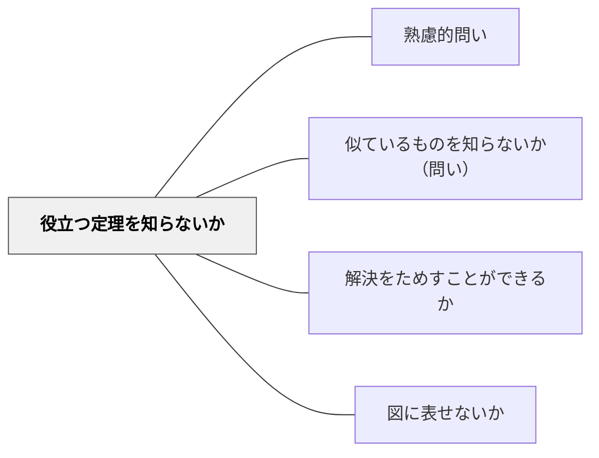

# 役立つ定理を知らないか

> 問題の解決に使えそうな知識・原理・定理を能動的に探索する問い。

## 背景（Context）
学習者は多くの知識を持っていても、それが目の前の問題に使えるとは気づかないことが多い。知識の「想起」と「適用」の間には大きなギャップがある。問いを通じて既習知識を意識的に探索することで、そのギャップを埋めることができる。

**岩井の講話では**：問題を理解したあと、「自分の知ってることとか分かってることを使ったり」、前に解決したことのある似た問題を役立てたりして、解決の計画を立てる流れを語っている（13:22〜13:48）。本パタンは「似ているものを知らないか」に続けて、前に解決できたアイデアが使えるかもしれない、という文脈で読み上げられる（14:44〜15:00）。

**本Wikiの読みとしては**：小学校では「定理」を、すでに習ったきまりや性質（例：たし算は順番を入れかえても答えが同じ）と読みかえて問うことができる。[[パタン/ポリアの問題解決法]] の Schoenfeld（1992）の項が、方略の名前を知っていることと使えることを分けるのと同じく、きまりを覚えていることと、目の前の問題に使えると気づくことは別である。

## 問題（Problem）
「何を使えばいいか分からない」という状況は、知識がないのではなく、知識と問題の接続ができていないことが原因であることが多い。定理や公式を暗記していても、どの場面で使うかという判断が訓練されていないと、知識は死んだものになってしまう。

## 力のかたち（Forces）
- 知識の活用は「探す意識」があって初めて可能になる
- 既習内容との関連付けが、深い理解と長期記憶を促進する
- 「使えそうなものを探す」という姿勢が能動的学習を生む
- 不適切な定理を試みることも、適切なものを絞り込む助けになる

## 解決（Solution）
**近いパタンとの見分け**：問いの型の表では、本パタンの見分けの問いは「使えそうな知識・原理・定理を、自分から探しているか」。全体の表は [[パタン/熟慮的問い#近いパタンとの見分け|熟慮的問い]] にある。

「今までに学んだ定理や原理で、この問題に使えそうなものはないか？」と問いかける。例えば幾何の問題なら「ピタゴラスの定理は使えるか？相似の関係はないか？」と具体的な候補を示し、学習者が探す手がかりにする。「なぜそれが使えると思うか？」と理由も問うことで、適用の判断力を育てる。

---

**例：楽に計算できるきまりを探す**（算数・2年）
1. 「38＋27＋2」を板書し、すぐには計算せず「今まで習ったきまりで、楽に計算できそうなものはないか」と問う。
2. 子どもは思い出したきまりをノートに書く（「たす順番を変えても答えは同じ」「（ ）で先に計算してもよい」など）。
3. 「なぜそれが使えそうか」を問う。「38と2で40になるから」と理由が出たら、38＋2＋27 で計算する。
4. 前から順に計算した答えと比べ、同じ67になることを確かめる。使わなかったきまりも消さずに残す。

---

**例：平行四辺形の面積で、習った求め方を探す**（算数・5年）
1. 平行四辺形の面積を初めて求める場面で、「今まで習った面積の求め方で、使えそうなものはないか」と問う。
2. 子どもは長方形・正方形の面積の求め方を挙げる。教師が候補を先に言わず、子どもが挙げるのを待つ。
3. 「長方形の求め方を使うには、この形をどうすればよいか」と問い、方眼の上で切って移す、を試す。
4. 長方形にできたら、元の平行四辺形のどこの長さが長方形の「たて」「横」になったかを確かめる。

## 結果（Consequences）
- 知識の「再活性化」が起こり、記憶の定着が強化される
- 知識と問題の接続が習慣化し、応用力が向上する
- 自分の知識体系を俯瞰する力が育つ

- 注意点：教師が候補を先に出しすぎると、探す過程が子どもの手から離れる。まず子どもが挙げ、出なかったときにだけ教師が足す。

## 関連パタン
- [[パタン/熟慮的問い]] — 親パタン
- [[パタン/似ているものを知らないか（問い）]] — アナロジーで知識を探す関連パタン
- [[パタン/解決をためすことができるか]] — 想起した定理で解を検証する
- [[パタン/図に表せないか]] — 図示で定理の適用可能性を確かめる

## クラスター図

## Actionable Insight

- 問題提示後に「今まで習った中で使えそうな公式・定理・原理をノートに3つ書き出してみよう」と促す——探す行為が既習知識を再活性化する
- 「その定理が使えると思う理由は？」と追い問いする——適用の判断に根拠を求めることで知識と問題の接続が深まる
- 「試してみたが合わなかった定理」も記録させる——不適用の試みも知識整理のプロセスとして価値づける

## 出典
- [[文献/熟慮的問いのパターンリスト（動画記録）]]
- ジョージ・ポリア（1954）『いかにして問題をとくか』丸善出版

- 岩井輝久（年不明）『熟慮的問いのパターンリスト』［動画］ https://youtu.be/WivskVtxG34 — 2026-11-13 に文字起こしで確認（13:22〜13:48、14:44〜15:00）
- [[文献/数学の問題解決で方略を選び直す（Schoenfeld1992）]] — [[パタン/ポリアの問題解決法]] の記述による
