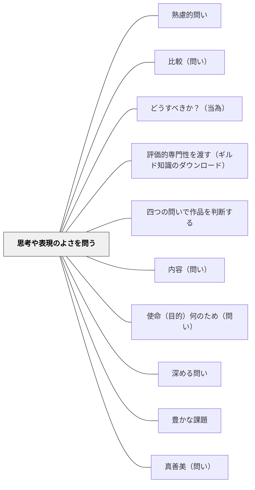

# 思考や表現のよさを問う

**このパタンが完成を助ける大きなパタン**：[[パタン/熟慮的問い]]

> 「この考え方のよさはどこか？」と問い、価値・優れた点・美しさを評価的に見る力を育てる。

## 背景（Context）
学習では「正しいか否か」の評価に集中しがちで、考え方や表現の「よさ」「優雅さ」「効率性」を問う機会が少ない。「よさ」を言語化する経験を積むことで、学習者は審美眼と評価的思考力を育てる。

学校では、教師が「これが大切だ」と一方的に伝えることが多い。けれども、算数の考え方には優雅さがあり、文学には美しさがあり、理科の法則には普遍性がある。それぞれの学問の「よさ」は、問われなければ気づかれないまま過ぎていく。

※旧パタン「価値を問う」を本ページに統合（2026-11-12）。問いの次元の系列（時制・感情などと並ぶ）に置かれていたが、問い（「この考え方のよさはどこ？」）が本ページと同じだったため一枚にした。熟慮的問いの問いの次元の表では旧名のまま並べている。

## 問題（Problem）
正誤の判断だけでは、思考・表現の質を高める視点が育たない。「正しい」だけでなく「よい」を問わなければ、学習者は価値判断の言語を持てず、より高い質の思考や表現を目指す動機が生まれない。価値を問われない学習者は、「なぜ学ぶのか」にも答えにくい。

## 力のかたち（Forces）
- よさを問うことで、基準や価値観を意識するようになる
- 「美しい解法」「わかりやすい説明」など多様な「よさ」がある
- 評価する経験が、自分の思考を磨く意欲を生む
- 他者のよさを認める姿勢が、学び合いの文化をつくる

## 解決（Solution）
**近いパタンとの見分け**：考え方・表現・学んだことの「よさ」を問うのが本パタン（旧「価値を問う」を統合）。美しさ・正しさ・役立ちの三つの軸で問うのは [[パタン/真善美（問い）]]。問いの系列の全体の表は [[パタン/熟慮的問い#近いパタンとの見分け|熟慮的問い]] にある。

「この解き方のよいところはどこだと思う？」「どの説明が一番わかりやすかった？なぜ？」「この表現の面白さや美しさはどこにある？」と問いかける。たとえば算数で複数の解法を示し「どれがエレガント（すっきりしている）だと思う？」と問う。作文の比較で「どちらの書き出しが読者を引き込む？その理由は？」と問い、理由を言葉にする。

学んだことそのものの「よさ」も問う（旧「価値を問う」）。算数でかけ算を学んだあとに「たし算でなくかけ算を使うことのよさは何か？」、文学で「なぜこの表現が選ばれたと思う？」と問う。必要に応じて、よさの観点（美しさ・効率・公平さ・普遍性など）を示す。単元の終わりに「この単元で学んだことの一番価値があると思うところは？」を一文書くと、子どもが「なぜ学ぶのか」を自分の言葉で語れるようになる。

## 結果（Consequences）
- 評価的思考力が育ち、質を意識した学習が生まれる
- 自分と他者の思考・表現の違いを建設的に捉えられる
- 「よさ」の基準を問う習慣が、美的・倫理的判断力の基盤になる

## 関連パタン
- [[教科/算数・数学で使うパタン]]
- [[パタン/熟慮的問い]] — 親パタン
- [[パタン/比較（問い）]] — 複数の考えを比べる
- [[パタン/どうすべきか？（当為）]] — 価値判断を問う
- [[パタン/評価的専門性を渡す（ギルド知識のダウンロード）]] — 「よさはどこか」と問うことが、学習者に評価的な語彙と判断の経験を渡す（Sadler, 1989）
- [[パタン/四つの問いで作品を判断する]] — 「よさ」を問う手順を四段階に構造化したもの
- [[パタン/内容（問い）]]
- [[パタン/使命（目的）何のため（問い）]] — 目的と価値は相補的な問い
- [[パタン/深める問い]] — 価値への問いが思考を根源へ導く
- [[パタン/豊かな課題]] — 価値の問いが豊かな課題の中核をつくる
- [[パタン/真善美（問い）]] — 美しさ・正しさ・役立ちの三つで問いを展開する兄弟パタン

## クラスター図

## Actionable Insight

- 算数で複数の解き方を板書し「どれが一番すっきりしていると思う？その理由は？」と問う——正誤でなく「よさ」で評価する問いが審美眼と思考の質を育てる
- 作文の比較で「どちらの書き出しが読者を引き込む？」と問い理由を言わせる——よさを言語化する経験が自分の表現を磨く基準をつくる
- 他者の発表を聞いた後「この説明で一番わかりやすかったところはどこ？」と問う——批評的に聴く習慣が学び合いの文化を育てる

## 出典
- [[文献/熟慮的問いのパターンリスト（動画記録）]]
