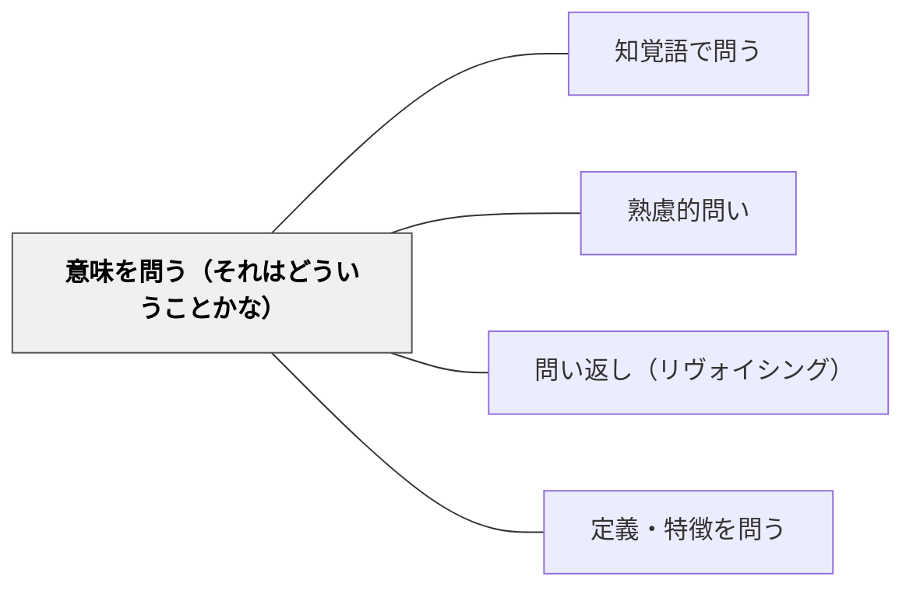

# 意味を問う（それはどういうことかな）

**このパタンが完成を助ける大きなパタン**：[[パタン/熟慮的問い]]

> 「それはどういうことか？」と問い、子どもが意味・定義を言葉にする。

## 背景（Context）
学習者は概念や用語を「知っている」つもりでも、その意味を自分の言葉で説明できないことが多い。表面的な理解にとどまった状態では、応用や転移が起きない。意味を問うことで、理解の深さを表面化し、本人が気づいていない曖昧さを明らかにする。

**原典では**：土居（2026）は、子どもに問いをつくる観点を教える方法として、深谷（2021）の「ビリヤード法」を紹介している。抽象的なテーマに「誰が」「どういう意味？」「いつから？」「いつまで？」「どこで？」「なぜ？」「どのように？」「事実か？」など様々な観点の疑問をぶつけ、具体的な問いをつくり出す方法である（第4章12「子どもが問いをもてるようになるための指導法」、Kindle版 170/204頁表示）。「どういう意味？」は、ここでは子ども自身が問いをつくるための観点の一つとして置かれている。

言葉の意味を問う発問の実例として、原典は説明文「『鳥獣戯画』を読む」（光村図書6年）の題名読みを挙げる。「鳥獣戯画という絵を『読む』ってどういうことだろう」と投げかけ、「ストーリーや価値を読み取るということかな。」という問題意識をもってから本文に入った授業である（第4章12、Kindle版 174/204）。第5章では同じ題名読みを、工夫の多い順に「絵なのに、『見る』ではなくて『読む』とは、どういうことなのでしょうか」→「絵を『読む』とはどういうことなのでしょうか」→「鳥獣戯画を『読む』とはどういうことなのでしょうか」→「題名を見て、何か疑問はありますか」と並べ、子どもの育ちに合わせて教師の工夫を減らしていく「発問のグラデーション」の例にしている（第5章「題名から想像できることは？」、Kindle版 193〜194/204）。最も工夫の多い問いは、「見る」と比べる手がかりを教師が出しており、工夫を減らした問いでは、その比較が子どもの側から出てくることをねらう、と説明されている。

なお原典は、子どもの発言を受けて「それはどういうこと？」と問い返す場面（本パタンの問い返しとしての面）は扱っていない。原典にあるのは、題名や本文の言葉の意味を教師が問う発問と、子どもが問いをつくる観点としての「どういう意味？」である。

**岩井の講話では**：問い返すことを、子どもが言ったことに対して「それってどういうこと」と問い返すことだと説明し、問い返すことで「考えが深まっていったりとか詳しくなったりすることがあります」と述べる（講話 17:38〜18:02）。そのうえで「意味を問う」を挙げている（18:02）。

## 問題（Problem）
「わかった」という感覚と「説明できる」レベルの理解はしばしば乖離している。学習者が意味を問われないままでいると、言語化されていない暗黙の理解に基づいて学び続け、概念の誤解が蓄積される。

## 力のかたち（Forces）
- 意味を言葉にするには、理解を整理・構造化する必要がある
- 説明しようとすると理解のギャップに自分で気づける
- 難しすぎる問いより「それはどういうこと？」は敷居が低い
- 教師が定義を与えてしまうと、学習者の言語化の機会が失われる

## 解決（Solution）
「それはどういうこと？」「自分の言葉で言うと？」「もう少し詳しく教えて」と問い、学習者自身に意味を説明させる。たとえば「摩擦って何？」「民主主義ってどういうこと？」と問い、教科書の定義ではなく自分の言葉で答えさせる。答えを否定せず、「もう少し言えそう？」と引き出し続ける。

---

**例：題名の一語の意味を問う**（国語・6年「『鳥獣戯画』を読む」など、題名に引っかかる語がある説明文）
1. 本文を配る前に題名だけを板書する。
2. 「鳥獣戯画は、画がつくから絵だね。絵なのに『見る』ではなくて『読む』とは、どういうことだろう」と、題名の一語の意味を問う。
3. 隣の人と予想を話す時間をとり、「〜ということかな」という予想をいくつか板書に残す。
4. 本文を読んだあと、最初の予想と筆者の「読む」の意味を比べ、「筆者の言う『読む』は、どういうことだった？」と、もう一度自分の言葉で言い直す。
（原典 Kindle版 174、193/204 の例をもとにした手順。4は Wiki 側の組み立て）

---

**例：子どもの言葉を「それってどういうこと？」で問い返す**（算数・4年「わり算の筆算」など、説明をし合う場面）
1. 子どもが「ここは、おろすんだよ」のように、手順の言葉だけで説明したところで止める。
2. 「『おろす』って、どういうこと？」と、その子の使った言葉をそのまま返して問う。
3. 言い直しが出たら、ほかの子に「今の説明、自分の言葉で言うとどうなる？」とつなぐ。
4. 出てきた言い直し（「十の位の数を一の位の横に書く」「残りといっしょにする」など）を並べて板書し、どれが同じことを言っているかを確かめる。
（講話 17:38〜18:02 の問い返しを授業に移した Wiki 側の手順。原典にこの場面はない）

**近いパタンとの見分け**：問い返しのうち、意味を自分の言葉で言うよう求めるのが本パタン。理由を求めるのは [[パタン/理由・根拠を問う]]、説明の先を求めるのは [[パタン/続きを問う]]。系列の全体の表は [[パタン/問い返し（リヴォイシング）#近いパタンとの見分け|問い返し（リヴォイシング）]] にある。

## 結果（Consequences）
- 理解の表面化によって、自分の誤解や曖昧さに気づける
- 言語化を繰り返すことで概念の理解が深まる
- 自分の言葉で語る習慣が、主体的な学びの基盤になる

- 注意点：意味の問いは、教師が比べる手がかり（「見る」ではなく「読む」など）を出すほど答えやすくなるが、そのぶん子どもが自分で引っかかりを見つける機会は減る。手がかりは子どもの育ちに合わせて減らしていく。

## 関連パタン
- [[パタン/知覚語で問う]]
- [[パタン/熟慮的問い]] — 親パタン
- [[パタン/問い返し（リヴォイシング）]] — 発言を問いとして返す
- [[パタン/定義・特徴を問う]] — 概念の定義を問う

## クラスター図

## Actionable Insight

- 「摩擦って何？」「民主主義ってどういうこと？」と問い、教科書の定義ではなく自分の言葉で答えさせる——言語化によって理解の表面化が起き誤解や曖昧さに気づける
- 答えを否定せず「もう少し言えそう？」と引き出し続ける——概念の理解が言語化を繰り返すことで深まる
- 「自分の言葉で言うと？」を習慣的に問う——主体的な学びの基盤が育つ

## 出典
- [[文献/熟慮的問いのパターンリスト（動画記録）]]

- 土居正博（2026）『自分で考え、学べる子を育てる！ 発問の技術』学陽書房（初版・電子書籍版） — 第4章「子どもが問いをもてるようになるための指導法」、第5章「題名から想像できることは？」。頁は Kindle 版の表示（204頁中）
- 深谷達史（2021）「問いに基づく探究的な学習とその実践」小山義徳・道田泰司編『「問う力」を育てる理論と実践』ひつじ書房 — 土居（2026）による紹介で確認（原典未確認）
- 岩井輝久（年不明）『熟慮的問いのパターンリスト』［動画］ https://youtu.be/WivskVtxG34 — 2026-11-13 に文字起こしで確認（17:38〜18:02）
