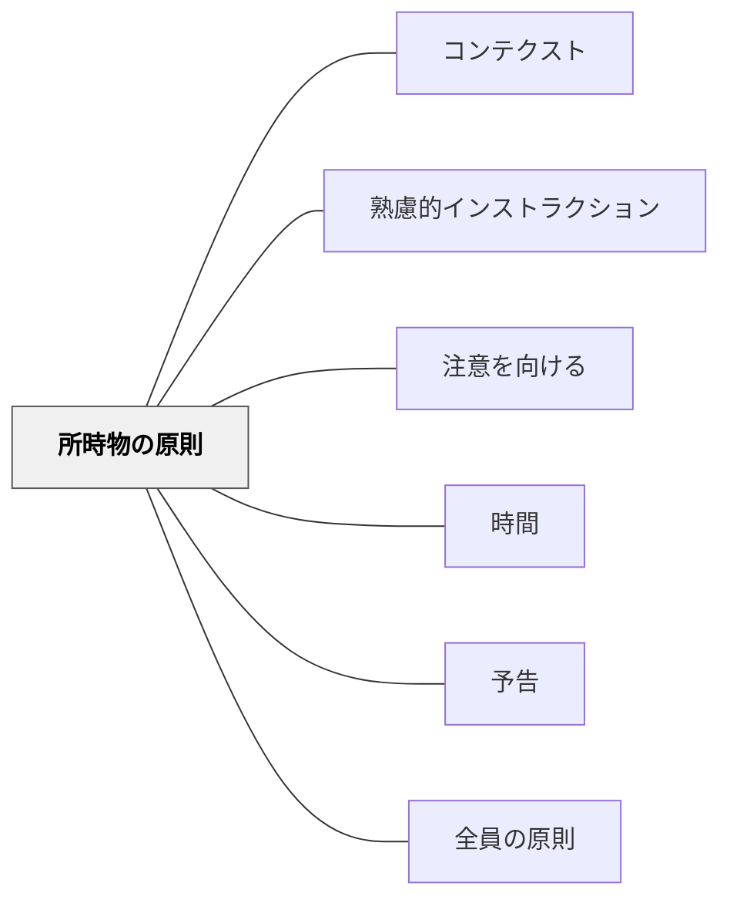

# 所時物の原則

**このパタンが完成を助ける大きなパタン**：[[パタン/熟慮的インストラクション]]

> 場所・時間・物が揃ってから指示を出す。準備なき指示は伝わらない。

## 背景（Context）
所時物の原則は向山洋一（1985）『授業の腕をあげる法則』明治図書に示される10原則の一つである。「所（場所）・時（時間）・物（道具・教材）」の三要素が整ってからインストラクションを出すことが効果的な指示の前提条件となる。大森修の「教材研究とは物を用意することである」という言葉も、この原則の「物」の重要性を示す。

※旧パタン「指示前の準備」を本ページに統合（2026-11-12）。どちらも、指示の前に三点をそろえる同じ手だった。旧ページが加えていた「受け手の注意」（心理的な準備）と、準備の完了を目に見えるようにする手は、解決に移した。

## 問題（Problem）
道具がそろっていない、場所が決まっていない、時間的準備がない状態で指示を出すと、受け手は指示を聞きながら準備に追われ、肝心の内容が頭に入らない。「道具を出してから聞いてくれれば良かった」という後悔が生まれる。

## 力のかたち（Forces）
- 物的準備が整うと、受け手は指示に集中できる
- 場所（活動する空間）が曖昧だと、受け手の行動範囲が定まらない
- 時間の準備とは「心の準備」でもあり、予告と連動する
- 準備を整える時間そのものが、気持ちを切り替えるためのゆとりになる。ただし確認が多すぎると、活動の始まりが遅れてテンポが落ちる

## 解決（Solution）
**近いパタンとの見分け**：物・場所・時間、そして注意をそろえてから話し始めるのが本パタン（旧「指示前の準備」を統合）。注意を集める合図そのものは [[パタン/注意を向ける]]。指示の系列の全体の表は [[パタン/熟慮的インストラクション#近いパタンとの見分け|熟慮的インストラクション]] にある。

**指示を出す前に「場所は確保されているか」「必要な時間はあるか」「必要な道具・教材は手元にあるか」の三点を確認し、揃ってから指示を出す。**

たとえば「ノートを開いてから指示を出す」「グループの配置が決まってから活動の説明をする」「プリントを配り終えてから問題の説明をする」のように、準備が整った状態をつくってからインストラクションを始める。

**物と場所に加えて、注意もそろえる**（旧「指示前の準備」）：物理的な準備（所時物）と心理的な準備（[[パタン/注意を向ける]]）の両方がそろってから話し始める。「ノートと鉛筆を出したら手を置いてください」のように、準備ができたことを目に見える形にしてから指示に移る。活動の切り替わりでは「前の活動の道具を片付けて、新しい道具を出したら座ってください」と、片付けと準備を一組にして伝える。

## 結果（Consequences）
- 受け手がインストラクションの内容に集中できる環境が整う
- 指示の途中で「道具を出して」という中断が減る
- 教師の授業設計の質が上がり、活動の流れがスムーズになる
- 活動が始まってからの「先生、何するんですか？」が減り、受け手が「準備してから聞く」習慣を身につける

## クラスター図

## Actionable Insight

- 指示を出す前に「全員の手元に必要なものが揃っているか」を確認してから話し始める——物が揃った状態での指示が受け手の注意を内容に向かわせる
- 「場所・時間・物」の3つを指示の前に揃える習慣を授業設計に組み込む——3要素の確認が指示中断のリスクを排除しインストラクションの質を高める
- グループの配置・プリントの配布・道具の準備を「指示の前のルーティン」として定着させる——準備完了後の指示が学習活動のスムーズな開始を保証する

## 出典

- 一つの教育のパタン・ランゲージ（岩井輝久）

## 関連パタン
- [[パタン/コンテクスト]]
- [[パタン/熟慮的インストラクション]] — 親パタン
- [[パタン/注意を向ける]] — 物が揃った後に注意を集める
- [[パタン/時間]] — 所時物の「時」に対応するインストラクション要素
- [[パタン/予告]] — 心の準備を促す前段
- [[パタン/全員の原則]] — 準備が整ったことを全員で確かめる

