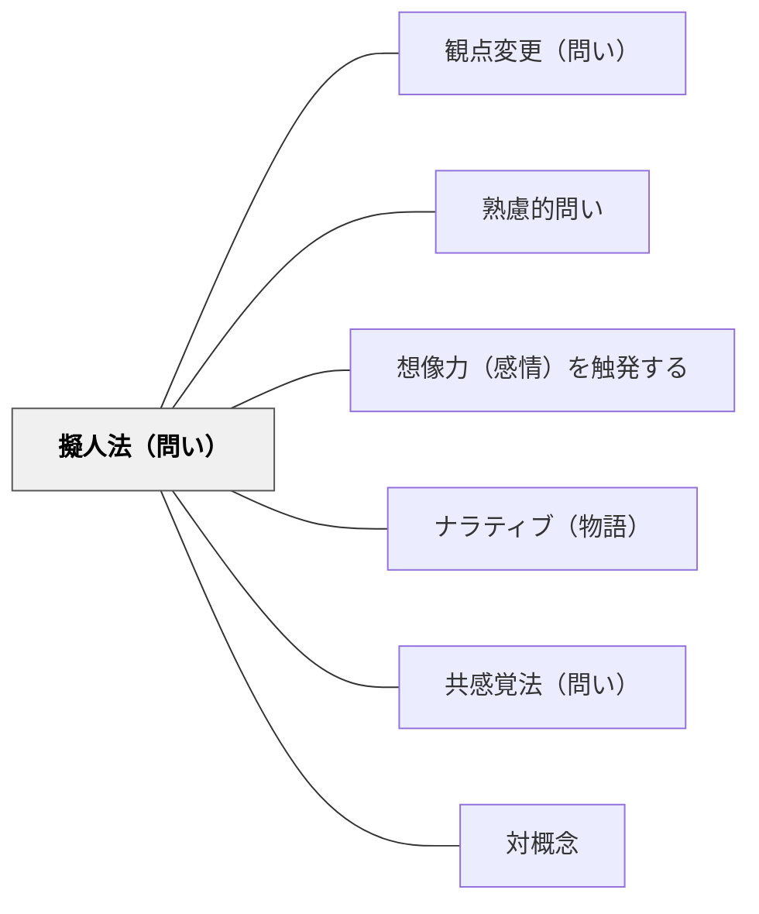

# 擬人法（問い）

> 人間に見立てることで問いに感情を込める

## 背景（Context）
擬人法は、非人間的な対象に人間の属性・感情・意志を与える修辞技法である。問いの形で用いると、概念・制度・自然現象などの「声なきもの」の視点を学習者が想像し、共感的に考える入口になる。原典では、問いの対象に感情を与えて、答える側に対象への思い入れを生む技法として説明されている（安斎 2021、第5章）。

**原典では**：安斎（2021）は擬人法を「光の色を変える」タイプのレトリックの一つとし、「人間でないものを、人間のようにたとえて表現するテクニック」で、比喩法の一種でもあると位置づける（第5章 MANNERS 16、Kindle版 84%）。例として、「もしあなたが社長だったら、この使われていない自社技術をどう活用しますか？」という問いは、やや無味乾燥で、対象に思い入れが湧きにくいとし、「自社技術」に「泣いている」「すっかり自信を無くした」「寂しそうな」といった感情を与えた言い換えを示す（同）。感情が表されると「なんとかしてあげたい」という気持ちが芽生えうる一方、「もっと俺を活かせ！」というセリフを込めると別のキャラクターが思い浮かび、挑戦的な発想が出るかもしれないと述べる（同）。どの感情を与えるかで、引き出される発想の向きが変わるということである。

**岩井の講話では**：安斎の本の一覧として「人間に見立てることで質問に感情を込める」と読み上げている（30:00〜30:06）。

## 問題（Problem）
概念や制度を客観的に分析するだけでは、その内側にある論理や矛盾に気づきにくい。学習者が感情的・身体的に問いに関わることができないと、議論が表面的な知識の整理に終わってしまう。擬人化という想像の足場がなければ、無生物や抽象物への深い思考が促されない。

## 力のかたち（Forces）
- 共感的想像力 vs 客観的分析
- 感情の関与 vs 批判的距離
- 創造的自由 vs 概念の正確な理解
- 内省的問い vs 外向きの議論

## 解決（Solution）
**近いパタンとの見分け**：問いの型の表では、本パタンの見分けの問いは「人に見立てて、気持ちを込めているか」。全体の表は [[パタン/熟慮的問い#近いパタンとの見分け|熟慮的問い]] にある。

原典の擬人法は、問い手が問いの中の対象に感情を与える技法である（「もしあなたが社長だったら、この寂しそうな自社技術をどう活用しますか？」）。学習者に対象の気持ちや声を想像してもらう次の問いは、その応用である。

「もしこの概念が話せたら、何と言う？」「この制度が生きていたら、今どんな気持ちだろう？」「自然が人間に問いかけるとしたら、どんな問いを投げかける？」のように、対象に人格・感情・声を与えて問う。回答の正誤より、想像の豊かさと理由の語りを大切にする。

---

**例：使われなくなった道具に気持ちを与えて問う**（生活科・2年）
1. 教室の隅で使われなくなっている道具（たとえば古い大なわ）を前に出し、「この大なわを、どうしたらまた使えるかな？」とまず問う。
2. 続けて「ずっとすみっこにいた大なわは、いま、どんな気持ちだと思う？」と問い、子どもが大なわの気持ちを一言ずつ言う。
3. 出た気持ち（「さみしい」「また遊びたい」など）を板書してから、「この大なわが喜ぶ使い方を考えよう」と問いを言い換える。
4. 子どもは使い方のアイデアを一つずつカードに書き、休み時間に一つ試してみる。

---

**例：川に語らせて、流れる水のはたらきを問う**（理科・5年）
1. 流れる水のはたらきの学習の後、「川の上流と下流のちがいは？」という問いを、「もし川が自分のことを話せたら、上流の自分と下流の自分をどう説明するだろう？」と言い換える。
2. 子どもは「上流の川」「下流の川」のどちらかになりきり、「ぼくは流れが速いので、石を…」のように、しん食・運ぱん・たい積の言葉を使って三文で書く。
3. 上流役と下流役で二人一組になり、書いた文を読み合ってから、教科書の写真や図で、説明が実際と合っているかを確かめる。

## 結果（Consequences）
- 学習者が感情と思考を結びつけて問いに向き合えるようになる
- 多様な解釈や価値観が可視化され、議論が深まる
- 普段は見えにくい構造や矛盾への気づきが生まれる

- 注意点：どんな感情やセリフを対象に与えるかで、引き出される発想の向きが変わる（「寂しそう」なら助けたくなり、「もっと俺を活かせ！」なら挑戦的な発想が出やすい）。問いの意図に合う感情を選ぶ。理科などでは、なりきった説明の後に、事実と合っているかを確かめる手順を入れる。

## 関連パタン
- [[パタン/観点変更（問い）]]
- [[パタン/熟慮的問い]] — 親パタン
- [[パタン/想像力（感情）を触発する]] — 擬人化という想像の足場が感情・想像力を動かす
- [[パタン/ナラティブ（物語）]] — 対象に声・人格を与えることは物語化の入口
- [[パタン/共感覚法（問い）]] — 感覚次元に翻訳して問う兄弟パタン
- [[パタン/対概念]] — 擬人化した声を対立する視点として問う応用

## クラスター図

## Actionable Insight

- 「もしこの制度が話せたら、何と言う？」と問うことで、学習者が感情と思考を結びつけて問いに向き合えるようになる——擬人化という想像の足場が概念への深い思考を促す
- 「自然が人間に問いかけるとしたら、どんな問いを投げかける？」と問う——声なきものの視点を想像させることで普段は見えにくい構造や矛盾への気づきが生まれる
- 回答の正誤より「なぜその想像をしたか」を語らせる——想像の理由の言語化が多様な解釈と価値観を可視化する

## 出典
- [[文献/熟慮的問いのパターンリスト（動画記録）]]

- 安斎勇樹（2021）『問いかけの作法 チームの魅力と才能を引き出す技術』ディスカヴァー・トゥエンティワン 第5章 MANNERS 16「レトリック（B-2）擬人法」 — Kindle版 84% で確認。[[文献/問いかけの作法（安斎勇樹）]]
- 岩井輝久（年不明）『熟慮的問いのパターンリスト』［動画］ https://youtu.be/WivskVtxG34 — 2026-11-13 に文字起こしで確認（30:00〜30:06）
