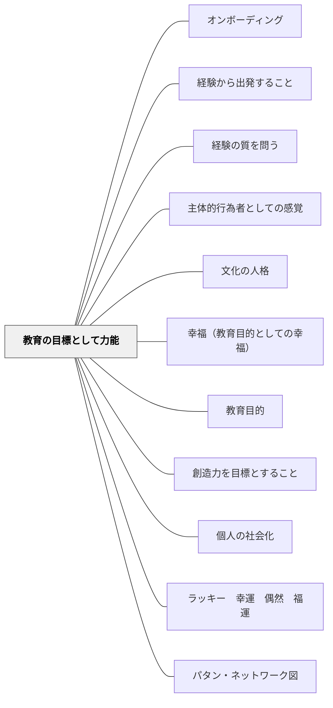

# 教育の目標として力能

**この考えが属するまとまり**：[[概念/教育思想の系譜#近いパタンとの見分け|教育は何のためか]]（教育思想の系譜）

> スピノザ哲学では「神すなわち自然（宇宙）」は無限の力能から成る実体であり、個物（人間を含む）はその表現としてそれぞれ独自の力能（なしうる力・コナトゥス）をもつ。教育の目的は、この力能を増大させること——より多くのことができるようになること——にある。

## 背景（Context）

スピノザの哲学が一言で形容されるように「神すなわち自然（宇宙）」は無限であり、その無限の自然／宇宙（すなわち神）は、無限の力能・属性から成る実体です。ここからスピノザは、私たちなどのあらゆる個物もこの神（自然／宇宙）の表現・変化であり、この世界の本質は力（力能）であると考えます。

力（力能）をもっています。太陽はこの世界を照らします。植物には光合成する力があります。この電子書籍も紙の本も書かれたものとして繰り返し読まれる可能性のあるものとしての機能（力能）があります。一つの本は読まれて、ある人には薬となるかもしませんし、毒となるかもしれません。食べ物は、その人に合えば力となります。このように、この自然のあらゆる存在は、神という無限の力能・属性からなる実体の現れ（変化・表現）であると考えると同時に、その現れ（私たちを含む個物）にも力能があると考えるのです。わたしたち個物が神（自然）の現れ（変化・表現）だというのは、國府功一郎さんが例として紹介していますが、シーツに襞ができるようなものです。ある時、シーツに襞ができて、ぴんとシーツが伸びると襞が消える。私たちも宇宙ではこのようなものだというのです。

ここからさらに「善悪は組み合わせによる相対的なものである」というスピノザの重要な考えが出てきます。

## 問題（Problem）

教育の目標をどこに置くべきか。知識の詰め込み・行動の制御・資格の取得が目標になると、学習者が実際に「何ができるようになったか」——すなわちその人の力能が増大したかどうか——が問われなくなる。よい教育とは何かという問いに対して、普遍的な答えを固定することも難しい。なぜなら、善悪は関係（組み合わせ）によって決まるからです。

スピノザはこの点について次のように述べます。

「我々は我々の存在の維持に役立ちあるいは妨げるもの〔・・・〕、言いかえれば〔・・・〕我々の活動能力を増大しあるいは減少し、促進しあるいは阻害するものを善あるいは悪と呼んでいる。」（スピノザ『エチカ』第四部定理八証明）

力能と活動能力は同じ意味だと考えてください。わたし達の力能を増大するものが善で、減少するものが悪と呼ばれているのです。

例えば、音楽は落ち込んでいるときに力となってくれるかもしれません。しかし、疲れすぎているときには、うるさく感じ、私たちの力を低下させるかもしれません。

良書はそもそもあるのだろうか——という問いもここから生まれます。

## 力のかたち（Forces）

- 教育の目標は、知識の量ではなく、その人の力能（活動能力）が増大したかどうかで問われる（原稿）
- 善悪は関係（組み合わせ）で決まる。同じ音楽が、ある時は力になり、ある時は力を下げる（原稿・スピノザ）
- そのため、どの学習者にも「よい」教材や良書を固定して決めることは難しい（原稿の良書の問い）
- 幸福な生活も自由も喜びも人格の完成も、力能を発揮した結果にある（原稿「経験から出発すること」の冒頭）

## 解決（Solution）

良書が力能を増大させることもあれば、減少させることもあります。その本が力となるかは、その本と人の組み合わせ・関係によって決まります。もし良書があるとしたら、良書とは、多くの人にとって良い本であると言えるかもしれません。その関係によっては、善くも悪くもない組み合わせもあります。文字が読めない人には、本の文字はインクのしみに過ぎないでしょう。

あまり綺麗な例ではありませんが、便秘の薬は、便秘の人には薬として働きますが、健康な時に飲むと、便が緩くなりすぎて毒となるかもしれません。

この善悪は関係である、組み合わせであるという考え方は教育においても、とても重要です。この考え方から、全ての人に絶対に善い教育は存在しないということ、またいわゆる個別的な教育が必要であることが言えるからです。これは個別的な教育だけでよいということではありません。状況に応じて、人間に共通するところに訴えるような工夫を重ねると同時に、差異に応じた個別的な教育が必要であるということが理論的に言えると思います。

よい教育とは、何か。私は、スピノザの哲学をふまえて、力能を増大させる教育が、よりよい教育であると考えます。そのよい教育は、先ほどの食べ物や音楽の例と同様に、教育と被教育者との関係・組み合わせによって決まるのです。ただ力能が増大すれば、その教育のプロセスがどうでもいいのかということではありません。そのプロセスがいくら楽しくて幸せでも（もちろん楽しくて幸せな方がいいです！）、子どもの力能の増大に繋がらなければ、よい教育とは決して言えないということです。

「教育は児童に幸福なる生活をなさしめるのを目的とする」牧口常三郎

牧口常三郎は、教育の目的は、児童の幸福な生活にあると考えました。この幸福な生活があるとしたら、それはその人の力能が十分に発揮された状態——コナトゥスが阻害されず、なしうることを実際になしている状態——と解釈できます。力能の増大とは、単に知識・技能が増えるということではなく、「生きたいと思う人生を実際に生きられる力」が育つことです（アマルティア・センのケイパビリティ・アプローチとも接続します）。

**教師の手立て（コナトゥス論的アプローチ）**

---

**手立て1: 力能の言語化**  
単元の始めと終わりに「あなたは今回の学びで、何が前よりできるようになりましたか」と問う。「知っている」ではなく「できる・なしうる」の言語で自己評価を促す。

---

**手立て2: 阻害要因の除去**  
力能が増大しない原因は、しばしば内容ではなく環境にある。「なぜ力にならないのか」を「組み合わせ・関係」の視点で問い直す。この子にとってこの課題・この場・この教師はどのような関係か。

---

**手立て3: 個別の組み合わせを試す**  
「全員に同じ教育が善い」という前提を手放し、同じ目標に向かう複数の経路を用意する。Mild / Main / Spicy の3段階タスク設計は、「力能を引き出す組み合わせ」を試みる具体的な実装。

**近いパタンとの見分け**：教育思想・教師の構えの表では、本パタンの見分けの問いは「その教育が、この子の力能（なしうる力）を増やす組み合わせになっているかを見ているか（岩井・スピノザ）」。全体の表は [[概念/教育思想の系譜#近いパタンとの見分け|教育思想の系譜]] にある。

---

### 岩井の原稿から（教育の目標としての力能）

（原稿のうち、すでに本ページの上の節にそのまま入っている段落は、ここでは繰り返さない。）

「曙の光は、立ちのぼる時には断じて立ちのぼる」ユゴー

（原稿では、ここにベルクソン（渡辺秀訳『ベルクソン全集第五巻』白水社）からの引用が入っている。長い引用は wiki には載せない。）

「教育はその人がそのなりうる最善のものとなり、その人が潜在的に深く蔵している本質を、現実にあらわすのを助けるべきである」（マズロー『創造的人間』佐藤三郎・佐藤全弘訳、誠信書房）

「教育の目的は、生徒の自己発展を刺激し誘導することにある」（ホワイトヘッド、杉本正二訳『教育の目標』万流社、1981年）

「理想を高くせよ、敢て野心大ならしめよとは云はず、理想なきものの言語動作を見よ、醜陋の極なり、理想低き者の挙止容儀を観よ、美なる所なし、理想は見識より出づ、見識は学問より生ず、学問をして人間が上等にならぬ位なら、初から無学で居る方がよし」夏目漱石

「学問は綱渡りや皿回しとは違う。芸を覚えるのは末のことである。人間が出来るのが目的である。大小の区別のつく、軽重の等差を知る。好悪の判然する、善悪の分界を呑み込んだ、賢愚、真偽、正邪の批判を謬まらざる大丈夫が出来上がるのが目的である。」夏目漱石

「定理５２　自己満足は理性から生ずることができる。そして理性から生ずるこの満足のみが、存在しうる最高の満足である。」（スピノザ『エチカ』第四部定理五十二）

「肝要なことは、われわれ全部が、ひとりひとり各人が、より賢明になることである」（原佑・飯島宗亭「アドラーの書」、『キルゲゴールの講和・遺稿集９』所収）

「人がこの世界でできることは、世界を正しい方向に一インチでも動かそうとする努力だ。それができれば、人は多くのことをやり遂げたことになる」ブーバー

「真の賢者はつねに喜々としている」トルストイ

（原稿では、ここにデカルト『方法序説』（岩波文庫）38頁からの引用が入っている。長い引用は wiki には載せない。）

「私の苦悩の体験が、私の利益になる。

そのおかげで、人を助けることができるのだ」ゴーゴリ

（原稿では、ここにヒルティからの引用が入っている。長い引用は wiki には載せない。）

 「太陽よ　万歳！

　闇よ　消え去れ！」プーシキン

　スピノザの力能という概念から教育理論や実践の歴史を見直した時に、今あるすべての教育哲学を根本的に刷新できることを見出しました。現在の中に過去があり、スピノザの力能という概念は、これまでのすべての教育理論や実践の原理となるものだと考えています。スピノザの力能という概念から教育を見直せば、また違った教育の世界が出てきます。そもそもスピノザの哲学を学ぶことで、私たちが生きている自然（宇宙）そのものを新しく捉え直すことになります。その新しい世界観の中で、自ずと教育の概念は新たな位置付けで再構成されることになるでしょう。

　スピノザの力能という概念を、大雑把には、「能力」とか「力」という意味です。また力能とは、なしうる力であると説明されることがあります。しかし、あらゆる概念は、歴史をもっていて、他の概念と関係し合っています。力能は能力であるとか、力であるとか、そういった辞書のような意味以上の意味を含んでいるのです。

　例えば、文科省から「資質・能力」という概念が打ち出されました。公教育に携わる人は、この概念を特に理解する必要があるでしょう。資質・能力のような概念をこれまで打ち出されたことはなかったのでしょうか。例えば似たようなもので生きる力という概念が謳われたことがありました。この資質・能力という概念も、生きる力が出てきたときの議論を踏まえて、作られた概念です。こういういった概念の歴史を踏まえ理解した上で、個々の教師は、自分でもう一度、能力とはなんだろうか、力とはなんだろうかと考えてみる必要があると思います。スピノザの力能について考えることで、この「資質・能力」を相対化する視点をもつことにも繋がります。

　はじめに色々な言葉を紹介したのは、力能を教育の目標とすることについて理解するのを助けてくれるだろうと考えたからです。これらの言葉と力能の関連を説明しながら、自分の伝えたいことが少しでも伝わればと思っています。

「曙の光は、立ちのぼる時には断じて立ちのぼる」ユゴー

　スピノザの哲学は、「神は無限」であるという世界観が出発点にあります。ただし、この神は、神すなわち自然とスピノザの哲学が一言で形容されるように自然（宇宙）のことです。この無限の自然／宇宙（すなわち神）は、無限の力能、属性から成る実体です。ここからスピノザは、私たちなどの、あらゆる個物もこの神（自然／宇宙）の表現、変化であり、この世界の本質は力であるとスピノザは考えます。例えば、この世界のあらゆるものは力（力能）をもっています。太陽はこの世界を照らします。植物には光合成する力があります。この電子書籍も紙の本も書かれたものとして繰り返し読まれる可能性のあるものとしての機能（力能）があります。一つの本は読まれて、ある人には薬となるかもしませんし、毒となるかもしれません。食べ物は、その人に合えば力となります。このように、この自然のあらゆる存在は、神という無限の力能、属性からなる実体の現れ（変化・表現）であると考えると同時に、その現れ（私たちを含む個物）にも力能があると考えるのです。わたしたち個物が神（自然）の現れ（変化・表現）だというのは、國府功一郎さんが例として紹介していますが、シーツに襞ができるようなものです。ある時、シーツに襞ができて、ぴんとシーツが伸びると襞が消える。私たちも宇宙ではこのようなものだというのです。

　ここからさらに善悪は組み合わせによる相対的なものだというスピノザの重要な考えが出てきます。

　良書はそもそもあるのだろうか、良書とはなんだろうかという問題があります。スピノザの哲学からは、どの人にとっても良い本は存在しないと考えることができます。多くの人にとって良い本はあるかもしれません。ある一つの同じ本は、その人の力を増大させることもあれば、減少させることもあるからです。その本が力となるかは、その本と人の組み合わせ、関係によって決まります。もし良書があるとしたら、良書とは、多くの人にとって良い本であると言えるかもしれません。その関係によっては、善くも悪くもない組み合わせもあります。文字が読めない人には、本の文字はインクのしみに過ぎないでしょう。

　よい教育とは、何か。私は、スピノザの哲学をふまえて、力能を増大させる教育が、よりよい教育であると考えます。そのよい教育は、先ほどの食べ物や音楽の例と同様に、教育と被教育者との関係によって組み合わせによって決まるのです。ただ力能が増大すれば、その教育のプロセスがどうでもいいのかということではありません。そのプロセスがいくら楽しくて幸せでも（もちろん楽しくて幸せな方がいいです！）、子どもの力能の増大に繋がらなければ、よい教育とは決して言えないということです。

　牧口常三郎は、教育の目的は、児童の幸福な生活にあると考えました。この幸福な生活があるとしたら、それはその人の力能が十分に発揮された結果／過程にあると言えます。

　スピノザは、喜びを力能という概念の関係からどのように考えていたのかということが、ここに関連してきます。スピノザによれば、喜びとは自分の力能が発揮され実現されることです。

（原稿では、ここにベルクソン（渡辺秀訳『ベルクソン全集第五巻』白水社）からの引用が入っている。長い引用は wiki には載せない。）

牧口常三郎もベルクソンと同様に創造すること、創造力が重要だと考えていました。この創造する力は、力能の一部を発揮し実現するものです。

「教育はその人がそのなりうる最善のものとなり、その人が潜在的に深く蔵している本質を、現実にあらわすのを助けるべきである」（マズロー『創造的人間』佐藤三郎・佐藤全弘訳、誠信書房）

スピノザによれば、本質とは力でした。このマズローの言葉の「本質」を「力能」という言葉にして「教育はその人がそのなりうる最善のものとなり、その人が潜在的に深く蔵している力能を、現実にあらわすのを助けるべきである」と言い換えることができます。

「肝要なことは、われわれ全部が、ひとりひとり各人が、より賢明になることである」（原佑・飯島宗亭「アドラーの書」、『キルゲゴールの講和・遺稿集９』所収）

民主主義が衆愚政治に陥らないためには、一人一人が賢明に力能を増大していくことが大切です。一人一人が強く賢くなり、団結すれば、上に立つ人間は、威張ったり不正をしたりできなくなり、平等の関係ができるのです。

「理想を高くせよ、敢て野心大ならしめよとは云はず、理想なきものの言語動作を見よ、醜陋の極なり、理想低き者の挙止容儀を観よ、美なる所なし、理想は見識より出づ、見識は学問より生ず、学問をして人間が上等にならぬ位なら、初から無学で居る方がよし」夏目漱石

「学問は綱渡りや皿回しとは違う。芸を覚えるのは末のことである。人間が出来るのが目的である。大小の区別のつく、軽重の等差を知る。好悪の判然する、善悪の分界を呑み込んだ、賢愚、真偽、正邪の批判を謬まらざる大丈夫が出来上がるのが目的である。」夏目漱石

批判とは物事を吟味することです（単なる非難ではありません）。批判する力は力能の一部（実現）です。個についても社会についても、こうなりたい、こういう社会にしたいと理想を思い描く力、想像力も力能の一部（実現）です。

「定理５２　自己満足は理性から生ずることができる。そして理性から生ずるこの満足のみが、存在しうる最高の満足である。」（スピノザ『エチカ』第四部定理五十二）

　ここは『エチカ』の面白いところだと思います。よく見られるのは、自己満足は悪いことだという価値観です。しかし、自己満足は理性から生じるものです。他者の評価に一喜一憂し、浮き沈みしていくのは、不自由な生き方です。自己満足できるということは、自分の中に、何が良くて悪いのか物差しとなる基準をもって判断できるということです。理性から真に自己満足できる力のある人間を育てることが大切であると考えます。

「第一条　教育は、人格の完成を目指し、平和で民主的な国家及び社会の形成者として必要な資質を備えた心身ともに健康な国民の育成を期して行われなければならない。」

このように教育基本法には、教育の目的が明記されています。では、先ほどのベルクソンの言葉にも出てくる人格の完成とはなんでしょうか。もし仮に人格の完成というものあるとしたら、それは創造力などの力能が十分に発揮された結果だと言えるでしょう。教育の目的は、力能を増大して、人格の完成を目指すためにあると考えることができます。

　このようにこの文章は、「資質・能力」「生きる力」といった概念を相対化して、教育そのものを目的や目標から捉え直す試みでもありました。教育のパタン・ランゲージは自分にとって、この力能のためにあります。人格の完成も民主主義の成熟も喜び（幸せ）も力能を発揮する中にあります。法律では、人格の完成が目的とされていますが、仮に人格の完成というものがあるとしても力能が先（主）のなのです。

　スピノザの考える自由の状態とは、与えられている条件（自然や時代状況などすべて人に制約があります）の中で、自分の力能（力）をうまく発揮できることです。自由も力能が実現された結果としてのみ存在するので、自由と力能を比べても力能が先（主）です。

　牧口常三郎の教育の目的論も、以上他にも引用した教育の目的論もありましたが、教育の目的は、力能の増大の過程や結果、幸福な生活や人格の完成を目指すものであるとまとめられると考えます。この目的のために力能を発揮し実現できる教育がよりよい教育と言えるのです。

 「太陽よ　万歳！

　闇よ　消え去れ！」プーシキン

#### 【主な参考文献】

キエラン・イーガン（２０１０）『想像力を触発する教育　認知的道具を活かした授業づくり』北大路書房

キエラン・イーガン（２０１３)『想像力と教育』北大路書房

國分功一郎（２０１８）『１００分de名著　スピノザ　エチカ　「自由」に生きるとは何か』NHK出版

斎藤正二(2010)『牧口常三郎の思想』第三文明社

スピノザ／畠中尚志訳（１９５１）『エチカ』岩波書店

ドゥルーズ／鈴木雅大訳（２００２）『スピノザ』平凡社

奈須正裕（２０１７）『「資質・能力」と学びのメカニズム』東洋館出版社

ベルグソン／渡辺秀訳『ベルクソン全集第五巻』白水社

ホワイトヘッド／杉本正二訳（１９８１年）『教育の目標』万流社

牧口常三郎(1981)『牧口常三郎全集 第5巻』第三文明社

牧口常三郎(1983)『牧口常三郎全集 第６巻』第三文明社

牧口常三郎(1982)『牧口常三郎全集 第7巻』第三文明社

牧口常三郎(1984)『牧口常三郎全集 第8巻』第三文明社

マズロー／佐藤三郎・佐藤全弘訳（１９８１）『創造的人間』誠信書房

（以上、岩井の原稿「教育のパタン・ランゲージ 集約」の「教育の目標としての力能」（原稿 1535–1674 行）から。）

### 岩井の原稿から（パタン・ランゲージに関するツイート：スピノザの力能と牧口の生命の伸長）

やはりアレグザンダーとスピノザは結びつけて考えることができる。力を発揮したり伸ばしたりすることは生命の喜びなのだ。パタンが重なったよりよい教育の中にいる被教育者が生き生きとしていることは当然ではないか。

『時を超えた建設の道』では、無名の質を捉えるときにということで、いくつかの概念が説明されているのですが、もし教育をパタン・ランゲージで論じるなら、スピノザの「力能」と牧口の「生命の伸長」という概念を加えてもいいと思います。

（以上、岩井の原稿「教育のパタン・ランゲージ 集約」の「パタン・ランゲージに関するツイート」から。）

## 結果（Consequences）

- 学習者の力能（なしうる力）が増大する
- パタンの圧縮による教育の経済性が実現する
- 関連パタンと重ね合わせることで効果が高まる

## 関連パタン
- [[パタン/オンボーディング]]
- [[パタン/経験から出発すること]]
- [[パタン/経験の質を問う]]
- [[パタン/主体的行為者としての感覚]]
- [[パタン/文化の人格]]

- [[パタン/幸福（教育目的としての幸福）]] — ケイパビリティ・アプローチにおいて力能は幸福の構成要素
- [[パタン/教育目的]] — 力能の増大は教育目的の中心に据えられる
- [[パタン/創造力を目標とすること]] — 創造力は力能のうち最も人間的な次元
- [[パタン/個人の社会化]] — 個人の力能が社会参加の資源になる
- [[概念/パタン・ランゲージ概論]]
- [[パタン/ラッキー　幸運　偶然　福運]] — 偶然を受け取る力・人徳の蓄積も力能の増大として捉えられる
- [[パタン/パタン・ネットワーク図]] — 力能パタンを含む教育パタン・ネットワークの可視化

## クラスター図

## Actionable Insight

- 「この学習で学習者は何ができるようになるのか」を一文で書く——知識の習得より「力能（なしうる力）」の増大を目標の起点にする
- 子どもが「これが自分にとって何の役に立つのか」を言えるよう、授業の最初または最後に一緒に考える
- アマルティア・センのケイパビリティアプローチで問う：「この教育でその子が生きたいと思う人生を実際に生きられるようになるか」——答えが「No」なら目標を見直す

## 出典
- [[文献/教育のパタン・ランゲージ図解バージョン変遷記録（動画記録）]]
- [[文献/メタパタンのパターンリスト（動画記録）]]
- [[文献/一つの教育のパタン・ランゲージ]]

岩井輝久「岩井輝久『一つの教育のパタン・ランゲージ』」（2026-04-29 vault収録）
