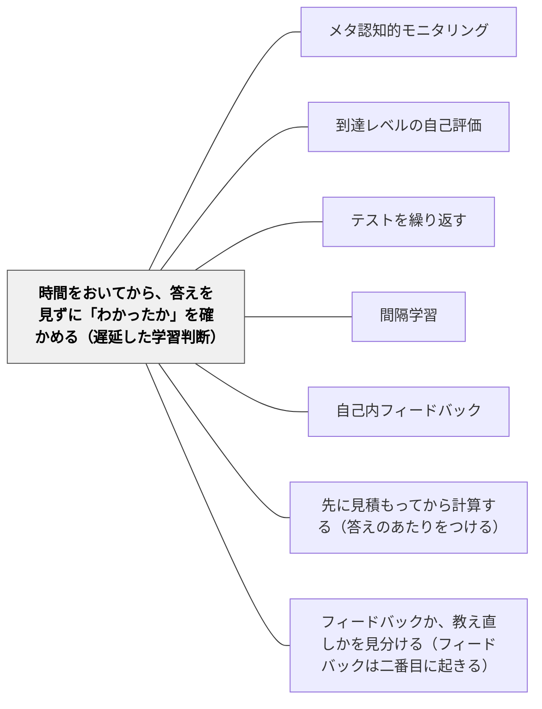

# 時間をおいてから、答えを見ずに「わかったか」を確かめる（遅延した学習判断）

> 勉強した直後に「わかった？」と聞けば、たいていの子は「わかった」と答える。翌日のテストで解けないと「あんなに勉強したのに」と驚く。わかったかどうかは、学んだ直後ではなく、時間をおいてから、答えを見ずに確かめると正確になる。

## [Pattern Connection]

[[文献/Organizing Instruction and Study to Improve Student Learning（Pashler et al., 2007）]] は、学習者の多くが、学び終えた直後には自分の習得度を高く見積もると書く（**分かったつもり**, p. 23）。そして、それを正す方法として、**時間をおいて、答えを見ずに判断する**手続き（遅延した手がかりのみの学習判断）を勧めた（勧め6a）。

> This research finds that, without training, most learners cannot accurately judge what they do and don’t know, and typically overestimate how well they have mastered material when they are finished studying. (p. 23)
>
> この研究によれば、訓練なしでは、多くの学習者は自分が何を知っていて何を知らないかを正確に判断できず、学び終えたときに、どれだけ習得したかをたいてい高く見積もる。

- **[[パタン/メタ認知的モニタリング]] との差分**：あちらは、学習中に自分の理解の状態を監視する力全般を扱う。本パタンは、その判断が**いつ・どう行われると正確になるか**という具体的な手続きを足す
- **[[パタン/到達レベルの自己評価]] との差分**：あちらは、到達の規準に照らして自分の作品や学びを評価する。本パタンは、規準ではなく**時間と手がかり**の条件で、判断の正確さを上げる
- **根拠の強さについて**：ガイドはこの勧めの根拠を **low** と評価している。証拠の多くは実験室での研究で、教室での実験は少ない（p. 23）。本パタンは、そのことを承知のうえで、低コストで試せる手続きとして置く

---

## 背景（Context）

授業の終わりに「今日のところ、わかった人？」と聞くと、多くの手が挙がる。ふり返りカードに「よくわかった」と書く子も多い。家で教科書を読み終えた子は、本を閉じて「理解した」と感じる。しかし次の日の授業で聞くと、思い出せないことが多い（Pashler et al., 2007, p. 24）。

学んだ直後は、内容がまだ頭の中に新しく残っていて、答えもそばにある。その状態での「わかった」は、あとで思い出せるかどうかの当てにならない指標である。

## 問題（Problem）

**学んだ直後に、答えが見える状態で「わかったか」を判断すると、判断は高すぎる。** 子どもは本当はまだ身についていないところを「わかった」と思い、学び直す時間をそこに使わない。

ガイドはさらに、年齢による差を報告している（p. 24）。7歳・9歳・大学生が絵を学んで思い出したあと、半分を学び直すために選ぶと、9歳と大学生は思い出せなかった絵を選んだが、7歳は最初の結果を無視して選んだ。3年生と5年生の研究では、どちらも分かっているかどうかは判断できたのに、3年生は学び直す項目をでたらめに選びがちだった。**分かっていないことに気づけても、それを学び直しの選択に使うのは、低学年では難しい**。

## 力のかたち（Forces）

- **直後の判断は気持ちがよい**：学んだ直後に「わかった」と感じることは、達成感になる。それを疑う手続きは、子どもには面倒に感じられる
- **答えが見えると判断が甘くなる**：答えや選択肢がそばにあると、自分で思い出せるかどうかではなく、見て分かるかどうかで判断してしまう
- **時間をおくと判断は正確になる**：時間をおき、手がかり（問い）だけを見て判断すると、どの年齢でも判断はかなり正確になる（p. 23–24）
- **判断を学び直しに使う力は、年齢で違う**：低学年の子は、分かっていないものを選んで学び直すことを自分ではしにくい

## 解決（Solution）

**「わかったか」の確かめは、学んだ直後ではなく、時間をおいてから行う。答えを隠して問いだけを見せ、「明日のテストで、これに正しく答えられそうか」を子どもに判断してもらう。判断が100でないものを、学び直しの対象にする。**

ガイドが3〜5年生の社会科の例として示す手順（p. 25）：

1. 新しい内容を教えてから**数日後**に、学習の時間を取る
2. 中心の内容をとらえる問いを10問ほど用意する
3. 問いを**答えなしで**一つずつ見せ、まず答えようとしてから、「明日のテストで正しく答えられる見込み」を0〜100で書いてもらう。「人は忘れるので、明日までに忘れる可能性も考えて」と伝える
4. 100をつけなかった問いについて、教科書を見る・先生に聞くなどして答えを確かめ、別の紙に書く
5. 同じ問いで、学期を通して繰り返す

読んだ内容の確かめには、**時間をおいたキーワード**の方法がある：教科書を読み終えたら別の宿題をし、そのあとで、本を見ずに白い紙に大事な言葉を4つ書く。書けなければ、もう一度読む（p. 25）。

---

### 具体例①：算数の単元の途中で——「明日、これ解けそう？」

分数の足し算の単元の途中、通分を学んで3日後の授業のはじめに、問題を3問だけ板書する（答えは書かない）。

- 「解かなくていいので、まず『明日のテストに出たら解けそうか』を、◎（きっと解ける）・○（たぶん）・△（自信がない）で書こう」
- そのあと実際に解いてもらう
- 「◎をつけたのに解けなかった問題」が、分かったつもりだった問題である。そこを今日の学び直しの中心にする

---

### 具体例②：低学年では、選ぶのを手伝う

2年生のかけ算九九で、子どもに「覚えていない段を自分で選んで練習しよう」と言っても、低学年の子は、得意な段や好きな段を選びがちである（ガイドの年齢差の報告と合う）。

- まず、九九カードを答えを隠して一枚ずつ見せ、言えたかどうかを子どもと一緒に◯✕で分ける
- 「✕のカードの山を練習しよう」と、学び直すものを**目に見える形で**分けてから練習に入る

判断と選択を切り離し、選択の部分を大人が支える。

---

### 具体例③：教科書を読んだあと——キーワードを4つ

社会科や理科の教科書を読む宿題で、読み終えた直後に「わかった」と思わせない工夫として、次の日の朝の会のあとに、教科書を閉じて「昨日読んだところの大事な言葉を4つ」書く時間を3分取る。4つ書けなかった子は、そのページをもう一度読む。

---

### 特別支援の視点

0〜100の数値の見込みは、抽象的で難しい子がいる。◎○△や、顔の絵（にこにこ・ふつう・こまった）で判断してもらう。判断のあとに、すぐ実際に解いて答え合わせをし、「にこにこだったけど、ちがった」を責めずに確かめる。分かったつもりに気づく経験は、それ自体が学びであり、失敗として扱わない。判断と学び直しの選択を一人で結びつけるのが難しい子には、具体例②のように、大人が選択を支える。

## 結果（Consequences）

**利点**

- 子どもが、分かったつもりだったところに気づき、学び直す時間をそこに使えるようになる
- 「わかった」という手応えと、実際に思い出せることの違いを、子どもが体験として知る
- 教師も、どこが身についていないかを、授業の終わりの挙手より正確につかめる

**注意点・リスク**

- **根拠は low である**：ガイドはこの勧めの根拠を低いと評価している。証拠の多くは実験室の研究で、教室での実験は少ない。教室で試し、子どもの判断が実際に正確になるかを記録する
- **判断を成績に結びつけない**：見込みの数値を評価に使うと、子どもは高く書くようになり、判断の意味がなくなる
- **低学年では判断だけでは足りない**：分かっていないことに気づけても、学び直しの選択に使えるとは限らない。選択を支える
- **時間をおく分、手間がかかる**：数日後に確かめの時間を取る計画が要る。[[パタン/間隔学習]] の復習の時間と兼ねると無理がない

## 関連パタン

- [[パタン/メタ認知的モニタリング]] — 自分の理解の状態を監視する力全般。本パタンは、その判断が正確になる時間と手がかりの条件を足す
- [[パタン/到達レベルの自己評価]] — 規準に照らした自己評価。本パタンは時間と手がかりの条件で判断の正確さを上げる
- [[パタン/テストを繰り返す]] — 答えを思い出す小テストは、何が身についていないかを見つける道具にもなる
- [[パタン/間隔学習]] — 時間をおいた確かめは、間隔をあけた復習の時間と兼ねられる
- [[パタン/自己内フィードバック]] — 自分で自分の理解を判断する内側の物差し。時間をおくと物差しが正確になる
- [[パタン/先に見積もってから計算する（答えのあたりをつける）]] — 解く前に「解けそうか」を判断する点で通じる。見積もりは答えの大きさ、本パタンは解ける見込み
- [[パタン/フィードバックか、教え直しかを見分ける（フィードバックは二番目に起きる）]] — 確信度を書くことで、誤答の種類を見分ける手順と組み合わせられる

## クラスター図

## Actionable Insight

- 授業の終わりの「わかった人？」を、数日後の授業のはじめの「この3問、明日解けそう？◎○△で」に置き換えてみる
- 教科書を読む宿題の翌朝に、本を閉じて大事な言葉を4つ書く時間を3分取る
- 低学年では、答えを隠したカードで「言えた」「言えなかった」を一緒に分けてから、言えなかった山を練習する

## 出典

Pashler, H., Bain, P. M., Bottge, B. A., Graesser, A., Koedinger, K., McDaniel, M., & Metcalfe, J. (2007). *Organizing instruction and study to improve student learning* (NCER 2007-2004). National Center for Education Research, Institute of Education Sciences, U.S. Department of Education.

> "This research finds that, without training, most learners cannot accurately judge what they do and don’t know, and typically overestimate how well they have mastered material when they are finished studying." (p. 23)
