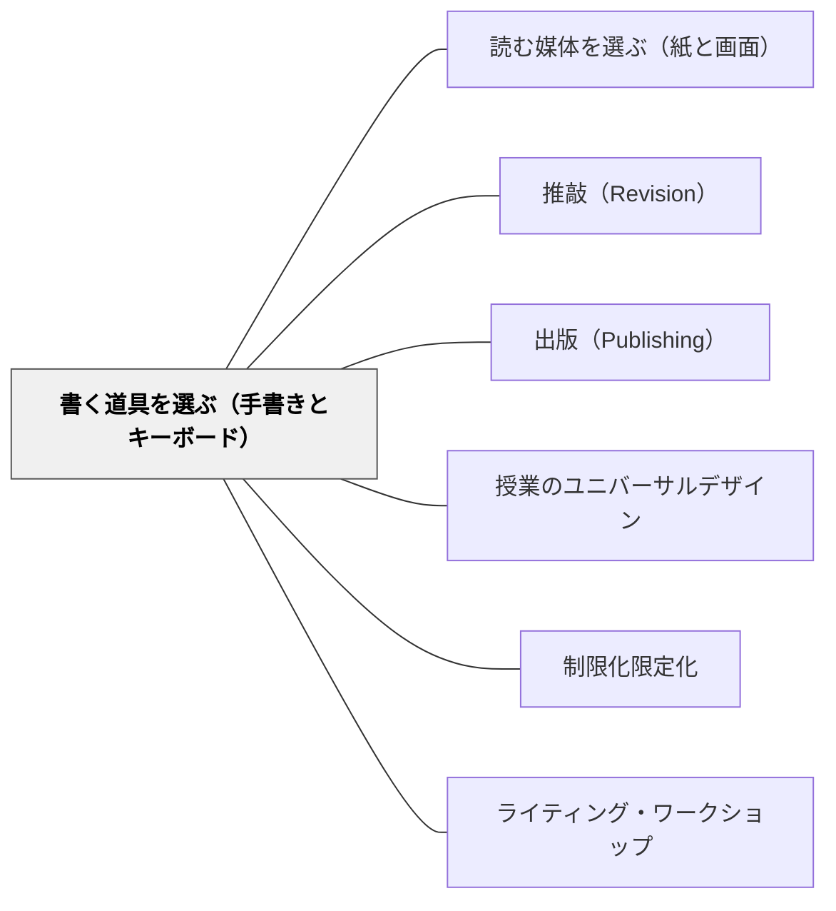

# 書く道具を選ぶ（手書きとキーボード）

**このパタンが完成を助ける大きなパタン**：[[パタン/熟慮的教材教具]]

> 手書きかキーボードかは、どちらが正しいかではなく、何を学ぶ時期に、何を書くかで選ぶ。何度も書き直して仕上げる作文は、キーボードの選択肢を。文字を覚える時期と、気を散らさずに考える時間は、手書きを。

## 背景（Context）

一人一台の端末が入り、作文もノートも、キーボード（や画面のキーボード）で書ける。手書きで書いていた時間の一部が、打つ時間に変わりつつある。コンピュータで書くことの効果を調べたメタ分析は、1990年代から出ている。

## 問題（Problem）

書く道具を考えずに決めると、どちらかの良さを手放す。全部を手書きにすると、何度も書き直す作文で、清書のたびに書き写す手間が子どもの考える時間を奪う。書くのが苦手な子ほど、その手間は重い。逆に全部をキーボードにすると、文字を覚える時期の手書きの練習が減り、端末のほかの機能が気を散らすこともある。

## 力のかたち（Forces）

- キーボードで書くと、文を足す・消す・動かすのがたやすく、読みやすい。書き直しが増え、読み合いもしやすい
- 研究では、コンピュータで書くことを学ぶと作文の量と質が上がったが、効果は小学生より中高生で大きかった
- 低学年は、文字の形とつづりを覚える時期で、手書きの書字を流暢にすることが勧められている
- 端末には、書くこと以外のものが多い
- キーボードを打つ速さが追いつかないと、考えより指が遅れる

> アナログな読書ノートは制限化だな。タブレットで読書記録する方法もあるけれど、タブレットには、余計なものが多すぎる。デジタルやタイピングの良さも捨て難いので、被教育者の状況にもよるか。（岩井の原稿から。[[パタン/制限化限定化]]）

## 解決（Solution）

**何を学ぶ時期に、何を書くかを先に決め、書く道具を選ぶ。何度も書き直して仕上げる作文（とくに中学年以上と、書くのが苦手な子）は、キーボードで書く選択肢を用意する。文字を覚える時期の練習と、考えを短くメモする場面は手書きにする。どちらで書いたかを記録しておく。**

| 書く場面 | 選び方 | 根拠 |
|---|---|---|
| 推敲を重ねて仕上げる作文（出版する作品） | キーボードで書く選択肢を用意する | コンピュータで書くことを学ぶと、質 d = .41・量 d = .50（Goldberg ほか 2003）。4〜12年生のワープロの効果 0.55（Graham と Perin 2007） |
| 書くのが苦手な子の作文 | キーボードや音声入力を選べるようにする | 成績の低い書き手では 0.70（Graham と Perin 2007）。書字に困難のある子の小集団の研究が多い（Graham ほか 2012） |
| 低学年の文字・つづりの練習 | 手書き | 書字・つづりを流暢にする勧めは、低学年の鉛筆の持ち方と文字の形を含む（Graham ほか 2012）。コンピュータの効果は小学生で小さい（Goldberg ほか 2003） |
| 考えを短く書き留める（読書ノート・メモ） | 手書きを基本に。端末なら書く画面だけを開く | 端末には余計なものが多い（岩井の原稿） |

**例（本 Wiki の想定）**
- 5年国語：意見文の単元で、下書きはノートに手書きで構成メモを書き、本文は端末で書く。読み合いのあと、段落を入れ替える推敲を端末で行う
- 2年国語：ひらがな・かたかなの練習と、短い日記は手書きで書く
- 4年：書くのが苦手な子には、作文の時間に、手書きか端末の音声入力かを選べるようにする。どちらで書いたかを作品に書き添える

---

**近いパタンとの見分け**：[[パタン/読む媒体を選ぶ（紙と画面）]] は読むときの媒体。本パタンは書くときの道具。読むことでは紙がやや有利という研究が多いが、書くことでは、作文の質はコンピュータが有利という古い研究と、差がない・手書きが有利という新しい研究があり、向きがそろっていない。

### 研究の裏づけ

- **コンピュータで書くことを学ぶ**：幼稚園〜高校の26研究のメタ分析で、コンピュータで書くことを学んだ子のほうが、作文の量（d = .50、14研究）も質（d = .41、15研究）も上だった。効果は小学生より中高生で大きく、推敲の回数も多かった。ただし1992〜2002年の研究で、キーボードという道具の効果と、読み合い・書きながら直すという授業の変化の効果は分けられない（[[文献/コンピュータで書くことを学ぶと、作文の量と質が変わるかを、1992〜2002年の研究で確かめる（Goldbergほか2003）|Goldbergほか2003]]、pp. 12–20）
- **ワープロの指導**：4〜12年生の18研究で、手書きと比べた効果は 0.55（本文は生徒全体 0.51、成績の低い書き手 0.70）（[[文献/作文指導の有効な要素を組み合わせる（Writing Next2007）|Writing Next2007]]、p. 17）
- **書字とタイピングを流暢にする**：小学生の作文の実践ガイドは、書字・つづり・文の組み立て・タイピングを流暢にすることを、根拠 moderate で勧める。根拠の9研究のうち7研究は、書くことに困難のある子の研究だった（[[文献/Teaching Elementary School Students to Be Effective Writers（Graham et al., 2012）|Graham et al., 2012]]、pp. 27–28）

## 結果（Consequences）

**よくなること**
- 何度も書き直す作文で、書き写す手間が減り、考えを直すことに時間を使える
- 書くのが苦手な子が、手書きの負担に邪魔されずに考えを書ける
- 書き直しと読み合いが増え、推敲が書く途中から始まる

**注意点・リスク**
- 本 Wiki がいま原典で読めているのは、コンピュータの側に有利な、少し古い研究だけである。新しいメタ分析では結論が割れている（下の「異論と反証」）
- 小学生では効果が小さかった。低学年の手書きを減らしてよい、という根拠にはならない
- 端末の書くこと以外の機能が、気を散らすことがある
- キーボードの効果に見えるものは、読み合いや書き直しが増えたという授業の変化の効果かもしれない

## 異論と反証

このパタンに反する研究・批判・訂正を、このページの中から集めた。くわしくは（ ）の節へ。考え方は [[異論と反証]]。

- **効く条件が限られる**：コンピュータで書くことの効果は、作文の量でも質でも、小学生より中高生で大きかった（[[文献/コンピュータで書くことを学ぶと、作文の量と質が変わるかを、1992〜2002年の研究で確かめる（Goldbergほか2003）|Goldbergほか2003]]・「研究の裏づけ」）。
- **逆効果の報告**：3年生72人の3年間の研究では、紙で書いた文章のほうが長く質も高く、コンピュータの文章は「ぎこちない」と評された（Shaw ほか 1994。[[文献/コンピュータで書くことを学ぶと、作文の量と質が変わるかを、1992〜2002年の研究で確かめる（Goldbergほか2003）|Goldbergほか2003]] による孫引き・「研究の裏づけ」）。
- **研究どうしの食い違い**：より新しいメタ分析は、小学生の作文で手書きとキーボードのどちらがはっきり上とは言えない（Malpique ほか 2023）、大学生のノートで差がない（Voyer ほか 2022）または手書きが有利（Flanigan ほか 2024）、と報告しているらしい。本 Wiki はどれも原典を読んでいない（要旨と紹介記事による）（「結果」）。

## 関連パタン

- [[パタン/読む媒体を選ぶ（紙と画面）]] — 読むときの媒体。書くことと研究の向きが違う
- [[パタン/推敲（Revision）]] — キーボードでは書き直しが増え、書きながら直すようになる
- [[パタン/出版（Publishing）]] — 仕上げて読み手に届ける作品は、キーボードで整えやすい
- [[パタン/授業のユニバーサルデザイン]] — 手書きの代わりにキーボードや音声入力を認める
- [[パタン/制限化限定化]] — アナログのノートは、端末の余計なものを外す制限化
- [[パタン/ライティング・ワークショップ]] — 書く道具の選び方が働く、書く時間の全体

## クラスター図

## Actionable Insight

- 次の作文の単元で、推敲の回だけ端末で書く選択肢を出し、どちらで書いたかを作品に書き添えてもらう
- 書くのが苦手な子一人に、音声入力かキーボードを試してもらい、書けた量と中身を手書きのときと比べる
- 低学年の文字の練習と短い日記は、手書きのまま守る
- 端末で書くときは、書く画面だけを開いておく約束を作る

## 出典

- Goldberg, A., Russell, M., & Cook, A. (2003). The effect of computers on student writing: A meta-analysis of studies from 1992 to 2002. *Journal of Technology, Learning, and Assessment*, 2(1). → [[文献/コンピュータで書くことを学ぶと、作文の量と質が変わるかを、1992〜2002年の研究で確かめる（Goldbergほか2003）]]
- Graham, S., & Perin, D. (2007). *Writing next*. Alliance for Excellent Education. → [[文献/作文指導の有効な要素を組み合わせる（Writing Next2007）]]
- Graham, S., et al. (2012). *Teaching elementary school students to be effective writers*. Institute of Education Sciences. → [[文献/Teaching Elementary School Students to Be Effective Writers（Graham et al., 2012）]]

## 根拠の確かめ（自動生成）

<!-- source-check: 自動生成。手で編集しない。文献ページの frontmatter の source_check から作る -->
このページが引く文献を、本 Wiki が原典でどこまで確かめたかで分けた。くわしくは各文献ページの「書誌・確認した範囲」や「原文との照合」へ。

- **原典照合**（原典にあたって、引用や要約を照らした）：[[文献/コンピュータで書くことを学ぶと、作文の量と質が変わるかを、1992〜2002年の研究で確かめる（Goldbergほか2003）|Goldbergほか2003]]
- **一部照合**（原典の一部の章や頁だけを読んで確かめた）：[[文献/作文指導の有効な要素を組み合わせる（Writing Next2007）|Writing Next2007]]・[[文献/Teaching Elementary School Students to Be Effective Writers（Graham et al., 2012）|Graham et al., 2012]]
