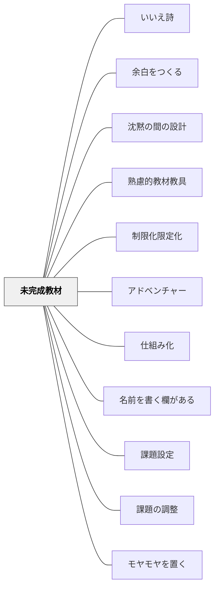

# 未完成教材

## 背景（Context）

[[パタン/余白をつくる]] として、子どもが自分の思考・感覚・選択を持ち込める「間」を教材に設けたい。完成した教材は使いやすいが、すべてが埋まっていると、子どもが入り込む余地がない。「まだ終わっていない・まだ埋まっていない」という状態が、学習者を能動的な参加者にする。自己決定理論（デシとライアン）の言う「自律性」の支えでもある。学習者が選択・決定・表現の自由をもてるとき、内発的動機は高まる。

※旧パタン「自分のやり方で自由にできる（考える余地がある）」を本ページに統合（2026-11-12）。どちらも、教材に意図的な余地を残し、子どもが自分の解釈・表現・やり方で埋める手（自由記述欄という例まで同じ）だったため一枚にした。熟慮的教材教具の「教材設計の原則」の表では旧名のまま並べている。

## 問題（Problem）

ワークシートや教材が細かく設計されすぎると、子どもは「答えを書き込む作業者」になる。自分で考える必要がなく、教材の指示通りに動くだけになる。その結果、「やった」という記録は残るが、深い理解や創造的な思考は育たない。

## 力のかたち（Forces）

- 完成した教材は使いやすいが、主体性の余地を奪う
- 空きが多すぎると、何をすればいいかわからず動けなくなる
- 「どこをどう埋めるか自分で決める」という経験が自律性を育てる
- 未完成の状態は「不安」でもあり「可能性」でもある——設計次第でどちらにもなる
- 適度な制約の中の自由が、最もよく働く

## 解決（Solution）

**近いパタンとの見分け**：教材に空きを残し、子どもが自分の考えややり方で埋めるのが本パタン（旧「自分のやり方で自由にできる」を統合）。終わりに解けない問いを残すのは [[パタン/モヤモヤを置く]]、時間と空間の余白は [[パタン/余白をつくる]]。教材の系列の全体の表は [[パタン/熟慮的教材教具#近いパタンとの見分け|熟慮的教材教具]] にある。

**教材に意図的な「空き」「未完成の部分」を残し、学習者がそこを自分の思考・表現・選択で埋めるように設計する。**

「空き」は偶然ではなく、意図的な設計として位置づける。何を空けるか（情報・手順・結論・表現）によって、促される思考の種類が変わる。

**実践例：**
- ワークシートに「自由記述欄」を設ける（「もう一つ気づいたことは？」「自分の言葉で書くと？」）
- 文の途中で終わる穴埋めではなく「この先どうなると思う？」という開放的な問いを置く
- 算数の練習プリントに「自分で問題を作る」欄を1問入れる
- 図や絵の一部を空白にして「続きを描く」活動をつくる
- 授業のまとめを「教師が書かず、子どもが自分の言葉で書く」形にする
- 実験の手順を途中まで示し「この後どうすれば確かめられる？」と子どもに委ねる
- 「何を学ぶかは決まっているが、どう表すかは自由」と、表現形式やアプローチを子どもが決める欄を一つ置く（旧「自分のやり方で自由にできる」）

## 結果（Consequences）

- 「自分の考えが入る場所がある」という感覚が、学習への参加感・主体性を高める
- 多様な答えが生まれ、比較・対話・精緻化の素材になる
- 教師は「子どもが何を考えているか」を未完成部分の記述から読み取れる
- 「完成させる」喜びと「自分で決めた」達成感が重なる
- 多様な学習者のやり方が尊重され、内発的動機が高まる

## このパタンが働く教材

| 教材 | どのように未完成教材として働くか |
|------|----------------------------------|
| [[教材/6つの部屋の詩ワークシート]] | 書く欄を最小限の言葉だけで開き、子どもが自分の経験・感覚・キーワードで空白を埋める |

## クラスター図

## Actionable Insight

- ワークシートに「自分の言葉で書くと？」という自由記述欄を1カ所加える——空きがあることで「自分の考えが入る場所がある」という参加感が生まれる
- 算数練習プリントの最後に「自分で問題を1問作る」欄を追加する——空白を埋める主体性が深い理解をもたらす
- 授業のまとめを「教師が書かず、子どもが自分の言葉でノートに書く」形に変える——完成を子どもの手で行うことで達成感と自律性が育つ

## 出典

- 一つの教育のパタン・ランゲージ（岩井輝久）
- 鈴木克明（2002）『教材設計マニュアル――独学を支援するために』北大路書房（旧「自分のやり方で自由にできる」）

## 関連パタン
- [[実践/詩を紹介する・詩を創作する]]
- [[パタン/いいえ詩]]

- [[パタン/余白をつくる]] — 学びの「間」を意図的につくる上位パタン
- [[パタン/沈黙の間の設計]] — 時間の余白と教材の余白は相補的
- [[パタン/熟慮的教材教具]] — 未完成は教材のアフォーダンスの一形態
- [[パタン/制限化限定化]] — 制約と余白は表裏——どこを制限しどこを開けるかが設計の核心
- [[パタン/アドベンチャー]] — 未完成の教材は冒険の入り口になる
- [[パタン/仕組み化]]
- [[パタン/名前を書く欄がある]] — 主体性の確保
- [[パタン/課題設定]] — 自律性のある課題設計
- [[パタン/課題の調整]] — 柔軟な課題への対応
- [[パタン/モヤモヤを置く]] — 終わりに解けない問いを残す余地
- [[文献/Self-Determination Theory（Ryan & Deci, 2000）]] — 自律を支える教師のもとで内発的動機づけと概念的な学習が高まる

