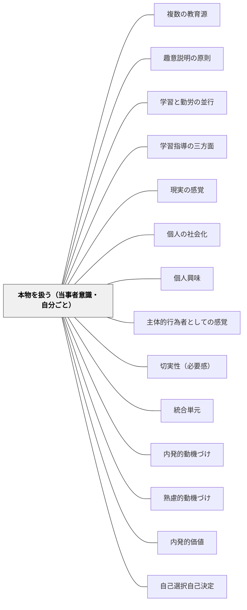

# 本物を扱う（当事者意識・自分ごと）

**このパタンが完成を助ける大きなパタン**：[[パタン/熟慮的動機づけ]]・[[パタン/作ることで学ぶ]]

> 本物の課題・リアルな問題に向き合うとき、人は「傍観者」でいられなくなる。当事者意識が、内発的な学習の起爆剤になる。

## [Pattern Connection]

**研究からの補足（2026-10-19）：活動と文化の中で使える知識を育てる（Brownほか1989）**

Brownほか（1989, pp. 33–35）は、真正な活動を文化の中で意味をもつ実践として論じる。Wiki側の適用案として、本物の資料を用意するだけでなく、誰のどんな問いに答えるのか、何を根拠に判断するのかを明確にする。例えば読む相手の疑問をもとに説明文を修正する。現実の複雑さをそのまま与えることや専門家の方法を無支援で再現させることとは区別する。 出典：[[文献/活動と文化の中で使える知識を育てる（Brownほか1989）]]。

## 背景（Context）
プロジェクト学習・探究学習において、学習者が「自分ごと」として問題に向き合えるかどうかが、動機の深さを大きく左右する。本物（authentic）の課題・素材・聴衆・プロセスは、学習の意味と当事者意識を高める。

## 問題（Problem）
教科書の練習問題や模擬的な課題では、「これは学校の中だけの話だ」という感覚が生まれやすい。本物感がない学習は形式的になり、解けばそれで終わりという受動的な関与にとどまる。

## 力のかたち（Forces）
- 本物の課題は複雑で、すべてを「正解」に向けてコントロールするのが難しい
- 本物に触れることで、予期せぬ学びや問いが生まれる豊かさがある
- 本物の聴衆（学校外に発表する・誰かの役に立つ）が当事者意識を強める
- 本物と向き合うことで、失敗や困難も「リアルな経験」として意味を持ちやすい

## 解決（Solution）
**学習者が直面する課題・素材・成果物の受け手を「本物」に近づけることで、「これは自分に関係がある」という当事者意識と動機を生み出す。**

**近いパタンとの見分け**：課題・素材・受け手を本物にするのが本パタン。「必要だ」と感じる入口は [[パタン/切実性（必要感）]]、単元の終わりの本物に近い課題を先に決めるのは [[パタン/パフォーマンス課題]]。探究・課題の系列の全体の表は [[パタン/作ることで学ぶ#近いパタンとの見分け|作ることで学ぶ]] にある。

地域の実際の問題を課題にする、本物の専門家に発表する機会を設ける、制作物が実際に使われる状況をつくる、フィールドワークや実際の素材に触れる機会を取り入れるなどが有効である。

> **研究の裏づけ（2026-10-31）**：『How People Learn』（2000）は、ボストン近くの学校で、ハイチ・クレオール語を話す7・8年生が「3階の水飲み場の水がいちばんおいしい」という自分たちの思いこみを確かめた探究を紹介する。目かくしの味見をすると、中学生約40人のうち88％が3階の水が好きだと答えたのに、実際には55％が1階の水を選んだ（偶然なら33％）。生徒は驚き、酸性度・塩分・水温・細菌を調べ、1階の水が華氏で20度冷たいことから、温度が好みを決めているのではないかと考えた（pp. 176–177、囲み7.4）。9月と6月の面接では、検証できる仮説を立て、実験で確かめる考え方が育っていた（pp. 184–187）。ただし報告書は、生徒の説明に、飲み水の浄化と海の浄化を取り違える誤りも残っていたと書く（p. 185）。出典：[[文献/人の学び方の研究を授業の設計につなぐ（全米研究評議会2000）]]。

> **研究の裏づけ（2026-10-31）**：アメリカの全米数学諮問委員会の最終報告（2008）は、「実生活の」文脈で算数を教えた研究を検討した（基準を満たした研究は10件、メタ分析できたのは4件）。実生活の文脈で教えると、似た文脈の問題はよく解けるようになったが、計算・簡単な文章題・方程式の成績は上がらなかった（pp. 49–50）。「実生活」の意味は研究者によってまちまちで、教師の実施の仕方も測りにくいと断ったうえで、この結果は広い政策の根拠には足りないとする（p. 50）。本物の文脈は、ねらう力に合わせて使い、別の力の練習と組み合わせる。出典：[[文献/算数の土台を研究から絞り込む（全米数学諮問委員会2008）]]。

## 結果（Consequences）
- 学習者が学習の目的を「テストのため」でなく「実際の問題を解くため」として捉えるようになる
- 本物への関与が深い理解・多角的な思考・創造性を促進する
- 学習の成果が実社会とつながることで、達成感と有能感が高まる

## クラスター図

## Actionable Insight

- 地域の実際の問題（環境・まちづくり・社会課題）を学習の課題にする——本物の課題が「これは学校の中だけの話」という感覚を払拭し当事者意識を生む
- 制作物が実際に使われる状況をつくる（地域への展示・当事者への発表・実物の配付）——本物の受け手がいることが学習の質と責任感を根本から変える
- フィールドワークや実際の素材に触れる機会を1単元に1回取り入れる——本物に向き合う体験が予期せぬ学びと問いを生む豊かさをもたらす

## 出典

- 一つの教育のパタン・ランゲージ（岩井輝久）

## 関連パタン
- [[パタン/複数の教育源]]
- [[パタン/趣意説明の原則]]
- [[パタン/学習と勤労の並行]]
- [[パタン/学習指導の三方面]]
- [[パタン/現実の感覚]]
- [[パタン/個人の社会化]]
- [[パタン/個人興味]]
- [[パタン/主体的行為者としての感覚]]
- [[パタン/切実性（必要感）]]
- [[パタン/統合単元]]
- [[パタン/内発的動機づけ]]
- [[パタン/熟慮的動機づけ]] — 親パタン
- [[パタン/内発的価値]] — 関連パタン
- [[パタン/自己選択自己決定]] — 関連パタン
- [[パタン/R1.ゴールと関連づけること（目的思考性）]] — 関連パタン（ARCSとの接点）
- [[パタン/パフォーマンス課題]] — 関連パタン
- [[パタン/フィールドワークの段取り]] — 専門家取材は「本物」に触れる典型的な経験
- [[パタン/専門家のやり方と初学者の学び方を分ける（研究の方法は学びの方法ではない）]] — 本物のやり方を、新しい内容を学ぶ唯一の方法にしない、という歯止め
- [[文献/活動と文化の中で使える知識を育てる（Brownほか1989）]] — 本物らしい題材に、知識を使う目的と判断の機会を組み合わせる。
- [[文献/人の学び方の研究を授業の設計につなぐ（全米研究評議会2000）]] — 自分たちの思いこみを確かめた水飲み場の探究（Chèche Konnen）
- [[文献/算数の土台を研究から絞り込む（全米数学諮問委員会2008）]] — 実生活の文脈は似た問題には効くが、計算などには効かなかった

## このパタンが働く実践
- [[実践/ローベルみたいな物語を書こう]]
- [[実践/個別支援級の複式算数：重さと面積をわたり・ずらしで学ぶ]]

- [[実践/発達特性別の環境調整]] — 困りごとを本人の意思と環境のミスマッチとして扱い、参加可能な環境を設計する。
- [[実践/ライティング・ワークショップ年度初め]] — 書いた作品を読者に届ける経験が、書くことを自分ごとにする。
