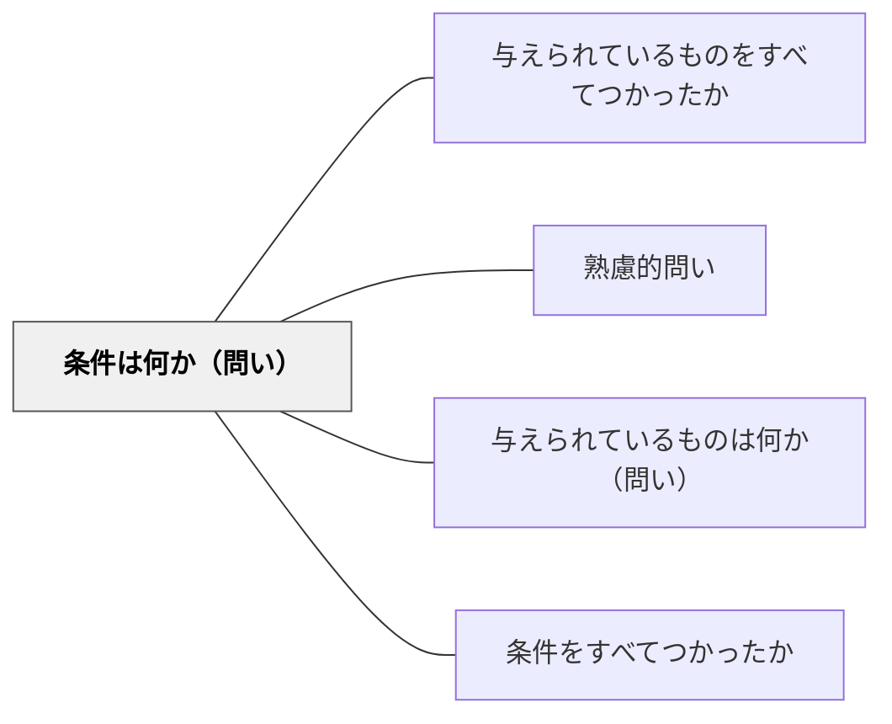

# 条件は何か（問い）

> 制約・条件・前提を明確にすることで、問題の境界線を把握する。

## 背景（Context）
多くの問題には、暗黙の制約や明示的な条件が含まれている。学習者がこれらを意識せずに解答しようとすると、解の範囲を誤ったり、条件を満たさない解を出してしまうことがある。問題の「縛り」を意識することは、有効な解法の選択に直結する。

**岩井の講話では**：「条件は何か」は、求めるもの・分からないこと・与えられているものと並んで「問題を理解する」ところの問いに置かれる（14:04〜14:21）。解いている途中から後には、「与えられているものを全て使ったか」に続けて、自分に与えられている条件を全て使ったかを問う（16:07〜16:15）。また講話では、2年生にはまず「求めるものは何か」「与えられているものは何か」の二つを教え、もう少し上の学年ではこのリストの中から問いを少し増やすと話している（9:18〜9:41）。講話は、このリストの問いは算数以外の問題にも広く使えるとも述べる（12:25〜12:35）。

**本Wikiの関連ページでは**：[[パタン/熟慮的問い]] は、ポリアのリストで「与えられているものをすべてつかったか」と「条件をすべてつかったか」を別の問いとし、前者を数や情報の使い残し、後者を条件の見落としと分けている。本パタンは、解く前にその条件を確かめておく側の問いである。

## 問題（Problem）
学習者は条件を無意識に無視したり、逆に過剰に制限を加えたりしがちである。特に複数の条件が重なっているとき、どれが本質的かを見極めるのが難しい。条件を整理しないまま解き始めると、後で根本的な修正が必要になることがある。

## 力のかたち（Forces）
- 条件を言語化することで、問題の輪郭がはっきりする
- すべての条件を列挙することで、矛盾や不整合に気づける
- 「どこまでが許されているか」を知ることは解法の自由度を規定する
- 条件の見落としは、誤った解への直接の原因になる

## 解決（Solution）
**近いパタンとの見分け**：問いの型の表では、本パタンの見分けの問いは「問題の条件と、その範囲を確かめているか」。全体の表は [[パタン/熟慮的問い#近いパタンとの見分け|熟慮的問い]] にある。

「この問題の条件は何か？制約はどこまでか？」と問いかける。例えば「整数に限るのか、実数も含むのか」「時間的な制約はあるか」などを確認させる。また「この条件がなかったら問題はどう変わるか？」という問いと組み合わせると、条件の意味を深く理解させられる。

---

**例：買い物の文章題で条件に線を引く**（算数・4年）
1. 「1000円で、1さつ120円のノートをできるだけ多く買います。何さつ買えますか」を読み、「この問題の条件は何か」と問う。
2. 子どもは条件に線を引いて書き出す（1000円をこえない、1さつ120円、さつ数は1、2、3…と数える）。
3. 1000÷120＝8あまり40 から8さつと答えたら、「9さつだと条件のどれに合わないか」を問い、120×9＝1080円で1000円をこえることを確かめる。
4. 「『できるだけ多く』という条件がなかったら、答えはどう変わるか」と問い、条件が答えをしぼっていることを話し合う。

---

**例：お楽しみ会の出し物を条件から考える**（学級活動・中学年）
1. 出し物の案を出す前に、「この話し合いの条件は何か」と問い、時間（1班10分）・場所（教室）・全員が参加する、などを黒板に書き出す。
2. 班で案を出し、それぞれの案が条件に合うかを一つずつ確かめる。
3. 条件に合わない案は捨てずに、「どの条件をどう変えれば、できるようになるか」を話し合う。
4. 決まった案について、最後にもう一度、条件をすべて満たしているかを確かめる。

## 結果（Consequences）
- 解の範囲が明確になり、誤解に基づく解答が減る
- 条件を意識することで、解法の選択が適切になる
- 問題の構造を論理的に把握する習慣が身につく

- 注意点：条件を書き出すだけで終えると、解いている途中で見落としが起きる。解いた後に [[パタン/条件をすべてつかったか]] で、書き出した条件をもう一度確かめる（講話の並び 14:12〜14:21、16:07〜16:15）。

## 関連パタン
- [[パタン/与えられているものをすべてつかったか]]
- [[パタン/熟慮的問い]] — 親パタン
- [[パタン/与えられているものは何か（問い）]] — 既知情報を整理する補完的な問い
- [[パタン/条件をすべてつかったか]] — 条件の活用を確認する問い

## クラスター図

## Actionable Insight

- 問題を解く前に「この問題の条件・制約を全部書き出してみよう」と促す——条件の明示化が解の範囲を明確にし見落としによる誤答を防ぐ
- 「整数に限るか・時間的制限はあるか」など解の範囲を規定する条件を確認する習慣を作る——条件意識が問題の構造を論理的に把握する力の土台となる
- 「この条件がなかったら問題はどう変わるか？」という問いを解後に加える——条件の意味への問いが条件の理解を表面的な確認から深い理解へと変える

## 出典
- [[文献/熟慮的問いのパターンリスト（動画記録）]]
- ジョージ・ポリア（1954）『いかにして問題をとくか』丸善出版

- 岩井輝久（年不明）『熟慮的問いのパターンリスト』［動画］ https://youtu.be/WivskVtxG34 — 2026-11-13 に文字起こしで確認（9:18〜9:41、12:25〜12:35、14:04〜14:21、16:07〜16:15）
