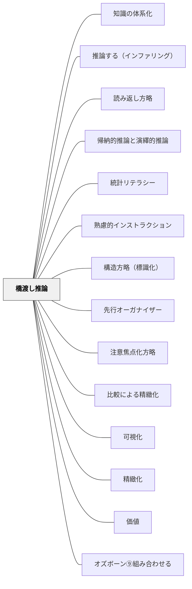

# 橋渡し推論

**このパタンが完成を助ける大きなパタン**：[[パタン/熟慮的インストラクション]]

> 「AだからB」「AとBは対比関係にある」と関係を明示することで、理解の結束性を高める。

---

## [Pattern Connection]

**研究からの補足：推論と理解の点検から読解を捉える（Cainほか2004）**

原典の推論課題には、文章内の情報を統合して答える問いがある（p. 35）。Wiki側の適用案として、答えの手がかりとなる二箇所を示してもらい、その関係を言い直す。教師が接続語を付けたことだけで、子ども自身の推論が成立したとはしない。 出典：[[文献/推論と理解の点検から読解を捉える（Cainほか2004）]]。

### 牧口常三郎（1931）——認識と評価の区別：橋渡し推論は認識作用である

*創価教育学体系 第2巻* の「認識と評価の峻別」は、橋渡し推論の本質を哲学的に裏付ける。

**橋渡し推論は純粋な認識作用**

牧口は認識作用（対象の実在・関係を捉える働き）と評価作用（対象が自分の生命に対してどんな関係力を持つかを測る働き）を根本的に区別する。

橋渡し推論——「AだからB」「AとBは対比である」という命題間の関係の明示——は**認識作用**である。それは「何が何に対してどんな関係にあるか」という事実の把握であり、好悪や価値判断（評価）ではない。

**混同が起こすと教育場面でどうなるか**

> 「生徒が教師に『何ですか』と質問する。この場合に『まだこんな事が解らないのか』と……するならば、これは明らかに認識作用と評価作用とを……したるものではないか」（牧口）

橋渡し推論を促す場面でも同じことが起きる。「AとBの関係がわからない」は認識の問題であり、「まだわからないの？」という応答は評価の混入である。教師が「この二つの関係は何だと思う？」と問うとき、それは認識を求める行為であり、学習者の人格・能力の評価ではない——この区別が指導の安全性を作る。

**実践への示唆**

- 関係を問う（「AとBはどんな関係？」）は認識の問い——正解/不正解で評価せず、関係の言語化を純粋に促す
- 「なぜなら・したがって・一方で」の選択を間違えても、それは関係の認識の誤りであり人格評価ではない——訂正は認識の修正として行う

- **他のパタンへの波及**：[[パタン/価値]]（認識と評価を区別することが価値教育の前提）・[[パタン/熟慮的インストラクション]]（指示設計で認識と評価の場面を分ける）

**Blitzer（2014）統合——論理・条件文と橋渡し推論：**

*Thinking Mathematically* Ch.3「Logic」は条件文（Conditional Statement）を形式化する。p → q（「p ならば q」）は橋渡し推論の形式的な表現であり、「A だから B」という命題間の関係を論理的に扱う基盤を与える。

- **補強された点**：橋渡し推論の「だから・なぜなら・したがって」という接続は、条件文の方向性（p → q）と対応する。Blitzer が示す「必要条件（necessary condition）」と「十分条件（sufficient condition）」の区別——"q is necessary for p" / "p is sufficient for q"——は、橋渡し推論の「なぜ接続するか」の論理的精度を高める
- **拡張された点**：量化文の否定（「すべての A は B」の否定は「ある A は B でない」）は、橋渡し推論の誤りを検出する道具として使える。「A → B だから B → A」という誤った逆転を見抜く論理訓練として
- **他のパタンへの波及**：[[パタン/帰納的推論と演繹的推論]] — 演繹推論の形式化が橋渡し推論に論理的基盤を与える。[[パタン/統計リテラシー]] — 統計的因果推論の誤り（相関を因果と混同する）を橋渡し推論の精度で見抜く

## 背景（Context）

テキストや説明の中に書かれた事実・命題は、それぞれ単独では意味を持っても、相互の関係が明示されていなければ「断片の集まり」に留まる。学習者が「わかった」と感じるのは、情報を並べた状態ではなく、命題と命題の間の関係（因果・対比・条件・順序）を推論し統合したときだ。

山本博樹（2019）はこの関係推論を**橋渡し推論（bridging inference）**と呼び、説明の質を左右する中核的な認知プロセスと位置づけた。そして教師の説明設計においては、学習者が自力でこの推論を行えるよう関係を明示的に示すことが有効だと示した。

※旧パタン「橋渡し推論（命題間の関係の明示化）」を本ページに統合（2026-11-13）。二つのページは要約の一文も解決も同じで、互いを相手の別名にしていた。旧ページにあった牧口常三郎（認識と評価の区別）と Blitzer（条件文）の節は、上の Pattern Connection に移した。

## 問題（Problem）

「Aである。Bである。」と並べて書いても、AとBの関係は伝わらない。「AだからB」なのか「AだがB」なのか、「AはBの原因」なのか「AはBと対照的」なのかは、読者・聴衆が自分で推論するしかない。

この推論を必要以上に学習者に任せると、関係の誤読・見落とし・断片的な理解が起きる。特に抽象度が高い内容・初めて出会う概念では、関係の明示がなければ「並んでいる事実」として処理され、統合的な理解には至らない。

## 力のかたち（Forces）

- 接続詞・関係語（「なぜなら」「したがって」「一方で」「ただし」「つまり」）が橋渡し推論の言語的手段
- 矢印・記号・図解を使った視覚的な関係明示も有効
- 関係を明示しすぎると説明が冗長になり、学習者が自分で推論する機会が失われる
- 学習者に「この二つはどんな関係？」と問うことで、能動的な推論が生まれる
- 認識（何がどんな関係にあるか）と評価（良い・悪い）を混同すると、関係を問う場面が萎縮した雰囲気になる

## 解決（Solution）

**命題間の関係を接続詞・関係語・図解を使って明示的に示す。また、学習者自身が推論する機会を設ける。**

**近いパタンとの見分け**：指示・説明の表では、本パタンの見分けの問いは「「だから」「一方で」など、文と文の関係を明示しているか」。全体の表は [[パタン/熟慮的インストラクション#近いパタンとの見分け|熟慮的インストラクション]] にある。

---

### 関係の種類と使う表現

| 関係の種類 | 接続表現の例 |
|-----------|-------------|
| **因果** | なぜなら・だから・したがって・その結果 |
| **対比** | 一方で・それに対して・ところが・しかし |
| **条件** | もし〜なら・〜という条件のもとで |
| **順序** | まず・次に・最後に・〜の後で |
| **換言** | つまり・言い換えると・要するに |

---

### 板書での実践

「A → B」と矢印を書いて「これはどんな関係？」と聞く。接続語を板書に明示する習慣をつくるだけで、授業の中に橋渡し推論の足場が生まれる。

---

### 「関係を問う」発問

- 「この二つの出来事、どんな関係があると思う？」
- 「Aが起きたのはなぜ？ BとCのどちらが原因に近い？」
- 「これとさっきの話は似ている？それとも反対？」

正解より**関係の言語化**を求める問いにすることで、学習者の推論が可視化される。

---

## 結果（Consequences）

- 断片的な知識が関係によってつながり、統合的な理解が形成される
- 学習者が因果・対比・条件などの論理的関係を自分で推論する力が育つ
- 説明の結束性が高まり、受け手の理解の正確さが向上する

## 関連パタン
- [[パタン/知識の体系化]]
- [[パタン/推論する（インファリング）]]
- [[パタン/読み返し方略]]
- [[パタン/帰納的推論と演繹的推論]]
- [[パタン/統計リテラシー]]
- [[パタン/熟慮的インストラクション]] — 親パタン
- [[パタン/構造方略（標識化）]] — 構造全体を明示する方略
- [[パタン/先行オーガナイザー]] — 全体の関係構造を事前に示す
- [[パタン/注意焦点化方略]] — 関係の核心に注意を向ける
- [[パタン/比較による精緻化]] — 比較・対比による関係の明確化
- [[パタン/可視化]] — 関係を図解で見える形にする
- [[パタン/精緻化]] — 命題間の関係づけが精緻化の核心
- [[パタン/価値]] — 認識と評価の区別；橋渡し推論は認識作用
- [[文献/推論と理解の点検から読解を捉える（Cainほか2004）]] — 離れた記述を結んだ根拠を確かめる。
- [[パタン/オズボーン⑨組み合わせる]]

## クラスター図

## Actionable Insight

- 板書するとき、2つの事柄の間に矢印と接続語（「なぜなら」「したがって」「一方で」）を書く習慣を今日1回試す——接続語が「見える」だけで理解の結束性が上がる
- 「AとBはどんな関係だと思う？」と子どもに問う——正解ではなく関係の言語化を促す

---

## 出典

山本博樹（2019）『教師のための説明実践の心理学』ナカニシヤ出版

- 一つの教育のパタン・ランゲージ（岩井輝久）（旧「橋渡し推論（命題間の関係の明示化）」）
