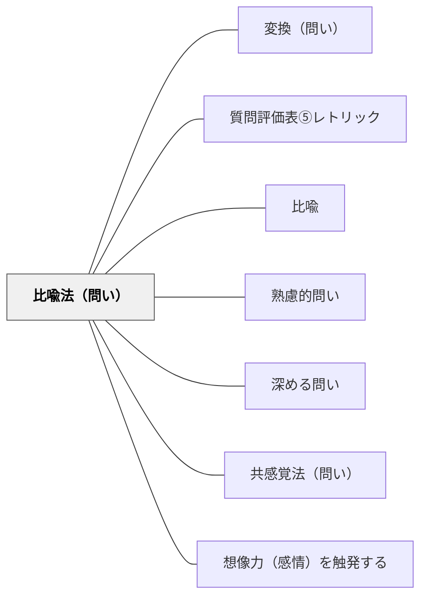

# 比喩法（問い）

**このパタンが完成を助ける大きなパタン**：[[パタン/熟慮的問い]]・[[パタン/想像力（感情）を触発する]]

> 別のものに喩えることでイメージを豊かにした問い

## 背景（Context）
比喩は、未知のものを既知のものに結びつけることで理解を深める認知的道具である。問いの形で比喩を用いることで、抽象的な概念や複雑な状況を具体的なイメージとして捉え直すことができる。「もしこの問題が天気なら？」のような問いは、論理的分析とは異なる直感的・感性的なアプローチを引き出す。

**原典では**：安斎（2021）は比喩法を、問いの意味を拡げてイメージをふくらませる「光の色を変える」タイプのレトリックの最初に置き、「別のものにたとえることで、イメージを豊かにする」技法とする（第5章 MANNERS 15、Kindle版 83%）。直喩と隠喩の区別は割愛し、問いの表現に部分的に比喩を取り入れて印象を変えることを広く含める。比喩法の基本は、問いで扱っている内容と「同じ性質や構造を持った別のもの」を借りてきて表現に加えることである（同）。例として、「この会社で、あなたはどんな風に働きたい？」を「舞台」や「船」の比喩でアレンジし、会社を活躍の場と捉えるなら「舞台」、不確実な環境を共に乗り越える集団と捉えるなら「船」というように、問いの意図や相手に伝えたいニュアンスに立ち返って比喩を選ぶと説明している（同、83%）。慣れないうちは難しいが、「意識的に練習をすると、誰でも使えるようになるテクニック」でもあるという（同、84%）。

**岩井の講話では**：安斎の本の一覧として「別のものにたとえることでイメージを豊かにする」と読み上げている（29:53〜30:00）。

## 問題（Problem）
抽象的なテーマを正面から問うと、学習者は既習の語彙や概念を繰り返すだけになりやすい。新しい切り口を与えなければ、議論は予定調和になる。比喩的な問いがなければ、学習者は言語化しにくい感覚や直感を問いの中に持ち込めない。

## 力のかたち（Forces）
- 直感的理解 vs 論理的分析
- イメージの豊かさ vs 概念の正確さ
- 比喩の親しみやすさ vs 誤解を招くリスク
- 創造的発想 vs 厳密な思考

## 解決（Solution）
**近いパタンとの見分け**：問いの型の表では、本パタンの見分けの問いは「別のものにたとえて、イメージを豊かにしているか」。全体の表は [[パタン/熟慮的問い#近いパタンとの見分け|熟慮的問い]] にある。

「もしこの問題が天気なら、今はどんな天気？」「この組織を建物に喩えるとしたら、どんな建物？」のように、テーマを別の領域に置き換えて問う。原典の比喩法は、問い手が問いの意図に合う比喩（同じ性質や構造をもつ別のもの）を選び、問いの言葉に入れる技法である。学習者に比喩を選んでもらう問いは、その応用として使う。回答後に「なぜその比喩を選んだか」を問うと、さらに深い洞察が得られる。

---

**例：学級を「船」にたとえて目標を問う**（学級活動・4年）
1. 学期はじめに、ふつうの問い「この学級で、どんなふうに過ごしたい？」をまず黒板に書く。
2. その横に、比喩を入れた問い「この学級という船で、どんな航海をしたい？」を書き、二つを読み比べる。
3. 子どもは「行き先（目標）」「嵐（困ったとき）」「乗組員（一人ひとりの役目）」のうち一つを選んで、ノートに一文書く。
4. 発表の後、「船」でなく「畑」にたとえたら、どんな問いになるかを子どもが考え、比喩によって問いの向きが変わることを確かめる。

---

**例：人の体のしくみを「工場」にたとえて問う**（理科・6年）
1. 消化と吸収を学んだ後、「食べ物は体の中でどうなる？」という問いを、「体という工場で、食べ物はどんな工程を通っていく？」と言い換えて出す。
2. 子どもは口・胃・小腸・大腸を「工程」として順に並べ、それぞれの「仕事」を一言で書く。
3. 「工場のたとえで説明しにくいところはどこか」と続けて問い、たとえと実際のしくみがずれるところ（たとえば吸収）を話し合う。

## 結果（Consequences）
- 言語化しにくい感覚や直感が問いの場に持ち込まれる
- 参加者の多様な表現が尊重され、議論が活性化する
- 抽象概念への新しい切り口が生まれ、理解が深まる

- 注意点：比喩は問い手が問いの意図に合わせて選ぶ。意図と合わない比喩を入れると、問いの向きそのものが変わる。また、いくつもレトリックを重ねると「派手なミラーボールのような問いかけ」になるので、一度聞いて意図がわかるかを確かめる（安斎 2021、第5章）。

## 関連パタン
- [[パタン/変換（問い）]]
- [[パタン/質問評価表⑤レトリック]]
- [[パタン/比喩]]
- [[パタン/熟慮的問い]] — 親パタン

- [[パタン/深める問い]] — 比喩が表面的な言語化を超えた理解を生む
- [[パタン/共感覚法（問い）]] — 比喩と感覚を組み合わせた兄弟パタン
- [[パタン/想像力（感情）を触発する]] — 比喩が感情・想像力を動かす

## クラスター図

## Actionable Insight

- 「もしこの問題が天気なら、今はどんな天気？」と問い、なぜその比喩を選んだかを語らせる——言語化しにくい感覚や直感が問いの場に現れる
- 「この組織を建物に喩えるとしたら、どんな建物？」のように具体的な比喩域（建物・天気・植物）を提示して問う——比喩域の指定が思考の足場になる
- 抽象的な概念を学んだ後、「この概念を何かに喩えるとしたら？」と問う——既習の語彙を繰り返すだけでなく新しい切り口で理解が深まる

## 出典
- [[文献/熟慮的問いのパターンリスト（動画記録）]]

- 安斎勇樹（2021）『問いかけの作法 チームの魅力と才能を引き出す技術』ディスカヴァー・トゥエンティワン 第5章 MANNERS 15「レトリック（B-1）比喩法」 — Kindle版 83% で確認。[[文献/問いかけの作法（安斎勇樹）]]
- 岩井輝久（年不明）『熟慮的問いのパターンリスト』［動画］ https://youtu.be/WivskVtxG34 — 2026-11-13 に文字起こしで確認（29:53〜30:00）
