# 比較で概念をつくる（事例ペアの設計）

> 概念は定義から生まれるのではなく、よく設計された「比べるペア」から生まれる。何を揃え、何だけを変えるか——事例ペアの設計が概念の輪郭を決める。

## [Pattern Connection]

**研究からの補足（2026-10-17）：次の学びへの準備として転移を捉える（BransfordとSchwartz1999）**

原典は、事例比較を後続の講義から学ぶ準備として検討した大学生の研究を紹介する（公開著者稿pp. 17–19）。Wiki側の適用案として、比べて気づいた点を残し、説明を聞いた後に何を捉え直したかを尋ねる。比較だけで理解を完成させる設計の根拠にはしない。 出典：[[文献/次の学びへの準備として転移を捉える（BransfordとSchwartz1999）]]。

**研究からの補足（2026-10-16）：事例比較の効果と条件を確かめる（Alfieriほか2013）**

原典の平均効果は中程度で、課題や測定によるばらつきがある（p. 107）。本パタンの比較教材設計を具体化するWiki側の案として、揃えた条件と変えた条件を教師が記録し、比較後は別の事例で判断を確かめる。「同時提示なら必ず有効」という保証にはしない。 出典：[[文献/事例比較の効果と条件を確かめる（Alfieriほか2013）]]。

## 背景（Context）

このWikiには「比較」を扱うパタンが既に4つある。「対比」はイーガン系で、感情的なコントラストによって意味の重さを実感させる手立て。「比較（問い）」は「AとBはどう違う？」という発問の型。「比較による精緻化」は学んだ後に別の概念と比べて理解を深める学習方略——学習者の操作である。「実例を比べて分析する」は完成した作品の質を比べて達成規準を共同構築する。

これらに対し本パタンの固有領域は、概念を**初めて形成する**場面で、教師が「どの2事例を・何を揃え・何を変えて・どう同時に並べるか」を**事前に設計する**ところにある。「学んでから比べて深める」のではなく、「比べることで概念がそもそも生まれる」場面の教材設計のパタンである。

理論的土台は Gentner の構造アラインメント理論（structure-mapping theory）。2つの事例を並べて対応づける（アラインする）とき、人は表面的特徴ではなく関係構造に注意を向け始める。共通構造の抽出（スキーマ誘導）と差異の発見（精密化）が同時に進む。Alfieri, Nokes-Malach, & Schunn（2013）が 57 実験（336 テスト）をまとめたメタ分析は、事例を比べる学習が、一つずつ見る学習などより、多くの場合、学びが大きいことを示した（d = 0.50）。効き方は、比べる目的や原理を示す時機、内容によって変わった。Rittle-Johnson & Star（2007）は、同じ方程式を2通りの解法で並べて比べた7年生の群が、解法を1つずつ順に学んだ群より、正しく解く力（手続き的知識）と手続きの柔軟性で伸びることを示した（概念理解には差がなかった）。概念理解で差が出たのは、同じ問題の2通りの解法を比べた群と、別の問題を同じ解法で比べた群を比べた Rittle-Johnson & Star（2009）のほうである。

> **研究の裏づけ（2026-10-31）**：上の効果の中身は、米国教育科学研究所の実践ガイド（Woodward ほか 2012）の付録D（What Works Clearinghouse による再分析）で確かめ、2026-10-31 に書き直した（以前は「概念理解と手続きの柔軟性の両方で伸びる」と書いていた）。同ガイドは、複数の解き方を比べる勧めの根拠を moderate とし、手続きの柔軟性は7研究中6研究で伸びたが、手続き的知識と概念理解への効果は一貫しなかったとまとめる。代数をまったく（またはほとんど）知らない生徒が代数の解き方を比べたり解き直したりした3研究では、手続き的知識に負の効果があった。出典：[[文献/算数の問題解決を4〜8年生で育てる（Woodwardほか2012）]]。

## 問題（Problem）

教師は新しい概念を「定義＋例ひとつ」で導入しがちだ。例が1つしかないと、子どもはその例のどの特徴が本質で、どれが偶然かを区別できない。三角形を「底辺が水平な正三角形」のイラストだけで導入すると、傾いた鋭角三角形や細長い鈍角三角形を「三角形ではない」と判断する子が出る——例の偶然的特徴（向き・対称性）を本質と取り違えている。

事例を順番に1つずつ提示する（逐次提示）と、前の事例の記憶が薄れて比較が成立しない。「先週やった例と今日の例、何が同じ？」と問うても、子どもの頭の中で前の事例の解像度はすでに落ちている。同時に視野に入る形で並んでいないと、比較は走らない——特にワーキングメモリへの負荷が大きい低学年や特性のある子では顕著である。

比較のチャンスを「気づいた子が気づけばいい」と子ども任せにすると、人間の比較は放っておけば表面的類似に引っ張られる（Gentner）。絵柄が似ている・数字の桁が同じ——そういう表面の比較で終わり、関係構造の比較には至らない。

> **原文との照合（2026-10-11）**：この指摘は [[文献/Structure-Mapping（Gentner, 1983）]] の「類推の移行の予想」と合う。字義どおりの類似は対象の記述からも関係からも引き出せるので思い出しやすく、類推は関係で記憶を探さないと見つからないので気づかれにくい（p. 167–168）。ただし原文ではこれは非公式な観察にもとづく**予想**として出されている。

事例ペアの設計を怠ると、子どもは「概念の定義文を暗記する」か「手続きだけを覚える」のどちらかに逃げる。どちらも概念は形成されていない。

## 力のかたち（Forces）

- 1事例では、本質的特徴と偶然的特徴が区別できない——偶然が概念に紛れ込んでしまう
- 人間の比較は放っておくと表面的類似に引かれる（Gentner）。構造に目を向けさせるには「何を揃えるか」を教師が統制する必要がある
- 近い比較（類似ペア・1点だけ違う）は精密な区別を生み、遠い比較（異質ペア・表面が違って構造が同じ）は抽象的なスキーマを生む——目的によって使い分ける必要がある
- 同時提示でなければワーキングメモリ上で比較が成立しない。特に低学年・特性のある子は逐次提示では比較が崩れる
- 両事例とも未習熟だと比較自体が負荷過多になる——Rittle-Johnson, Star & Durkin（2009）は、前提の知識が乏しい生徒には比較がかえって負担になることを示し、一つの解き方に慣れてから比べることが勧められている（Woodward ほか 2012 の注119による。以前は Rittle-Johnson & Star の知見として書いていた）
- 事例ペアの設計には教材研究の時間がかかる——全単元でやると重い。核となる概念に絞る判断が要る
- 比較で立ち上がった概念は、その後の命名・定義によって固定しないと残らない——比較しただけで終わらせない後処理も要る

## 解決（Solution）

**概念を導入する場面で、その概念の本質次元を「1つだけ違う」よく統制された2事例として設計し、子どもの目の前に同時に並べる。そして「こっちのこれは、そっちのどれにあたる？」という対応づけ（アラインメント）の問いで、構造への注意を引き出す。**

設計の原則は4つ。

1. **同時に並べる**——黒板の左右、ワークシートの上下、スライドの分割画面。逐次でなく同時。「前の問題と比べてごらん」ではなく、両方が今この瞬間に視界に入っている状態を作る。物理的に隣に置く・指で対応づけながら話す——特別支援の場面ではこれが命綱になる。

2. **1つだけ変える**——概念の本質次元だけが異なり、他は揃っているペア＝「近い比較」を最初に置く。同じ数字で式の形だけ違う、同じ題材で文体だけ違う、同じ図形で向きだけ違う。揃えるべきものを揃えると、変わったところが概念の本質次元として浮かび上がる。

3. **目的で距離を選ぶ**——違いを際立たせて精密な区別を作りたいなら近いペア。共通構造を抽出して抽象的スキーマを作りたいなら、表面が違って構造が同じ「遠いペア」。Gentner の **progressive alignment**（漸進的アラインメント）の原則——まず近い比較で構造に気づかせ、それから遠い比較に進むと、構造的類似の検出が確実に育つ。

4. **対応づけを言語化させる**——「こっちのこれは、そっちのどれにあたる？」というアラインメントの問いを置く。比較表・ベン図・矢印で対応関係を構造化する。観点を絞る（「今日は『へん』だけ比べよう」）と、表面比較に流れない。

---

### 具体例1：算数・解法のペアで「手続きの柔軟性」と「概念理解」を同時に育てる

Rittle-Johnson & Star（2007）の実験設計をそのまま小学校に持ち込む。

導入の場面：

- 同じ方程式（あるいは文章題）を、架空の2人の子が違うやり方で解いたノートを左右に並べて見せる。たとえば「3×（x＋2）＝15」を、（左）両辺を3で割ってから引く（右）展開してから引く——どちらも正しい
- 「どちらも答えは合っている。どこが同じで、どこが違う？どんなときにどちらが速い？」と問う
- 子どもは「左の方法は3で割れる数のときに速い」「右の方法はどんな場合でも使える」など、手続きの**意味と適用範囲**を語り始める
- 1つの解法ずつ順に学んだ群より、正しく解く力と手続きの柔軟性が伸びる（概念理解は差なし）——これが Rittle-Johnson & Star（2007）の知見。概念理解まで伸ばすには、比べる組み合わせの設計が要る（2009年の研究）

ナンバートークの日常的舞台はこれの繰り返しと考えてよい。複数の解法を黒板に並べて「どこが同じで、どこが違う？」と問うのは、本パタンの最小ユニットを毎日回している姿である。

---

### 具体例2：「三角形」の概念を、正例と変則例・非例のペアで導入する

教科書の「三角形」の導入は、底辺が水平な正三角形1つで済まされがちだ。それでは概念は不完全にしか形成されない。

導入の場面：

- 黒板の左右に2つの図形を並べる。左：傾いた鋭角三角形。右：細長い鈍角三角形。「これとこれ、どちらも三角形だ。どこが同じ？」と問う。「3本の直線」「閉じている」「角が3つ」——本質的特徴が子どもの言葉で出てくる
- 次に、左：三角形。右：三角形に見えるが1辺が曲がっている図形（非例）。「これとこれ、どこが違う？片方が三角形でない理由は？」と問う。「辺がまっすぐじゃない」——非例との比較が本質の輪郭を鋭くする
- どちらの「同じ・違う」も、子どもが本質的特徴（3本の直線・閉じている）と偶然的特徴（向き・形の印象）を分離するために働く

ここで重要なのは、正例だけ／非例だけを並べないこと。「正例ペア（向きだけ違う）」で本質特徴を抽出し、「正例・非例ペア」で境界を確定する——2段構えで概念の輪郭が固まる。

---

### 具体例3：国語・同じ出来事を書いた2つの短文で「描写」の概念をつくる

「直接書く／様子で見せる（show, don't tell）」という概念を、定義から入らず、ペアから立ち上げる。

導入の場面：

- 黒板の左右に2つの短文を並べる。左：「ぼくは泣いた。」右：「気がつくと、ほおがぬれていた。」
- 「どちらも、ぼくが泣いた話。何が違う？」と問う
- 「左は『泣いた』と書いてある。右は書いてないのに、泣いたことが分かる」——子どもの言葉で違いが立ち上がる
- 「これとこれの違いに名前をつけるとしたら？」と問い、「直接書く／様子で見せる」という概念の輪郭を子どもと一緒に固める

ここでも揃えるところを揃えている——同じ出来事（泣いた）、同じ主語、ほぼ同じ短さ。違うのは「書き方」の1点だけ。だから「書き方」が概念の本質次元として浮かび上がる。

---

### 特別支援の視点：同時提示はワーキングメモリへの配慮そのもの

事例ペアの「同時提示」は、認知特性への配慮として極めて重要な手立てになる。

- **物理的に隣に置く**——黒板の左右、机の上に2枚のカード、ワークシートの上下。今この瞬間、両方が視界に入る状態を作る
- **指で対応づけながら話す**——「こっちのこれ」「そっちのこれ」と指差しと言葉を同期させる。記憶への負荷を視覚的・身体的な参照に肩代わりさせる
- **比較の観点を1つに絞る**——「今日は『へん』だけ比べよう」「今日は『答えの大きさ』だけ比べよう」。観点が多いと負荷過多になり、子どもは表面比較に逃げる
- **両方とも未習熟のペアにしない**——少なくとも片方は子どもが安心して扱える事例にする。両方とも未習熟だと比較自体が成立しない（Rittle-Johnson, Star & Durkin, 2009）

同時提示・観点の絞り込み・片足の足場——この3つは特別支援の場面に限らず全員にとって有効だが、特性のある子・ワーキングメモリに負荷を抱える子にとっては「あるかないか」を分ける設計になる。

> **研究の裏づけ（2026-10-31）**：英国の Education Endowment Foundation の算数の指針（2017、7〜14歳）は、例と例でないものを示す課題を勧める。ひし形の授業例では、教師が形を一つずつ見せて「ひし形だと思う人？」と挙手を数え、答えを少しずつ明かしながら投票をくり返し、最後に定義を話し合い直す。形と向きは、「正方形はひし形ではない」のようなよくある誤解が浮かぶように選んである（p. 21）。また、5×18 の求め方を出し合い、似ている点・分かりやすさ・暗算での効率を比べてから、12×15 で同じ工夫を探す例も載せる（p. 22）。出典：[[文献/7〜14歳の算数の指導を研究から整える（英国EEF2017）]]。

> **研究の裏づけ（2026-10-31）**：Rittle-Johnson と Star（2009）の原典で、本パタンの記述を確かめた。中学1・2年生162人を、①同じ型の方程式どうしを同じ解き方で、②違う型の方程式どうしを同じ解き方で、③同じ方程式を二つの解き方で比べる三群に分けた。概念の理解は③がほかの二群より高く、①と②は差がなかった。正しく解く力は三群とも同じで、近道の使用は①だけが少なかった（p22〜p24）。比較を支えた特徴として、比べる解き方をステップをそろえて書く、似ている点と違う点を見つける場、効率を考える問い、ステップの共通の名前、比較を補う直接の説明の五つを挙げる（p33〜p34）。一方、ささいにしか違わない解き方を比べても効果は薄いだろうとし、「片方になじんでから比べる」は検証していない仮説として書いている（p31〜p32）。出典：[[文献/何と何を比べると学びが伸びるかを確かめる（RittleJohnsonとStar2009）]]。

> **研究の裏づけ（2026-10-31）**：小学5・6年生の見積もりでは、Star と Rittle-Johnson（2009）が、同じ問題の二つの方法を並べて比べると柔軟性が伸びたと報告した。概念の理解は全体では差がなく、事前に少し見積もれた子（正答20%以上）でだけ、2週間後によく残った。著者らは、比べることが概念の理解を助けるには、限られた方法に少しなじんでいることが先に要るかもしれず、十分な習熟までは要らないようだとする（p. 21、p. 26）。本パタンの「少なくとも片方は子どもが安心して扱える事例にする」に近い結果だが、事前の力で分けたあとの分析である。出典：[[文献/見積もりの方法を比べると柔軟になる（StarとRittleJohnson2009）]]。

> **研究の裏づけ（2026-11-11）**：（教科書の分析・根拠は弱い）中国の変式の考え方は、「比べなければ見分けられない（没有比較就沒有鑒別）」を役割の一つに挙げる。一つの問題をいくつもの解き方で並べ（一題多解）、子どもの解き方を出し合ったあと、どれがいちばん簡単かを話し合って、低い段の解き方から高い段の解き方へ導く。方法の使いどころを知るには、その方法では解けない問題と並べる必要がある、とも書く（pp. 10–14）。効果を測った研究ではない。出典：[[文献/中国の教科書は、変わらない関係を保ったまま問題を少しずつ変えて並べるかを、たし算・ひき算の単元で読む（Sun2013）]]。

> **研究の裏づけ（2026-11-11）**：（理論の論文・根拠は弱い）変化の理論を練習問題に当てた論文は、「すべてが変わると、何も見分けられないかもしれない」とし、見分けてほしい面は、ほかの特徴が比較的変わらない中で変えると見分けられやすいと述べる。同じ「傾きを求める」問題でも、符号がばらばらに変わる並びと、1点を固定してもう1点の x 座標だけを変える並びとでは、学び手が一般化できることがちがう、とする。出典：[[文献/練習問題の並びを一つのまとまりとして設計すると、変わるところと変わらないところから一般化が生まれるかを、教師たちの反応から考える（WatsonとMason2006）]]。

## 近いパタンとの見分け

「比べる」を扱うパタンは、**だれが・いつ・何を比べるか**で分かれる。

| パタン | だれが | いつ | 何を比べるか |
| --- | --- | --- | --- |
| **比較で概念をつくる（本ページ）** | 教師が設計する | 概念を初めてつくる前 | 「1つだけ違う」よう統制した2事例 |
| [[パタン/比較による精緻化]] | 学習者が比べる | 学んだあと | 学んだ概念と、別の概念・作品・出来事 |
| [[パタン/実例を比べて分析する]] | 教師と学習者 | 書く・つくる前や途中 | 作品の実例（良い例・普通の例・改善の要る例）。達成規準をつくる |
| [[パタン/練り上げ（比較検討の全体交流）]] | 学級全体で | 自力解決のあと | 出そろった子どもの考え。効率・一般化・既習との似かたで比べる |
| [[パタン/比較（問い）]] | 教師が問う | どの場面でも | 「どこが同じ？どこが違う？」という問いの型（旧「異同（問い）」を統合） |
| [[パタン/対照法（問い）]] | 教師が問う | 議論の焦点をつくるとき | 「AかBか」と、対立する二つの極 |
| [[パタン/対比]] | 教師が配置する | 意味の重さを感じてほしいとき | 正反対の場面（感情のコントラスト。イーガン系） |

**比べないほうがよい比較**：[[パタン/利己愛の罠（比較が内発的動機を壊す）]] は、子どうしの出来ばえを比べることが、内側からの意欲をこわすことを扱う。上の表は、事例・考え・作品を比べるパタンで、人と人を比べるものではない。

## 結果（Consequences）

**利点：**

- 本質的特徴の抽出が速く・確実になる——「定義の暗記」でなく「構造の理解」として概念が残る
- 「例の運の悪さ」による誤概念を予防する（[[パタン/誤概念の組み替え（素朴概念を資源にする）]] への接続）。1事例だけで導入したときに混入する偶然的特徴を、ペア設計の段階で排除できる
- 子どもは「比べる」という思考操作を、概念形成と同時に身につける——後の[[パタン/比較による精緻化]]や[[パタン/分類の設計（「同じ」を決める力）]]の前提になる
- 教師の側に「この概念を立ち上げるならこの2事例」というペアのストックが蓄積されると、教材研究の質が上がる

**注意点：**

- ペア設計には教材研究の時間がかかる——全単元でやると重い。各単元の中心概念1つに絞る。それ以外は「例＋追加例」で済ませてもよい
- 両事例とも未習熟だと比較が負荷過多になる——少なくとも一方は足場として馴染んでいる事例にする
- 比較の観点を絞らないと表面比較で終わる——「今日は何を比べるか」を最初に決める
- 比較で立ち上がった概念は、その後の**命名・定義・適用**で固定しないと残らない。「比べて違いを見つけた」で終わらせず、「だからこれを『◯◯』と呼ぶ」「どんな場面でこれが使える？」という後処理までセットで設計する
- 近い比較（1つだけ違う）ばかり繰り返すと、概念が狭く閉じる。ある段階で意図的に「遠い比較」を入れて、表面が違っても同じ構造を見抜く力に進める（progressive alignment）

> **研究の裏づけ（2026-10-31）**：『How People Learn』（2000）は、知覚の学習から来た「対比の事例」を、いつ・どこで・なぜ知識を使うかの理解を助ける方法として紹介する。うまく並べた対比は、それまで見落としていた特徴や、どの特徴が大事かに気づく助けになる（例：一次関数は、一次関数でないものと並べると分かりやすくなる）（p. 60）。また、データを比べたあとに講義を聞いた大学生の群が転移のテストでいちばんよく、データを2倍の時間比べて講義を受けなかった群は成績が悪かったことから、「講義は必要だった」と書く（p. 59、囲み3.6）。報告書は「構成主義だから直接教えてはならない」という見方を、教え方の理論と知ることの理論の取り違えだとする（p. 11）。比べることは、説明から学ぶ準備にもなる。出典：[[文献/人の学び方の研究を授業の設計につなぐ（全米研究評議会2000）]]。

## 関連パタン

- [[文献/練習問題の並びを一つのまとまりとして設計すると、変わるところと変わらないところから一般化が生まれるかを、教師たちの反応から考える（WatsonとMason2006）]] — 変わらない背景の上で一つを変えると見分けられやすい
- [[文献/中国の教科書は、変わらない関係を保ったまま問題を少しずつ変えて並べるかを、たし算・ひき算の単元で読む（Sun2013）]] — 「比べなければ見分けられない」。一題多解で解き方を比べる
- [[文献/算数の問題解決を4〜8年生で育てる（Woodwardほか2012）]] — 作業例を並べて比べる研究の再分析。手続きの柔軟性は伸びるが、概念理解への効果は研究によって違う
- [[パタン/比較による精緻化]] — 学んだ後に別の概念と比べて理解を深める学習者の操作。本パタンは学ぶ最初に比べて概念をそもそもつくる教師の教材設計
- [[パタン/対比]] — イーガン系の感情的コントラスト（意味の重さの実感）。本パタンは認知的な構造アラインメントの設計（本質特徴の抽出）
- [[パタン/比較（問い）]] — 「どう違う？」という発問の型。本パタンはその問いが効くために必要な事例ペア側の設計
- [[パタン/実例を比べて分析する]] — 完成した作品の質を比べて達成規準を共同構築する。本パタンは概念の本質特徴を抽出することが目的
- [[パタン/対照法（問い）]] — 「AかBか」と対立する二極を並べる問い。本パタンは1つだけ違う2事例
- [[パタン/練り上げ（比較検討の全体交流）]] — 子どもの考えが出そろったあとに全体で比べる。本パタンは概念をつくる前に教師が並べる2事例
- [[パタン/利己愛の罠（比較が内発的動機を壊す）]] — 人と人を比べることの害。本パタンが比べるのは事例であって人ではない
- [[パタン/類推（アナロジー）]] — 構造アラインメントという同じ認知メカニズムの上にある。類推は既知→未知への構造写像、本パタンは2事例→概念への構造抽出
- [[パタン/分類の設計（「同じ」を決める力）]] — 「何を同じとみなすか」の決定。比較ペアで立ち上がった概念は、次の段階で分類基準として固定される
- [[パタン/ナンバートーク]] — 複数の解法を黒板に並べて比較する場。具体例1（解法比較）の日常的な舞台であり、本パタンの最小ユニットの反復実装
- [[パタン/不備のある実例を示す]] — 正例と不備例のペアは「1つだけ違う」設計の一種。「あと一歩で良くなる」差分の言語化が改善の概念をつくる
- [[パタン/具体事例から典型事例（中心概念）へ]] — 事例群から中心概念へ向かう動き。本パタンはその最小単位（2事例のペア）の設計
- [[パタン/誤概念の組み替え（素朴概念を資源にする）]] — よく設計されたペアは「例の運の悪さ」による誤概念を予防する。予防（本パタン）と治療（誤概念の組み替え）の関係
- [[パタン/解説を先に渡さない（自得の設計）]] — 比較を「問題ペアとして設計する」本パタンに対し、比較を「ヒントとして渡す」位置づけ。同じ比較という手法の異なる運用面
- [[パタン/問題の系列が足場を担う（一変数変化の連鎖）]] — 比較を「問題ペア」で設計する共通点。比較軸の数を1に絞る点で一致。本パタンは2事例の比較で概念を立ち上げ、系列設計は連続した問題群の比較で難度を上げる
- [[パタン/変化オペレータの系列設計（喜びのグレードアップ）]] — 比較軸を何にするかの設計が共通。変化オペレータの④質的変化は「遠い比較（progressive alignment）」に対応し、表面が違って構造が同じ事例の洞察体験を系列の中で設計する
- [[パタン/同等点と差異点の均衡設計（学習の駆動エンジン）]] — 認知的メカニズム（何を揃え何を変えるかの設計技法）を本パタンが扱い、「同等点と差異点の均衡が学習者の動機を駆動する」という動機論的原理を均衡設計が扱う。相補的に使う
- [[パタン/つながった関係ほど写る（体系性で類推を選ぶ）]] — 揃えた関係が、ほかの関係とつながっているかを点検する
- [[文献/Structure-Mapping（Gentner, 1983）]] — 比べ方の種類と、字義どおりの類似は思い出しやすいという予想の原典
- [[文献/事例比較の効果と条件を確かめる（Alfieriほか2013）]] — 既出のメタ分析への原典導線と、一般化の条件を補う。
- [[文献/次の学びへの準備として転移を捉える（BransfordとSchwartz1999）]] — 比較の成果を、その後の説明から学べるかでも確かめる。
- [[文献/人の学び方の研究を授業の設計につなぐ（全米研究評議会2000）]] — 対比の事例（p. 60）と、比べたあとの説明の必要（囲み3.6）
- [[文献/7〜14歳の算数の指導を研究から整える（英国EEF2017）]] — 例と例でないもの（ひし形）、計算の工夫の比較（5×18）
- [[文献/何と何を比べると学びが伸びるかを確かめる（RittleJohnsonとStar2009）]] — 何と何を比べるか（同じ型の問題・違う型の問題・同じ問題の違う解き方）で効果が違う（原典）
- [[文献/見積もりの方法を比べると柔軟になる（StarとRittleJohnson2009）]] — 小学5・6年生の見積もり。比べると柔軟性が伸び、概念の理解は少しなじんだ子でだけ残った
- [[文献/通常の学級で特別な支援の要る子を支える五つの勧め（英国EEF2020）]] — 明示的な指導の要素としての非例と、定義・特徴・例・非例の四つの枠
- [[文献/何を変え、何を変えずに見せるかで、学べることが変わるかを確かめる（Kullbergほか2017）]] — 何を変え何を変えずに見せるかを、気づきの条件とする変化の理論

## クラスター図

```mermaid
flowchart LR
    ne6af94e8bc83e381a7e6a682e5bfb5e38292e381a4e3818fe3828befbc88e4ba8be4be8be3839ae382a2e381aee8a8ade8a888efbc89["比較で概念をつくる（事例ペアの設計）"]
    ne6af94e8bc83e381abe38288e3828be7b2bee7b7bbe58c96["比較による精緻化"]
    ne5afbee6af94["対比"]
    ne6af94e8bc83efbc88e5958fe38184efbc89["比較（問い）"]
    ne5ae9fe4be8be38292e6af94e381b9e381a6e58886e69e90e38199e3828b["実例を比べて分析する"]
    ne5afbee785a7e6b395efbc88e5958fe38184efbc89["対照法（問い）"]
    ne7b7b4e3828ae4b88ae38192efbc88e6af94e8bc83e6a49ce8a88ee381aee585a8e4bd93e4baa4e6b581efbc89["練り上げ（比較検討の全体交流）"]
    ne588a9e5b7b1e6849be381aee7bda0efbc88e6af94e8bc83e3818ce58685e799bae79a84e58b95e6a99fe38292e5a38ae38199efbc89["利己愛の罠（比較が内発的動機を壊す）"]
    ne9a19ee68ea8efbc88e382a2e3838ae383ade382b8e383bcefbc89["類推（アナロジー）"]
    ne58886e9a19ee381aee8a8ade8a888efbc88e3808ce5908ce38198e3808de38292e6b1bae38281e3828be58a9befbc89["分類の設計（「同じ」を決める力）"]
    ne3838ae383b3e38390e383bce38388e383bce382af["ナンバートーク"]
    ne4b88de58299e381aee38182e3828be5ae9fe4be8be38292e7a4bae38199["不備のある実例を示す"]
    ne585b7e4bd93e4ba8be4be8be3818be38289e585b8e59e8be4ba8be4be8befbc88e4b8ade5bf83e6a682e5bfb5efbc89e381b8["具体事例から典型事例（中心概念）へ"]
    ne8aaa4e6a682e5bfb5e381aee7b584e381bfe69bbfe38188efbc88e7b4a0e69cb4e6a682e5bfb5e38292e8b387e6ba90e381abe38199e3828befbc89["誤概念の組み替え（素朴概念を資源にする）"]
    ne8a7a3e8aaace38292e58588e381abe6b8a1e38195e381aae38184efbc88e887aae5be97e381aee8a8ade8a888efbc89["解説を先に渡さない（自得の設計）"]

    ne6af94e8bc83e381a7e6a682e5bfb5e38292e381a4e3818fe3828befbc88e4ba8be4be8be3839ae382a2e381aee8a8ade8a888efbc89 --- ne6af94e8bc83e381abe38288e3828be7b2bee7b7bbe58c96
    ne6af94e8bc83e381a7e6a682e5bfb5e38292e381a4e3818fe3828befbc88e4ba8be4be8be3839ae382a2e381aee8a8ade8a888efbc89 --- ne5afbee6af94
    ne6af94e8bc83e381a7e6a682e5bfb5e38292e381a4e3818fe3828befbc88e4ba8be4be8be3839ae382a2e381aee8a8ade8a888efbc89 --- ne6af94e8bc83efbc88e5958fe38184efbc89
    ne6af94e8bc83e381a7e6a682e5bfb5e38292e381a4e3818fe3828befbc88e4ba8be4be8be3839ae382a2e381aee8a8ade8a888efbc89 --- ne5ae9fe4be8be38292e6af94e381b9e381a6e58886e69e90e38199e3828b
    ne6af94e8bc83e381a7e6a682e5bfb5e38292e381a4e3818fe3828befbc88e4ba8be4be8be3839ae382a2e381aee8a8ade8a888efbc89 --- ne5afbee785a7e6b395efbc88e5958fe38184efbc89
    ne6af94e8bc83e381a7e6a682e5bfb5e38292e381a4e3818fe3828befbc88e4ba8be4be8be3839ae382a2e381aee8a8ade8a888efbc89 --- ne7b7b4e3828ae4b88ae38192efbc88e6af94e8bc83e6a49ce8a88ee381aee585a8e4bd93e4baa4e6b581efbc89
    ne6af94e8bc83e381a7e6a682e5bfb5e38292e381a4e3818fe3828befbc88e4ba8be4be8be3839ae382a2e381aee8a8ade8a888efbc89 --- ne588a9e5b7b1e6849be381aee7bda0efbc88e6af94e8bc83e3818ce58685e799bae79a84e58b95e6a99fe38292e5a38ae38199efbc89
    ne6af94e8bc83e381a7e6a682e5bfb5e38292e381a4e3818fe3828befbc88e4ba8be4be8be3839ae382a2e381aee8a8ade8a888efbc89 --- ne9a19ee68ea8efbc88e382a2e3838ae383ade382b8e383bcefbc89
    ne6af94e8bc83e381a7e6a682e5bfb5e38292e381a4e3818fe3828befbc88e4ba8be4be8be3839ae382a2e381aee8a8ade8a888efbc89 --- ne58886e9a19ee381aee8a8ade8a888efbc88e3808ce5908ce38198e3808de38292e6b1bae38281e3828be58a9befbc89
    ne6af94e8bc83e381a7e6a682e5bfb5e38292e381a4e3818fe3828befbc88e4ba8be4be8be3839ae382a2e381aee8a8ade8a888efbc89 --- ne3838ae383b3e38390e383bce38388e383bce382af
    ne6af94e8bc83e381a7e6a682e5bfb5e38292e381a4e3818fe3828befbc88e4ba8be4be8be3839ae382a2e381aee8a8ade8a888efbc89 --- ne4b88de58299e381aee38182e3828be5ae9fe4be8be38292e7a4bae38199
    ne6af94e8bc83e381a7e6a682e5bfb5e38292e381a4e3818fe3828befbc88e4ba8be4be8be3839ae382a2e381aee8a8ade8a888efbc89 --- ne585b7e4bd93e4ba8be4be8be3818be38289e585b8e59e8be4ba8be4be8befbc88e4b8ade5bf83e6a682e5bfb5efbc89e381b8
    ne6af94e8bc83e381a7e6a682e5bfb5e38292e381a4e3818fe3828befbc88e4ba8be4be8be3839ae382a2e381aee8a8ade8a888efbc89 --- ne8aaa4e6a682e5bfb5e381aee7b584e381bfe69bbfe38188efbc88e7b4a0e69cb4e6a682e5bfb5e38292e8b387e6ba90e381abe38199e3828befbc89
    ne6af94e8bc83e381a7e6a682e5bfb5e38292e381a4e3818fe3828befbc88e4ba8be4be8be3839ae382a2e381aee8a8ade8a888efbc89 --- ne8a7a3e8aaace38292e58588e381abe6b8a1e38195e381aae38184efbc88e887aae5be97e381aee8a8ade8a888efbc89

    classDef hub fill:#f0f0f0,stroke:#555,color:#000,font-weight:bold
    class ne6af94e8bc83e381a7e6a682e5bfb5e38292e381a4e3818fe3828befbc88e4ba8be4be8be3839ae382a2e381aee8a8ade8a888efbc89 hub
```

## Actionable Insight

- **次の単元の中心概念を1つ選び、「1つだけ違うペア」を1組つくる**——その単元の核となる概念について、本質次元だけが異なり他は揃っている2事例を準備する。「同じ題材で文体だけ違う」「同じ数字で式の形だけ違う」「同じ図形で向きだけ違う」——どれか1つでよい。ペアを作る作業そのものが、自分が概念の本質を何だと考えているかの自己点検になる
- **例を出すとき「もう1つ、ちょっと違う例」を隣に並べてから問う癖をつける**——例を1つだけ出して説明するのではなく、必ず2つ並べてから「どこが同じ？どこが違う？」と問う。逐次でなく同時に。黒板の左右・ワークシートの上下・スライドの分割画面、どんな形でもよい。「隣に並べる」を授業の標準動作にする
- **「こっちのこれは、そっちのどれ？」という対応づけの問いを1日1回使う**——アラインメントの問いを意識的に教室に持ち込む。指差しと言葉を同期させる、観点を1つに絞る。子どもの目が表面ではなく関係構造に向かう一言を、毎日1回必ず投げる

## 出典

Gentner, D. (2010). Bootstrapping the mind: Analogical processes and symbol systems. *Cognitive Science*, 34(5), 752–775.

Rittle-Johnson, B., & Star, J. R. (2007). Does comparing solution methods facilitate conceptual and procedural knowledge? An experimental study on learning to solve equations. *Journal of Educational Psychology*, 99(3), 561–574.

Alfieri, L., Nokes-Malach, T. J., & Schunn, C. D. (2013). Learning through case comparisons: A meta-analytic review. *Educational Psychologist*, 48(2), 87–113.
