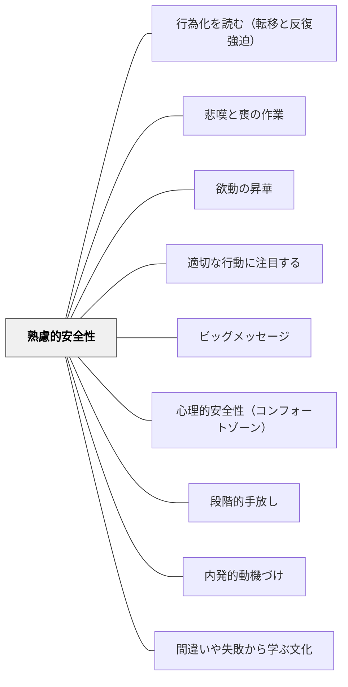

# 熟慮的安全性

**このパタンが完成を助ける大きなパタン**：[[パタン/文化をつくる]]・[[パタン/アドベンチャー]]

**一文でいうと**：認められる経験を意図して積み重ね、「ここでは考えを出しても大丈夫」という確信を子どもの中に育てる。

## 使いどころ・使いすぎ注意

| 観点 | 内容 |
| --- | --- |
| 使いどころ | 発言や挑戦が少ないとき。間違えることを怖がる様子が見えるとき。年度初めや、新しい集団をつくるとき。 |
| 使いすぎ注意 | 安全だけを目的にすると、挑戦のない教室になる。安全は、ストレッチゾーンへ出ていくための土台である（[[パタン/アドベンチャー]]）。 |

> 認められる経験が積み重なることで、ここは安全だという確信になる。

## 背景（Context）

「心理的安全性」はAmy Edmondsonによって研究され、「チームの中で対人リスクを取っても安全だという信念」として定義された。しかし心理的安全性はただ「安全です」と宣言すれば生まれるものではない。実際に認められる経験・受け入れられる経験が積み重なることで、初めて「ここは安全だ」という確信が育つ。

「熟慮的安全性」は、この「実際の経験による安全性の積み上げ」を指す。熟慮的に——つまり意図的に、繰り返し——認められる場をつくることで、心理的安全性の土台を形成するパタンだ。

## 問題（Problem）

「このクラスは安全ですよ」と言っても、子どもたちはすぐには信じない。特に、過去に否定された経験・笑われた経験・無視された経験がある子は、言葉だけでは動かない。経験による積み重ねが必要だ。

## 力のかたち（Forces）

- 安全性は「宣言」ではなく「経験の積み重ね」で生まれる
- 1回の認められる経験では不十分——繰り返しが必要
- 認められる経験は小さくても構わない——正解でなくても「あなたの考えを聞いた」という事実が積み重なる
- 教師の言動・表情・反応が安全性の証拠として子どもに読まれている

## 解決（Solution）

**意図的に、繰り返し「認められる経験」を積み重ねる設計をせよ。**

**近いパタンとの見分け**：学級の文化の表では、本パタンの見分けの問いは「「認められる経験」を、意図して繰り返し積み重ねているか」。全体の表は [[パタン/文化をつくる#近いパタンとの見分け|文化をつくる]] にある。

---

### 熟慮的安全性をつくる実践的手立て

**発言・間違いへの反応**
- 間違いや的外れな発言に対して「なるほど」「そういう考え方もあるね」と受け取る
- 「正解かどうか」の前に「考えたこと自体」を認める

**ペアワーク・小集団での安全性**
- いきなり全体発表ではなく、ペア→小集団→全体の順に発言のリスクを段階的に下げる

**ルーティンによる安全性**
- 毎授業の始めに「今日の一言」「思ったことを書く」などの低リスク発信の機会をつくる
- 習慣化することで「ここでは発信することが普通」という文化になる

**教師自身の開示**
- 教師が「わからないことがある」「間違えた」と開示することで、不完全さが認められる証拠になる

---

### 「適切な行動に注目する」との接続

「適切な行動に注目する」パタンで子どもの行動を具体的に認めることが、熟慮的安全性の最も直接的な実践だ。「○○さんが手を挙げた」「△△さんが質問した」——その行動への注目と言語化が、「ここでは挑戦することが認められる」という経験の積み重ねになる。

### この楕円の下で働くパタン

| パタン | どう働くか |
| --- | --- |
| [[パタン/適切な行動に注目する]] | 望ましい行動を名指して認める。熟慮的安全性のいちばん直接的な実践 |
| [[パタン/段階的手放し]] | ペア→小集団→全体のように、発言のリスクを段階的に下げてから渡していく |
| [[パタン/ビッグメッセージ]] | 学級全体への価値観の発信が、一人ひとりへの認める経験と組み合わさる |
| [[パタン/間違いや失敗から学ぶ文化]] | 間違いを学びの材料として扱う規範を、学級の文化にする |
| [[パタン/心理的安全性（コンフォートゾーン）]] | 目指す状態の定義。本パタンは、それを経験の積み重ねでつくる設計 |

### 研究の裏づけ

> **研究の裏づけ（2026-11-01）**：米国教育科学研究所の小学校の行動上の問題の実践ガイド（Epstein ほか 2008）は、望ましい行動を認め、問題行動には注目という強化を与えないことを、代わりになる行動を教える勧め（根拠 strong）の一部とした。叱ることも、注目を求めて行動する子にはほうびになりうる。ガイドは肯定的な言葉と修正の言葉を4対1にすることも勧めるが、比率そのものを確かめた研究かは未確認である。認める経験を意図して積み重ねるという本パタンの手立てに近い。出典：[[文献/小学校の教室での行動上の問題を減らす（Epsteinほか2008）]]。

> **研究の裏づけ（2026-11-01）**：『How People Learn』（2000）は、「まちがえたところや知らないところを見つかってはいけない」という暗黙の規範があると、子どもは分からないときに質問したり、新しい問いを試したりするのをためらうとする（p. 145）。日本の教師がまちがえた子の考えを学級で話してもらうやり方が全員の理解を深めるのは、誤りの分析を尊重する学級の文化を教師が育ててきたからで、手立てだけを取り入れても同じ結果は出ないかもしれない、とも書く（p. 147）。また、熟達者を「答えを全部知っている人」と考えると助けを求めにくくなり、「すぐれた初学者」という見方に替えると学び続けやすくなった例を挙げる（p. 48）。上の「教師自身の開示」は、この見方と重なる。出典：[[文献/人の学び方の研究を授業の設計につなぐ（全米研究評議会2000）]]。

> **研究の裏づけ（2026-11-01）**：ステレオタイプ脅威を和らげるとされる、大切な価値を書く短い作文（自己肯定化）について、同じ学区・同じ手順の二つの無作為化比較（Hanselman ほか 2017、7年生）では、1年目は黒人とヒスパニックの生徒の8年生の成績に効果が残った（d = 0.15）が、翌年の学年では効果がなかった（d = −0.07）。実施の仕方・生徒の書いたもの・生徒の違い・学校の文脈のどれも、差を説明しなかった。安心の手立ては、短い一回の活動よりも、日々の学級の関わりの中で育てるほうが確かかもしれない（Results・Discussion）。出典：[[文献/価値を書く短い作文の効果が、同じ学区の翌年に消えたことを確かめる（Hanselmanほか2017）]]。

> **研究の裏づけ（2026-11-05）**：「考えを出しても大丈夫」は、ほめる量より、何を認めるかで育つ。Railside 高校の数学の教師は、話し合いで目立たなかった生徒のつぶやきを拾って「いい考えだ、大事だよ」と返し、ほかの生徒の発言を「それは○○さんの考えにつながるね」と結んだ。複雑指導を作った Cohen は、こうした言葉かけは、公に・知的な中身について・具体的に・グループの課題に関係して返すべきだとする（p. 633）。教師はまた、助けを求められたら助ける責任と、分からなければ助けを求める責任の二つを、どの生徒にも伝えていた（p. 632）。成績の低かった生徒は、級友に「なぜそうしたの？」と聞くことで助けられたと話している（pp. 631–632）。一方で教師は、生徒が苛立っていても課題の難しさを下げなかった（pp. 635–636）。安全は、課題をやさしくすることとは別のものとして扱われていた。観察と面接による記述で、この言葉かけだけの効果は確かめられていない。出典：[[文献/能力で分けない数学の学級で、学科全体が一つの教え方を続けると、生徒の学びと格差はどう変わるかを、三つの高校を追って確かめる（BoalerとStaples2008）]]。

> **研究の裏づけ（2026-11-05）**：心理的安全性の原典（Edmondson 1999）自体が、安全の信念は経験の積み重ねで育つと想定している。著者は、チームのメンバーの多くは、自分や他人の失敗を話し合ったときに感謝や関心が示される経験をしてきたとき、失敗しても拒まれないと結論すると書く（p. 355）。また、心理的安全性は、なれ合いの許しでも、いつも前向きな気分でもなく、発言しても恥をかかされない・拒まれない・罰せられないという確信だとする（p. 354）。米国の製造会社の51のチーム（427人）の調査では、心理的安全性の高いチームほど、質問・助けを求める・失敗を話すなどの学ぶ行動が多く、学ぶ行動を通して、外の管理職がつけた成果の評価と結びついた（pp. 365–368）。学ぶ行動の少ないチームでは「リーダーは、うまくいっていないことを知りたがらない」という声があった（p. 374）。ただし大人の職場の、一時点の調査で、因果は示せない。経験が積み重なって安全の信念が育つ過程そのものは、この研究では調べられていない（p. 379）。出典：[[文献/失敗しても責められないとチームで思えることは、質問や失敗の話し合いなどの学ぶ行動と結びつくかを、51の職場のチームで確かめる（Edmondson1999）]]。

## 結果（Consequences）

- 時間をかけて「ここは安全だ」という確信が子どもの中に育つ
- 挑戦・発言・質問が増える——リスクを取ることへの恐れが薄れる
- 認められる経験が積み重なることで、学習への内発的動機が育ちやすくなる

## 境界

[[パタン/心理的安全性（コンフォートゾーン）]]＝目指す状態の定義／本パタン＝それを経験の積み重ねで作る設計

⚖ **緊張関係**: [[緊張関係マップ]] — [[パタン/親近感と刺激を組み合わせる]]・[[パタン/アドベンチャー]] と拮抗する。判断軸：〈安全基盤の上に挑戦を設計する〉

## 関連パタン
- [[パタン/行為化を読む（転移と反復強迫）]]
- [[パタン/悲嘆と喪の作業]]
- [[パタン/欲動の昇華]]
- [[学級経営/学級経営で使えるパタン]]
- [[実践/発達特性別の環境調整]]
- [[学級経営/心理的安全性]]

- [[パタン/適切な行動に注目する]] — 熟慮的安全性の最も直接的な実践
- [[パタン/ビッグメッセージ]] — 全体への価値観の発信が個別の認め経験と組み合わさる
- [[パタン/心理的安全性（コンフォートゾーン）]] — 熟慮的安全性が心理的安全性の基盤になる
- [[パタン/段階的手放し]] — リスクを段階的に下げながら発信の機会をつくる
- [[パタン/内発的動機づけ]] — 安全性は自律性・有能感の前提条件
- [[パタン/間違いや失敗から学ぶ文化]] — 間違いを学びの材料にする規範。安全性を学級の文化の側から支える
- [[文献/小学校の教室での行動上の問題を減らす（Epsteinほか2008）]] — 望ましい行動を認め、問題行動に注目を与えない（strong の勧めの一部）
- [[文献/人の学び方の研究を授業の設計につなぐ（全米研究評議会2000）]] — 誤りを見つかってはいけないという規範（p. 145）と、すぐれた初学者（p. 48）
- [[文献/価値を書く短い作文の効果が、同じ学区の翌年に消えたことを確かめる（Hanselmanほか2017）]] — 短い自己肯定化の作文の効果が翌年に消えた追試
- [[文献/入学前に「つまずきはよくあり、乗り越えられる」と伝える短い介入が、だれに効いたかを確かめる（Yeagerほか2016）]] — 所属の不安を、よくあるつまずきとして読み替える短い介入
- [[文献/能力で分けない数学の学級で、学科全体が一つの教え方を続けると、生徒の学びと格差はどう変わるかを、三つの高校を追って確かめる（BoalerとStaples2008）]] — 能力の割り当て（公に・中身について・具体的に）と、助けを求める責任を伝えること
- [[文献/失敗しても責められないとチームで思えることは、質問や失敗の話し合いなどの学ぶ行動と結びつくかを、51の職場のチームで確かめる（Edmondson1999）]] — 原典：失敗を話したときに感謝と関心が返る経験で、拒まれないと思えるようになる（著者の想定）・大人の職場の一時点の調査
- [[文献/罰ではなく、生徒の気持ちを理解し関係を保つ生徒指導の考え方を教師に伝えると、停学は減るかを確かめる（Okonofuaほか2016）]] — 教師の考え方に働きかけて、学校を心理的に安全な場にする

## クラスター図

## Actionable Insight

- 今日の授業で1人の子どもが何か発言したとき、内容の正誤より前に「考えてくれてありがとう」と言う——小さな認める経験の積み重ねが安全性をつくる
- 授業の最初5分を「答えなくてもいい発問」に使う——「どう思う？」と全員に問い、挙手や書くだけで認められる経験をつくる
- 自分が間違えた場面を週1回意識的に見せる——教師の失敗開示が「ここは失敗してもいい場所」の証拠になる

## 出典

Edmondson, A. C. (1999). Psychological safety and learning behavior in work teams. *Administrative Science Quarterly*, 44(2), 350–383.（職場のチームの研究。子どもの教室に当てはめるのは本 Wiki の解釈）  
岩井輝久「教育のパタン・ランゲージ（適切な行動に注目する・熟慮的安全性記述）」
