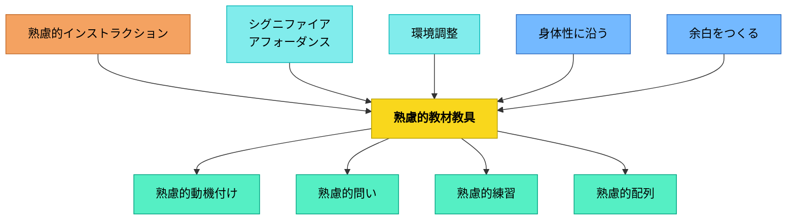

# 熟慮的教材教具

**一文でいうと**：教材・教具を、価値・目的・使いやすさ・学習者の経験から吟味して設計する。

## 使いどころ・使いすぎ注意

| 観点         | 内容                                               |
| ------------ | -------------------------------------------------- |
| 使いどころ   | 教材の意図や使い方が伝わりにくいとき。             |
| 使いすぎ注意 | 教材を作り込みすぎると、子どもの工夫の余地が減る。 |

> 教育材料について考えない日はない——教材・教具の設計と選択を熟慮することが教育の質を決める。

## 背景（Context）

※旧パタン「熟慮的教育材料」を本ページに統合した（2026-11-11）。2026年6月に「熟慮的教材教具」へ改名したとき、旧ページが残って二枚になっていた。旧ページだけにあった「3軸のチェック」を解決の頭に移した。

教育材料（教材・教具）は教育実践の中核をなす。教科の分類そのものが「価値」から出発している（牧口常三郎）。どんな教材を選び、どう設計し、どう改善するかは教育の成否に直結する。

一方で、教材や教具の選定・デザインは「手近なもの」や「慣例的なもの」に依存されがちである。時間が限られていたり、多様な子どもたちに同時に対応しなければならない場面では、教材教具そのものに深く意識を向けることが後回しにされてしまう。

鈴木克明「教材設計マニュアル」・牧口常三郎の価値論・スペンサーの活動分類・ノーマンのシグニファイアなど複数の理論が交差する領域がここにある。

## 問題（Problem）

教材が「手元にあるから使う」「教科書をそのまま使う」というデフォルトになりがちで、どんな価値・目的のためにどんな教材を設計・選択すべきかという熟慮がなされない。また、教材や教具の選定が不十分な場合、学習者にとって不自然な負荷がかかる。

例：左利きの子どもが数字を書こうとしても、自分の手が数字を隠してしまい、計算がスムーズに進まない。

## 力のかたち（Forces）

- 教育材料には価値論的な根拠（利・善・美）が必要
- 教材設計には引き算の発想が重要（足し算よりも減らす）
- 学習者のレディネス・動機付け・イメージ形成が教材効果に影響する
- 教材の分析手法（クラスター・手順・階層）が設計を精緻化する
- アナログな実装技法（切り貼り・ポケット・色分け）も設計の一部
- 教材教具は学習者にとっての「経験の媒体」であり、身体的・認知的インタラクションの質に強く影響を与える
- 「教材をどう使うか」ではなく「教材自体の質」が教育の本質的な成果を左右する場面も多い
- 学習者の多様性（利き手・特性・年齢など）に対する配慮が求められる

## 解決（Solution）

**教育材料の源泉・価値・種類・設計手順・実装技法を熟慮し、以下のパターンを文脈に応じて重ねて教材を設計・改善する。**

**まず手元に置く3つの問い**（旧「熟慮的教育材料」の3軸のチェック。下位パタンの多いこのページの入口として本Wikiが置いた）：

| 軸 | 問い | 合わないときは |
| --- | --- | --- |
| **価値**（利・善・美。牧口常三郎） | 子どもの生活や学習に役立つか。倫理的に適切で、だれも傷つけないか。美しく、使いたいと思えるか | 教材を選び直す。目的のない教材は意味を届けにくい |
| **シグニファイア**（ノーマン） | 何をすればいいかが、材料そのものから伝わるか | 指示を補うか、もっとはっきりした素材に替える |
| **身体性** | 左利き・感覚の過敏さ・発達の多様さなど、多様な身体で使えるか | ユニバーサルデザインの視点で見直す |

あわせて「何を足すか」より先に「何がなくてもよいか」を問う（[[パタン/引き算＞足し算（教材）]]）。

教材や教具を選ぶとき・作るときには、それが**どのようなインタラクションを可能にするのか（アフォーダンス）**、**何を学習者に示唆しているのか（シグニファイア）**を熟慮する。「誰にとって使いやすいか」「誰にとって障壁となるか」を具体的に想像して設計する。

**具体例：**

- 左利きにも対応したレイアウト設計（10マス計算ドリル、1行マス計算プリント）
- 書く場所が明示されているワークシート（記入欄が視覚的に明確）
- 子どもが操作しやすいサイズ・形状の教具（はさみ・のり・パズルなど）
- むげんプリントの「1行マス計算プリント」：左右どちらの利き手にも対応し視覚的にも整っている
- 杉渕鐵良の「10マス計算ドリル」：スモールステップ設計で成功体験を積み重ねやすい

似た教材のパタンのどれを使うかで迷ったら、下の「[[#近いパタンとの見分け|近いパタンとの見分け]]」の表を見る。

### 教育材料の源泉と価値論（牧口常三郎）

| パタン                          | 核心                                   |
| ------------------------------- | -------------------------------------- |
| [[パタン/教育目的]]             | 教育材料の存在理由——何のために教えるか |
| [[パタン/価値]]                 | 利・善・美——教育材料を選ぶ根拠         |
| [[パタン/生活環境]]             | 生活する環境そのものが教育材料になる   |
| [[パタン/自然的環境]]           | 自然環境との関わりから価値が生まれる   |
| [[パタン/自然現象]]             | 自然事象を教育材料として設計する       |
| [[パタン/社会的環境]]           | 社会的環境を教育材料として活かす       |
| [[パタン/人生現象]]             | 人生の出来事・ドラマを教育材料にする   |
| [[パタン/利的経済的価値の創造]] | 有用性・経済的価値を育む教育材料       |
| [[パタン/善的道徳的価値の創造]] | 道徳的・倫理的価値を育む教育材料       |
| [[パタン/美的美術的価値の創造]] | 美的価値・芸術的感性を育む教育材料     |

### 教育材料の種類・素材

| パタン                    | 核心                               |
| ------------------------- | ---------------------------------- |
| [[パタン/本]]             | 書籍・絵本・読み物を教材として使う |
| [[パタン/図画・地図]]     | 図・地図・グラフを見て読む教材     |
| [[パタン/半具体物]]       | 操作可能な半具体的教材             |

### 活動の分類（スペンサー）

| パタン                                                    | 核心                           |
| --------------------------------------------------------- | ------------------------------ |
| [[パタン/直接の自己保存に関する活動]]                     | 生理学などの直接的健康維持活動 |
| [[パタン/間接の自己保存に関する活動]]                     | 数学・物理学・化学・生物学など |
| [[パタン/子孫の教育を目的とする活動]]                     | 育児法など次世代を育てる活動   |
| [[パタン/適当なる社会的政治的関係を維持しようとする活動]] | 社会科学・歴史学など           |
| [[パタン/人生の趣味を満足させる活動]]                     | 美術・絵画・音楽など           |

### 知識体系の分類（牧口常三郎）

| パタン                                                  | 核心                           |
| ------------------------------------------------------- | ------------------------------ |
| [[パタン/キーコンセプト（胚細胞的概念）]]               | 教科の核となる概念が教育材料   |
| [[パタン/自然法則に関する知識体系]]                     | 物理・生物などの法則体系       |
| [[パタン/社会法則に関する知識体系]]                     | 社会科学から出る法則体系       |
| [[パタン/自然と人類との相関に成る価値に関する知識体系]] | 人間が創造した価値の表現法体系 |
| [[パタン/身体動作を以ってする直接的表現法]]             | 遊び・体操・ダンスなど         |
| [[パタン/立体的創作品を以ってする表現法]]               | 工芸・工作などの生産的教科     |
| [[パタン/平面的創作品を以ってする表現法]]               | 図画・地図などを描いて表す     |
| [[パタン/言語という符号の組み立てを以ってする表現法]]   | 歌・談話・文章・数式・音楽など |

### 教材設計の原則（大きな視点）

| パタン                                                    | 核心                                 |
| --------------------------------------------------------- | ------------------------------------ |
| [[パタン/引き算＞足し算（教材）]]                         | 教材は足すより引く                   |
| [[パタン/想像力（感情）を触発する]]                       | 感情と想像力に働きかける設計         |
| [[パタン/熟慮的配列]]                                     | 教材の順序・配列を熟慮する           |
| [[パタン/ゲーム]]                                         | 教材のゲーム化                       |
| [[パタン/ソーシャル]]                                     | 社会的関係を教材として活かす         |
| [[パタン/オンボーディング]]                               | 学習の土台に乗せる                   |
| [[パタン/イメージ]]                                       | 具体的な姿・お手本を持てるようにする |
| [[パタン/フィードバック]]                                 | 教材の中にフィードバックを組み込む   |
| [[パタン/シグニファイア]]                                 | 何ができるかが見て分かる設計         |
| [[パタン/熟慮的動機づけ]]                                 | 動機付けを意図的に設計する           |
| [[パタン/切実性（必要感）]]                               | 必要感・意味を見出せる設計           |
| [[パタン/多方興味]]                                       | 多様な興味を活かす                   |
| [[パタン/アドベンチャー]]                                 | リスクを負う設計                     |
| [[パタン/未完成教材\|自分のやり方で自由にできる（考える余地がある）]] | 考える余地を残す（未完成教材に統合） |
| [[パタン/モヤモヤを置く]]                                 | 葛藤・コンフリクトを仕込む           |

### 教材設計手順（鈴木克明「教材設計マニュアル」）

| パタン                                      | 核心                             |
| ------------------------------------------- | -------------------------------- |
| [[パタン/教材をイメージする]]               | 完成形をイメージしてから設計する |
| [[パタン/出入り口を明確にする（目標設定）]] | 学習の開始点とゴールを明確にする |
| [[パタン/テストを作成する]]                 | 先にテストを作り目標を明確化する |
| [[パタン/教材の構造を見極める]]             | 教材の知識・スキル構造を分析する |
| [[パタン/教え方の作戦を立てる]]             | 指導方略を選択・設計する         |
| [[パタン/形成的評価]]                       | 試用・改善サイクルを回す         |
| [[パタン/教材を改善する]]                   | 評価に基づいて継続的に改善する   |

### 教材分析手法

| パタン                      | 核心                               |
| --------------------------- | ---------------------------------- |
| [[パタン/問題設定]]         | 何を解決するための教材かを設定する |
| [[パタン/課題設定]]         | 学習者が取り組む課題を設計する     |
| [[パタン/クラスター分析]]   | 内容の関連を束として分析する       |
| [[パタン/手順分析]]         | 手順・プロセスを分解して分析する   |
| [[パタン/階層分析]]         | 概念・スキルの上下関係を分析する   |
| [[パタン/自己選択自己決定]] | 学習者が選択・決定できる設計       |

### 設計技法

| パタン                        | 核心                                       |
| ----------------------------- | ------------------------------------------ |
| [[パタン/制限化限定化]]       | 範囲を絞ることで集中を高める               |
| [[パタン/自己説明（精緻化）]] | 自分で説明することで理解を深める               |
| [[パタン/可視化]]             | 見える形で示す                             |
| [[パタン/仕組み化]]           | 自動的に動く仕組みに組み込む               |
| [[パタン/対応づけ]]           | 操作と結果の対応を分かりやすくする         |
| [[パタン/概念モデル]]         | 使い方が分かるメンタルモデルを提供する |

### 教材の内容要素

| パタン                              | 核心                                     |
| ----------------------------------- | ---------------------------------------- |
| [[パタン/熟慮的問い]]               | 教材の中の問いを設計する                 |
| [[パタン/熟慮的インストラクション]] | 教材の中の説明・指示を設計する           |
| [[パタン/フィードバック]]           | 教材の中の評価・フィードバックを設計する |
| [[パタン/記憶術]]                   | 記憶を助ける技法を組み込む               |

### 実装技法（アナログ）

| パタン                        | 核心                               |
| ----------------------------- | ---------------------------------- |
| [[パタン/切り貼り]]           | 既存の教材を組み替えて最適化する   |
| [[パタン/ポケット]]           | 教材に収納・整理の仕組みを組み込む |
| [[パタン/色分け]]             | 色で意味・構造を示す               |
| [[パタン/名前を書く欄がある]] | 自分のものだと感じられるようにする   |

### 課題設計

| パタン                          | 核心                               |
| ------------------------------- | ---------------------------------- |
| [[パタン/エクセレンスの収集家]] | 良い事例を集め学習者に示す         |
| [[パタン/課題の調整]]           | 課題の難易度・量を学習者に合わせる |

### 研究の裏づけ

> **研究の裏づけ（2026-10-31）**：『How People Learn』（2000）は、Ball（1993）が3年生に負の数を教えた例を紹介する。ふしぎなピーナッツ・お金・ゲームの得点・数直線上のかえる・地下のある建物など、多くのモデルを検討し、まず建物の階のモデル、次にお金のモデルを使った。階のモデルは「負の数は0と同じ」という誤解を防ぐのに役立つと考えたが、負の数のひき算は表しにくいと分かっていた。実際、5 + (−6) のような問題は扱えず、「−5 は −2 より低いが、小さいとは限らない」という感覚になる心配があった（pp. 166–168）。どのモデルにも限界があり、限界を知って複数のモデルを使い分けることが、教科を教えるための知識の中身だとする。出典：[[文献/人の学び方の研究を授業の設計につなぐ（全米研究評議会2000）]]。

> **研究の裏づけ（2026-11-01）**：教材を深く学ぶことの効果について、Lewis と Perry（2014）の無作為化比較では、分数の教材研究の手引き（日本の教科書と教師用指導書・授業ビデオ・研究論文など）を使って授業研究をした米国の教師のグループが、分数の知識の四つの面のうち三つで有意に伸びた。開発者でない第三者による追試（Schoen ほか 2023）では、分数の手引きを受けた二群で授業の質が上がった（授業研究つき 0.82、一人で学ぶ 0.73）が、子どもの分数のテストはどの群も比較群を上回らなかった（pp. 238–239）。教材を深く学ぶことは授業を良くしたが、子どもの成績まで届くかは、まだ確かめられていない。出典：[[文献/教材の手引きを添えた授業研究で教師の分数の知識が伸びる（LewisとPerry2014）]]・[[文献/授業研究と分数の手引きの効果を追試で分けて確かめる（Schoenほか2023）]]。

> **研究の裏づけ（2026-11-01）**：小学校の算数のメタ分析（Pellegrini ほか 2021）では、教科書やデジタル教材を研修少なめに入れ替えた30研究の効果は +0.05 と小さかった。教材を入れるための研修（2日以上）を伴うと、紙の教材は +0.12、デジタル教材は 0.00 だった（表2、p. 23）。教材は、入れ替えるだけでなく、使い方を教師がつかむまで支えると効きやすい。出典：[[文献/小学校の算数で効いたプログラムの種類を確かめる（Pellegriniほか2021）]]。

> **研究の裏づけ（2026-11-01）**：授業研究を含む教員研修の104研究のメタ分析（Sims ほか 2021）では、授業研究・コーチング・学習共同体という形の効果はどれも 0.06〜0.09 で差がなく、形よりも研修に含まれる仕組みの数が効き目を分けた。教材の手引きを添えた授業研究も、計画・仲間の支え・フィードバックに、手本や練習などの仕組みを足すと効きやすいと読める（pp. 34–36）。出典：[[文献/教員研修の効き目を、研修に含まれる学びの仕組みの数で確かめる（Simsほか2021）]]。

> **研究の裏づけ（2026-11-05）**：具体物は、置くだけでは効かない。55の研究のメタ分析（Carbonneau ほか 2013）では、算数の具体物は条件しだいで学びを助けるにとどまり、3〜6歳では効果がとても小さく、ときに負だった。Laski ほか（2015）は、認知科学の研究から、具体物を効かせる四つの原則を引き出す。①同じ具体物を長い期間、一貫して使う（1年以上使うと中程度の効果、短い期間では具体物なしと変わらない）、②見てすぐ分かる表し方から始め、だんだん抽象的な表し方に移る、③日常の物に似た具体物や、関係のない目立つ特徴のある具体物を避ける（本物そっくりのお札と硬貨では、数字だけの紙よりまちがいが多かった）、④具体物と算数の概念の関係を、言葉と身ぶりではっきり説明する（pp. 2–6）。具体物は概念そのものではなく、概念を表す物なので、何を表しているかを読み取るには抽象的な思考が要る、というのが出発点である（p. 2）。ただし文献の見直しによる原則の提案で、四つを組み合わせた効果は確かめられていない。著者4人のうち3人は米国モンテッソーリ協会の関係者である。出典：[[文献/算数の具体物は、どう使えば効くのかを、認知科学の四つの原則とモンテッソーリ教育の教具から考える（Laskiほか2015）]]。

## 近いパタンとの見分け

教材・教具のパタンは、設計の手順、何を学ぶ教材か、教師の教材研究、引く・空ける、見て分かる、小さな実装、具体と身体、で分かれる。上の一覧は出どころの系列（牧口・スペンサー・鈴木克明など）ごとなので、ここでは教材をつくるときに迷う順に並べ直す。牧口とスペンサーの分類は、下の「系列の中の小さなまとまり」の表に分けて並べる。

| 迷いどころ | パタン | 見分けの問い |
| --- | --- | --- |
| 設計の手順（鈴木） | [[パタン/教材をイメージする]] | 設計の最初に、完成した教材とその使われ方を思い描いているか |
| 設計の手順（鈴木） | [[パタン/出入り口を明確にする（目標設定）]] | 学習前の状態（入り口）と学習後にできること（出口）を書き、その差を教材で埋めているか |
| 設計の手順（鈴木） | [[パタン/テストを作成する]] | 教材より先に、学習後に答えられるべき評価問題をつくっているか |
| 設計の手順（鈴木） | [[パタン/教材の構造を見極める]] | 教える内容を、クラスター・手順・階層の観点で分析しているか |
| 設計の手順（鈴木） | [[パタン/教え方の作戦を立てる]] | 提示・例・練習・フィードバックの組み立てと順序を決めているか |
| 設計の手順（鈴木） | [[パタン/教材を改善する]] | 使ったあとのつまずきと反応を記録し、次に直しているか |
| 何を学ぶ教材か | [[パタン/問題設定]] | 子どもが「解決したい・知りたい」と感じる問題を、出発点に据えているか |
| 何を学ぶ教材か | [[パタン/課題設定]] | 目標に合った難しさ・文脈・意味をもつ課題にしているか |
| 何を学ぶ教材か | [[パタン/課題の調整]] | 子どもの状態に応じて、難しさ・量・形を変えられる選択肢があるか |
| 教師の教材研究 | [[パタン/素材研究から発問内容を見出す]] | 教師が自分で教材をやってみて、問いたいことを見つけているか |
| 教師の教材研究 | [[パタン/問題解決的教材研究]] | 教師が「疑問→調べる→解決」を自分で歩き、その道を授業の骨格にしているか |
| 引く・空ける | [[パタン/引き算＞足し算（教材）]] | 足す前に、目標に要らない情報・装飾・手順を削っているか |
| 引く・空ける | [[パタン/未完成教材]] | 教材に意図的な空きを残し、子どもが自分の考えややり方で埋めているか（旧「自分のやり方で自由にできる」を統合） |
| 引く・空ける | [[パタン/モヤモヤを置く]] | 学習の終わりに、解けない問いや引っかかりを残しているか |
| 引く・空ける | [[パタン/余白をつくる]] | 1時間や教材の中に、子どもが自分のペースで考える時間と空間があるか（間の系列の表は余白をつくるにある） |
| 見て分かる | [[パタン/シグニファイア]] | 何ができるか・何をするかが、教材を見ただけで分かるか（旧「シグニファイアアフォーダンス」を統合） |
| 見て分かる | [[パタン/可視化]] | 見えない・あいまいなものを、目に見える形にしているか（大パタン。シグニファイアはその一部） |
| 見て分かる | [[パタン/概念モデル]] | 仕組みの全体像を、図やモデルで渡しているか |
| 見て分かる | [[パタン/対応づけ]] | 新しい内容と、子どもがすでに知っていることとの対応・類似・対比を示しているか |
| 見て分かる | [[パタン/ナッジ]] | 選択肢を閉じずに、望ましい行動へそっと押す配置になっているか |
| 見て分かる | [[パタン/仕組み化]] | 「いつ・何を・どうやって」が自明になるルーティンを、教材に組み込んでいるか |
| 小さな実装 | [[パタン/色分け]] | 色に一貫した意味をもたせ、形や位置とも組み合わせているか |
| 小さな実装 | [[パタン/名前を書く欄がある]] | 名前の欄で、教材を「自分のもの」と感じられるか |
| 小さな実装 | [[パタン/ポケット]] | カードや資料を出し入れできる場所があるか（足場として、要らなくなれば抜ける） |
| 小さな実装 | [[パタン/切り貼り]] | 別の紙に書いて貼ることで、失敗を気にせず試せるか |
| 具体と身体 | [[パタン/操作物による概念形成]] | 触れて動かせる物を、考えるための道具として使っているか |
| 具体と身体 | [[パタン/半具体物]] | 実物と記号のあいだに、絵や図の段を挟んでいるか |
| 具体と身体 | [[パタン/身体性に沿う]] | 体の動き・空間の配置・触れることを、理解や表現の手立てにしているか |
| 具体と身体 | [[パタン/表し方の形を計算の形に合わせる（表現が誤りを強めることがある）]] | 表し方の上の操作が、式の上の操作と一対一に対応しているか |
| そのほか | [[パタン/記憶術]] | 覚えにくい内容に、韻・頭字語・イメージ・場所法などの手がかりを添えているか（理解への橋として） |
| そのほか | [[パタン/カット技法（映像の一部を寸断し時間を省略する表現技法）]] | 映像を、目標に要る部分だけに切って見せているか |
| そのほか | [[パタン/エクセレンスの収集家]] | 優れた作品や実践を集め、なぜ優れているかを言葉にしているか |

**混同しやすい組**：
- [[パタン/問題設定]]・[[パタン/課題設定]]・[[パタン/課題の調整]]：問題設定は、何を解決するための教材かという出発の問題。課題設定は、子どもが取り組む課題の難しさ・文脈・意味。課題の調整は、子どもの状態に応じた変え方。
- [[パタン/素材研究から発問内容を見出す]] と [[パタン/問題解決的教材研究]]：どちらも教師が先に教材を体験する。前者は体験から「問いたいこと」を見つけ（土居）、後者は「疑問→調べる→解決」の道そのものを授業の骨格にする（小倉）。
- [[パタン/未完成教材]]・[[パタン/モヤモヤを置く]]・[[パタン/余白をつくる]]：未完成教材は教材の空きを子どもが埋める。モヤモヤを置くは、終わりに解けない問いを残す。余白をつくるは、1時間や教材の中の時間と空間の余白。
- [[パタン/シグニファイア]]・[[パタン/可視化]]・[[パタン/概念モデル]]・[[パタン/対応づけ]]・[[パタン/ナッジ]]：シグニファイアは「何ができるか」の印。可視化は見えないものを見えるようにする大パタンで、シグニファイアはその一部。概念モデルは仕組みの全体像、対応づけは既知との対応、ナッジは行動をそっと押す配置。
- [[パタン/操作物による概念形成]]・[[パタン/半具体物]]・[[パタン/表し方の形を計算の形に合わせる（表現が誤りを強めることがある）]]：操作物は動かして考える具体物、半具体物は実物と記号のあいだの段。表し方の形を合わせるは、どちらを使うときにも、表し方の操作が式の操作と一対一かを確かめる手順。
- [[パタン/教材の構造を見極める]] と [[パタン/クラスター分析]]・[[パタン/手順分析]]・[[パタン/階層分析]]：前者が親で、後の三つはその三つの観点。

**緊張**：
- [[パタン/シグニファイア]] と [[パタン/引き算＞足し算（教材）]]：印を足すか、削るか。見分けは、**その印がなかったら、初めて学ぶ子がどこで迷うか**である。迷うなら足し、迷わないなら削る。印は初めての子に効き、すでに知っている子には回り道になりうる（シグニファイアの研究の裏づけ）。
- [[パタン/操作物による概念形成]] と [[パタン/表し方の形を計算の形に合わせる（表現が誤りを強めることがある）]]：具体物や図は、使えば理解を助けるとは限らない。見分けは、**その表し方の上でする操作が、教えたい計算の操作と同じ形か**である。

### 系列の中の小さなまとまり（2026-11-13 追加）

上の表に入れなかった、牧口常三郎とスペンサーの分類（何のための教材か・教材の源・活動の種類・知識体系・表現法）、教材分析の三つの観点、教材に書き込む内容要素を、まとまりごとに並べる。分類の中の行は、その教材がどの価値・どの活動・どの表現につながるかで見分ける。

| 迷いどころ | パタン | 見分けの問い |
| --- | --- | --- |
| 何のための教材か（牧口） | [[パタン/教育目的]] | その教材を、何のために教えるのかが言えるか |
| 何のための教材か（牧口） | [[パタン/価値]] | その教材が、利・善・美のどの価値につながるかを考えて選んでいるか |
| 何のための教材か（牧口） | [[パタン/利的経済的価値の創造]] | 役に立つ・暮らしを支えるという価値を、子どもがつくり出す教材か |
| 何のための教材か（牧口） | [[パタン/善的道徳的価値の創造]] | 人と社会にとっての善さという価値を、子どもがつくり出す教材か |
| 何のための教材か（牧口） | [[パタン/美的美術的価値の創造]] | 美しさ・芸術的な感性という価値を、子どもがつくり出す教材か |
| 教材の源 | [[パタン/生活環境]] | 子どもが暮らす環境そのものを、教材として使っているか |
| 教材の源 | [[パタン/自然的環境]] | 身の回りの自然環境との関わりを、教材にしているか |
| 教材の源 | [[パタン/社会的環境]] | 地域・制度・人々の営みなど、社会の環境を教材にしているか |
| 教材の源 | [[パタン/自然現象]] | 雷・影・植物の成長など、「なぜそうなる」を生む自然の出来事を教材にしているか |
| 教材の源 | [[パタン/人生現象]] | 人の生き方や出来事のドラマを、教材にしているか |
| 教材の源 | [[パタン/本]] | 書籍・絵本・読み物を、教材として選んで使っているか |
| 教材の源 | [[パタン/図画・地図]] | 図・地図・グラフを、見て読む材料として手渡し、読み方を確かめているか |
| 活動の種類（スペンサー） | [[パタン/直接の自己保存に関する活動]] | 体と健康を守る知識（生理学など）につながる教材か |
| 活動の種類（スペンサー） | [[パタン/間接の自己保存に関する活動]] | 生計を支える知識（数学・物理・化学など）につながる教材か |
| 活動の種類（スペンサー） | [[パタン/子孫の教育を目的とする活動]] | 次の世代を育てる知識（育児など）につながる教材か |
| 活動の種類（スペンサー） | [[パタン/適当なる社会的政治的関係を維持しようとする活動]] | 社会と政治の関係を保つ知識（歴史・社会科学など）につながる教材か |
| 活動の種類（スペンサー） | [[パタン/人生の趣味を満足させる活動]] | 余暇と趣味を満たす知識（美術・音楽など）につながる教材か |
| 知識体系（牧口） | [[パタン/キーコンセプト（胚細胞的概念）]] | その教科の核になり、ほかの概念を生み出す概念を、教材の中心に置いているか |
| 知識体系（牧口） | [[パタン/自然法則に関する知識体系]] | 自然の法則（物理・生物など）を体系として学ぶ教材か |
| 知識体系（牧口） | [[パタン/社会法則に関する知識体系]] | 社会の法則（社会科学）を体系として学ぶ教材か |
| 知識体系（牧口） | [[パタン/自然と人類との相関に成る価値に関する知識体系]] | 人間が自然との関わりの中でつくり出した価値と、その表現を学ぶ教材か |
| 表現法（牧口） | [[パタン/身体動作を以ってする直接的表現法]] | 遊び・体操・ダンスなど、体の動きで表す教材か |
| 表現法（牧口） | [[パタン/立体的創作品を以ってする表現法]] | 工芸・工作など、立体の作品で表す教材か |
| 表現法（牧口） | [[パタン/平面的創作品を以ってする表現法]] | 図画・地図など、子どもが平面の作品を描いて表しているか |
| 表現法（牧口） | [[パタン/言語という符号の組み立てを以ってする表現法]] | 歌・談話・文章・数式・音楽など、符号を組み立てて表す教材か |
| 教材分析の観点（鈴木克明） | [[パタン/クラスター分析]] | 覚える内容を、関連のある束に分けて分析しているか |
| 教材分析の観点（鈴木克明） | [[パタン/手順分析]] | 手順やプロセスを、一つずつの段階に分けて分析しているか |
| 教材分析の観点（鈴木克明） | [[パタン/階層分析]] | 概念やスキルの上下関係（何ができれば何ができるか）を分析しているか |
| 教材に書き込む内容要素 | [[パタン/指示]] | 教材（紙・画面）に、何を・どのように・どこまでするかが一読でわかる指示を書いているか |
| 教材に書き込む内容要素 | [[パタン/説明]] | 教材の説明を、子どもの既有知識と水準に合わせ、例示・図・段階で組み立てているか |
| 教材に書き込む内容要素 | [[パタン/質問（教材設計）]] | 教材の節目に問いを埋め込み、立ち止まって考える場所をつくっているか |
| 設計技法 | [[パタン/制限化限定化]] | 範囲や条件をあえて絞り、安心して取り組めるようにしているか（岩井） |

**この表の中で混同しやすい組**：
- [[パタン/自然的環境]]・[[パタン/自然現象]]・[[パタン/自然法則に関する知識体系]]：自然的環境は自然との関わりそのもの、自然現象は「なぜ」を生む出来事、自然法則の知識体系は、そこから取り出した法則の体系。教材の源から体系へ、の順に並ぶ。
- [[パタン/社会的環境]] と [[パタン/社会法則に関する知識体系]]・[[パタン/適当なる社会的政治的関係を維持しようとする活動]]：社会的環境は教材の源、社会法則は知識の体系、スペンサーの活動は、その知識が人生のどの活動に役立つかの分類。
- [[パタン/クラスター分析]]・[[パタン/手順分析]]・[[パタン/階層分析]]：何を分析するかで分ける。覚える内容の束はクラスター、手順はプロセス、概念とスキルの上下は階層。
- [[パタン/指示]]・[[パタン/説明]]・[[パタン/質問（教材設計）]] と [[パタン/熟慮的インストラクション]]・[[パタン/熟慮的問い]]：前の三つは、教材（紙・画面）に書き込む内容要素。口頭の指示・説明の設計は熟慮的インストラクション、問いの型は熟慮的問いにある。
- [[パタン/制限化限定化]] と [[パタン/制約をかける（問い）]]・[[パタン/引き算＞足し算（教材）]]：制限化限定化は、学びの範囲そのものを絞る設計。制約をかける問いは、条件を狭めて発想を引き出す問い。引き算＞足し算は、教材の要素を削る原則。

## 結果（Consequences）

熟慮された教材教具は、子どもの能動性・集中・納得感のある学びを促進する。無用なストレスや混乱、指導側の説明・補助の負担を軽減する。学習の場がより「意味ある経験」として成立する。

- 教育材料が価値・目的に根ざして設計・選択されるようになる
- 教材の設計・改善が体系的なプロセスとして機能する
- 学習者の動機付け・理解・記憶が教材設計によって支援される

> 「道具のデザインが経験の質を変える。これは教育実践における重要なレバレッジポイントである。」

「熟慮的教材教具」は単なる機能性やコストの議論ではなく、「その道具が教育経験の何を可能にし、何を妨げるか」という視点から捉えることが求められる。

## [Pattern Connection]

**研究からの補足（2026-10-19）：算数を教えるための専門的な知識を見分ける（Ballほか2008）**

Ballほか（2008, pp. 398、402）の表現選択の議論からのWiki側の適用案として、十の束とばらの操作で繰り下がりを示し、筆算の各記号と対応させる。硬貨など別の教具とも比較し、交換の意味が見えるかを事前に試す。身近な素材であることだけで、目的に合う表現とは判断しない。 出典：[[文献/算数を教えるための専門的な知識を見分ける（Ballほか2008）]]。

**研究からの補足（2026-10-17）：教科内容を教えるための知識に変える（Shulman1986）**

原典はPCKに、類推・例・説明・実演などの表現と、学習者にとっての難しさの理解を含める（pp. 9–10）。Wiki側の適用案として、教材を選ぶ際に「何を示すか」「どこで誤解しやすいか」「別の表し方は何か」を一緒に記す。教材の新しさや見栄えだけで判断しないための補助視点とする。 出典：[[文献/教科内容を教えるための知識に変える（Shulman1986）]]。

## 関連パタン
- [[特別支援/視覚支援]]
- [[パタン/シグニファイア]]
- [[パタン/操作物による概念形成]]
- [[パタン/素材研究から発問内容を見出す]]
- [[パタン/半具体物]]
- [[特別支援/環境調整（特別支援）]]
- [[実践/個別教材の設計]]
- [[パタン/カット技法（映像の一部を寸断し時間を省略する表現技法）]]
- [[パタン/ナッジ]]
- [[パタン/可視化]]
- [[パタン/色分け]]
- [[パタン/熟慮的配列]]
- [[パタン/切実性（必要感）]]
- [[パタン/未完成教材]]
- [[パタン/問題解決的教材研究]]
- [[文献/人の学び方の研究を授業の設計につなぐ（全米研究評議会2000）]] — 負の数のモデル（建物の階とお金）の強みと限界（Ball）

- [[パタン/環境調整]] — 大きな上位パタン（引き算の原理）
- [[パタン/熟慮的インストラクション]] — 指示・説明の設計
- [[パタン/熟慮的動機づけ]] — 動機付けの設計
- [[パタン/熟慮的問い]] — 問いの設計
- [[パタン/熟慮的練習]] — 練習の設計
- [[パタン/身体性に沿う]] — 身体の動きと学びを接続する
- [[パタン/余白をつくる]] — 教材に余白を設けて子どもの思考を促す
- [[特別支援/TEACCHとシグニファイア]] — 構造化とシグニファイアの特別支援的応用
- [[パタン/表し方の形を計算の形に合わせる（表現が誤りを強めることがある）]] — 算数で表し方（図・具体物・数直線）を選ぶときの基準
- [[文献/教科内容を教えるための知識に変える（Shulman1986）]] — 教材の内容だけでなく、理解を助ける表現の選択肢を持つ。
- [[文献/算数を教えるための専門的な知識を見分ける（Ballほか2008）]] — 教具が見せる数学的関係と、見えにくくする点を比べる。
- [[文献/教材の手引きを添えた授業研究で教師の分数の知識が伸びる（LewisとPerry2014）]] — 分数の教材の手引きで教師の知識が伸びた
- [[文献/授業研究と分数の手引きの効果を追試で分けて確かめる（Schoenほか2023）]] — 手引きで授業の質は上がったが、子どもの成績は上がらなかった
- [[文献/小学校の算数で効いたプログラムの種類を確かめる（Pellegriniほか2021）]] — 教材の入れ替えと、教材を入れるための研修（紙 +0.12・デジタル 0.00）
- [[文献/教員研修の効き目を、研修に含まれる学びの仕組みの数で確かめる（Simsほか2021）]] — 授業研究などの研修の形より、中身の仕組みが効き目を分ける
- [[文献/算数の具体物は、どう使えば効くのかを、認知科学の四つの原則とモンテッソーリ教育の教具から考える（Laskiほか2015）]] — 算数の具体物を効かせる四つの原則（長く一貫して・具体から抽象へ・飾りを省く・関係を説明する）

**下位パタン（旧「熟慮的教育材料」の関連パタンから引き継ぎ）**：
- [[パタン/エクセレンスの収集家]]
- [[パタン/キーコンセプト（胚細胞的概念）]]
- [[パタン/クラスター分析]]
- [[パタン/テストを作成する]]
- [[パタン/フィードバック]]
- [[パタン/ポケット]]
- [[パタン/モヤモヤを置く]]
- [[パタン/人生の趣味を満足させる活動]]
- [[パタン/人生現象]]
- [[パタン/仕組み化]]
- [[パタン/価値]]
- [[パタン/出入り口を明確にする（目標設定）]]
- [[パタン/切り貼り]]
- [[パタン/利的経済的価値の創造]]
- [[パタン/名前を書く欄がある]]
- [[パタン/問題設定]]
- [[パタン/善的道徳的価値の創造]]
- [[パタン/図画・地図]]
- [[パタン/子孫の教育を目的とする活動]]
- [[パタン/対応づけ]]
- [[パタン/平面的創作品を以ってする表現法]]
- [[パタン/引き算＞足し算（教材）]]
- [[パタン/手順分析]]
- [[パタン/指示]]
- [[パタン/教え方の作戦を立てる]]
- [[パタン/教材の構造を見極める]]
- [[パタン/教材をイメージする]]
- [[パタン/教材を改善する]]
- [[パタン/教育目的]]
- [[パタン/本]]
- [[パタン/概念モデル]]
- [[パタン/生活環境]]
- [[パタン/直接の自己保存に関する活動]]
- [[パタン/社会法則に関する知識体系]]
- [[パタン/社会的環境]]
- [[パタン/立体的創作品を以ってする表現法]]
- [[パタン/美的美術的価値の創造]]
- [[パタン/自己説明（精緻化）]]
- [[パタン/自然と人類との相関に成る価値に関する知識体系]]
- [[パタン/自然法則に関する知識体系]]
- [[パタン/自然現象]]
- [[パタン/自然的環境]]
- [[パタン/言語という符号の組み立てを以ってする表現法]]
- [[パタン/記憶術]]
- [[パタン/説明]]
- [[パタン/課題の調整]]
- [[パタン/課題設定]]
- [[パタン/質問（教材設計）]]
- [[パタン/身体動作を以ってする直接的表現法]]
- [[パタン/適当なる社会的政治的関係を維持しようとする活動]]
- [[パタン/間接の自己保存に関する活動]]
- [[パタン/階層分析]]

## クラスター図
<!-- cluster: manual -->

## Actionable Insight

- ワークシートを設計するとき「左利きの子どもが使うとどうなるか」を一度確認する——多様な身体的条件を想定するだけで教材の質が変わる
- 今使っている教材から「学習者がやらなくても困らないもの」を1つ探して削ってみる——引き算の原理の第一歩は「足す前に削ること」
- 教具を選ぶとき「これは何を自然に促すか（アフォーダンス）」を1つ言語化する——意図を明示することで選択の根拠が明確になる

## 出典

- 牧口常三郎（1972）『牧口常三郎全集第4巻 創価教育学体系 上』聖教新聞社
- 鈴木克明（2002）『教材設計マニュアル――独学を支援するために』北大路書房
- Norman, D. A.（1988）. *The Design of Everyday Things*. Basic Books.
- [[文献/熟慮的教育材料のパターンリスト（動画記録）]] — 動画 https://youtu.be/yI220g9e6eE

---

## 下位パタン一覧

| パタン                                                    | サマリー                                                                                     |
| --------------------------------------------------------- | -------------------------------------------------------------------------------------------- |
| [[パタン/エクセレンスの収集家]]                           | 優れた作品・事例・実践（エクセレンス）を収集・分析することで、質の基準と感覚を育てる。       |
| [[パタン/キーコンセプト（胚細胞的概念）]]                 | 教科の核となる概念が、深い理解と転移の鍵を握る教育材料。                                     |
| [[パタン/クラスター分析]]                                 | 関連し合う知識・概念のかたまり（クラスター）を識別し、教材の構造を把握する。                 |
| [[パタン/シグニファイア]]                                 | 「何ができるか」が分かる教材が、学習者を自然に導く。— D.A. ノーマン                          |
| [[パタン/テストを作成する]]                               | 教材を作る前にテスト（評価）を先に作ることで、目標が明確になる。                             |
| [[パタン/ポケット]]                                       | 教材に「ポケット」を設けてカード・付箋・資料を収納できるようにし、教材を活性化する。         |
| [[パタン/モヤモヤを置く]]                                 | 学習の終わりに「解決されない問い」「引っかかり」を意図的に残し、学習者の継続的な思考を促す。 |
| [[パタン/人生の趣味を満足させる活動]]                     | 美術・音楽・文学——人生を豊かに彩る芸術的活動が教育材料になる。                               |
| [[パタン/人生現象]]                                       | 誕生・成長・別れ・達成・挫折——人生の出来事そのものが強力な教育材料になる。                   |
| [[パタン/仕組み化]]                                       | 学習活動や教材の使い方をルーティン・システムとして設計し、自律的に学べる仕組みをつくる。     |
| [[パタン/出入り口を明確にする（目標設定）]]               | 学習の入り口（出発点）とゴール（到達点）を明確にすることで教材設計が定まる。                 |
| [[パタン/切り貼り]]                                       | 紙の教材を切り取り・貼り付けする操作的な活動が、学習への能動的関与を高める。                 |
| [[パタン/利的経済的価値の創造]]                           | 役に立つこと・生活を豊かにすること——有用性の価値を育む教育材料。                             |
| [[パタン/半具体物]]                                       | 具体物と抽象記号の間をつなぐ——操作可能な半具体的教材。                                       |
| [[パタン/名前を書く欄がある]]                             | 教材に名前を書く欄を設けることで、学習者が教材を「自分のもの」として所有する感覚が生まれる。 |
| [[パタン/問題設定]]                                       | 何を解決するための教材かを問い、学習者が取り組む価値のある問題を設定する。                   |
| [[パタン/善的道徳的価値の創造]]                           | 良いことをする・正しく生きる——道徳的・倫理的価値を育む教育材料。                             |
| [[パタン/図画・地図]]                                     | 図・絵・写真・地図・グラフを、見て読む教育材料として選び、手渡す。                           |
| [[パタン/子孫の教育を目的とする活動]]                     | 次の世代を育てるための知識——育児・教育そのものが重要な学習内容。                             |
| [[パタン/対応づけ]]                                       | 新しい知識・概念を学習者が既に持つ知識・経験と意識的に結びつける。                           |
| [[パタン/平面的創作品を以ってする表現法]]                 | 絵・図・地図——平面的な視覚表現で価値を表現し伝える。                                         |
| [[パタン/手順分析]]                                       | 手続き的なスキル・作業の手順を分解して分析し、教材設計に活かす。                             |
| [[パタン/教え方の作戦を立てる]]                           | 教材の構造を踏まえ、どの順序・方法・メディアで教えるかの作戦を立てる。                       |
| [[パタン/教材の構造を見極める]]                           | 教材が持つ知識・スキルの構造（クラスター・手順・階層）を分析し、設計に活かす。               |
| [[パタン/教材をイメージする]]                             | 設計を始める前に完成した教材がどんなものかをイメージする。                                   |
| [[パタン/教材を改善する]]                                 | 形成的評価の結果を踏まえて教材を継続的に改善する。                                           |
| [[パタン/教育目的]]                                       | 教材は目的なくして選べない——何のために教えるかが教育材料のすべてを方向づける。               |
| [[パタン/本]]                                             | 書籍・絵本・読み物は最も汎用性の高い教育材料の一つである。                                   |
| [[パタン/概念モデル]]                                     | 学習内容の構造・関係を図やモデルとして可視化し、学習者の理解を支援する。                     |
| [[パタン/生活環境]]                                       | 生活する環境そのものが最も豊かな教育材料である。                                             |
| [[パタン/直接の自己保存に関する活動]]                     | 身体・健康・命を直接守るための知識——最も根本的な教育内容。                                   |
| [[パタン/社会法則に関する知識体系]]                       | 社会科学が明らかにした社会の構造・法則が教育材料の重要な柱。                                 |
| [[パタン/社会的環境]]                                     | 人間関係・コミュニティ・社会の仕組みそのものが教育材料になる。                               |
| [[パタン/立体的創作品を以ってする表現法]]                 | 工芸・工作・彫刻——立体的な創作を通じて価値を表現し学ぶ。                                     |
| [[パタン/自己説明（精緻化）]]                             | 学習者が自分の言葉で説明・再構成することで、理解が深まる。                                   |
| [[パタン/美的美術的価値の創造]]                           | 美しいものに出会い、美しいものを作る——審美的価値を育む教育材料。                             |
| [[パタン/自然と人類との相関に成る価値に関する知識体系]]   | 人間が自然・社会と関わる中で創造した価値の表現法——芸術・言語・身体表現の知識体系。           |
| [[パタン/自然法則に関する知識体系]]                       | 物理・化学・生物学などが発見してきた自然の法則が教育材料の核をなす。                         |
| [[パタン/自然現象]]                                       | 「なぜそうなるのか」という問いを引き起こす自然の出来事が学びを動かす。                       |
| [[パタン/自然的環境]]                                     | 自然との関わりが価値を創造し、学びを生む。                                                   |
| [[パタン/色分け]]                                         | 色を使って情報を分類・強調・整理することで、学習者の理解とナビゲーションを支援する。         |
| [[パタン/言語という符号の組み立てを以ってする表現法]]     | 歌・談話・文章・数式・音楽——言語的・記号的表現で価値を伝える。                               |
| [[パタン/記憶術]]                                         | 記憶しにくい情報を覚えやすくする技法（ニーモニクス）を教材に組み込む。                       |
| [[パタン/質問（教材設計）]]                                           | 教材の中に問いを組み込むことで、学習者の思考を促し能動的な関与を生む。                       |
| [[パタン/身体動作を以ってする直接的表現法]]               | 遊び・体操・ダンス——身体を動かすことそのものが表現であり学びである。                         |
| [[パタン/適当なる社会的政治的関係を維持しようとする活動]] | 社会・歴史・政治を理解し、健全な市民として生きる知識。                                       |
| [[パタン/間接の自己保存に関する活動]]                     | 数学・物理学・化学・生物学——自然を理解することで生活を支える知識。                           |
| [[パタン/階層分析]]                                       | 知識・スキルの前提関係（何を先に学ぶべきか）を階層的に分析する。                             |
