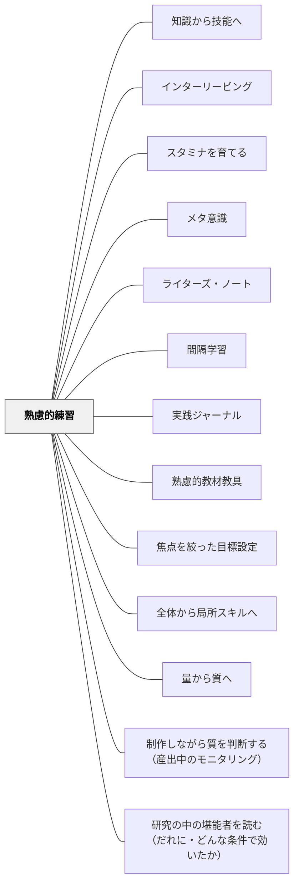

# 熟慮的練習

**一文でいうと**：伸ばしたい点を一つ決め、小さな目標と振り返りをもった練習として、意図して重ねる。

## 使いどころ・使いすぎ注意

| 観点 | 内容 |
| --- | --- |
| 使いどころ | 同じ練習をくり返しているのに伸びないとき。教師自身が実践の腕を上げたいとき。 |
| 使いすぎ注意 | 速さだけを成果にしない。誤った手続きのくり返しになっていないか確かめる（下の補足）。 |

## 背景（Context）

高度な専門性や実践的知恵は、単なる経験の積み重ねだけでは育たない。**意図的な目標設定と内省的な反復**によって、初めて洗練されていく。教育現場でも、教員や学習者が「ただ経験する」だけでなく、意味のある練習を行う必要がある。

## 問題（Problem）

漫然とした経験や反復では、技能や思考は自動化されるだけで、**質的な変容や成長が起きにくい**。「なんとなくやっている」授業や支援が、形だけのルーティンになってしまいがち。経験を積むことと学び続けることは必ずしも一致しない。

## 力のかたち（Forces）

- 上達や変化は、**現状を少し超える課題に挑戦し続けること**でしか得られない
- 教育実践は多忙で、立ち止まって考える時間がとりづらい
- 経験を積むことと、学び続けることは必ずしも一致しない

## 解決（Solution）

日々の実践において、自分が伸ばしたい要素（技能・態度・判断力など）に焦点を定め、**小さな目標と振り返りをもった「練習」**を意図的に取り入れる。

- フィードバックを受け取りながら、失敗をふまえた再挑戦を継続する
- 「うまくいった／いかなかった」の原因を考える**熟慮**を必ず含める

**実践例：**
- 授業後に「今日は○○を意識してやってみた。結果、△△だった。次は◇◇してみる」と記録する
- 同僚との定期的なふりかえりで「最近の小さなチャレンジとその結果」を共有する
- 子どもたちにも「今回の練習で"どこを伸ばそう"と思ってやってみた？」と問い返す

### 研究の裏づけ

> **研究の裏づけ（2026-10-31）**：米国教育科学研究所の算数に困難のある小学生への介入の実践ガイド（Fuchs ほか 2021）は、1〜5分の時間を計った練習を、介入の一部として定期的に入れるよう勧め、根拠を strong とした（27研究）。導入には使わず、効率のよい方略を先に教え、易しい組から少しずつ難しくし、グラフで記録を見て、誤りはすぐ直して説明してもらう。パネルは「時間を計ったプリントを与えるだけでは流暢さは育たない」と書き、速さより正確さが目標だと伝えること、不安の強い子には問題をたくさん一度に見せないことも勧める（pp. 51–55）。ただし根拠の44研究はすべて複数の要素を組み合わせた介入で、この要素だけの効果は分けられない（p. 65）。出典：[[文献/算数に困難のある子への介入を研究から組み立てる（Fuchsほか2021）]]。

> **研究の裏づけ（2026-11-01）**：練習の並べ方について、中学1年生126人の3か月の実験（Rohrer ほか 2015）では、習った日に4問、残り8問を後の宿題に1問ずつ散らした「まぜる練習」が、習った日に12問まとめる練習より、30日後のテストで高かった（74% 対 42%）。まぜる効果と間隔をあける効果は分けて測っていない（早期公開版 pp. 6–7）。出典：[[文献/練習問題をまぜると算数の学びが残る（Rohrerほか2015）]]。

> **研究の裏づけ（2026-11-01）**：Pashler ほか（2007）の学習と指導の実践ガイドは、2回学ぶ間隔を、覚えておく必要のある期間の約5%を下回らないようにするよう勧める（根拠 moderate）。間隔が長すぎる損は短すぎる損よりずっと小さい。教科書の練習問題は直前の内容に偏るので、前の単元の問題を数問「ふりかける」（pp. 5–6）。出典：[[文献/Organizing Instruction and Study to Improve Student Learning（Pashler et al., 2007）]]。

> **研究の裏づけ（2026-11-01）**：練習の効き目は、直後と後日で逆になることがある。大学生の実験（Roediger と Karpicke 2006）では、5分後は読み直した群が上だったが、1週間後には思い出すテストをした群が上回った（再生率 40% 対 56%・61%）。読み直した群ほど、1週間後も覚えているという自信が高かったが、実際の保持は低かった（pp. 252–253、表2）。Soderstrom と Bjork（2015）は、練習中のできと長く残る学習を区別し、その場のできの良さや滑らかさで学習を判断しないよう勧める。困難は、乗り越えられない場合には望ましくない（pp. 176–193）。出典：[[文献/想起テストによる長期保持（RoedigerとKarpicke2006）]]・[[文献/その場のできと長く残る学習を分ける（SoderstromとBjork2015）]]。

> **研究の裏づけ（2026-11-01）**：子どもの想起練習には支えが要る。9〜11歳の教室実験（Karpicke ほか 2014）では、白紙から思い出す自由再生は平均7%にとどまり、4日後のテストで学習活動の差は出なかった。中心の主題のまわりに五つの質問を置いた「質問マップ」で支えると、直後の再生で読み直しを上回った（40% 対 28%、d = 0.42）。実験ごとに条件が違い、長期の保持は確かめていない（pp. 201–204）。Dunlosky ほか（2013）は、想起練習と分散学習を有用性が高い方法とし、要約・ハイライト・再読などを低いとした。想起練習には正答のフィードバックが要り、分散学習を自分で選ぶには効果の説明や日程の支えが要ることがある（pp. 35, 39, 表4）。出典：[[文献/小学生の想起練習を支える手がかり（Karpickeほか2014）]]・[[文献/学習方法の効果と適用条件（Dunloskyほか2013）]]。

> **研究の裏づけ（2026-11-01）**：教師の練習について、現職の教師へのコーチングの60研究のメタ分析（Kraft ほか 2018）では、授業の観察評価で約 0.49、子どもの学力で約 0.18 の効果があった。規模の大きいプログラムほど効果は小さかった。根拠の多くは小学校段階の読み書きの指導で、特徴ごとの分析は記述的なもので因果の効果ではない（pp. 17–28）。出典：[[文献/教師へのコーチングの効果と条件を確かめる（Kraftほか2018）]]。

> **研究の裏づけ（2026-11-01）**：「熟慮的練習」の語は、Ericsson ほか（1993）の音楽大学のバイオリン学生の研究から来ている。原典は、いちばんうまい群ほど一人練習の累積時間が多いと報告したが、二重盲検の追試（Macnamara と Maitra 2019、39人）では、いちばんうまい群とうまい群の差は出ず、練習量で説明できる差は26%で原典の48%より小さかった。原典の側（Ericsson と Harwell 2019）は、熟慮的練習とは力のある教師が一人ひとりの目標と練習を設計し、すぐにフィードバックが得られ、直しながら繰り返す練習のことで、単なる練習の時間ではないと反論し、定義を満たす研究に絞ると29%（測定の誤差を補正すると61%）になるとした。同じ論文は、7〜9歳の子どもが一人で練習すると誤りに気づけず、曲を通して弾くだけでほとんど上達しなかった研究（McPherson と Renwick 2001）を引く（本 Wiki では原典未読）。量より、目標・フィードバック・誤りへの気づきという練習の質が論点である。出典：[[文献/熟慮的練習の名研究を追試で確かめる（MacnamaraとMaitra2019）]]・[[文献/熟慮的練習の定義をそろえて練習と熟達の関係を読み直す（EricssonとHarwell2019）]]。

## 結果（Consequences）

- 実践が、反射的な習慣から**意図的な学びの場**へと転換する
- 教員自身の力量形成が、自己調整可能なプロセスとして進む
- 子どもたちに対して、**学びのモデル**としての姿を示せる
- 組織的に熟慮的練習を共有することで、実践知の共同体が形成される

## [Pattern Connection]

**研究からの補足（2026-10-19）：数学的熟達を五つの側面から育てる（全米研究評議会2001）**

全米研究評議会（2001, pp. 121–124）は、手続きの流暢さに正確さ・効率・柔軟さ・適切な使用を含め、理解を支える練習の必要性を述べる。Wiki側の適用案として、計算練習の後に一問だけ「この数なら別の方法が使えるか」を尋ね、選んだ理由も見る。速さだけを練習の成果にせず、誤った手続きの反復が起きていないか確かめる。本書の算数の議論を、教師の専門性全般の効果証拠には広げない。 出典：[[文献/数学的熟達を五つの側面から育てる（全米研究評議会2001）]]。

**研究からの補足（2026-10-19）：復習間隔と保持期間を合わせて考える（Cepedaほか2006）**

Cepedaほか（2006, p. 356）は、長い間隔の条件ほど再学習量も増えると、効果を間隔だけに帰属できないと指摘する。本パタンへのWiki側の適用案として、目標にした知識について練習量と再訪日を記録し、その場の達成だけでなく後日の想起を確かめる。総練習量が異なる試行を単純に比較しない。言語的記憶のレビューなので、教師の熟達や専門技能全般の改善を直接保証する根拠にはしない。 出典：[[文献/復習間隔と保持期間を合わせて考える（Cepedaほか2006）]]。

## 関連パタン
- [[パタン/知識から技能へ]]
- [[特別支援/特別支援級の算数指導]]
- [[実践/ノート指導（読み書きハンドブック・ノート検定）]]
- [[パタン/インターリービング]]
- [[パタン/スタミナを育てる]]
- [[パタン/メタ意識]]
- [[パタン/ライターズ・ノート]]
- [[パタン/間隔学習]]
- [[パタン/実践ジャーナル]]
- [[パタン/熟慮的教材教具]]
- [[パタン/焦点を絞った目標設定]]
- [[パタン/全体から局所スキルへ]]
- [[パタン/量から質へ]]
- [[パタン/制作しながら質を判断する（産出中のモニタリング）]] — 練習の最中に自分が何を見ているかを扱う（Sadler, 1989）
- [[文献/復習間隔と保持期間を合わせて考える（Cepedaほか2006）]] — 練習量・時間配置・後日の保持を分けて振り返る。
- [[文献/数学的熟達を五つの側面から育てる（全米研究評議会2001）]] — 練習の成果を正確さ・効率・柔軟さ・使いどころで見る。
- [[文献/算数に困難のある子への介入を研究から組み立てる（Fuchsほか2021）]] — 時間を計った練習は、方略・記録・すぐの直しと組にする
- [[文献/練習問題をまぜると算数の学びが残る（Rohrerほか2015）]] — まぜる練習（30日後 74% 対 42%）
- [[文献/Organizing Instruction and Study to Improve Student Learning（Pashler et al., 2007）]] — 復習の間隔（期間の約5%以上・moderate）
- [[文献/想起テストによる長期保持（RoedigerとKarpicke2006）]] — 5分後と1週間後で逆転。読み直しは自信だけ高い
- [[文献/その場のできと長く残る学習を分ける（SoderstromとBjork2015）]] — 練習中のできと学習を分ける
- [[文献/小学生の想起練習を支える手がかり（Karpickeほか2014）]] — 子どもの想起には支えが要る（質問マップ 40% 対 28%）
- [[文献/学習方法の効果と適用条件（Dunloskyほか2013）]] — 想起練習と分散学習の有用性が高い
- [[文献/教師へのコーチングの効果と条件を確かめる（Kraftほか2018）]] — 教師へのコーチング（授業 0.49、学力 0.18）
- [[パタン/研究の中の堪能者を読む（だれに・どんな条件で効いたか）]] — この親パタンの手立てが、だれに・どんな条件でとくに効いたか
- [[文献/熟慮的練習の名研究を追試で確かめる（MacnamaraとMaitra2019）]] — 語の出どころの研究の追試（差は出ず、26%）
- [[文献/熟慮的練習の定義をそろえて練習と熟達の関係を読み直す（EricssonとHarwell2019）]] — 元の定義（教師の設計・すぐのフィードバック）と練習の質

### 下位パタン

### 関連
- [[パタン/自己調整]] — 学習者が自分の学習を調整する力
- [[パタン/フィードバック]] — 適切なフィードバックで学習を加速する
- [[パタン/エラー分析]] — 誤りを分析することで理解が深まる

## クラスター図

## Actionable Insight

- 授業後に「今日は○○を意識してやってみた。結果△△だった。次回は◇◇する」を3行だけ書く——熟慮的練習の最小実践が実践ジャーナルの1エントリ
- 子どもに「今回の練習で伸ばそうと思ったのはどこ？」と1回問いかける——目標意識のある練習とない練習では上達速度が全く違う
- 今週の授業で「うまくいかなかった1場面」を同僚に話す——失敗を共有することが実践知の共同体を育てる熟慮的練習の集団版になる

## 出典

- パタン集/熟慮的練習.md
