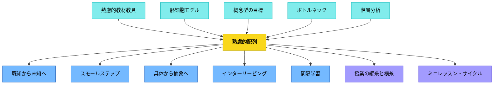

# 熟慮的配列（シークエンス）

**一文でいうと**：学習経験をどの順序で並べるかによって、理解・意欲・転移の起こり方を設計する。

## 使いどころ・使いすぎ注意

| 観点         | 内容                                               |
| ------------ | -------------------------------------------------- |
| 使いどころ   | 単元や活動の順序を考えるとき。                     |
| 使いすぎ注意 | 順序を固定しすぎると、子どもの発見に応答しにくい。 |

> 学習の順序は、内容と同じくらい重要である。

## 背景（Context）

[[パタン/熟慮的教材教具]] によって教材の内容が整ったとき、次に問われるのは「どの順番で提示するか」である。同じ内容でも、提示の順序が変わると、理解の深さもつまずきの場所もまったく異なる結果をもたらす。

このパターン群の起源は**1883年「改正教授術」**（当時の教員養成の教科書）に掲載された**ペスタロッチ主義の原則**にある。「既知から未知へ」「身近なものから遠くへ」をはじめとする配列原則がすでに示されており、100年以上前から教育実践の中核を担ってきた。本パターンリストはこの原則を踏まえ、その後の研究・実践の知見を加えて拡張したものである。

ペスタロッチ自身は1801年の『ゲルトルート児童教育法』でこの配列原則を体系化した。「自然が音から言葉へ、そして言葉から音声へと徐々に進渉していく順序に連鎖させるという原則」——あらゆる教科・技能の指導は、人間の精神発達の「不変の原型」（心理学的順序）に従った配列をとらなければならない。

## 問題（Problem）

学習経験の配列に原則がないと、学習者はまだ持っていない理解の上に新しい概念を積み上げることになる。基盤のない上積みは崩れやすく、丸暗記や断片的知識に終わる。

## 力のかたち（Forces）

- 内容には内在的な論理的依存関係がある（Aを知らなければBはわからない）
- 学習者の認知的・情意的発達には自然な進行方向がある
- 配列が厳格すぎると、学習者の興味や問いの方向を無視することになる
- 教師には時間と教育課程上の制約がある

## 解決（Solution）

**学習経験を、複数の発展的次元に沿って意図的に配列する。** 各次元は「より到達しやすいもの→より到達が難しいもの」という方向を持っている。

| 次元         | 方向                                            |
| ------------ | ----------------------------------------------- |
| 認識論的     | [[パタン/既知から未知へ]]                       |
| 空間的       | [[パタン/身近なものから遠くへ]]                 |
| 難易度       | [[パタン/スモールステップ]]（簡単から難しいへ） |
| 物質性・抽象度 | [[パタン/具体から抽象へ]]                     |
| 概念形成     | [[パタン/具体事例から典型事例（中心概念）へ]]   |
| 分析方向     | [[パタン/総合から分析へ]]                       |
| スキル粒度   | [[パタン/全体から局所スキルへ]]                 |
| 一般化       | [[パタン/具体から抽象へ\|特殊から一般へ]]（具体から抽象へに統合） |
| 複雑さ       | [[パタン/単純から複雑へ]]                       |
| 表出         | [[パタン/観念から表出へ]]                       |
| 技能形成     | [[パタン/知識から技能へ]]                       |
| 言語受容     | [[パタン/聴くことから語ることへ]]               |
| 読み書き     | [[パタン/読むことから書くことへ]]               |
| 量と質       | [[パタン/量から質へ]]                           |
| モード転換   | [[パタン/視覚表現から文章表現へ]]               |
| 動機づけ①    | [[パタン/アンカーイベントから問いへ]]           |
| 動機づけ②    | [[パタン/必然性から楽しさへ]]                   |
| 興味の深化   | [[パタン/好奇心から多方興味へ]]                 |
| モデル       | [[パタン/一流から学ぶ]]                         |
| 複雑性の受容 | [[パタン/あえて複雑から丸ごと学ぶ]]             |

複数の次元を組み合わせ、ユニット全体・単元・一時間の授業それぞれのスケールで配列を設計する。

近い次元のどれを使うかで迷ったら、下の「[[#近いパタンとの見分け|近いパタンとの見分け]]」の表を見る。

**矛盾するパターンの共存：** このリストには一見矛盾するパターンが含まれる（例：「単純から複雑へ」と「あえて複雑から丸ごと学ぶ」）。これは矛盾ではない。パターンは問題状況を解決するための道具であり、どのパターンを選ぶかは**意図・状況・目的**によって変わる。教育のある状況から離れてパターンは存在しない。

### 研究の裏づけ

> **研究の裏づけ（2026-11-01）**：中学1年生126人の教室で3か月かけた実験（Rohrer ほか 2015）では、全員が同じ問題を、並べ方だけを変えて練習した。習った日に4問、残り8問を後の宿題に1問ずつ散らした「まぜる練習」は、習った日に12問まとめる「ブロック練習」より、予告なしのテストの点が高かった（1日後 80% 対 64%、30日後 74% 対 42%）。著者は、習った直後に同じ種類を少し続けるのはよいかもしれないとする。まぜる効果と間隔をあける効果は分けて測っていない（早期公開版 pp. 6–7）。出典：[[文献/練習問題をまぜると算数の学びが残る（Rohrerほか2015）]]。

> **研究の裏づけ（2026-11-01）**：問題と説明の順序について、Sinha と Kapur（2021）は、先に問題に取り組んでからあとで教える授業が、概念の理解と転移で先に教える授業を上回ったとする（g = 0.36）。2〜5年生と汎用の技能では、わずかに先に教えるほうがよかった（pp. 778–781）。『How People Learn』（2000）は、データを比べたあとに講義を聞いた大学生の群が転移のテストでいちばんよく、比べる時間を2倍にして講義を受けなかった群は成績が悪かった例を挙げ、「講義は必要だった」と書く（p. 59）。比べる・取り組む段階のあとに、説明の段階を置く配列である。出典：[[文献/先に問題に取り組み、あとで教える授業を比べる（SinhaとKapur2021）]]・[[文献/人の学び方の研究を授業の設計につなぐ（全米研究評議会2000）]]。

> **研究の裏づけ（2026-11-01）**：具体から抽象へという順序も、いつも最善とは限らない。Ainsworth（2006）は、具体的な表現が複雑な場合もあり、領域・表現・学習者を見て順序を考えるとする（p. 14）。出典：[[文献/複数の表現を学びにつなぐ（Ainsworth2006）]]。

> **研究の裏づけ（2026-11-05）**：練習の並べ方にも研究の整理がある。違う種類の問題をまぜる交互練習は有用性「中」と評価された。4年生が角柱の面・辺・頂点・角の数を求める研究では、練習中は種類ごとにまとめて解く組のほうがよくできた（99%対68%）が、翌日のテストではまぜて解いた組が77%、まとめた組が38%で、まとめた組はどの公式を使うかの取り違えが多かった（p. 41）。一方、5・6年生の分数の研究では、まぜる練習だけでは伸びず、伸びたのはまとめる練習のあとでまぜた組などで、それも主に前の知識の少ない子どもだった（p. 42）。著者は、新しい種類はまずそれだけで練習し、そのあとで前に習った種類とまぜることを勧める（p. 44）。研究の数は少なく、効果のない研究も混じる。出典：[[文献/学習方法の効果と適用条件（Dunloskyほか2013）]]。

> **研究の裏づけ（2026-11-05）**：学ぶ順序と間隔の配置について、米国教育科学研究所の実践ガイド（Pashler ほか 2007）は二つを勧める。一つは、大事な内容に、少なくとも数週間、できれば数か月あけて、もう一度出会う機会をつくること（根拠 moderate）。復習が近すぎると効きにくく、あけすぎによる損はあけなさすぎより小さいとされる。宿題に1〜2か月前の内容の問題を数問まぜる、などの例が挙がっている（pp. 5–7）。もう一つは、算数・理科の問題解決で、解き方の例と、自分で解く問題を交互に置くこと（根拠 moderate）。例をまとめて先に見せるより、交互に置くほうがよく学ぶ。力がついてきたら、例を減らし、自分で解く問題を増やす（pp. 4, 9–10）。ただし、間隔の研究の多くは事実や語の意味のような切り離された知識を扱っている、とガイド自身が書く（p. 6）。出典：[[文献/Organizing Instruction and Study to Improve Student Learning（Pashler et al., 2007）]]。

> **研究の裏づけ（2026-11-11）**：（研究の整理・根拠は弱い）学年をまたぐ並べ方の誤りの型が整理されている。たとえば、次の概念に要る前の概念が古い形のまま（かけ算を「いくつ分」だけで理解していて、比や比例に要る「何倍に拡大する」を持っていない）、必要な材料の欠け、つながりの欠け、いったん習って長く使わないまま忘れる単元、などである（pp. 48–50）。単元を並べるとき、前の単元の概念がどの形で育っているかを確かめる手がかりになる。出典：[[文献/子どもの考えが学年をまたいでどう育つかの道筋を、教育課程・評価・指導の土台にできるかを、算数の研究から整理する（Daroほか2011）]]。

## 近いパタンとの見分け

配列のパタンは、どこから入るか、概念をどうつくるか、全体と部分のどちらを先にするか、難しさをどう上げるか、支えをどう外すか、表出をどの順にするか、で分かれる。上の次元の表に、熟慮的配列の下位ではないが配列を扱うパタン（スパイラル学習・問題の系列・段階的手放し・守破離など）を加えて並べる。

| 迷いどころ | パタン | 見分けの問い |
| --- | --- | --- |
| 入口 | [[パタン/既知から未知へ]] | 子どもがすでに知っていることを呼び起こし、そこに新しい内容をつないでいるか |
| 入口 | [[パタン/身近なものから遠くへ]] | 生活圏から出発して、同心円状に射程を広げているか |
| 入口 | [[パタン/アンカーイベントから問いへ]] | 心を動かす鮮烈な体験を単元の入口に置き、そこから問いを引き出しているか |
| 入口 | [[パタン/道具の限界から新概念へ（既知の壁を学びの入口に）]] | 今の道具では解けない壁にぶつかったところで、新しい概念を出しているか |
| 入口 | [[パタン/必然性から楽しさへ]] | 「必要だから」で入り、できるようになったところで「楽しい」に移る道を設計しているか |
| 入口 | [[パタン/好奇心から多方興味へ]] | 一点の好奇心を深め、そこからほかの領域へ橋をかけているか |
| 概念のつくり方 | [[パタン/具体から抽象へ]] | 多様な事例を比べ、子ども自身が共通点を言葉にしてから、定義や法則を示しているか（旧「特殊から一般へ」を統合） |
| 概念のつくり方 | [[パタン/具体事例から典型事例（中心概念）へ]] | 集めた事例の中から「最もよく示す一つ」を選び、その理由から概念の核をつかんでいるか |
| 概念のつくり方 | [[パタン/解決から抽象へ]] | 子どもが自分で解いた解き方を、どこでも使える形に言い換えて抽象にしているか |
| 全体と部分 | [[パタン/総合から分析へ]] | 完成形や全体像を先に見せてから、分析・分解に入っているか（分かるための順序） |
| 全体と部分 | [[パタン/全体から局所スキルへ]] | 不完全でも活動の全体を先にやってみて、要ると感じた技を練習しているか（できるための順序） |
| 全体と部分 | [[パタン/一流から学ぶ]] | その領域の最高の作品や実践に先に触れ、水準を内側にもっているか |
| 全体と部分 | [[パタン/あえて複雑から丸ごと学ぶ]] | 単純にすると学ぶべきものが消える対象を、支えを添えて複雑なまま扱っているか |
| 難しさの上げ方 | [[パタン/スモールステップ]] | 課題を、確実にできる小さな単位に割っているか |
| 難しさの上げ方 | [[パタン/単純から複雑へ]] | 本質的な関係だけのモデルから始め、変数・条件を一つずつ足しているか |
| 難しさの上げ方 | [[パタン/問題の系列が足場を担う（一変数変化の連鎖）]] | 問題を一度に一か所だけ変わる列にして、前の問題が次の問題の足場になっているか |
| 難しさの上げ方 | [[パタン/変化オペレータの系列設計（喜びのグレードアップ）]] | 同・逆・＋α・質的変化・複合という変化の種類を、順に広げているか |
| 難しさの上げ方 | [[パタン/スパイラル学習]] | 各トピックを最小限の形で入れ、何周かするたびに深めているか（計画として戻る） |
| 難しさの上げ方 | [[パタン/わからなければ先に進む（迂回と再訪）]] | わからないところで止まり続けず、先に進んであとで戻ってよいと子どもに伝えているか（学び方として戻る） |
| 支えの外し方 | [[パタン/段階的手放し]] | 私がやる→一緒にやる→あなたがやる、の順に責任を移しているか |
| 支えの外し方 | [[パタン/知識から技能へ]] | 技能の練習の前に、その技能を支える知識を先に入れているか |
| 支えの外し方 | [[パタン/量から質へ]] | 評価を保留して量をこなしたあと、選んだものの質を上げる段に移っているか |
| 支えの外し方 | [[パタン/型から自由創作へ（閉じた練習の開口部）]] | 型の練習の最後に、同じ型で自分の問題や作品をつくる段を置いているか |
| 支えの外し方 | [[パタン/守・破・離（習熟の三段階）]] | 型を守る→他に学んで広げる→自分の型をつくる、の段階を見て指導を変えているか |
| 表出の順序 | [[パタン/観念から表出へ]] | 書く・話す前に、内側で考えが形になる時間をとっているか |
| 表出の順序 | [[パタン/聴くことから語ることへ]] | 豊かに聴く体験を先に保証し、言いたいことがあふれてから語っているか |
| 表出の順序 | [[パタン/視覚表現から文章表現へ]] | 絵や図で考えを外に出してから、文章に変えているか |
| 表出の順序 | [[パタン/読むことから書くことへ]] | たくさん読んでから、そのジャンルで書いているか |

**混同しやすい組**：
- [[パタン/具体から抽象へ]]・[[パタン/具体事例から典型事例（中心概念）へ]]・[[パタン/解決から抽象へ]]：具体から抽象へは、事例を比べて共通点を出す。典型事例へは、事例の中から最もよく示す一つを選んで核をつかむ。解決から抽象へは、自分で解いた解き方を言い換えて抽象にする。
- [[パタン/総合から分析へ]] と [[パタン/全体から局所スキルへ]]：どちらも全体を先にする。総合から分析へは全体を「見て」から分析する（分かるための順序）。全体から局所スキルへは全体を「やって」から技を練習する（できるための順序）。
- [[パタン/スモールステップ]]・[[パタン/単純から複雑へ]]・[[パタン/問題の系列が足場を担う（一変数変化の連鎖）]]・[[パタン/変化オペレータの系列設計（喜びのグレードアップ）]]：スモールステップは課題を小さく割る。単純から複雑へは、モデルに条件を足していく。問題の系列は、一度に一か所だけ変わる問題の列をつくる。変化オペレータは、その変え方の種類を順に広げる。
- [[パタン/スパイラル学習]] と [[パタン/わからなければ先に進む（迂回と再訪）]]：どちらも「あとで戻る」。スパイラル学習は教師の計画として戻り、わからなければ先に進むは、子どもの学び方として戻る。
- [[パタン/既知から未知へ]] と [[パタン/道具の限界から新概念へ（既知の壁を学びの入口に）]]：既知から未知へは、知っていることに新しいものをつなぐ。道具の限界からは、知っている道具が通じなくなるところで新しいものが要ると気づく。
- [[パタン/型から自由創作へ（閉じた練習の開口部）]]・[[パタン/守・破・離（習熟の三段階）]]・[[パタン/段階的手放し]]：型から自由創作へは、問題の系列の最後に創作の段を置く設計。守破離は、型との関わり方の三段階。段階的手放しは、教師から子どもへの責任の移し方。

**緊張**：[[パタン/単純から複雑へ]] と [[パタン/あえて複雑から丸ごと学ぶ]]（上の「矛盾するパターンの共存」）：見分けは、**単純にしたとき、学ぶべきものそのものが消えないか**である。消えないなら単純から始め、消えるなら（文学の多義性・倫理のジレンマ・歴史の複数の立場など）、支えを添えて複雑なまま扱う。

### 系列の中の小さなまとまり（2026-11-13 追加）

上の表に入れなかった、単元と一時間の組み立てのパタンを並べる。

| 迷いどころ | パタン | 見分けの問い |
| --- | --- | --- |
| 単元を組み立てる | [[パタン/逆向き設計]] | 単元の終わりに見たい姿と評価の証拠を先に決め、そこから活動を逆算しているか |
| 単元を組み立てる | [[パタン/授業の縦糸と横糸]] | 単元を、縦糸（問いの連鎖）と横糸（資料→活動→評価）に分けて設計してから組み合わせているか |
| 単元を組み立てる | [[パタン/知識の体系化]] | この知識がほかのどの知識とつながるかを問う場を、定期的に設けているか |
| 単元を組み立てる | [[パタン/ボトルネック]] | 結果を決めているいちばんの詰まりどころを、最初に見つけているか |
| 一時間を組み立てる | [[パタン/場を設定する]] | 新しいトピックの導入で、見通しをもてるよう、場の準備（5点チェックリスト）をしているか |
| 一時間を組み立てる | [[パタン/見てから聞く]] | 新しい概念で、まず体験し、振り返ってから講義を聞く順にしているか |
| 一時間を組み立てる | [[パタン/共有の時間]] | 活動の終わりに数分とり、数人の発見や作品を全体で共有して、次の学習につながる言葉を残しているか |

**この表の中で混同しやすい組**：
- [[パタン/逆向き設計]] と [[パタン/授業の縦糸と横糸]]：逆向き設計は、評価から逆算する単元設計の原理。縦糸と横糸は、問いの連鎖と、資料・活動・評価を分けて組む具体的な手順。
- [[パタン/見てから聞く]] と [[パタン/経験から出発すること]]：見てから聞くは、一時間の中の「体験→振り返り→講義」の順序。経験から出発することは、学びを経験から始めるという原理。
- [[パタン/共有の時間]] と [[パタン/ティーチングシェア]]：どちらも終わりに共有する。ティーチングシェアは、ワークショップの最後に、学びを教えることとして共有する型。
- [[パタン/ボトルネック]] と [[パタン/逆向き設計]]：ボトルネックは、どこから手をつけるかを決める。逆向き設計は、どこへ向かうかから組み立てる。

## 結果（Consequences）

- 各学習経験が次の経験への足場になり、学習が螺旋的に深まる
- 学習者は「なぜこれを学ぶのか」が体験を通じて自ずと理解できる
- 教師は詰まりが生じた場合に「どの配列の次元で問題が起きているか」を診断できる

ただし、あらゆる配列原則を同時に満たすことはできない。設計者は各単元・目標に応じて、どの次元を優先するかを判断する必要がある。

## [Pattern Connection]

**研究からの補足（2026-10-19）：復習間隔と保持期間を合わせて考える（Cepedaほか2006）**

Cepedaほか（2006, pp. 354–357, 370–371）は、同じ材料を学び直すまでの間隔と、最後の学習から確認までの期間を分けて扱う。本パタンへのWiki側の適用案として、内容の提示順に加え、既習事項を再訪する日と保持を確かめる日を書き込む。単元の論理的順序そのものを検証した研究ではないため、「どの順序で学ぶか」と「いつ再び学ぶか」を区別する。 出典：[[文献/復習間隔と保持期間を合わせて考える（Cepedaほか2006）]]。

**研究からの補足（2026-10-17）：問題解決とスキーマ獲得を分けて捉える（Sweller1988）**

原典では、目標に向けた探索が処理の容量を使い、問題の特徴を学ぶことと競合する可能性を論じる（pp. 260–263）。Wiki側の適用案として、初めての関係を学ぶ課題の前後に、条件と操作を対応づける時間を置く。難易度順に並べれば必ず学習が進むという根拠にはしない。 出典：[[文献/問題解決とスキーマ獲得を分けて捉える（Sweller1988）]]。

**研究からの補足（2026-10-17）：教科内容を教えるための知識に変える（Shulman1986）**

原典のカリキュラムの知識には、代替教材、他教科との横の関係、過去と今後の学習との縦の関係が含まれる（p. 10）。Wiki側の適用案として、単元の順序を決める際に、既習の何を使い、次に何へつながるのかを記す。具体的な配列の優劣や効果を、この概念的論考だけで確定しない。 出典：[[文献/教科内容を教えるための知識に変える（Shulman1986）]]。

**研究からの補足（2026-10-17）：次の学びへの準備として転移を捉える（BransfordとSchwartz1999）**

原典で紹介された研究では、比較後の講義が重要で、講義のない比較反復だけでは同じ成果にならない（公開著者稿pp. 17–19）。Wiki側の適用案として、比較で生じた問いを受けて説明し、その説明を使う課題を置く。すべての単元で比較を先行させる一般則にはしない。 出典：[[文献/次の学びへの準備として転移を捉える（BransfordとSchwartz1999）]]。

**研究からの補足（2026-10-16）：事例比較の効果と条件を確かめる（Alfieriほか2013）**

原典の「比較後に原理」の結果は一論文の3実験に基づく（p. 108）。Wiki側の適用案として、比較後に説明を置く授業でも、比較が成立しない子には必要な手がかりを先に渡す。説明を常に遅らせる配列の根拠にはしない。 出典：[[文献/事例比較の効果と条件を確かめる（Alfieriほか2013）]]。

**研究からの補足（2026-10-16）：概念理解と手続きを往復して育てる（RittleJohnsonほか2001）**

概念と手続きの初期状態は領域や経験によって異なる（p. 358）。Wiki側の適用案として、単元の途中に短い説明課題を置き、その結果から練習か意味の確認へ戻る。配列原則全体の妥当性をこの実験で裁定しない。 出典：[[文献/概念理解と手続きを往復して育てる（RittleJohnsonほか2001）]]。

## 関連パタン
- [[文献/子どもの考えが学年をまたいでどう育つかの道筋を、教育課程・評価・指導の土台にできるかを、算数の研究から整理する（Daroほか2011）]] — 学年をまたぐ並べ方の誤りの型
- [[パタン/既知から未知へ]]
- [[パタン/具体から抽象へ]]
- [[パタン/知識から技能へ]]
- [[パタン/あえて複雑から丸ごと学ぶ]]
- [[パタン/アンカーイベントから問いへ]]
- [[パタン/一流から学ぶ]]
- [[パタン/観念から表出へ]]
- [[パタン/教え方の作戦を立てる]]
- [[パタン/具体事例から典型事例（中心概念）へ]]
- [[パタン/好奇心から多方興味へ]]
- [[パタン/視覚表現から文章表現へ]]
- [[パタン/身近なものから遠くへ]]
- [[パタン/全体から局所スキルへ]]
- [[パタン/総合から分析へ]]
- [[パタン/単純から複雑へ]]
- [[パタン/聴くことから語ることへ]]
- [[パタン/読むことから書くことへ]]
- [[パタン/必然性から楽しさへ]]
- [[パタン/量から質へ]]

- [[パタン/熟慮的教材教具]] — 上位パタン（何を提示するかを決める）
- [[パタン/スモールステップ]] — 難易度軸の配列
- [[パタン/体験への接続]] — 経験を出発点とする配列
- [[パタン/経験から出発すること]] — 経験を基点とすること
- [[パタン/胚細胞モデル]] — 核概念を中心に配列を組み立てる
- [[パタン/場を設定する]] — 配列の各入口で学習者の認知的準備を整える
- [[パタン/インターリービング]] — 異なる内容を交互に配列することで識別力と転移を高める
- [[パタン/間隔学習]] — 時間的な配列の工夫が記憶の定着を左右する
- [[パタン/概念型の目標]] — 学習者がつかむ概念が配列の方向を決める
- [[パタン/ボトルネック]] — ボトルネックの特定が配列の優先順位を決める
- [[パタン/ミニレッスン・サイクル]] — ミニレッスンの連続配置が単元の学習経路をつくる
- [[パタン/授業の縦糸と横糸]] — 縦糸（長期的な学習経路）と横糸（各時の構造）の組み合わせが配列の骨格
- [[パタン/話す・描く・書く]] — 話す→描く→書くという配列が書く力の足場をつくる
- [[パタン/階層分析]] — 学習課題を階層的に分解することで正しい配列順序が見えてくる
- [[パタン/問題の系列が足場を担う（一変数変化の連鎖）]] — 難易度次元の配列（上位）を算数問題設計に具体化した実装——「一変数変化の連鎖」は熟慮的配列の難易度軸を問題レベルで実現するメカニズム
- [[パタン/変化オペレータの系列設計（喜びのグレードアップ）]] — 難易度次元での配列（本パタン）と、変化種別次元での配列（変化オペレータ）の分業。難易度軸の中に同・逆・＋α・質的変化・複合の5種の変化が埋め込まれる
- [[パタン/型から自由創作へ（閉じた練習の開口部）]] — 子パタン。本パタンが「どの順で並べるか」の上位原則を扱うのに対し、型習得の末尾をどう開くかという配列上の具体的設計を担う
- [[文献/概念理解と手続きを往復して育てる（RittleJohnsonほか2001）]] — 理解と練習を往復する確認を配列に入れる。
- [[文献/事例比較の効果と条件を確かめる（Alfieriほか2013）]] — 比較と原理の説明の順序を、理解を見ながら選ぶ。
- [[文献/次の学びへの準備として転移を捉える（BransfordとSchwartz1999）]] — 比較と説明を、次の学びを準備する関係として配列する。
- [[文献/教科内容を教えるための知識に変える（Shulman1986）]] — 前後の学習と他教科とのつながりを、配列の検討材料にする。
- [[文献/問題解決とスキーマ獲得を分けて捉える（Sweller1988）]] — 解く順序と、構造を学ぶための負担を併せて検討する。
- [[文献/復習間隔と保持期間を合わせて考える（Cepedaほか2006）]] — 内容の順序に加え、再訪までの時間と確認時点を設計する。
- [[文献/練習問題をまぜると算数の学びが残る（Rohrerほか2015）]] — まぜる練習（交互）と間隔。30日後 74% 対 42%
- [[文献/先に問題に取り組み、あとで教える授業を比べる（SinhaとKapur2021）]] — 先に問題、あとで教える順序の効果と条件
- [[文献/人の学び方の研究を授業の設計につなぐ（全米研究評議会2000）]] — 比べたあとに講義（p. 59）
- [[文献/複数の表現を学びにつなぐ（Ainsworth2006）]] — 具体から抽象への順序は常に最善ではない
- [[文献/学習方法の効果と適用条件（Dunloskyほか2013）]] — 交互練習：種類ごとの練習のあとに、前に習った種類とまぜる（10の学習方法の総説）
- [[文献/Organizing Instruction and Study to Improve Student Learning（Pashler et al., 2007）]] — 間隔をあけた復習と、解き方の例と問題を交互に置く配置（勧め1・2）
- [[文献/学び方の方略は、学びのどの段階で使うかで効き方が変わるかを、228のメタ分析から整理する（HattieとDonoghue2016）]] — 学びの段階（得る・固める、表層・深層・転移）に合わせて方略を並べる
- [[パタン/わからなければ先に進む（迂回と再訪）]] — わからないところを迂回してあとで再訪する順序

## クラスター図
<!-- cluster: manual -->

## Actionable Insight

- 次の単元を設計するとき「既知→未知」「具体→抽象」「簡単→難しい」の3次元で順序を確認する——どの次元が逆になっているか一つ見つけて修正するだけでよい
- 授業の後半に急に難しい内容が来ていないか確認する——難易度の急上昇がボトルネックになっていることが多い
- 「スモールステップ」として学習を小さく分解した後、全体を俯瞰して順序を見直す——小さな段階の積み上げが正しい方向かを確認する

## 出典

- 1883年「改正教授術」ペスタロッチ主義の原則
- [[文献/ゲルトルート児童教育法（ペスタロッチ）]] — ペスタロッチ原典（1801年）
- [[文献/熟慮的配列のパターンリスト（動画記録）]]

---

## 下位パタン一覧

| パタン                                        | サマリー                                                               |
| --------------------------------------------- | ---------------------------------------------------------------------- |
| [[パタン/具体事例から典型事例（中心概念）へ]] | 多くの「例」の中に、その概念の心臓部がある。                           |
| [[パタン/単純から複雑へ]]                     | 単純なモデルは間違っているかもしれないが、複雑さへの入口として正しい。 |
| [[パタン/好奇心から多方興味へ]]               | 一点の好奇心が、やがて世界全体への窓になる。                           |
| [[パタン/必然性から楽しさへ]]                 | まず「やらなければ」から始まり、やがて「やりたい」に変わる。           |
| [[パタン/総合から分析へ]]                     | 全体を見てから、部分に分け入る。                                       |
| [[パタン/聴くことから語ることへ]]             | 豊かな話し手は、まず豊かな聴き手だった。                               |
| [[パタン/視覚表現から文章表現へ]]             | 絵や図で思考したことを、言葉に変換することで理解が深まる。             |
| [[パタン/身近なものから遠くへ]]               | 自分の足元から世界への通路を開く。                                     |
