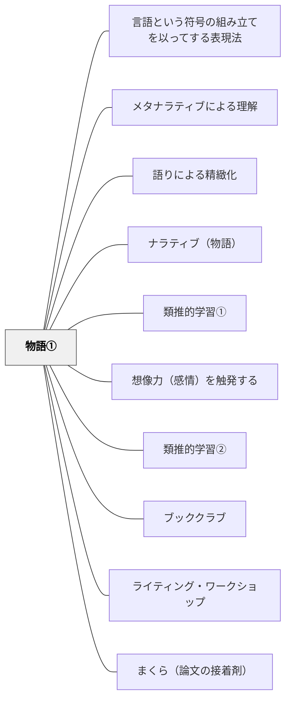

# 物語①

**このパタンが完成を助ける大きなパタン**：[[パタン/想像力（感情）を触発する]]

> 人は、世界や自分を物語形式で理解している。

## 背景（Context）

岩井輝久「物語と算数」より

人は、世界や自分を物語形式で理解している。物語は、とても効果的で魅力的な認知的道具だ。認知的道具とは、ヴィゴツキーの理論に依拠した概念で、物事を認識するための道具のことである。

> 「認知的道具（Cognitive tools）：人類の文化の歴史の中で発達し、人々によって習得されて、思考の助けとなる道具である。思考や理解の力を拡大する。」——キエラン・イーガン（2010）

物語以外にも比喩やユーモア、対概念など様々な認知的道具が考えられる。岩井は AND ON vol.1に教育のパタン・ランゲージとして5つの大きな教育のパタンを記した。その一つ「想像力を触発すること」というパタンの重要な小パタンとして「物語」という認知的道具が位置づけられている。本稿では、絵本を用いた算数の授業を具体的な実践として取り上げる。

## 問題（Problem）

授業で提示された情報が断片的にしか記憶されず、感情的な関与が薄い。学習者の想像力が触発されないと、知識は「誰かのどこかの話」として届かず、長期的な記憶に残らない。

## 力のかたち（Forces）

- 人は、世界や自分を物語形式で理解している（原稿の冒頭）
- 物語は、思考や理解の力を拡大する認知的道具の一つで、比喩・ユーモア・対概念などほかの道具もある（原稿）
- 知識はすべて、だれかの想像力と感情から生まれた。知識を、それを生んだ希望や不安や情熱の脈絡から切り離すと、生き生きとした意味が届かない（原稿のイーガンの引用）
- 想像力を触発する方が、人は効率よく学び、覚えていられる——経済を原理とすること（原稿）

## 解決（Solution）

**想像力を触発せよ——すべての知識は人間の想像力と感情から生まれた。**

**近いパタンとの見分け**：想像力・感情（イーガン）の表では、本パタンの見分けの問いは「物語を認知的道具として使い、たとえば絵本で算数の数量を物語の文脈の中で体験しているか（岩井「物語と算数」）」。全体の表は [[パタン/想像力（感情）を触発する#近いパタンとの見分け|想像力（感情）を触発する]] にある。

AND ON vol.1（岩井輝久, 2018）に記した「想像力を触発すること」パタンから：

> 「学習者の想像力が触発される時にこそ、学習はやさしくなるし効率も上がるという事実は、長い間一目瞭然の事実であった。」——キエラン・イーガン

学校のカリキュラムにある知識はすべて人間的な源をもつ——知識は誰かが何らかの理由で発明したり発見したりしたものだから、その人の想像力と感情が関わるという意味をもたらす希望や不安、情熱の脈絡の中で教える必要がある。（キエラン・イーガン, 2010）

---

**認知的道具としての物語**：

> 「物語——学習の際、感情を触発するために最も有効である。」（キエラン・イーガン, 2010, vi）

> 「物語がもつ偉大なる力は、2つの作業を同時に行っている点にある。第1に、情報を覚えやすい形で伝えるのに効果がある。第2に、伝えられる情報について、それを聞く人の感情を方向づけることができる。」（キエラン・イーガン, 2010, p16）

---

**算数での実践例**：絵本（例：『お待たせクッキー』）を導入教材として用いると、数量の概念が物語の文脈の中で体験できる。「なぜ人数分のクッキーを分ける必要があるのか」という感情的な文脈が、学習内容を生きた知識として定着させる。

### 岩井の原稿から（物語①）

（原稿のうち、すでに本ページの上の節にそのまま入っている段落は、ここでは繰り返さない。）

−物語と算数ー

　　　　　　　　　　　　　　　　　　　　　岩井輝久

物語は、とても効果的で魅力的な認知的道具です。認知的道具とは、ヴィゴツキーの理論に依拠した概念で、物事を認識するための道具のことです。

「認知的道具（Cognitive tools)：人類の文化の歴史の中で発達し、人々によって習得されて、思考の助けとなる道具である。思考や理解の力を拡大する。」キエラン・イーガン（２０１０）

物語以外にも比喩やユーモア、対概念など様々な認知的道具が考えられます。詳しく知りたい方はキエラン・イーガンの著作をぜひお読みください。私は、AND ON vol.1に教育のパタン・ランゲージとして５つの大きな教育のパタンについて書きました。それらの一つに「想像力を触発すること」という大きなパタンがあります。その大きなパタンの中の重要な小パタンに「物語」という認知的道具を私は位置付けています。この「物語」というパタンを重ねて実践して考えたり調べたりしたことの中から、教育における物語の意味と価値、その具体的な実践として絵本を用いた算数の授業について今回はお伝えします。紹介したパタンの中にある「想像力を触発すること」のアイデアは、キエラン・イーガンの想像力を触発する教育からきています。AND ON vol.1から「想像力を触発すること」というパタンのところを引用します。

＝＝＝＝＝＝＝＝＝＝＝＝＝＝＝＝＝＝＝＝＝＝＝＝＝＝＝＝＝＝＝＝＝＝＝＝＝＝＝＝＝＝＝

4 想像力を触発すること

想像力を触発する方が、人は効率よく学び、学習したことを覚えていることができる。想像力を触発することは、学習を成功に導く鍵である。

（原稿では、ここにキエラン・イーガン（2010）からの引用が入っている。長い引用は wiki には載せない。）

想像力を触発せよ。すべての知識は人間の想像力と感情から生まれた。

想像力を触発することで、人は効率よく学ぶことができるーー経済を原理とすること(3)。想像力を触発する主な認知的道具について理解することーー比喩、物語、対概念など。そして、認知的道具を活かした授業づくりをすること。

参考文献 

キエラン・イーガン(2010)『想像力を触発する教育認知的道具を活かした授業づくり』北大路書房

キエラン・イーガン(2013)『想像力と教育』北大路書房

＝＝＝＝＝＝＝＝＝＝＝＝＝＝＝＝＝＝＝＝＝＝＝＝＝＝＝＝＝＝＝＝＝＝＝＝＝＝＝＝＝＝＝＝＝

（岩井輝久、２０１８）

さらに物語を学習において用いることの意味や価値について、キエラン・イーガンの教育学や量的な教育研究を通して、どのように考えられているのかお伝えします。

（原稿では、ここにキエラン・イーガン（2010）vi、p11、p16、p74からの引用が入っている。長い引用は wiki には載せない。）

キエラン・イーガンは、小さい子が惹きつけられる物語と高学年の子が惹きつけられる物語が違うところから「物語」と「ナラティブ」という用語を区別して使っています。本稿では、「物語」という用語を「ナラティブ」とほぼ同じことを意味していると考えて使っています。

物語を用いて学んだ方が、よく覚えられるということには、エビデンスがあります。ストーリー記憶術で知られる研究です。このストーリー記憶術については、バウアーとクラーク（Bower ＆ Clark,1969）が効果的であることを報告しています。

（三宮真智子、２０１８）では、その例としてイオン化列（イオン化傾向の大きさの順に元素を並べた際の序列）の覚え方「貸そうかな、まああてにすんな、ひどすぎる借金」を紹介しています。

貸そう（カリウム：K）か（カルシウム：Ca)な（ナトリウム：Na）,ま（マグネシウム：Mg）あ（アルミニウム：Al)あ（亜鉛：Zn）て（鉄：Fe）に（ニッケル：Ni)すん（すず：Sn）な（鉛：Pb),ひ（水素：H2）ど（銅：Cu）す（水銀：Hg）ぎる（銀：Ag）借（白金：Pt）金（金：Au）。

「覚えるべき項目をストーリー仕立てにすることで、記憶の負荷が小さくなります。たとえば、先ほどのイオン化列の例であれば、１６項目の元素記号が、たった１つのストーリーにコンパクトに収められるわけです。しかも、具体的な意味が付与され、状況が鮮明にイメージできるため、覚えやすくなります。ストーリーを自らつくれば愛着も湧き、なおのこと忘れにくくなるでしょう。」（三宮真智子、２０１８）

物語には、記憶を助ける働きや感情や想像力を触発する働きがあることが分かります。私たちは、感情や想像力を触発されることによって、よく学ぶことができます。また記憶の負荷が小さくなるのは、経済を原理とすることから考えても歓迎すべきことです。経済を原理とするというのは、教育から不用な時間・費用・労力等を省いていくことです。ここで大切なのが、教育者側からの働きかけ、つまり教授などにおいても、子どもたちの学習においても、不用な時間、費用、言語、音声、苦しみ等を省いていくことです。

次に実際に物語を活かした授業を紹介します。

#### 物語と算数−絵本を用いた算数の授業について−

物語というパタンを重ねた授業の実例については、キエラン・イーガンも『想像力を触発する教育』の中で報告していますが、マリリン・バーンズ(Marilyn Burns)らが絵本を使って算数の授業を展開していて、私は、そのことについて実践したことなどをこれからお伝えします。

絵本を授業で上手に使うと子どもたちの理解を大きく助けることができます。アメリカの算数の授業研究には、文学を用いた算数の授業について書かれた本がたくさんあります。マリリン・バーンズの本やMath and Literatureというシリーズの本などです。Math and Literatureには、小学生から中学生向けの授業についての本が何冊も出ています。これらの本を読んだ中でも、私は日本語訳がある『おまたせクッキー』という絵本を使った授業が大好きです。何回かやってみて、とても効果的であると子どもたちを通して確認できました。この授業は、複数の本に事例が紹介されていて、アメリカでは、かなり有名な授業のようです。

#### おまたせクッキー（小学校３年生　わり算）

概要

絵本を上手く使うと子どもたちの理解を大きく助けることができます。算数と生活がどのように関連しているのか紹介することができます。『おまたせクッキー』の読み聞かせを活かして授業をすると、等分除の場面を子どもたちは、よく理解できます。「おまたせクッキーの時と何が違う？」と、包含除の場面では、おまたせクッキーの等分除の場面を思い出し、比べてみることで、違いが分かり易くなります。

原題は、”The Doorbell Rang"で『おまたせクッキー』という邦題で翻訳されています。こんなお話です。トレイに１２枚のクッキーがあります。２人の子がいます。２人で分けて食べようとすると、リンリンリン、ドアのベルが鳴り、2人のお友達が家の中に入ってきました。４人で分けて食べようとすると、リンリンリン、ドアのベルが鳴り、さらに２人のお友達が家に中に入ってきました。６人で分けて食べようとすると、再びリンリンリン、ドアのベルが鳴り、６人のお友達が家の中に入ってきました。１２人で分けて食べようとすると、リンリンリン、トレイに一杯のクッキーを焼いてきたおばあちゃんが家に入ってきましたというお話です。

用意するもの

・ハッチンズ／乾侑美子訳（２０１１）『おまたせクッキー』偕成社

・画用紙

授業の流れ

■『おまたせクッキー』を読み聞かせをして、わり算の記号を教えます。

　１.１２÷２＝６

　２.１２÷４＝３

　３.１２÷６＝２

　４.１２÷１２＝１

■教師が「最後におばあちゃんがクッキーを１８枚持ってきてくれました。合わせて何枚になったでしょうか。」と質問すると、子どもたちは、クッキーが３０枚になったことに気づきます。もう一つの式を黒板に書きます。

　５.３０÷１２＝

■それぞれの場面を絵と式に表して、３０÷１２の答えを見つけようと課題を提示します。

■画用紙を配ります。画用紙を８つの部屋（セクション）ができるように折ります。

■左上のはじめの部屋に本のタイトル「おまたせクッキー」と自分の名前の書きます。続けて４部屋に、１〜４の式と絵を書きます。６番目の部屋に絵をかいて３０÷１２の問題解決をします。

■子どもたちが課題を終えて、全体のディスカッションの後、７番目の部屋に新しい絵と式を考えます。お話の続きを考えるということです。子どもたちは表現したことを全体で共有します。

実際の授業についてSusan Ohanian and Marilyn Burns（1995)や実際に授業をしてみたことを元にもう少し細かく授業を再現してお伝えします。

T＝教師　C＝子ども

『おまたせクッキー』のはじめのページを読み聞かせしたら、読むのをやめて子どもたちに質問します。

T「お皿に１２枚のクッキーがあります。同じ数ずつビクトリアとサムで分けると１人分は何枚になりますか。」

C「それぞれ1人分は６枚ずつになります。」

T「説明できる人？」

C「６+６＝１２です。」

T「または、こうやって2人に１枚ずつのクッキー、つまり２枚のクッキーを６回配ると考えてかけ算を使えば、２×６＝１２と説明することもできますね。」

読み聞かせを続けます。新しいお客さんが増えるたびに読み聞かせを止めて、1人何枚のクッキーをゲットできるのか質問します。子どもたちがたし算で説明したときには、同じようにかけ算に言い換えるようにしました。

最後まで読み終えてから、子どもたちに尋ねます。

T「お話を振り返ってみましょう。」

C「お母さんが焼いた１２枚のクッキーを2人で分けることになりました。2人で同じ数ずつ分けると、1人分は、６枚になりました。」

教師は、１２÷２＝６と黒板に書きます。

T「（÷を指差して）これはわり算の記号です。じゅうにわるには、ろくと読みます。この１２は何を表していますか？」

C「１２枚のクッキーです。」

T「この２は、何を表していますか？」

C「2人の子です。」

T「そうですね。そして、この６は、1人分のクッキーの数を表しています。」

この話の続きのページを振り返りながら、式を書いていきます。

　１.１２÷２＝６

　２.１２÷４＝３

　３.１２÷６＝２

　４.１２÷１２＝１

T「これらの式は、このお話で何が起きたのかを教えてくれますね。次にドアのベルが鳴ったときには、どんなことがおきましたか？」

C「おばあちゃんがやってきた！」

C「おばあちゃんが、たくさんクッキーを焼いてきたよ。」

T「おばあちゃんは、何枚のクッキーを焼いてきたのかな？」

子どもたちは絵本の絵を見て数える。

C「１２×６で７２枚だ。」

T「７２枚だと少し問題が難しくなりすぎてしまうので、１８枚焼いてきてくれたことにして問題を書き換えてみましょう。もしそう考えると、合わせて何枚のクッキーになりますか？」

C「１２＋１８で３０枚です。」

黒板に３０÷１２＝

と書き、画用紙を配ります。

T「８つの部屋になるように画用紙を折りましょう。」

T「この紙に、この絵本の物語を語り直してもらいます。左上のはじめの部屋には、絵本のタイトル『おまたせクッキー』と自分の名前を書きます。」

T「続けて４つの部屋に１〜４の式を書いて、それぞれの式について、どのようにクッキーを分けたらよいのか絵に表します。」

例として１２÷２＝６の等式と2人にそれぞれ６枚ずつのクッキーの絵を黒板にかきます。

T「三つ部屋が残っています。続きの部屋には、５番目の問題、３０÷１２について、どのように３０枚のクッキーを１２人の子たちに分けるのか絵をかきます。残りの二部屋でお話を終わらせます。またベルが鳴ったとして、どれだけの人が、どれだけのクッキーを持ってきたのか自分でお話を考えて表現します。つまり続きの６番目の問題を考えてお話を終わらせます。例えば、私は、おじいちゃんが６枚のクッキーを買ってきてくれたという続きのお話にしてみました。みなさんも考えてみましょう。」

ここから子どもたちの問題解決の活動の時間です。やってみると、３０÷１２の解決には、大きく２種類の考えが出てきました。それぞれ大型テレビに映して説明してもらいました。３０÷１２＝２あまり６で1人分のクッキーが２枚になって６枚余るという考えと、３０÷１２＝２.５、または２と１／２で、あまりの６枚のクッキーをそれぞれ半分にして分ける処理をしてから1人分が２と１／２枚になるという考えです。

この学習活動では、あまりが出てくるなど教科書よりも先に進んでしまいます。しかし、この経験をベースに教科書を進めていくとそのあとの理解がとても早かったです。また、この絵本の等分除の場面と包含除の場面を比べることができるので、それらの違いについても、普通に教科書通りやるよりもスムーズに子どもたちは、区別することができました。

この授業を何度かやってみて、確かな手応えを感じました。その他の単元でも、絵本を使った授業の可能性を追求していきたいと考えていきます。これからの課題です。

Marilyn Burns, Stephanie Sheffield（２００４）を元に、他にも『ゴリラが１ぴき』という絵本を使って算数の授業をしたことがあります。１ぴきのゴリラが、ジャングルで２ひきのちょうちょう、３ばのセキセイインコ、４ひきのりす、５ひきのパンダ、６ぴきのうさぎ、７ひきのかえる、８ひきのさかな、９わのとり、１０ぴきのねこに出会うというお話です。作者の大好きなものであるこれらを合わせるといくつになるでしょうかという問題を解決します。『おまたせクッキー』の授業もそうですが、教科書の文章問題と比べて、どちらの絵本を使った授業も、想像力と感情が触発され、子どもたちは、より意欲的に学習できたと思います。

Marilyn Burns, Stephanie Sheffield(2004)やRusty Bresser(2004)に『おまたせクッキー』や『ゴリラが１ぴき』の他にも邦訳されていて、算数の授業で使われる物語の本がいくつかありますので、紹介します。手元にある本は、内容も少しお伝えします。

Marilyn Burns, Stephanie Sheffield(2004)

ローラインガルスワイルダー（２０１２）『大きな森の小さな家―インガルス一家の物語〈1〉』福音館書店

インガ・ムーア（２０１５）『くろねこのロク空をとぶ』徳間書店

Rusty Bresser(2004)にある授業で使われている本

安野光雅（２０１７）『ふしぎなたね』童話屋

ある日、怠け者のおとこが仙人からもらった「ふしぎなたね」。その種を食べれば「１年間おなかがすくことはない」そうだ。でも、その種を地面に埋めると「一年後には2個実る」らしい。そんなお話を軸にしながら、おとこは家庭を築いていきます。そんなお話を楽しみながら、２の倍数の感覚を楽しむ事ができる絵本。

エリノアピンチェス（１９９７）『おいてきぼりのジョー』文化出版局

聞くもあわれな虫の兵隊ジョーのお話。軍隊が行進するたびにジョーはいつも列からはみ出てしまう。ジョーは考えた。２５匹を２列にしたら？３列なら？４列はどうだろう・・・？失敗もしたけれどあきらめなかったジョーは、５匹ずつ５列にすればいいということに気づいて、行進は大成功。

ジョーが試した様々な列の行進を式に表すと、次のようになります。

２５÷２＝１４あまり１

２５÷３＝８あまり１

２５÷４＝６あまり１

２５÷５＝５

このお話を使って、Rusty Bresser(2004)は、なぞなぞをつくる課題を提案しました。７つの手がかりを考えます。

・１で割ると、あまりは０。

・２で割ると、あまりは０。

・３で割ると、あまりは１。

・４で割ると、あまりは２。

・５で割ると、あまりは０。

・６で割ると、あまりは４。

・７で割ると、あまりは３。

答えの数は、１〜２５のどれかです。さて、答えはいくつでしょうか。

クリス・ヴァン・オールズバーグ（１９８４）『ジュマンジ』ほるぷ出版

ジョージシャノン（２００５）『どうしてかわかる？』晶文社

ジョン・シェスカ（１９９９）『算数の呪い』小峰書店

「たいていのことは算数の問題として考えれるんですよ」なんて、算数の先生が言ったために、何もかもが算数の問題として押し寄せてきました。Rusty Bresser(2004)は、この絵本にある問題を書き換えて、算数の問題作りに取り組む授業を提案しています。

スーザン・メドー（１９９７）『いぬのマーサとスープのひみつ』フレーベル館

デブラ・フレイジャー（１９９９）『あなたがうまれたひ』福音館書店

デミ（２００９）『１つぶのおこめ』光村教育図書

マオバタハン（１９９３）「やっかいならくだ」『アラビア数学奇譚』白揚社遺産相続の話です。旅人が歩いていると、３人の兄弟がケンカをしています。３５頭のらくだがいます。遺言によれば、兄が半分、弟が３分の１、末の子が９分の１のらくだを相続することができますが、割り切れず、うまく分けることができません。旅人は、この問題をどうやって解決するのでしょうか。算数・数学がどのように人生と関わり、価値を持つのかということを伝えてくれる物語だと思います。

ロアルド・ダール（１９９７）『恋のまじない　ヨンサメカ』評論社

邦訳されているものを使って、実践、検証を重ねていきますので、機会があれば報告したいです。

【参考文献】

アツコ・モロズミ／松野正子訳（１９９２）『ゴリラが１ぴき　なんだかおかしなかずのほん』岩波書店

岩井輝久（２０１８）「教育のパタン・ランゲージ」『AND ON vol.1』

キエラン・イーガン／高屋景一、佐柳光代訳（２０１０）『想像力を触発する教育　認知的道具を活かした授業づくり』北大路書房

キエラン・イーガン／高屋景一、佐柳光代訳（２０１３）『想像力と教育』北大路書房

ハッチンズ／乾侑美子訳（２０１１）『おまたせクッキー』偕成社

三宮真智子（２０１８）『メタ認知で〈学ぶ力〉を高める』北大路書房

Marilyn Burns, Stephanie Sheffield(2004), Math and Literature: Grades 2-3, Pearson Education Canada

Rusty Bresser(2004), Math and Literature: Grades 4-6, Pearson Education Canada

Susan Ohanian and Marilyn Burns（1995), Math by All Means: Division, Grades 3-4 (Math By All Means Series), Math Solutions Publications

（以上、岩井の原稿「教育のパタン・ランゲージ 集約」の「パタン　物語①」から。）

## 結果（Consequences）

- 学習者の力能（なしうる力）が増大する
- パタンの圧縮による教育の経済性が実現する

## 関連パタン
- [[実践/ローベルみたいな物語を書こう]]
- [[パタン/言語という符号の組み立てを以ってする表現法]]
- [[パタン/メタナラティブによる理解]]
- [[パタン/語りによる精緻化]]

- [[パタン/ナラティブ（物語）]] — 物語の定義・感情と記憶の接続を扱う補完パタン
- [[パタン/類推的学習①]] — 物語もアナロジーも認知的道具として機能する
- [[パタン/想像力（感情）を触発する]] — 物語は想像力触発の中心的な認知的道具
- [[パタン/類推的学習②]] — 物語の書き換え（パロディ作文）は物語パタンの実践形態
- [[パタン/ブッククラブ]] — 物語を共同体で読み、意味を共有する
- [[パタン/ライティング・ワークショップ]] — 物語を書く実践の場
- [[パタン/まくら（論文の接着剤）]] — まくらは論文内の物語展開（分類・経過・理由型）を支える
- [[概念/パタン・ランゲージ概論]]

## クラスター図

## Actionable Insight

- 今週の授業の導入に物語的要素（登場人物・状況・問題）を1つ加える——算数の問題文に人物と文脈を添えるだけで記憶への定着が変わる
- 学習内容を「誰が・何をしていたら・どんな問題が起きたか」という物語形式で子どもに説明させる
- 授業の核心に関わる絵本や物語を1冊選び、導入教材として使う

## 出典
- [[文献/教育のパタン・ランゲージ入門]]
- [[文献/一つの教育のパタン・ランゲージ]]

岩井輝久（2018）「物語と算数」『一つの教育のパタン・ランゲージ』AND ON vol.1

キアラン・イーガン（2010）『想像力を触発する教育——認知的道具を活かした授業づくり』北大路書房

キアラン・イーガン（2013）『想像力と教育』北大路書房

## 根拠の確かめ（自動生成）

<!-- source-check: 自動生成。手で編集しない。文献ページの frontmatter の source_check から作る -->
このページが引く文献を、本 Wiki が原典でどこまで確かめたかで分けた。くわしくは各文献ページの「書誌・確認した範囲」や「原文との照合」へ。

- **その他**（動画の記録や本 Wiki の作者自身の本など）：[[文献/教育のパタン・ランゲージ入門|教育のパタン・ランゲージ入門]]・[[文献/一つの教育のパタン・ランゲージ|一つの教育のパタン・ランゲージ]]
