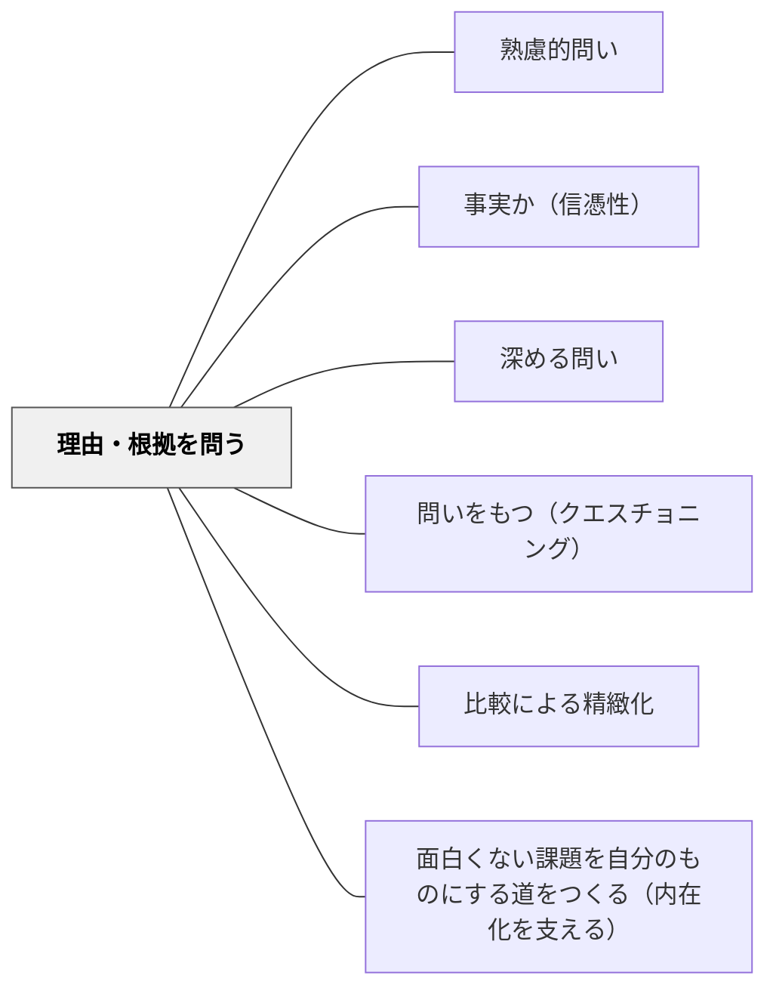

# 理由・根拠を問う

**このパタンが完成を助ける大きなパタン**：[[パタン/熟慮的問い]]

> 「どうしてそう考えたの？」と理由・根拠・証拠を問い、論理的思考を育てる。

## 背景（Context）
学習者が答えを出したとき、その答えがたとえ正しくても、なぜそう考えたかを言語化させなければ、思考のプロセスが見えない。根拠のない「感じ」や「なんとなく」で答えている場合、理由を問われることで初めて自分の思考を意識できる。

**原典では**：土居（2026）は、発問を「教師による、子どもに考えさせるための指導言」と定義する。その前段では、「廊下は静かに右側を歩きます。」と一方的に伝えるのと、「なぜ廊下は静かに歩かなくてはいけないのですか。」と尋ねるのとでは、子どもの受け取り方と思考の程度が大きく変わると述べる（第1章「発問とは」、Kindle版 12/204頁表示）。一方で、「挨拶はなぜ重要なのでしょうか。」「命はなぜ大切なのでしょうか。」と問うても議論が深まらなかった経験も挙げ、「発問だけでは子ども達は動かない」として、発問に指示（ノートに書く・線を引くなど）を組み合わせる必要を説く（第1章3、Kindle版 20/204）。このほか原典には、理由を問う発問に手がかりを添える例が、別々の工夫の例として出てくる。一つは、叙述を指して理由を問う形で、「どんな気持ち？」ではなく「なぜとんぼりとんぼりなの？」と問うと子どもが前のめりになったという長崎伸仁の授業の話を、「その理由を問うことで心情を間接的に」考える工夫として紹介している（第2章6「間接的に問う」、Kindle版 67/204）。二つめは、発問の文言に「理由を考えると」を入れて因果関係や理由へ向ける「思考のヒント」（第2章10、Kindle版 77/204）。三つめは、「賛成？反対？」と選択肢を置くと、選んだ「理由」として自分の考えが自然に出てくるという使い方（第3章5「選択肢を入れる」、Kindle版 111/204）。なお原典は、桂聖らの「Which型課題」を、「なぜ」（Why）や「どのように」（How）より「どちらがいい」（Which）の方が子どもは活発に考える、という提案として紹介している（第4章9、Kindle版 161/204）。

根拠を問う場面については、理科で実験結果から結論を書いた子どもに「本当にそこまで言えるかな？」とゆさぶる例がある。葉に日光を当てた・当てない実験から「日光が葉に当たると、光合成してでんぷんをつくり、そのでんぷんを成長に使っている。」と書いた場合、「光合成」は子どもの既有知識であり、「成長に使っている」も実験からは言えないので、言えるのは「植物の葉に日光が当たるとでんぷんをつくることができる」までだ、という整理である（第3章4「ゆさぶる」、Kindle版 109/204）。

なお原典は、子どもの発言に対して「どうしてそう考えたの？」と問い返す場面（本パタンの問い返しとしての面）は扱っていない。問い返しは参考文献に盛山（2021）が挙がるのみである。

**岩井の講話では**：問い返すことの一つとして「理由根拠を問う」を挙げ、例として「どうして考えたのかな」を示している（講話 18:16）。問い返しについては「子供たちが言ったことに対して『それってどういうこと』って言って問い返したり」し、それによって「考えが深まっていったりとか詳しくなったりする」と述べる（17:38〜18:02）。

## 問題（Problem）
答えだけを評価する文化では、学習者は結果に集中し、理由や根拠を明示することを軽視する。理由を問われる習慣がないと、論理的・批判的思考の基盤が育たない。

## 力のかたち（Forces）
- 理由を求めることで思考プロセスが可視化される
- 根拠を問うことで、思い込みや直感と証拠の区別がつく
- 「なぜ」を繰り返すと深い層の理解に達する
- 他者に説明することで、自分の論理の穴に気づける

## 解決（Solution）
**近いパタンとの見分け**：問い返しのうち、理由と証拠を求めるのが本パタン。意味を求めるのは [[パタン/意味を問う（それはどういうことかな）]]、「なぜ」を重ねて根っこへ掘るのは [[パタン/深める問い]]。系列の全体の表は [[パタン/問い返し（リヴォイシング）#近いパタンとの見分け|問い返し（リヴォイシング）]] にある。

「どうしてそう考えたの？」「その根拠は何？」「どこからそう分かる？」と問い、理由・根拠・証拠を言語化させる。たとえば「春になると気温が上がる、なぜだと思う？」「地球が温まっているという証拠は何があるかな？」と具体的な証拠を求める。正解の後でも「なぜそれが正しいといえるの？」と追い問いする。

---

**例：「なぜとんぼりとんぼりなの？」――叙述を指して理由を問う**（国語・2年「かさこじぞう」など物語文）
1. 心情を問いたい場面で、「どんな気持ち？」と直接問う前に、その心情が表れている言葉（「とんぼりとんぼり」など）を一つ選んでおく。
2. 「なぜ、とんぼりとんぼり帰ってきたの？」と、言葉を指して理由を問う。
3. 「その言葉に線を引いて、わけをノートに一行書きましょう」と指示を添える。
4. 子どもが挙げた理由ごとに「どの言葉からそう思った？」と、本文のどこが根拠かを確かめる。
（原典 Kindle版 67/204 の長崎伸仁の授業の話をもとにした手順。3・4は Wiki 側の組み立て）

---

**例：「本当にそこまで言えるかな？」――結論と根拠の幅を合わせる**（理科・6年「植物の養分と水の通り道」）
1. 日光を当てた葉と当てない葉のでんぷんの有無を調べ、各自が「わかったこと」を書く。
2. 書かれた結論を一つ取り上げ、「本当にそこまで言えるかな？今日の実験のどの結果がそれを示している？」と問う。
3. 実験結果から言えること／知っていることを足して言っていること、の二列に、結論の言葉を分けて板書する。
4. 「今日の実験から確かに言えるのは、ここまで」と、子どもが自分の言葉で結論を言い直す。
（原典 Kindle版 109/204 の例をもとにした手順）

## 結果（Consequences）
- 論理的に説明する力が育ち、議論の質が高まる
- 根拠に基づいた思考習慣が学習全般に転移する
- 他者の主張に対しても根拠を問う姿勢が身につく

- 注意点：「なぜ〜なのでしょうか」と問うだけでは議論が深まらないことがある（原典は道徳の「命はなぜ大切なのでしょうか」を例に挙げる）。理由を考える手がかり（叙述・資料・選択肢）を問いに添え、書く・線を引くなどの指示を組み合わせる。

## 関連パタン
- [[パタン/熟慮的問い]] — 親パタン
- [[パタン/事実か（信憑性）]] — 証拠・根拠の信頼性を問う

- [[パタン/深める問い]] — 根拠への問いが表面的理解を深い理解へ変える
- [[パタン/問いをもつ（クエスチョニング）]] — 根拠を問う力を育てる上位パタン
- [[パタン/比較による精緻化]] — 根拠の比較が概念の精緻化を生む
- [[パタン/面白くない課題を自分のものにする道をつくる（内在化を支える）]] — 子どもが活動の意味を自分の言葉にする機会

## クラスター図

## Actionable Insight

- 正解が出た後でも「なぜそれが正しいと言えるの？」と必ず追い問いする習慣をつける——正解の後の追い問いが根拠に基づく思考を育てる
- 「感じや直感で答えたと思う人、それを言葉にするとどうなる？」と問う——直感を証拠の言葉に変換させることが論理的思考の始点になる
- 「どこからそれが分かった？教科書のどのページ？実験のどの結果？」と出典を求める——証拠の場所を特定させることが批判的思考の習慣をつくる

## 出典
- [[文献/熟慮的問いのパターンリスト（動画記録）]]

- 土居正博（2026）『自分で考え、学べる子を育てる！ 発問の技術』学陽書房（初版・電子書籍版） — 第1章「発問とは」「発問セット指示①」、第2章「発問自体への工夫① 間接的に問う」「発問自体への工夫⑤ 選択肢や思考のヒントを入れる」、第3章「ゆさぶる」「選択肢を入れる」、第4章「発問をなくしていく」。頁は Kindle 版の表示（204頁中）
- 岩井輝久（年不明）『熟慮的問いのパターンリスト』［動画］ https://youtu.be/WivskVtxG34 — 2026-11-13 に文字起こしで確認（17:38〜18:16）
