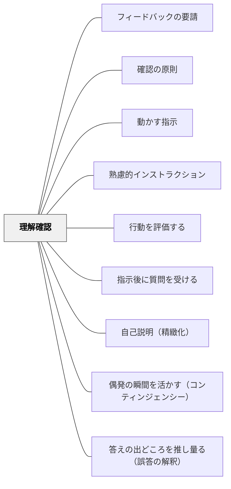

# 理解確認

> 「わかりましたか？」だけでは不十分。行動レベルで理解を確かめる。

## [Pattern Connection]

**研究からの補足（2026-10-19）：理解の点検を次の行動につなぐ（Flavell1979）**

Flavell（1979, p. 909）は、質問や言い換えが、理解の促進にも点検にも使えるとする。Wiki側の適用案として、指示後に一人ずつ最初の操作を示す機会を設け、誤りがあれば説明や提示方法を変える。代表者の応答だけを全員の理解の証拠にはしない。本論文は、この確認方法の学級全体への効果を直接検証してはいない。 出典：[[文献/理解の点検を次の行動につなぐ（Flavell1979）]]。

**研究からの補足（2026-10-18）：自律性と明確な支援を両立する（Jangほか2010）**

原典は、観察された行動的関与と生徒が報告した関与で結果が異なることを示す（pp. 595–597）。Wiki側の適用案として、次の一手を実演してもらう確認に、困りや納得について尋ねる機会を添える。指示を実行できたことを、教科内容の理解や本人の関与の証明にしない。 出典：[[文献/自律性と明確な支援を両立する（Jangほか2010）]]。

**研究からの補足（2026-10-18）：足場かけの調整と手放しを確かめる（van de Polほか2010）**

原典は、支援を現在の理解に合わせるため、先に学習者の状態を確かめる必要を論じる（p. 275）。Wiki側の適用案として、「次の一手をやってみて」と頼み、その応答から説明を加える箇所を選ぶ。教師の確認発話だけを数えず、その後の学習者の反応と組にする（p. 286）。 出典：[[文献/足場かけの調整と手放しを確かめる（van de Polほか2010）]]。

## 背景（Context）
指示や説明の後に受け手が理解しているかを確認することは、インストラクションの基本ステップの一つである。しかし「わかりましたか？」と問うだけでは、実際の理解の有無は確認できない。受け手は分かっていなくても「はい」と答えることが多く、形式的な確認に終わりやすい。

## 問題（Problem）
理解していないまま活動に入ると、後になって混乱や失敗が集積する。「分かった」という申告と実際の行動可能な理解は別物である。確認しないことでインストラクターは「伝わった」と思い込み、受け手の実態が見えなくなる。

## 力のかたち（Forces）
- 言語的な「はい」は理解の証拠にならない
- 実際にやってみることが最も確実な理解確認の方法
- 時間的制約の中で全員の理解を確認することは難しい
- 確認の方法によって得られる情報の質が大きく変わる

## 解決（Solution）
**指示・説明の後に、実際にやってみる・説明させる・質問させるなど、行動レベルで理解を確認する。**

「一つやってみて」「隣の人に説明して」「どうすれば良いか一言で言って」のように、動作・言語化・実演を通じて確認する。代表者に説明させることで、クラス全体の理解状況を把握できる。確認の結果によって指示を補足するか、活動に進むかを判断する。

## 結果（Consequences）
- 指示の理解不足を活動前に発見・修正できる
- 受け手が「聞いているふり」に慣れることを防ぐ
- インストラクターが受け手の実態を把握した状態で次に進める

## クラスター図

## Actionable Insight

- 指示の後に「一つやってみて」「隣の人に説明して」のどちらかを1回入れる——行動で確認することで「分かったふり」を防ぐ
- 全体に「分からなかった人？」と問うのではなく、代表者1人に説明させてクラス全体の理解状況を把握する——一人の言語化がクラス全員のモデルになる
- 確認の結果「まだ迷っている」と感じたら「もう一度、隣の人と確認してから始めよう」と戻る——確認が次のステップへの判断点として機能する

## 出典

- 一つの教育のパタン・ランゲージ（岩井輝久）

## 関連パタン
- [[パタン/フィードバックの要請]]
- [[パタン/確認の原則]]
- [[パタン/動かす指示]]
- [[パタン/熟慮的インストラクション]] — 親パタン
- [[パタン/行動を評価する]] — 活動後の評価と連動
- [[パタン/指示後に質問を受ける]] — 確認の場を明示的に設ける
- [[パタン/自己説明（精緻化）]] — 説明による理解確認
- [[概念/形成的評価の5つの戦略（3×3の枠組み）]] — 戦略②の実装。証拠を引き出す最小の手立て
- [[パタン/偶発の瞬間を活かす（コンティンジェンシー）]] — 「確かめた」で終わらせず、その結果によって次の一歩を分岐させる設計
- [[パタン/答えの出どころを推し量る（誤答の解釈）]] — 確認して出てきた応答を、どの角度から読むか
- [[文献/足場かけの調整と手放しを確かめる（van de Polほか2010）]] — 確認を、次の支援を学習者に合わせるための診断として使う。
- [[文献/自律性と明確な支援を両立する（Jangほか2010）]] — 指示の理解と、本人の学習経験を別々に聞く。
- [[文献/理解の点検を次の行動につなぐ（Flavell1979）]] — 理解を進める問いと、理解を確かめる問いの役割を見分ける。

