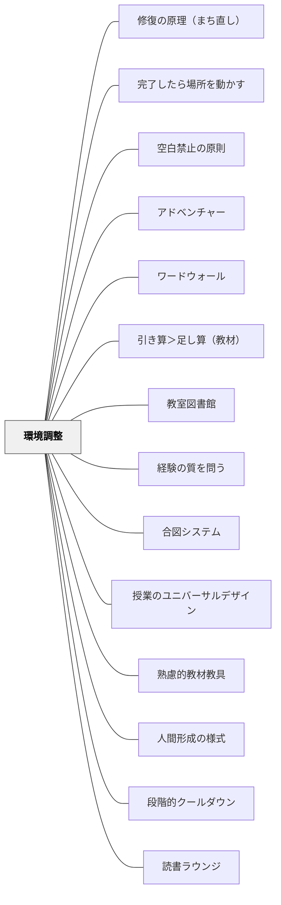

# 環境調整

**このパタンが完成を助ける大きなパタン**：[[パタン/可視化]]

**一文でいうと**：子どもを変えようとする前に、物的・社会的な環境（教材・空間・時間・教師の言葉や関わり）を意図して調整する。

## 使いどころ・使いすぎ注意

| 観点 | 内容 |
| --- | --- |
| 使いどころ | 授業や生活で問題が起きたとき。同じ説明や質問が何度もくり返されるとき。 |
| 使いすぎ注意 | あらゆる困難の原因を環境だけに帰さない。環境の調整と、代わりになる行動を教えることは組で働く（下の研究の裏づけ）。 |

> 全ての被教育者がよく学べるように環境調整せよ。環境調整は、教育経験の質を左右する無数のパターンを含む大きなパターン——いや、超特大パターンである。

## 背景（Context）

「人間は環境の子である」（ロバート・オーエン）。教育は環境を通して行われる。教師と被教育者との関わり、教室、黒板の板書の色など、どれも環境になる。

**環境調整を進めていくことは、偶然を飼い慣らしていくことである。**

教材や教具・教室や学習空間などの物的環境調整や、クラスメートや教師などの社会的環境調整によって、学習や教育の成果を最大化することを目的とする。

環境調整は他のパターンのほとんどを含む**超特大パターン**だ。教師の仕事・教育者や学校の仕事のほとんどがこの環境調整なのではないかと思う。

## 問題（Problem）

何の環境調整もないとき、教育は偶然に任されている。被教育者は何をすればよいかわからず、同じところをぐるぐる回る。本来の教育の価値が届かない。

## 力のかたち（Forces）

- 環境調整を進めることは偶然を飼い慣らすことだ——無意図的な環境こそ最大の障害
- 教育者は自分が考えている以上に大きな教育環境である
- 物的環境と社会的環境の両方を意図的に調整することで相乗効果が生まれる
- ナッジ（肘でつつく：無意識のバイアスを利用して行動をより良い方向に導く手段）はこの環境調整に含まれる概念だ

## 解決（Solution）

環境調整と特別支援のパタンのどれを使うかで迷ったら、下の「[[#近いパタンとの見分け|近いパタンとの見分け]]」の表を見る。

**教育における環境調整を2種類に分けて意図的に設計する。**

いるかどり（2023）では物的環境・空間的環境・人的環境の3分類を提示している。岩井の解釈では**物的環境に空間的環境を含め、社会的環境に人的環境を含む**2分類として整理する。

---

### 1. 物的環境調整

物的な環境における調整としては、教材や教具・教室内の温度や湿度・照明などの調整が挙げられる。これらの環境要因が快適であれば、生徒たちはより集中して学習することができる。また、教室内の机や椅子の配置、教材の配置なども大切な環境調整だ。教材の調整は、学習内容や難易度を被教育者の理解度や興味に合わせて調整することを含む。

**姿勢の改善を目指す物的環境調整の例（いるかどり2023）**：
- 椅子の高さを調整すること
- 椅子の背もたれの部分にマットを置くこと
- 椅子の座る部分にマットを敷くこと
- 机の高さを調節すること
- 机の天板の広さを拡張すること
- 机の天板に角度をつけること

---

### 2. 社会的環境調整

社会的な環境における調整としては、教育者の被教育者への人的な関わり（声かけ・評価の調整・教育設計の調整など）、クラスメートや教育者の関係性・コミュニケーション・協力関係などが挙げられる。被教育者同士の関係性や教育者と被教育者の関係性が良好であれば、被教育者は学習意欲を高めることができる。

**教育者は考えている以上に影響が大きい教育環境だ**——教育者自身が教育環境である。被教育者の実態に応じて、表情や姿勢・声の大きさ・声の質・指示・質問などを使い分けながら、教育者は環境調整を進めていく。

---

### 具体例①：指示の一言が環境を変える

「次の時間は何ですか」と聞かれた時——

- 「次の時間は社会です」と答えるのか
- 「週予定を確認しましょう」と答えるのか

答え方一つで教師の考えや目的が現れる。そして子どもたちの結果がその答え方によって変わってくる。指示という社会的環境調整が、教育の成果を左右する。

---

### 具体例②：言語理解が苦手な被教育者へのケース（いるかどり2023）

**言語を可視化する**：
- イラストを掲示する
- 実物を手に取って見せる

**感覚にアプローチする**：
- 背中をポンポンと優しく触れながら「背中をピンと」伝える
- 教師が手をグーにして手本を示しながら実際に手を添えて「背中とお腹にグー1つ」と伝える

同じ「姿勢を正して」というメッセージでも、言語・視覚・触覚と複数のアプローチで環境を調整することで届き方が変わる。

---

### 具体例③：パタパタゲームで目標設定を体験的に学ぶ

音信（知人の教育者）がよく行っていた実践。**目標設定という社会的環境調整を体験的に学ぶ**活動だ。

**手順**：
1. 全員でサークル（輪）になる
2. 時計周りの順番で膝の上を手でパタパタと叩いていく
3. まずなんとなくやってみる
4. 次に「できるだけ早くやってみて」と言ってタイムを取る
5. 「どれぐらいの速さでできる？」と問い、子どもたちが目標タイムを設定する（4秒・5秒など）
6. 目標タイムを目指してチャレンジを繰り返す

**何が起きるか**：なんとなくただやっている時より、目標を設定してやった時の方がパフォーマンスが明らかに良くなる。しかも楽しくなる。

**目標設定の学び**：この体験を通してSMART目標設定のコツが分かる。
- 「1秒でやれ」→絶対無理な目標 = やる気が出ない
- 「できるだけ早く」→漠然とした目標 = 伸びにくい
- 「今のタイムより1秒縮める」→適切な目標 = 意欲と成果が出る

簡単すぎても難しすぎても良い目標とは言えない。この体験的学習をデザインするのも環境調整だ。

---

### 環境調整に含まれる小パターン群

環境調整はほぼすべての教育パターンを含む超特大パターンだ。パターンリストをながめると、ほとんどが環境調整に含まれることが分かる：

**物的・空間的**
- 教材・教具の選定・配置（シグニファイア・アフォーダンス）
- 温度・照明・机椅子の配置

**学習の設計・順序**
- 基地から未知へ・簡単なものから難しいものへ（シークエンス）
- 分散学習・インターリーブ学習になるよう設計する
- 少ない項目を厳選して深く学べるようにする（モーラ的学習の回避）
- 類推的学習になるように教育をデザインする

**可視化・制限**
- 可視化：分かりにくいものを分かりやすく、見えないものを見えるようにする
- クラスやグループの状態が分かるようにする
- 制限化：どのように制限・焦点化するか

**動機づけ・感情**
- 想像力（感情）を触発する工夫
- ゲーミフィケーション：ゲームの要素を取り入れる
- 必要感のあるものになるよう生活と関連付けた教育をデザインする

**社会的関係・コミュニティ**
- 心理的安全性を確保するための環境調整
- 子ども同士がフィードバックし合い、学び合えるように促進する手立て
- 個別化：子どもたちの違いに応じた物的・社会的環境調整

**学習への参加**
- オンボーディング：全ての人が学習の土台に乗れるよう、これから学ぶことと関係のある知識を少しおさらいしてから新しい学習に入る。前の知識との繋がりから新しいことを学べるよう声かけ・質問をする

**指示・説明・発問**
- 指示の仕方を工夫する・一つ変えていく
- 説明の仕方を分かりやすくする
- 子どもたちが質問できるようにスキルを学べる関係を調整する。質問が出る状況になるよう環境を調整する

**フィードバック**
- 評価：生徒の理解度や進歩状況に応じて評価方法や評価基準を変更する
- フィードバックの提供・評価の透明性の確保

**教師のあり方**
- コーチング・カウンセリング・ファシリテーター・ティーチャー・ジェネレーターなど、どういったあり方を取るかが子どもたちにとっての社会的環境調整になる

---

### 問題が起きた時に「どう環境調整するか」を考える

授業や教育でいろんな問題が起きる。その時に「どう環境調整するのか」という問いで考えていくしかない。自分のできる環境調整を考え、優れた教師がしている様々な環境調整から学び、自分の教育活動に生かしていく。

### 研究の裏づけ

> **研究の裏づけ**：米国教育科学研究所の小学校の行動上の問題の実践ガイド（Epstein ほか 2008）は、困った行動のきっかけを「教室の設定や課題と、子どもの強み・好み・スキルとのずれ」として見て、教室の環境（きまりの再確認・時間割・席・活動の切り替え・課題の難しさ）を変えることを根拠 strong とした。同時に、代わりになる行動（注目の求め方・助けの求め方・怒りの静め方など）を教えて強めることも strong とした。環境の調整とスキルを教えることは、どちらか一方ではなく組で勧められている。根拠の多くは、情緒・行動の障害のある子の単一事例研究と米国の研究である。出典：[[文献/小学校の教室での行動上の問題を減らす（Epsteinほか2008）]]。

> **研究の裏づけ**：英国の小学校153学級・3,766人の研究（Barrett ほか 2015）では、光・温度・空気の質・自分たちの教室だと感じられる工夫・柔軟さ・視覚的な複雑さ・色の七つが、子どもの1年間の伸びと関わっていた。教室の要因だけで予測した伸びの差は、伸び全体の幅の16%にあたった（分散の説明率ではなく、幅の比）。学校の単位の違いは3%しかなく、同じ学校の中でも教室ごとの違いが大きかった。観察研究で、教師の違いは測られていない（pp. 118, 127, 130）。出典：[[文献/教室の光・空気・掲示・色が、子どもの伸びとどう関わるかを確かめる（Barrettほか2015）]]。

> **研究の裏づけ**：学ぶ場所を自然の中に移すことも、環境の調整の一つである。147研究の系統的レビュー（Mann ほか 2022）では、近くの自然の中で行う教科の授業は、教室と比べて学力の伸びは同じだったが、意欲と学ぶことへの関わりは高まった研究があった（比べる群のある2研究）（p. 8）。出典：[[文献/自然の中で学ぶと、子どもの学力と育ちに何が起きるかを、147の研究から確かめる（Mannほか2022）]]。

> **研究の裏づけ**：学級全体の環境と教師の関わりを整える学級経営の取り組みは、小学校の子どもの行動（0.24）・社会性と情動（0.21）・学力（0.17）を小さく確かに高めた（54の取り組みのメタ分析）。教師の行動（秩序の保ち方・規則と手順）に焦点を当てた取り組みは、学力で 0.21 対 0.09 と、暫定的に効果が大きかった（p = .05）。性別・学年・家庭の経済状況・行動の問題の有無で、効果ははっきりとは変わらなかった。ただし、子ども本人の評価は、教師や観察者の評価より改善が小さく出た。出典：[[文献/学級経営の方略とプログラムは、学力・行動・情緒・意欲をどのくらい変えるかを54の取り組みから確かめる（Korpershoekほか2016）]]。

> **研究の裏づけ**：（観察）教室の掲示に気が散るのは、とくに学級全体の活動のときである。米国の幼稚園〜4年生の52学級の観察では、子どもが課題から離れたとき、その中身が教室の掲示などを見ることになる割合は、学級全体の活動で、一人や小グループの活動の約3倍だった（研究2、p. 36）。また、教室の掲示などに気を散らす割合は、年度が進むにつれて増え、教室の見た目に慣れて気が散らなくなるという予想とは逆だった（pp. 19, 25）。著者は、学級全体の活動の場面では、教室の見た目をすっきりさせることが課題から離れる行動を減らすかもしれないとする（pp. 45–46）。観察研究で、掲示を減らした効果を確かめたものではない。出典：[[文献/小学生が授業から離れるのは、どんな形態の授業で、どのくらいの長さの活動のときかを、52の学級で観察して確かめる（Godwinほか2016）]]。

## 近いパタンとの見分け

環境調整のパタンは、物的環境（物・空間・掲示）を変えるか、社会的環境（人・関わり・仕組み）を変えるか、で分かれる。そのうえで、特別な支援が要る子どもの困りごとに合わせた手立てと、問題に見える行動の奥を読む手立てを並べる。

| 迷いどころ | パタン | 見分けの問い |
| --- | --- | --- |
| 物的環境 | [[パタン/完了したら場所を動かす]] | 終わったものを別の場所へ動かし、終わった・まだ・残り、が一目で見えるようにしているか |
| 物的環境 | [[パタン/目の前に山があれば登りたくなる]] | 次のステップが目の前に見えるように置き、取りかかるまでの手間（摩擦）を取り除いているか |
| 特性に合わせる | [[パタン/発達特性と環境調整]] | 困難を子どもと環境の関係として見て、人的・物的・空間的な環境を特性に合わせて調整し、必要なスキルも一緒に育てているか |
| 特性に合わせる | [[パタン/合図システム]] | 助けが要るときに、声に出さずに伝えられる目立たない合図を、子どもと決めてあるか |
| 特性に合わせる | [[パタン/段階的クールダウン]] | 危機になる前に、落ち着く場所と段階を、前もって設計してあるか |
| 全員に届く設計 | [[パタン/授業のユニバーサルデザイン]] | 特別な支援の要る子への配慮を、ほかの子どもにも役立つ設計として、授業全体に組み込んでいるか |
| 全員に届く設計 | [[パタン/多様な演習レベル]] | 同じ内容で難しさの違う演習を用意し、子どもが選べるようにしているか |
| 全員に届く設計 | [[パタン/コーティーチング]] | 二人の教師が設計を共有して、役割を分けて教えているか |
| 見方を変える | [[パタン/子どもの尊厳]] | 子どもの欠陥のリストではなく、才能のリストから見ているか |
| 行動の奥を読む | [[パタン/行為化を読む（転移と反復強迫）]] | 同じ問題行動の繰り返しを、言葉にできないことを行為で語っているものとして読み、繰り返し向き合っているか（フロイト） |
| 行動の奥を読む | [[パタン/悲嘆と喪の作業]] | 喪失を経験した子を急いで元気にしようとせず、悼む時間と繰り返しを保障しているか（フロイト） |

**混同しやすい組**：
- [[パタン/完了したら場所を動かす]]・[[パタン/目の前に山があれば登りたくなる]] と [[パタン/ナッジ]]・[[パタン/シグニファイア]]：前の二つは、進み具合や次の一歩を物の配置で見せる具体的な手。ナッジは行動をそっと押す配置の考え方、シグニファイアは何ができるかの印。
- [[パタン/授業のユニバーサルデザイン]] と [[パタン/発達特性と環境調整]]：前者は全員に届く授業の設計、後者は一人ひとりの特性に合わせた調整。両方を組にして使う。
- [[パタン/多様な演習レベル]] と [[パタン/豊かな課題]]：多様な演習レベルは、難しさの違う演習を別々に用意する。豊かな課題は、一つの課題の中に低い入口と高い天井をつくる。
- [[パタン/合図システム]] と [[パタン/援助要求スキル]]：合図システムは、助けを求める手段を環境として用意する。援助要求スキルは、助けを求める力そのものを育てる。
- [[パタン/行為化を読む（転移と反復強迫）]] と [[パタン/段階的クールダウン]]：段階的クールダウンは、その場の危機を和らげる手。行為化を読むは、繰り返される行動の意味を時間をかけて読む手。

**緊張**：環境の調整と、代わりになる行動を教えること：本ページの「使いすぎ注意」にあるとおり、あらゆる困難の原因を環境だけに帰さない。見分けは、**環境を変えたあとにも同じ困りごとが続くか**である。続くなら、[[パタン/発達特性と環境調整]] のように、必要なスキルを一緒に育てる。

## 結果（Consequences）

- 学習者の力能（なしうる力）が増大する
- 偶然に頼らず、意図的に学習成果を設計できる
- 他の大きなパターン（可視化・フィードバック・文化をつくる等）と重ねることで効果が高まる
- 問題が起きた時に「どう環境調整するか」という建設的な思考の軸ができる

---

## Pattern Connection

**研究からの補足：実行機能の負担と支援を見分ける（Diamond2013）**

原典は実行機能の遂行に情動・社会的・身体的条件が関わると論じる（pp. 153–154）。Wiki側の適用案として、安心して聞き返せる状況や課題量など、一つの条件を変えて取り組み方を観察する。あらゆる困難の原因を環境だけに帰す根拠ではない。 出典：[[文献/実行機能の負担と支援を見分ける（Diamond2013）]]。

**研究からの補足：全員の学び方を広げる包摂的な授業（FlorianとBlackHawkins2011）**

原典のwork choiceとplay zoneは、全員に開かれた機会をどう使うかに焦点を置く（pp. 820–826）。Wiki側の適用案として、資料や相談場所を用意した後、使いたい子が実際に使えたかを確かめる。物的配置の変更だけで包摂が成立したと判断しない。 出典：[[文献/全員の学び方を広げる包摂的な授業（FlorianとBlackHawkins2011）]]。

### Dewey（1938）

Deweyの *Experience and Education*（1938）は、環境調整という実践的パタンに哲学的な根拠を与える。「なぜ環境調整が教育の核心なのか」という問いへの答えが、相互作用（Interaction）の概念にある。

- **既存パタンとの関連**：本パタンの「全ての被教育者がよく学べるように環境調整せよ」という原則は、DeweyのInteraction原則——「経験は個人の内的条件と客観的条件の相互作用として生まれる」——の教育実践的表現そのものである。
- **補強された点**：環境調整が「なぜ重要か」の哲学的根拠が明確になる。教師が規制できるのは客観的条件（環境）だけである。だからこそ環境調整こそが教師の仕事の核心になる。

**Deweyの相互作用モデルと環境調整の関係**

> "The environment, in other words, is whatever conditions interact with personal needs, desires, purposes, and capacities to create the experience which is had."（Dewey, 1938, Ch.3）

| 側面 | 内容 | 教師がコントロールできるか |
|---|---|---|
| **内的条件** | 学習者の需要・欲求・目的・能力 | 直接は不可。間接的にのみ影響できる |
| **客観的条件（環境）** | 教師の言葉・素材・空間・道具・社会的関係 | 可能——これが環境調整の対象 |

> "The trouble with traditional education was not that educators took upon themselves the responsibility for providing an environment. The trouble was that they did not consider the other factor in creating an experience; namely, the powers and purposes of those taught."（Dewey, 1938, Ch.3）

伝統的教育は客観的条件（教科書・規律）を絶対視し内的条件を無視した。放任的進歩教育は内的条件（子どもの衝動）に従属し客観的条件を軽視した。環境調整の本質は、この2条件を均衡させることにある。

- **他のパタンへの波及**：[[パタン/経験の質を問う]]（相互作用が経験の質の第3の次元）・[[パタン/副次的学習]]（環境調整が副次的態度形成の条件を設定する）

---

### Hammeken（2003）統合：**

*The Teacher's Guide to Inclusive Education: 750 Strategies for Success!* は、本パタンに「Universal Design for Learning（UDL）」という哲学的フレームを接続する。

- **補強された点**：本パタンの「全員がよく学べるように環境調整する」という原則が、UDLの「はじめから全員のために設計する（Design for all from the start）」に対応することが明確になった。「障害のある子のための配慮は全員に有効」という視点が加わり、環境調整が「特定の子への特別対応」から「授業設計の質の向上」へと再定義される。
- **接続した概念**：配慮（Accommodation）と修正（Modification）の区別——「アクセスの方法を変える（内容は変えない）配慮」を先に試み、それでも届かないときに「内容自体を変える修正」を検討するという原則が加わった。
- **他のパタンへの波及**：[[パタン/授業のユニバーサルデザイン]] として独立したパタンを生成。[[実践/インクルーシブ授業の設計]] として教科別の具体的配慮カタログを整備。

---

### 細谷恒夫（1957）

細谷の *教育の哲学 人間形成の基礎理論* は、環境調整の「何を調整するか」という問いに対して、教育的環境の**四層構造**という体系的な答えを与える。

- **既存パタンとの関連**：本パタンが「全ての被教育者がよく学べるように環境調整する」と述べるとき、調整の対象となる環境はどこまで広いのか。細谷の分析は、その全体像を階層的に示す。
- **補強された点**：環境調整の射程がいかに広いかが構造的に見えてくる。「物的環境」「社会的環境」という2分類を、より深い理論的枠組みに接続できる。

**教育的環境の四層構造**

| 層 | 内容 | 教育的意義 |
|---|---|---|
| **自然的環境（風土）** | 気候・地形・自然。人間形成の最基底 | 直接調整は困難だが、文化を通して間接的に作用 |
| **精神的環境（文化）** | 制度・法律・科学・芸術・習俗 | 個人に行動の「軌道」を与えると同時に「更新の可能性」をもたらす |
| **人間的交渉** | 共感的・同僚的・同志的という三類型の人間関係 | 発達段階によって支配的な類型が変わる |
| **教育的交渉** | 意図的に人間形成を目的とした交渉 | 「目的意識」が初めて環境に加わる層 |

**文化の二面性——制約と更新の可能性**

細谷が特に強調するのは、精神的環境（文化）の二面性である：

1. **軌道（制約）**: 文化は新しく生まれた個人に対し、その行動の「軌道」として機能する。習俗・規範・慣行は個人に「これに従って行動せよ」という圧力を与える。
2. **更新の可能性**: 若い世代は文化をその本来の意味から問い直し、更新する可能性を持っている。生活条件の変化によって文化が「因襲」に転落したとき、その陳腐性を感じるのは新しい世代だからだ。

これは授業設計に直接示唆を与える——「文化（教科の内容）を与える」という一方向の環境調整ではなく、子どもたちが文化を批判的に問い、更新の主体になれるような環境調整が必要である。

> 「文化の更新とか変革を試みようとするものも、その前提としてその文化を単なる傍観者としてではなく、一応は自己のものとして受けとらなければならない」（第三章 教育的環境論）

- **他のパタンへの波及**：[[パタン/人間形成の様式]]（どの様式の形成を目ざすかによって必要な環境調整が変わる）・[[パタン/コミュニティをつくる]]（人間的交渉の三類型は環境調整の対象として考えられる）

---

**プラトン『国家』（前380年頃）——「美しい土地に住む」：環境が魂を形成する古代的論理：**

- **「美しい土地に住む」比喩（第3巻）**：プラトンは守護者の文芸・音楽教育の目的として「若者たちがいわば健康な土地に住むように……美しい作品からの影響が彼らの視覚や聴覚にやってきて働きかけ、こうして彼らを早く子供のころから、知らず知らずのうちに、美しい言葉に相似た人間……へと、導いて行くために」と述べた。これは環境調整の最も根本的な哲学的根拠の一つ——「子どもを変えようとするのでなく、子どもが育つ環境を美しくする」という原則の古代的定式化
- **細谷の「精神的環境（文化）」との接続**：細谷の四層構造における「精神的環境（文化）」——制度・法律・科学・芸術・習俗が「行動の軌道」を与える層——に、プラトンの「美しい作品への曝露が魂を形成する」という審美的環境論が接続する。教室の掲示物・図書のラインナップ・音楽への接触が「精神的環境」の小学校版として機能する
- **Deweyの「相互作用の客観的条件」との接続**：Deweyは「客観的条件（環境）が個人の内的条件と相互作用して経験が生まれる」と述べた。プラトンの「美しい土地に住む」は「美的な客観的条件が、理性の到達以前に内的感受性を形成する」という同じ構造を古代に示す
- **「知らず知らずのうちに」——意図せぬ学習の設計**：「意図せず美しい人間になる」という結果は、Deweyの「副次的学習」（Collateral Learning）の古代版でもある。教師が直接指導しなくても、環境への曝露が最も根本的な性格形成を担う
- **波及するパタン**：[[パタン/審美的交渉]] — 「美しい土地に住む」比喩は審美的交渉の環境設計版；[[文献/国家（プラトン）]] — 本統合の出典

---

**いるかどり（2023）統合：**

*子どもの発達障害と環境調整のコツがわかる本*（ソシム）は、本パタンの3分類（人的・物的・空間的）を発達障害のある子どもの具体的な困りごとに対して適用した実践書。

- **補強された点**：「困りごと別の調整」（言語理解・感覚過敏・読み書き・整理整頓・集団参加）が本パタンの抽象原則を具体的な実践に落とし込む基盤となった。「見通しを持てるようにする（スケジュールの可視化）」が最も即効性の高い調整として明確に位置づけられた。
- **修正・拡張された点**：「子どもを変えようとする」から「環境を変える」への視点転換が本書の核心。本パタンの「問題が起きた時に『どう環境調整するか』を考える」という原則がより具体的な発達障害文脈で深化した。
- **他のパタンへの波及**：[[パタン/発達特性と環境調整]]（新規）として、発達障害文脈での具体的な子パタンを作成。[[実践/発達特性別の環境調整]]（新規）として、困りごと別の実践ガイドを整備。

---

**岩井輝久（2023）——環境調整は人的環境調整を含む特大パタンだという気づき**

> 「環境調整というのは大きなパタン。物的環境調整もあるけど、環境調整の中には人的環境調整もある。例えば、教師がどう関わるのか。次の時間は何ですかと聞かれる。「次の時間は、社会です。」と答えるのと、「週予定を確認しましょう。」と答えるのでは、大きく結果が変わってくる。」（岩井輝久、2023）

> 「「大パタンから小パタンへ」というシークエンスのメタパタンを構成できた。教育全般を貫く大パタンの中でも環境調整は人的環境調整を含む特大パタンだということが分かった。」（岩井輝久、2023）

- **既存パタンとの関連**：本パタンの解決セクションでは「物的環境調整」と「社会的環境調整（人的環境調整）」の2分類を提示している。このツイートはその分類を作るプロセスの記録であり、「人的環境調整が環境調整に含まれる」という構造が、パタン・ランゲージの整理を通じて初めて明示的に把握されたことを示している
- **補強された点**：「次の時間は社会です」vs「週予定を確認しましょう」という指示の一言は、人的環境調整の最も小さな単位の例だ。教師の言葉・関わり方・問いかけのすべてが人的環境調整であり、それが物的環境調整と並んで「超特大パターン」の内実を構成する
- **他のパタンへの波及**：[[自分のパタンを作る]]（パタン・ランゲージを整理することで、各パタンの規模と位置関係が初めて見えてくる——「整理する」こと自体がパタンを発見する行為だ）

## 関連パタン
- [[パタン/修復の原理（まち直し）]]
- [[学級経営/学級経営で使えるパタン]]
- [[特別支援/特別支援で使えるパタン]]
- [[特別支援/インクルーシブ教育]]
- [[学級経営/心理的安全性]]
- [[パタン/完了したら場所を動かす]]
- [[特別支援/環境調整（特別支援）]]
- [[特別支援/視覚支援]]
- [[パタン/空白禁止の原則]]
- [[パタン/アドベンチャー]]
- [[パタン/ワードウォール]]
- [[パタン/引き算＞足し算（教材）]]
- [[パタン/教室図書館]]
- [[パタン/経験の質を問う]]
- [[パタン/合図システム]]
- [[パタン/授業のユニバーサルデザイン]]
- [[パタン/熟慮的教材教具]]
- [[パタン/人間形成の様式]]
- [[パタン/段階的クールダウン]]
- [[パタン/読書ラウンジ]]
- [[パタン/発達特性と環境調整]]

- [[パタン/可視化]] — 環境調整の中核手段
- [[パタン/ナッジ]] — 環境調整に含まれる概念
- [[パタン/フィードバック]] — 社会的環境調整の中心
- [[パタン/文化をつくる]] — 社会的環境調整による文化形成
- [[パタン/オンボーディング]] — 学習の土台を整える環境調整
- [[パタン/シグニファイア]] — 教材の物的環境調整
- [[パタン/自己調整]] — 自己調整できるように環境調整する
- [[メタパタン/経済を原理とする]] — 引き算の原理（不要な環境は削ぐ）

- [[パタン/4象限ノートテンプレート（意味のあるノート）]] — 収束後の記録形式を変えることで、全員が学びを所有しやすくする。
- [[文献/全員の学び方を広げる包摂的な授業（FlorianとBlackHawkins2011）]] — 教材の配置だけでなく、誰が利用できるかを点検する。
- [[文献/実行機能の負担と支援を見分ける（Diamond2013）]] — 配置だけでなく、情動・社会的条件による負担を見る。
- [[文献/小学校の教室での行動上の問題を減らす（Epsteinほか2008）]] — 環境の調整（strong）と代わりの行動を教えること（strong）は組
- [[文献/教室の光・空気・掲示・色が、子どもの伸びとどう関わるかを確かめる（Barrettほか2015）]] — 教室の光・温度・空気・掲示・色と、子どもの伸びの関係を調べた大規模な観察研究
- [[文献/自然の中で学ぶと、子どもの学力と育ちに何が起きるかを、147の研究から確かめる（Mannほか2022）]] — 学ぶ場所を自然の中に移すことの効果
- [[文献/学級経営の方略とプログラムは、学力・行動・情緒・意欲をどのくらい変えるかを54の取り組みから確かめる（Korpershoekほか2016）]] — 学級全体の環境と教師の関わりを整える取り組みの効果（小学校・54の取り組み）
- [[文献/小学生が授業から離れるのは、どんな形態の授業で、どのくらいの長さの活動のときかを、52の学級で観察して確かめる（Godwinほか2016）]] — 学級全体の活動では教室の掲示に気が散りやすく、年度が進むと増えた（観察）

## このパタンが働く実践

- [[実践/発達特性別の環境調整]] — 人的・物的・空間的環境を、困りごと別に具体化した実践ガイド。
- [[実践/個別支援級の複式算数：重さと面積をわたり・ずらしで学ぶ]] — 複式・個別支援の条件下で、具体物・見通し・直接指導の配置を調整する。

## クラスター図

## Actionable Insight

- 授業で問題が起きているとき「どう環境調整するか」という視点で考える——子どもを変えようとするより環境を調整する方が効果的な場合が多い
- 明日の授業で1つだけ物的環境調整を変える——机の配置・教材の見せ方・掲示物のどれか1つを変えるだけでいい
- 毎回同じ質問が出る場面を思い出し、そこに「指示の書かれたカード」か「手順の掲示物」を置く——説明より環境を整える方が経済的

## 出典
- [[文献/みるみる（個別最適な学び）]]

ロバート・オーエン「人間は環境の子である」  
いるかどり（2023）物的環境・空間的環境・人的環境の3分類  
岩井輝久「岩井輝久『一つの教育のパタン・ランゲージ』」（2026-04-29 vault収録）  
[[文献/大きなパターンと環境調整（動画記録）]] — 動画 https://youtu.be/BVWj3stX51Q  
岩井輝久「パタン　環境調整（動画記録）」https://youtu.be/kGE8qjkpV1s
