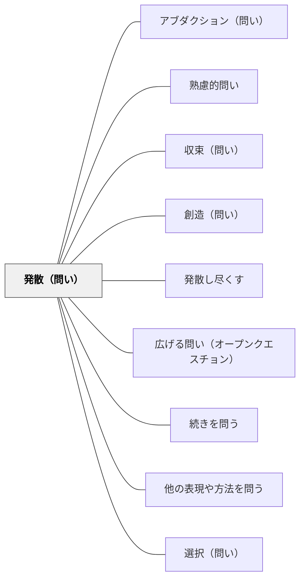

# 発散（問い）

> 「他にはどんな方法・アイデアがあるか？」と問い、思考の広がりを意図的に生み出す。

## 背景（Context）
思考は放っておくと最初に思いついたアイデアや慣れ親しんだ解法に収束してしまう。
創造的な問題解決や豊かなアイデア生成には、まず可能性の空間を広く探索することが必要だ。
ブレインストーミングのように「量を求め、批判を保留する」ことで、思考の幅が生まれる。
発散的思考と収束的思考は車の両輪であり、発散の問いはその片方を意図的に活性化させる。
「他には？」は、その最も短い形である。最小限の言葉で、最初の答えで満足する思考の慣性を破る。

※旧パタン「他には？（問い）」を本ページに統合（2026-11-12）。基本疑問詞の系列に置かれていたが、問い（他には？まだある？量を求める）が本ページと同じだったため一枚にした。熟慮的問いの基本疑問詞の表では旧名のまま並べている。

## 問題（Problem）
学習者が最初の思いつきや慣れたやり方に固執してしまい、多様な可能性を探索しないとき、どう思考の広がりを促すか。「一つの正解を探す」という学習文化も、思考の多様性を妨げる。

## 力のかたち（Forces）
- 発散の問いは「答えは一つ」という思い込みを崩す力を持つ。
- 批判を保留する安心感がなければ、奇抜なアイデアは出てこない。
- 発散し過ぎると、議論が散漫になり収束が難しくなる。
- 他者のアイデアが触発剤となり、さらにアイデアが広がるという連鎖が起きる。

## 解決（Solution）
**近いパタンとの見分け**：「他には？」と量を求めて広げるのが本パタン（旧「他には？（問い）」を統合）。関連するものを自由に広げるのは [[パタン/連想（問い）]]、広げたあとに絞るのは [[パタン/収束（問い）]]。問いの系列の全体の表は [[パタン/熟慮的問い#近いパタンとの見分け|熟慮的問い]] にある。

「他にどんな方法が考えられますか？」「全部で何案出せますか？」「まだありますか？」と問いかけ、思考を先に進めさせる。
「どんなに突飛なアイデアも構いません」と評価を保留する文脈を明示する。
時間を区切って「3分でできるだけ多くのアイデアを」と量を目標に設定することも有効だ。
他者のアイデアを聞いて「それを元にさらに考えると？」とブランチを促す。
子どもが一つ答えを出したら、「他には？」を3回くり返す。「最初に思いついたものとは全く違う視点から考えると？」と問うと、思考の固着を意識して破れる。

## 結果（Consequences）
慣れ親しんだ解法の外に出て、可能性の空間が広がる。
「答えは一つ」という固定観念が崩れ、複数の視点を持つことが当たり前になる。
発散の後の収束（[[パタン/収束（問い）]]）によって、より質の高い解決策が選ばれるようになる。
創造的な雰囲気が醸成され、学習者が安心してアイデアを出せる文化が育つ。

## 関連パタン
- [[パタン/アブダクション（問い）]]
- [[パタン/熟慮的問い]] — 親パタン
- [[パタン/収束（問い）]] — 発散した後に絞り込む問い
- [[パタン/創造（問い）]] — 発散の中でも特に新しいものを生み出す問い
- [[パタン/発散し尽くす]] — 発散を徹底するパタン
- [[パタン/広げる問い（オープンクエスチョン）]]
- [[パタン/続きを問う]]
- [[パタン/他の表現や方法を問う]]
- [[パタン/選択（問い）]] — 広げたあと、選ぶ問いと組む

## クラスター図

## Actionable Insight

- 「3分でできるだけ多くのアイデアを出そう」と時間と量の目標を設定する——量を求めることが発散の質を引き出す逆説的な効果を持つ
- 「どんなに突飛なアイデアも歓迎」と評価を保留する文脈を最初に明示する——批判が保留されることで、奇抜なアイデアと本質的な発見が安全に生まれる
- 他者のアイデアを聞いて「それを元にさらに考えると？」とブランチを促す——アイデアの連鎖がさらなる発散を生み可能性の空間を広げる

## 出典
- [[文献/熟慮的問いのパターンリスト（動画記録）]]
