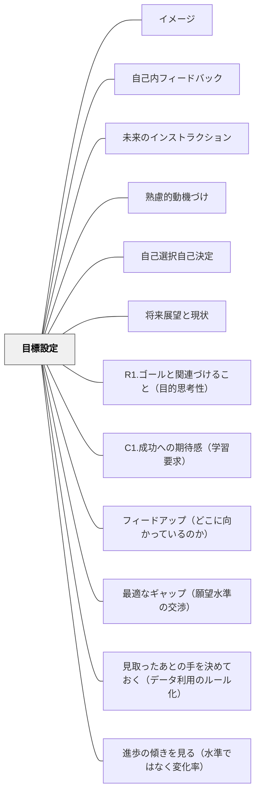

# 目標設定

> 適切な目標を持つことが、行動の方向性とエネルギーをつくる。具体的で挑戦的、かつ自分で設定した目標が最も力を持つ。

## [Pattern Connection]

**研究からの補足（2026-10-18）：自律性と明確な支援を両立する（Jangほか2010）**

原典の構造には、目標へ向かう行動のガイドが含まれる（pp. 590, 593）。Wiki側の適用案として、目標と最初の一手を共有した後、納得できる点や困る点を聞く。目標を教師が示すか本人が決めるかだけで自律性を判定しない。SMARTや目標設定単独の効果の検証ではない。 出典：[[文献/自律性と明確な支援を両立する（Jangほか2010）]]。

**研究からの補足（2026-10-18）：できるという見通しを経験から育てる（Bandura1977）**

原典は、行動の結果への期待とその行動を遂行できるという効力期待を分ける（pp. 193–194）。Wiki側の適用案として、目標を書いた後に「最初の一手」「自分でできる部分」「必要な援助」を短く確認する。目標の設定方式やSMARTの効果を直接検証した論文ではない。 出典：[[文献/できるという見通しを経験から育てる（Bandura1977）]]。

**研究からの補足（2026-10-18）：フィードバックの効果を注意の向きから捉える（KlugerとDeNisi1996）**

目標設定ありの方がFI効果が大きいという分析は、著者の採用した厳しい有意基準.01には届かず、慎重な解釈を求めている（p. 273）。Wiki側の適用案として、目標を一つ決め、結果のどこが目標との差を示すかを一緒に確認する。この研究から目標設定の万能な効果を追加主張しない。 出典：[[文献/フィードバックの効果を注意の向きから捉える（KlugerとDeNisi1996）]]。

**研究からの補足（2026-10-17）：学級の構造から学習への動機づけを支える（Ames1992）**

原典の達成目標は、理解・技能の向上を目指すか、能力の証明や他者との比較を重視するかという意味の違いを含む（pp. 261–262）。Wiki側の適用案として、冊数や正答数の目標に、どんな読み方や考え方を身につけたいかを添える。具体的な数値目標を置いたことだけで熟達目標が成立したとは判断しない。 出典：[[文献/学級の構造から学習への動機づけを支える（Ames1992）]]。

**原典の接続（2026-10-14）**：自己調整学習の六モデル（Panadero2017）を参照し、目標を固定せず遂行中の証拠で見直すための補足を本ページに加えた。

## 背景（Context）
ロック＆ラサムの目標設定理論が示すように、目標は動機と行動に直接影響する。目標がなければ努力は散漫になり、目標が明確であれば人は持てる力を集中させる。学習においても、目標設定は動機付けの核心的なプロセスのひとつである。

## 問題（Problem）
曖昧な目標（「頑張る」「もっとよくする」）では行動が具体化しない。教師から与えられた目標は、学習者の動機に結びつきにくい。また、高すぎる目標は無力感を、低すぎる目標は意欲の欠如をもたらす。

## 力のかたち（Forces）
- 目標は具体的・測定可能・達成可能・意味ある・期限のある（SMART）ものが行動につながりやすい
- 自分で設定した目標（内発的帰属）は、他から与えられた目標より強い動機を生む
- 近接目標（短期）と遠隔目標（長期）の組み合わせが持続的な動機付けに有効
- 目標の進捗を可視化・確認できる仕組みが達成感と次への動機を生む

## 解決（Solution）

> **原典による補足：遂行中に目標も見直す（2026-10-14）**：Panadero（2017, pp. 18–21）は、自己調整を一方向の目標達成手順ではなく、フィードバックを受ける循環として整理する。途中の証拠によって目標の具体性や方向を変えることも含まれる。Wiki側の適用案として、課題の途中で「目標は今も適切か」「方法を変えるか、目標を小さくするか」を一度確認する。目標を最初に書けたことだけで自己調整を評価しない。出典：[[文献/自己調整学習の六モデル（Panadero2017）]]。

**学習者が自分で具体的・適度に挑戦的な目標を設定できる機会と支援を提供することで、動機と行動の方向性をつくる。**

単元の始めに「この期間で何を達成したいか」を学習者自身に設定させる、目標を定期的に振り返り調整する機会を設ける、短期と長期の両方の目標を持てるよう支援する、達成した目標を可視化・蓄積するツールを活用するなどが有効である。

## 結果（Consequences）
- 学習者が何に向かって努力すればよいかが明確になり、行動が具体化する
- 目標達成の体験が自己効力感と達成感を育てる
- 目標設定・振り返りの習慣が自己調整学習の基盤となる

## このパタンが働く教材

| 教材 | どのように目標設定が働くか |
|------|----------------------------|
| [[教材/1週間の読書目標]] | 今週の読書目標を自分で決め、達成状況と次の調整を振り返る |

## クラスター図

## Actionable Insight

- 単元の始めに「この期間で何を達成したいか」を学習者自身に1文設定させる——自分で設定した目標が内発的帰属を生み他から与えられた目標より強い動機を生む
- 「今週の目標→単元末の目標」という近接と遠隔の両方の目標を持てるよう支援する——短期と長期の組み合わせが持続的な動機付けに最も有効
- 目標の達成状況を週末・単元末に振り返り調整する機会を設ける——進捗の可視化と定期的な振り返りが達成感と次への動機を生み自己調整学習の習慣を育てる

## 出典

- 一つの教育のパタン・ランゲージ（岩井輝久）

## 関連パタン

- [[文献/自己調整学習の六モデル（Panadero2017）]] — 目標を固定せず遂行中の証拠で見直す。
- [[パタン/イメージ]]
- [[パタン/自己内フィードバック]]
- [[パタン/未来のインストラクション]]
- [[パタン/熟慮的動機づけ]] — 親パタン
- [[パタン/自己選択自己決定]] — 関連パタン
- [[パタン/将来展望と現状]] — 関連パタン
- [[パタン/R1.ゴールと関連づけること（目的思考性）]] — 関連パタン（ARCSとの接点）
- [[パタン/C1.成功への期待感（学習要求）]] — 関連パタン（ARCSとの接点）
- [[パタン/フィードアップ（どこに向かっているのか）]] — 関連パタン
- [[パタン/最適なギャップ（願望水準の交渉）]] — 目標の立て方ではなく、目標と現在地の距離そのものを設計変数として扱う（Sadler, 1989）
- [[概念/教授学的契約（やり過ごしの均衡）]] — 均衡点を動かすには子ども自身が引き受けた目標が要る
- [[パタン/見取ったあとの手を決めておく（データ利用のルール化）]] — 学習者の側の「到達点を事前に言葉にする」操作を、教師の意思決定について行ったもの
- [[パタン/進歩の傾きを見る（水準ではなく変化率）]] — 動的目標。達成に照らして上方修正される目標は固定した目標よりよい結果につながる（Fuchs, 1993）
- [[概念/自己調整学習の内側（成長の道とウェルビーイングの道）]] — 目標が「成長の道」と「ウェルビーイングの道」のどちらに向くかで働きが変わる
- [[文献/Teaching Elementary School Students to Be Effective Writers（Graham et al., 2012）]] — 作文の目標を立てる介入は、根拠が strong の勧めの柱の一つ
- [[文献/学級の構造から学習への動機づけを支える（Ames1992）]] — 達成量に加え、何を成功と捉える目標かを確かめる。
- [[文献/フィードバックの効果を注意の向きから捉える（KlugerとDeNisi1996）]] — 目標と結果の照合を、具体的な次の行動へつなげる。
- [[文献/できるという見通しを経験から育てる（Bandura1977）]] — 到達したい目標に、遂行できる部分と必要な援助の見通しを添える。
- [[文献/自律性と明確な支援を両立する（Jangほか2010）]] — 目標に、進め方の手がかりと本人の受け止めを添える。

