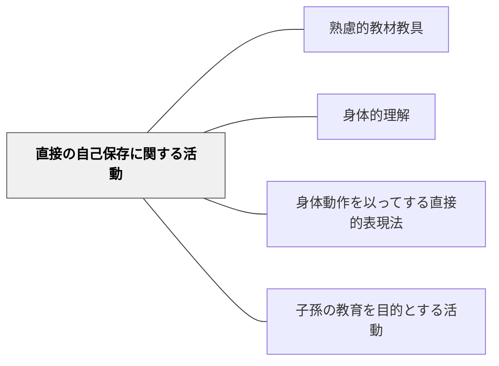

# 直接の自己保存に関する活動

**このパタンが完成を助ける大きなパタン**：[[パタン/熟慮的教材教具]]

> 身体・健康・命を直接守るための知識——最も根本的な教育内容。

## 背景（Context）

ハーバート・スペンサーが「何の知識が最も価値があるか」という問いに対して提示した活動分類の第一項目。生理学・保健・衛生・体育など、身体の健康を直接守るための知識・活動が含まれる。牧口常三郎もこの分類を参照している。

**原典では**：スペンサーの論文「いかなる知識が最も価値あるか」（1859年）は、人間の生活を成り立たせる主な活動を、重要さの順に五つに分けた。本項はその第1で、原文は “those activities which directly minister to self-preservation”。スペンサーは五つのどれについても、最も価値ある知識は「科学（Science）」だと結論した。

牧口常三郎は『創価教育学体系』第4巻で、この五要素を「教材の選択論上、今でも一顧せざるを得ない貴重なる文献」と評し、第1を「直接の自己保存に関する活動＝直接なる自己保存の準備＝生理学」と訳している。

## 問題（Problem）

学校教育で抽象的・学術的な知識を優先するあまり、身体・健康という最も基礎的な価値が後回しになることがある。

## 力のかたち（Forces）

- 身体的健康は他の全ての活動の基盤
- 健康教育は知識だけでなく習慣形成が重要
- 個人差・家庭環境の違いへの配慮が必要

## 解決（Solution）

**身体・健康・生命に関わる知識と実践（生理学・保健・食育・体育）を教育材料に位置づけ、生活に生きる形で設計する。**

**近いパタンとの見分け**：教材・教具の表では、本パタンの見分けの問いは「体と健康を守る知識（生理学など）につながる教材か」。全体の表は [[パタン/熟慮的教材教具#近いパタンとの見分け|熟慮的教材教具]] にある。

**例：すり傷の手当て**（保健・中学年）
すり傷の手当ての手順を実際に練習し、なぜまず洗うのかを、体のしくみ（ばい菌・皮膚）から考える。

---

**例：手洗いを確かめる**（保健・低学年）
手洗いチェッカー（光で汚れが見える道具）で、洗い残しの多い場所を確かめ、自分の洗い方を直す。

## 結果（Consequences）

- 健康リテラシーと身体感覚が育つ
- 自己管理能力の基盤が形成される

- 注意点：スペンサーは五つを重要さの順に並べたが、順位をそのまま時間配分にすると、教育の幅が狭くなる

## 関連パタン

- [[パタン/熟慮的教材教具]] — 親パタン
- [[パタン/身体的理解]] — 身体を通じた学び
- [[パタン/身体動作を以ってする直接的表現法]] — 身体的表現
- [[パタン/子孫の教育を目的とする活動]] — スペンサーの第三活動カテゴリ（育児・次世代教育の知識）

## クラスター図

## Actionable Insight

- 保健・体育の授業で「この知識が明日の自分の生活をどう変えるか」を1文書かせる——知識が生活に接続されることで最も根本的な教育内容が「役立つもの」として内面化される
- 食育・睡眠・運動など日常生活に直結する内容を他教科の文脈とも結びつける——身体・健康の知識が孤立した保健の知識でなく生活全体に関わる知識として位置づけられる
- 「自分の身体の変化を1週間観察してみよう」という習慣課題を取り入れる——自己観察の習慣が健康リテラシーと自己管理能力の基盤を形成する

## 出典

- ハーバート・スペンサー（知識の分類）
- [[文献/熟慮的教育材料のパターンリスト（動画記録）]]

- Spencer, H. (1911). What knowledge is of most worth? In *Essays on education and kindred subjects* (pp. 1–44). J. M. Dent.（初出1859年。Project Gutenberg 版 #16510 で原文を確認）
- 牧口常三郎（2007）『創価教育学体系』第4巻（聖教文庫、第8刷のデジタル版）第二章「教科構造論」— 2026-11-13 に該当箇所の原文を確認。[[文献/創価教育学体系 4（牧口常三郎）]]
