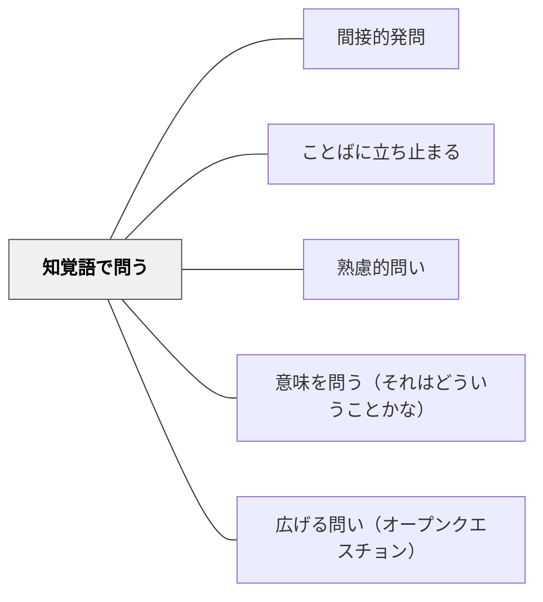

# 知覚語で問う

> 「どこを見ている？」「何が聞こえる？」と、見る・聞くなど感覚で直接確かめられる言葉で問い、子どもの経験を引き出して考えの入口にする。

## 背景（Context）
抽象的な概念や論理的な説明に偏った学習では、身体感覚や感覚的なイメージが切り離されてしまう。しかし人間の理解は身体性と深く結びついており、感覚的な言葉で問うことで、抽象的な概念に身体的なリアリティを与えられる。

**原典では**：土居（2026）は、有田和正の「バスの運転手は、運転している時、どこを見ていますか。」という発問を、「バスの運転手は、どんな仕事をしていますか。」と直接問う発問と比べて説明している。「どこを見ているか」と問うのは「『見る』という直接的な感覚を示す語を用いており」、「仕事」という言葉では知らない子は答えられないのに対し、子どもは直接目で見てわかることを答えればよいので答えやすい（第2章6「発問自体への工夫① 間接的に問う」、Kindle版 67/204頁表示）。そのうえで、「宇佐美寛（1985）では、このような直接的な感覚を示す語を『知覚語』と呼び、子ども達の経験が多く語られる発問の言葉として取り上げています」と紹介し、知覚語で問うことを「間接的に問う」工夫の一種と位置づける（同）。原典の言う知覚語は、「見る」のように感覚で直接確かめられる行為を指す語で、問いの答えは子どもが見たこと・経験したことになる。

原典はまた、この発問の力は内容ではなく問い方にあるとする。発問の「内容」はバスの運転手がどんなことを考えながら仕事をしているかで、誰も思いつかないものではないが、「どこを見ているか」と問うたところが秀逸だ、という（第2章5、Kindle版 62/204）。有田の授業では、この発問の前に、バスについて知っていることを自由に話したあとで「バスはタイヤが何個ついていますか。」と問い、自分が実はよく見ていなかったと気づく流れをつくっていたことも紹介されている（第2章14、Kindle版 92/204）。

**岩井の講話では**：知覚語を問うとは、たとえば視覚や聴覚に関わる問いで、「バスの運転手は何を見ているのかな」といった問いのことだと説明している（講話 18:31〜18:46）。後半では、問いの表現の型の一つとして「五感に関する表現で感覚を刺激する」ものを挙げ、「さっきの知覚語を問うっていうのと同じこと」と述べている（30:06〜30:14）。

## 問題（Problem）
「なぜ？」「どう思う？」という問いは言語的・論理的な思考を呼び出すが、感覚的・直感的な理解が引き出せないことがある。知覚語を使わなければ、学習者の身体的・感覚的な理解の層にアクセスできない。

## 力のかたち（Forces）
- 感覚的な言葉は直感的な理解を引き出しやすい
- 「見える」「聞こえる」「感じる」は敷居が低く答えやすい
- 身体的な表現から論理的な説明へ橋渡しができる
- 感性と理性の両方を活かした学びが深まる

## 解決（Solution）
**近いパタンとの見分け**：問いの型の表では、本パタンの見分けの問いは「「どんな感じがする？」「どう見える？」と、感覚の言葉で問うているか」。全体の表は [[パタン/熟慮的問い#近いパタンとの見分け|熟慮的問い]] にある。

「これを見てどんな感じがする？」「手で触ってみてどう感じた？」「この音楽を聴いてどんな色が浮かぶ？」と知覚的な言語で問いかける（「この計算問題、解けそうな感じがする？」は、知覚語というより見通しを問う例である）。たとえば理科で「この実験を見てどんな感じがした？予想と違うものを感じた？」と、子どもが感覚を起点に考える。

---

**例：「どこを見ている？」で仕事の中身に入る**（社会・3年「地域の仕事」／生活科）
1. はじめに「バスについて知っていること」を自由に出し合う。
2. 「バスのタイヤはいくつついている？」と問い、答えが割れたら「よく見ているつもりでも、見ていないことがあるね」と確かめる。
3. 「バスの運転手さんは、運転しているとき、どこを見ているだろう？」と問う。
4. 出てきた「見ている所」（ミラー・信号・乗る人の足もと・時計など）を板書し、「どうしてそこを見るのだろう？」と仕事の中身へつなげる。
（原典 Kindle版 67、92/204 で紹介された有田和正の授業をもとにした手順）

---

**例：「何が聞こえる？」で場面の様子をとらえる**（国語・物語文、中学年）
1. 場面の様子を読み取りたい段落を音読する。
2. 「この場面に立っていたら、何が聞こえると思う？」と、聴覚の語で問う（「何が見える？」「どんなにおいがする？」でもよい）。
3. 本文の言葉を根拠に、聞こえる音を短くノートに書き出す。
4. 書き出した音を並べ、「この音から、どんな場面だとわかる？」と様子のまとめに戻る。
（講話 18:31〜18:46 の「視覚とか聴覚とか」を国語に移した Wiki 側の手順。原典は「見る」の例のみ）

## 結果（Consequences）
- 身体感覚が学びの入口となり、概念が身近になる
- 感覚的な理解が言語化されることで、思考が豊かになる
- 多様な感覚・感性をもつ学習者が参加しやすくなる

- 注意点：知覚語の問いは、答えが「見えたこと・聞こえたこと」で終わりやすい。原典の例でもねらいは運転手の仕事を考えることであり、出てきた知覚の答えを「どうしてそこを見るのだろう」などでねらいへつなげる一手を用意しておく。

## 関連パタン
- [[パタン/間接的発問]]
- [[パタン/ことばに立ち止まる]]
- [[パタン/熟慮的問い]] — 親パタン
- [[パタン/意味を問う（それはどういうことかな）]] — 感覚を意味へ変換する
- [[パタン/広げる問い（オープンクエスチョン）]] — 多様な答えを引き出す

## クラスター図

## Actionable Insight

- 授業の問いに「どんな感じがする？」「見てどう感じた？」を1つ加える——感覚的な言葉が敷居を下げ、多様な学習者が参加しやすくなる
- 抽象概念を学ぶ前に「これを触ったら/聞いたら/見たらどんな感じがしそう？」と身体的想像を促す——感覚的イメージが先にあることで概念の理解が身体的リアリティを持つ
- 感覚的な答えが出た後に「それって何が起きているから？」と言語化の橋渡しをする——感覚から論理への移行が理解の深みと豊かさを両立させる

## 出典
- [[文献/熟慮的問いのパターンリスト（動画記録）]]

- 土居正博（2026）『自分で考え、学べる子を育てる！ 発問の技術』学陽書房（初版・電子書籍版） — 第2章「発問の『方法』とは」「発問自体への工夫① 間接的に問う」「『整理』への工夫② 論理的な学びの文脈をつくる」。頁は Kindle 版の表示（204頁中）
- 宇佐美寛（1985）「再び『定石化』を疑う」『現代教育科学』1985年4月号 — 土居（2026）による紹介で確認（原典未確認）
- 岩井輝久（年不明）『熟慮的問いのパターンリスト』［動画］ https://youtu.be/WivskVtxG34 — 2026-11-13 に文字起こしで確認（18:31〜18:46、30:06〜30:14）
