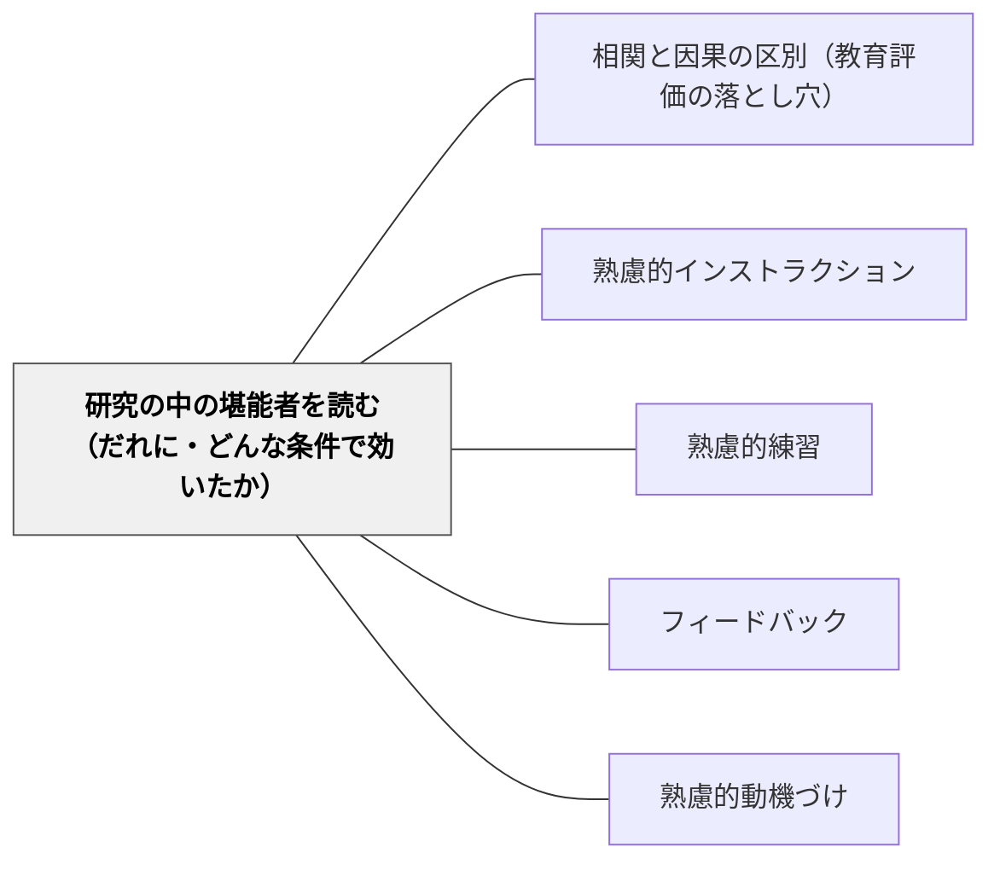

# 研究の中の堪能者を読む（だれに・どんな条件で効いたか）

**一文でいうと**：量的な研究の平均の陰にある「とくによく効いた相手と条件」を拾い、根拠の強さで分けて、次の実践で確かめる仮説にする。

## 使いどころ・使いすぎ注意

| 観点 | 内容 |
| --- | --- |
| 使いどころ | 研究を読んで「効く」「効かない」で終わりそうなとき。自分の教室の子どもに当てはまるかを考えたいとき。 |
| 使いすぎ注意 | 効いた条件の一覧を処方箋にしない。小さな研究の大きな効果は、まず研究の作りを疑う。 |

> 平均の効果量は、効く相手と効かない相手を混ぜた数である。

## 背景（Context）

牧口常三郎は『創価教育学体系Ⅰ』で、帰納の研究の源泉として、自分の偶然の成功に加えて、もう一つを挙げた。

> 「（B）同様の成功を齎らしたる所謂堪能者の成功の事実の観察と、之を生じたる特殊の原因の考察。」（p. 89）

卓越した実践者（堪能者）の成功を比べて観察し、その成功を生んだ特殊な原因を取り出す方法である。牧口は研究の段階として、自分の経験だけを信じて独断に陥る第二期を越え、衆人の経験を比べ統合する第三期へ進むことを説いた（[[文献/創価教育学体系 1（牧口常三郎）]]、[[メタパタン/アブダクション（仮説形成）]]）。

いまの量的な教育研究には、何千人分の実践の記録がある。そこにも「同様の成功」が眠っている。メタ分析の平均の中で、ある相手、ある条件のときにとくによく効いた事実である。Tipton ほか（2023）は、社会科学のメタ分析は「効果があるかないか」ではなく、効果がどれだけばらつき、それを何で説明できるかを主に問うべきだと論じた（[[文献/成長マインドセットのメタ分析を効果のばらつきから読み直す（Tiptonほか2023）]]）。本パタンは、牧口の（B）を研究の論文に当てはめるものである。

## 問題（Problem）

研究を平均だけで読むと、「効かない」か「全員に効く」かの二択になる。教室で知りたいのは「この子に、この条件で」の情報なのに、それは論文の下位群の結果、調整要因の分析、限界の節に埋もれている。一方で、飛び抜けて大きな効果をそのまま信じると、研究の作りが生んだ見かけの効果に振り回される。

## 力のかたち（Forces）

- 平均は、効く相手と効かない相手を混ぜる。効く相手だけを見れば小さくない効果も、全体では小さく見える（Tipton ほか 2023）
- 飛び抜けた効果は、研究の作りから出やすい。2,000人を超える研究の効果量の中央値は 0.03、100人以下の研究は 0.24 で、研究者が作った狭いテストでも大きく出る（[[文献/教育の介入の効果量を読む物差しを作り直す（Kraft2020）]]）
- 研究どうしの比較（メタ分析の調整要因）は、ほかの違いと混ざる。同じ研究の中で条件だけを変えた比較のほうが強い（Tipton ほか 2023）
- 大きな効果が、追試で消えることがある。大規模な無作為化比較の40%は、効果があるともないとも言えない幅で終わる（[[文献/大規模な無作為化比較の多くが結論を出せないことを確かめる（LortieForguesとInglis2019）]]）
- 同じ効果量でも、比べる相手で重さが変わる。介入がなくても1年で伸びる量は、読みで1→2年生 0.97、5→6年生 0.32、11→12年生 0.06 と学年で大きく違う。縮めたい集団の差や、似た介入の過去の効果とも比べて読む（[[文献/効果量を、1年の伸び・集団の差・似た研究と比べて読む（Hillほか2008）]]）
- 研究の作りだけで、効果量はおよそ2倍に変わる。教育プログラムの評価645研究では、公刊 0.30・未公刊 0.16、250人以下 0.30・超 0.16、研究者が作ったテスト 0.40・独立したテスト 0.20、小さな準実験 0.33・大きな無作為化比較 0.12（[[文献/研究の作りが効果量をどれだけ大きく見せるかを確かめる（CheungとSlavin2016）]]）
- 小さな研究ほど効果が大きく出る理由は、出版の偏りだけではない。効果が大きいと見込む研究ほど小さな標本で足りる、大きな標本は子どもの幅が広い、小さな研究は目が行き届く、大きな研究には参加を望まない学校も入る（[[文献/学習に困難のある小学生への支援の効き方を確かめる（Dietrichsonほか2021）]]）
- それでも、条件の情報がなければ、教室で使う手がかりにならない

## 解決（Solution）

**論文の中の「とくに効いた相手と条件」を拾い、根拠の強さで四つの段に分けて集め、教室で確かめる仮説にせよ。**

### 四つの段

| 段 | どんな根拠か | 読み方 |
| --- | --- | --- |
| 強 | 同じ研究の中で、条件や相手だけが違う群を比べて差が出た | いちばん信頼できる。それでも対象の年齢・教科・国を確かめる |
| 中 | メタ分析の調整要因など、研究どうしの比較で差が出た | ほかの違いと混ざっている。仮説として強め |
| 仮説 | 一つの小さな研究で飛び抜けた効果が出た | 次の実践で確かめる仮説として置く |
| 再現されず | 追試や別の分析で消えた・読み方が分かれた | 失敗の記録も残す。何が違ったかが手がかりになる |

### 読む場所

- 下位群の結果（成績の高低・学年・事前の知識で分けた結果）
- 調整要因の分析（メタ分析の表の後半）
- 同じ研究の中の条件の比較（何と何を比べたか）
- 著者自身の限界の節と、追試の論文

### 収集表

本 Wiki の文献ページで原典を確かめた知見から集めた。「関連する親パタン」は図解の親パタン。

| 段 | 手立て | だれに | どんな条件で | 結果 | 出典 | 関連する親パタン |
| --- | --- | --- | --- | --- | --- | --- |
| 強 | 成長マインドセットの短い介入 | 米国の9年生のうち、成績が学校の中で中央値以下の生徒 | 仲間が実際に難しい課題を選ぶ雰囲気の学校で効果が続いた | 成績の効果量 0.11。上位の生徒には有意な効果なし | [[文献/A National Experiment Reveals Where a Growth Mindset Improves Achievement（Yeager et al., 2019）]] | [[パタン/熟慮的動機づけ]] |
| 強 | 二つのものを比べる | 中学1・2年生162人 | 同じ問題を二つの解き方で比べる（同じ型の問題どうし・違う型の問題どうしではなく） | 概念の理解がほかの二つの比べ方より高い | [[文献/何と何を比べると学びが伸びるかを確かめる（RittleJohnsonとStar2009）]] | [[パタン/類推的学習①]] |
| 強 | まぜる練習 | 中学1年生126人 | 習った日に少し、残りを後の宿題に散らす | 30日後のテスト 74% 対 42% | [[文献/練習問題をまぜると算数の学びが残る（Rohrerほか2015）]] | [[パタン/熟慮的練習]] |
| 強 | 思い出すテスト | 大学生 | 1週間後に測る（5分後では読み直しが上） | 1週間後の再生 56〜61% 対 40% | [[文献/想起テストによる長期保持（RoedigerとKarpicke2006）]] | [[パタン/熟慮的練習]] |
| 強 | 思い出す練習 | 9〜11歳 | 白紙からではなく、質問マップで支える | 直後の再生 40% 対 28%（白紙からの自由再生は平均7%で差が出なかった） | [[文献/小学生の想起練習を支える手がかり（Karpickeほか2014）]] | [[パタン/熟慮的練習]] |
| 強 | コメントだけで返す | イスラエルの小学5・6年生 | 評点を付けない | 評点を含む二群より興味と成績が高い | [[文献/評点とコメントが向ける注意を確かめる（Butler1988）]] | [[パタン/フィードバック]] |
| 強 | 背景知識 | 7・8年生64人 | 文章の題材（野球）をよく知っている | すべての測定で知識の効果。読解力の効果は有意でない | [[文献/背景知識と文章の記憶を確かめる（RechtとLeslie1988）]] | [[パタン/精緻化]] |
| 強 | 本を読んだら金銭の報酬 | 米国の2年生 | 英語のテストを受けた子（英語を母語としない子・二言語の学級の子ではない） | 読み 0.173。二言語の学級の子は −0.118 で、平均では打ち消し合う（著者自身の実験。本章の要約による） | [[文献/196の無作為化実験から、どの種類の支援が学力を伸ばしたかを確かめる（Fryer2017）]] | [[パタン/熟慮的動機づけ]] |
| 強 | 算数の目標ごとに金銭の報酬 | 米国の5年生 | 事前の成績が高い子 | 算数 0.228 で読みは変わらず。低い子は算数が変わらず、報酬の付かない読みが −0.165（2年後も −0.219）（著者自身の実験。本章の要約による） | [[文献/196の無作為化実験から、どの種類の支援が学力を伸ばしたかを確かめる（Fryer2017）]] | [[パタン/熟慮的動機づけ]] |
| 強 | 教師への報酬を先に払い、届かなければ返す | 米国の小中学校の教師と子ども | 年度末に払うのではなく先に払う（損失の枠） | 1年目の算数 0.455 対 0.245（差は有意）。2年目は差が消えた。幼稚園は両年とも大きい（著者自身の実験。本章の要約による） | [[文献/196の無作為化実験から、どの種類の支援が学力を伸ばしたかを確かめる（Fryer2017）]] | [[パタン/熟慮的動機づけ]] |
| 強 | 保護者に報酬を払う親の学校 | 米国の就学前の子と保護者 | 子どもの非認知の力が事前に中央値以上 | その子たちで約0.3。中央値未満は効果なし。人種でも分かれ、説明はつかなかった（著者自身の実験。本章の要約による） | [[文献/196の無作為化実験から、どの種類の支援が学力を伸ばしたかを確かめる（Fryer2017）]] | [[パタン/熟慮的動機づけ]] |
| 強 | 毎日の二人一組の数学の個別指導 | 米国シカゴの経済的に厳しい地域の9・10年生 | 授業の1時限を毎日、決まった流れと頻繁な確かめで（指導者は教員免許のない大学新卒者など） | 参加した生徒の数学のテスト 0.16 SD（研究1）・0.37 SD（研究2）。11年生でも 0.22 SD。黒人とラテン系で差なし、学級の荒れの多い学校と少ない学校でも差なし | [[文献/中高生でも遅くないことを、毎日の二人一組の数学の個別指導で確かめる（Guryanほか2023）]] | [[パタン/個別化]] |
| 強 | 学ぶ内容の役立ちを自分で書く課題 | 米国の大学の生物学の入門で、人種的少数派かつ親が大卒でない学生 | 教師が役立ちを告げるのではなく、学生が自分や家族の生活とのつながりを具体例で書く | 成績 0.51 点（d = 0.55）、差を61%縮めた。全員の平均は d = 0.06。前の成績が低い学生、援助の動機の強い学生ほど効いた | [[文献/学ぶ内容の役立ちを自分で書く課題が、だれに効いたかを確かめる（Harackiewiczほか2016）]] | [[パタン/熟慮的動機づけ]] |
| 強 | 入学前に「つまずきはよくあり、乗り越えられる」と伝える | 米国の三つの学校の入学生（9,500人超）の、人種的少数派や親が大卒でない学生 | 1回のオンラインの教材。上級生の話を読み、自分の予想するつまずきを後輩に向けて書く。学生に学びの準備がある | 全日制の在籍や成績が上がり、差を31〜40%縮めた。有利な立場の学生には効果なし | [[文献/入学前に「つまずきはよくあり、乗り越えられる」と伝える短い介入が、だれに効いたかを確かめる（Yeagerほか2016）]] | [[パタン/帰属志向性]] |
| 中 | 成長マインドセットの教材（場による違い） | 同上の実験1と実験2 | すでにその考えを教わった高校の卒業生か、大学の考え方として示されたか | 前者では効かず、後者では所属感の教材と同じくらい効いた（理由は著者の推測） | [[文献/入学前に「つまずきはよくあり、乗り越えられる」と伝える短い介入が、だれに効いたかを確かめる（Yeagerほか2016）]] | [[パタン/成長マインドセット]] |
| 強 | 一人練習の累積時間 | ドイツの音楽大学のピアノ専攻の学生とアマチュア（各12人） | 18歳までの累積（7,606 対 1,606 時間） | 音楽と関係のない課題（反応時間など）には差がなく、両手の複雑な協調では、群をそろえたうえでも累積時間が個人差を説明した（振り返りの見積もり） | [[文献/熟慮的練習の語が生まれた音楽家の練習の研究を読む（Ericssonほか1993）]] | [[パタン/熟慮的練習]] |
| 中 | 見積もりの方法を比べる | 小学5・6年生 | 事前に少し見積もれた子（正答20%以上） | その子たちでだけ、概念の理解が2週間後によく残った（事後に分けた分析） | [[文献/見積もりの方法を比べると柔軟になる（StarとRittleJohnson2009）]] | [[パタン/類推的学習①]] |
| 中 | 先に問題に取り組み、あとで教える | 6〜10年生でとくに大きい（0.50）。大学生 0.28 | 子どもの解き方をもとに教えるなど、生産的失敗の設計の要素を多く満たすほど差が大きい | 概念の理解と転移で全体 g = 0.36。2〜5年生は −0.09（わずかに先に教えるほうが上） | [[文献/先に問題に取り組み、あとで教える授業を比べる（SinhaとKapur2021）]] | [[パタン/熟慮的インストラクション]] |
| 中 | 発見を支える | 子どもから大人 | 足場やフィードバックがある（自分で生み出すだけではない） | d = 0.50。生み出すだけは −0.15。手助けのない発見がいちばん不利なのは中高生（−0.53） | [[文献/発見学習の支援条件を見分ける（Alfieriほか2011）]] | [[パタン/熟慮的インストラクション]] |
| 中 | フィードバック | さまざま | 注意を課題に向け、自分自身に向けない | 平均 0.41 だが38%超が負。ほめ言葉を含む研究群 0.09、含まない群 0.34 | [[文献/フィードバックの効果を注意の向きから捉える（KlugerとDeNisi1996）]] | [[パタン/フィードバック]] |
| 中 | 情報の多いフィードバック | 幼稚園から大学（435研究、出版年の中央値は1985年） | 正誤だけでなく、課題・過程・ときに自己調整の情報を含む | 0.99。正誤と正答を返すだけ 0.46、報酬や罰 0.24（全体 0.48） | [[文献/The Power of Feedback（Hattie & Timperley, 2007）]] | [[パタン/意味のある具体的なフィードバック]] |
| 中 | 報酬や罰で返すフィードバック | 幼稚園から大学 | 情報を含まない報酬や罰 | 動機づけを測った効果量の21%が負で、その86%が情報のない報酬や罰。動機づけへの平均は 0.33（学力などの認知は 0.51） | [[文献/The Power of Feedback（Hattie & Timperley, 2007）]] | [[パタン/熟慮的動機づけ]] |
| 中 | 能動的な学び | 大学の理系の学生 | 50人以下の授業 | 効果が最も大きかった（全体で 0.47 SD） | [[文献/講義だけの授業と能動的な学びを比べる（Freemanほか2014）]] | [[パタン/能動的関与]] |
| 中 | 強度の高い能動的な学び | 米国の大学の理系の授業の、人種的少数派か低所得の学生 | 授業時間のうち学生が活動する割合が高い | それ以外の学生との差を、試験で42%、合格率で76%縮めた。強度の低い授業では合格率の差はむしろ広がった（全体では試験33%・合格率45%縮小） | [[文献/能動的な学びが、少数派と低所得の学生との差を縮めるかを確かめる（Theobaldほか2020）]] | [[パタン/能動的関与]] |
| 中 | 同じ能動的な学びの、研究ごとの違い | 同上 | 研究（授業と教員）ごとに | 試験の15研究のうち5研究、合格率の26研究のうち11研究では、それ以外の学生のほうに大きく効き、差が広がった | [[文献/能動的な学びが、少数派と低所得の学生との差を縮めるかを確かめる（Theobaldほか2020）]] | [[パタン/能動的関与]] |
| 中 | 明示的な指導と問題解決の方略 | 学習障害のある子ども（算数） | ほかの要素を考慮しても | 大きな効果量と関連（多くは要素の組み合わせ） | [[文献/算数の困難に応じて指導を組み合わせる（Gerstenほか2009）]] | [[パタン/個別化]] |
| 中 | 個別指導（一対一・少人数） | 就学前〜小学生（研究の多くは低学年の読み） | 教師か教員以外の専門の指導者が、授業時間中に、週3回以上 | 全体 0.37。教師 0.50・専門の指導者 0.40・ボランティア 0.21・保護者 0.23。授業中 0.40・放課後 0.21。週1〜2日 0.24 | [[文献/だれが・いつ・どれだけ個別指導すると効くかを確かめる（Nickowほか2020）]] | [[パタン/個別化]] |
| 中 | 読みと算数の個別指導 | 学年によって | 読みは低学年ほど大きい／算数は2〜5年生で最大 | 読み：就学前〜幼稚園 0.50→2〜5年生 0.22→6年生以上 0.12。算数：2〜5年生 0.44 | [[文献/だれが・いつ・どれだけ個別指導すると効くかを確かめる（Nickowほか2020）]] | [[パタン/個別化]] |
| 中 | 子ども同士の教え合い | 学習に困難のある、またはそのおそれのある幼稚園〜6年生 | 同じ学年の二人組で、手順の決まった教え合い | 単独の方法で 0.39。二人組 0.42・より大きなグループ 0.28。予測区間 0.06〜0.71 | [[文献/学習に困難のある小学生への支援の効き方を確かめる（Dietrichsonほか2021）]] | [[パタン/ソーシャル]] |
| 中 | 子ども同士の教え合い | 学習障害のある子ども（算数） | 同じ学年の教え合い | 効果は小さく有意でない（Gersten ほか 2009。Dietrichson ほかの引用による）。困難の最も大きい子には効きにくい可能性 | [[文献/学習に困難のある小学生への支援の効き方を確かめる（Dietrichsonほか2021）]] | [[パタン/個別化]] |
| 中 | 大人による少人数指導 | 学習に困難のある、またはそのおそれのある幼稚園〜6年生 | 一対一でも、2〜5人でも | 単独で 0.38。人数による差ははっきりしない（直接比べた研究は4つで結論は出ない） | [[文献/学習に困難のある小学生への支援の効き方を確かめる（Dietrichsonほか2021）]] | [[パタン/個別化]] |
| 中 | 高い量の個別指導 | 就学前〜高校 | 6人以下で週4日以上（または36週で50時間以上） | 1年あたり算数 0.309（推定6つ）・読み 0.229。低い量は 0.015 | [[文献/196の無作為化実験から、どの種類の支援が学力を伸ばしたかを確かめる（Fryer2017）]] | [[パタン/個別化]] |
| 中 | 教員研修 | 現職の教師と子ども | 教材・研修・実施の設計図がそろった研修（Reading Recovery など） | 読み 0.403。一般の研修はほぼゼロ（有意な研究なし） | [[文献/196の無作為化実験から、どの種類の支援が学力を伸ばしたかを確かめる（Fryer2017）]] | [[パタン/個別化]] |
| 中 | 読みの支援全般 | 子どもの年齢によって | 平均5歳未満 | 読み 0.177。14歳超は 0.039（年齢との相関 −0.21）。算数は年齢とほぼ無相関 | [[文献/196の無作為化実験から、どの種類の支援が学力を伸ばしたかを確かめる（Fryer2017）]] | [[パタン/個別化]] |
| 中 | 五つの方針の組み合わせ | 米国の成績の低い公立校 | 五つ（フィードバック・データ・高い量の個別指導・時間・高い期待）がそろった学年と教科 | 4年生の算数 0.331、6・9年生の算数 0.608。ほかの学年は小さい（多くは準実験） | [[文献/196の無作為化実験から、どの種類の支援が学力を伸ばしたかを確かめる（Fryer2017）]] | [[パタン/個別化]] |
| 中 | 算数の少人数の個別指導 | 算数でつまずいている幼稚園〜5年生 | 支援員が、構造化されたプログラムで2〜6人に | +0.30（13研究）。一対一 +0.19 より小さくない（差は有意でない） | [[文献/小学校の算数で効いたプログラムの種類を確かめる（Pellegriniほか2021）]] | [[パタン/個別化]] |
| 中 | 学級の組織と経営の研修 | 小学校の学級全体（算数） | チームで助け合い、チームの平均で小さな特権を得る仕組みなど | +0.19（7研究）。算数の内容と教え方の研修は +0.03（有意な研究なし） | [[文献/小学校の算数で効いたプログラムの種類を確かめる（Pellegriniほか2021）]] | [[パタン/ソーシャル]] |
| 中 | 教材を入れるための研修 | 小学校の教師と子ども（算数） | 紙の教材（デジタル教材ではなく） | +0.12（7研究）。デジタル教材は 0.00（5研究） | [[文献/小学校の算数で効いたプログラムの種類を確かめる（Pellegriniほか2021）]] | [[パタン/熟慮的教材教具]] |
| 中 | 読みの個別指導の人数 | 読みに困難のある幼稚園〜5年生 | 一対一（少人数ではなく） | +0.41 対 +0.24（差は有意）。算数では逆に少人数が小さくなかった（Pellegrini ほか 2021） | [[文献/読みに困難のある小学生への支援の効き方を確かめる（Neitzelほか2022）]] | [[パタン/個別化]] |
| 強 | 遅れている子を取り出す補習 | インドの都市の公立小学校の3・4年生（1万5千人超・2都市） | 地域の若い女性が、決まった教材で、まだ持っていない1・2年生の基礎を1日2時間 | 受けた子 0.6〜1 SD。学校全体では下位3分の1 0.43、上位3分の1 0.22。1年後も下位3分の1で 0.10 残る | [[文献/遅れている子を取り出して地域の若い女性が教える補習の効き方を確かめる（Banerjeeほか2007）]] | [[パタン/個別化]] |
| 強 | 学級の人数を減らす（取り出しで残った子） | 同上 | 同じ教師のもとで、1日2時間、人数がほぼ半分 | 伸びたとは言えなかった（中位の子でも）。教師に残る子が20人未満の小さな学校でだけ、わずかな効果 | [[文献/遅れている子を取り出して地域の若い女性が教える補習の効き方を確かめる（Banerjeeほか2007）]] | [[パタン/個別化]] |
| 強 | 段階に合わせるコンピューターの算数 | 同上の4年生 | 二人で1台、週2時間、自分の段階に合ったゲーム | 算数 0.35〜0.47 SD。下位3分の1 0.42、上位3分の1 0.32 で、層による差は小さい | [[文献/遅れている子を取り出して地域の若い女性が教える補習の効き方を確かめる（Banerjeeほか2007）]] | [[パタン/個別化]] |
| 強 | 段階に合わせる学習ソフト（放課後） | インドの公立中学生（6〜9年生、希望者619人） | 一人ひとりの段階を見積もり、間違いの型に合わせて問題を出すソフト＋指導員の見守り、4.5か月 | 算数 0.36、ヒンディー語 0.22 SD。事前の点の高低で効果は同じ。比べた群の下位3分の1はほぼ伸びず、相対的な効果は下位で大きい | [[文献/一人ひとりの段階に合わせるソフトで、学年から大きく遅れた中学生が伸びるかを確かめる（Muralidharanほか2019）]] | [[パタン/個別化]] |
| 中 | 学年相当の内容を足す放課後の集団指導 | インドの公立中学生（同じ時期・同じ地域） | 技術なし、学年の内容の復習、週の時間は33%長く1年 | 効果なし（別の実験の結果を本論文が引く・原典未読） | [[文献/一人ひとりの段階に合わせるソフトで、学年から大きく遅れた中学生が伸びるかを確かめる（Muralidharanほか2019）]] | [[パタン/個別化]] |
| 強 | 1年生を事前の成績で二つの学級に分ける | ケニア西部の公立小学校121校の1・2年生 | 教師を1人増やして分けた二つの学級（分けても40人超）。教師は無作為に割り当て。教師には上位に向けて教える動機がある | 18か月後 0.14 SD。上の子にも下の子にも効果。終了1年後も 0.16 SD。真ん中の子は上下どちらの学級でも同じくらい伸びた | [[文献/1年生を事前の成績で二つの学級に分けると、だれが伸びるかを確かめる（Dufloほか2011）]] | [[パタン/脱トラッキング（De-tracking）]] |
| 中 | 成績で分けた下の学級（教師の種類による違い） | 同上の下半分の子 | 1年契約で動機の強い教師か、身分の安定した正規の教師か | 契約の教師 0.255 SD、正規の教師 0.048 SD（伸びたとは言えない）。正規の教師は下の学級では授業をする割合が上がらなかった | [[文献/1年生を事前の成績で二つの学級に分けると、だれが伸びるかを確かめる（Dufloほか2011）]] | [[パタン/個別化]] |
| 強 | 段階に合わせて教えるやり方を、研修と教材で担任に渡す | インドのビハール州・ウッタラーカンド州の公立小学校の1〜5年生 | 教材だけ／担任の研修と見回り／学校の中にボランティアを足す。そのための時間の区切りはない | 効果なし。教室は段階で組み分けられず（0〜11%）、担任は学年の教科書に戻り、ボランティアは担任の手伝いに回された（理由は観察と著者の解釈） | [[文献/段階に合わせて教えるやり方を公立学校に広げると、どんな条件で効いたかを確かめる（Banerjeeほか2016）]] | [[パタン/個別化]] |
| 強 | 決まった1時間に、担任が学年をまたいで段階で組み分けて教える | インドのハリヤナ州の公立小学校400校の3〜5年生 | 州が決めた授業の延長1時間を充てる（比べた学校は同じ1時間を通常の授業に）。指導主事が自分で教えてから担任を研修し、毎月授業を見る | 読み 0.15 SD（算数は教えず効果なし）。決まった1時間の92%で組み分けが行われた | [[文献/段階に合わせて教えるやり方を公立学校に広げると、どんな条件で効いたかを確かめる（Banerjeeほか2016）]] | [[パタン/個別化]] |
| 強 | ボランティアが授業時間中に学校を預かる集中のキャンプ | インドのウッタル・プラデーシュ州の公立小学校484校の3〜5年生（学力が最も低い州の一つ） | 40日のキャンプと夏の10日。段階で組み分けて読みと算数を1.5時間ずつ。担任はほぼ関わらない | 読み 0.61〜0.70、算数 0.62〜0.69 SD。始めに20ポイントの差があったハリヤナ州の比べた学校に追いついた | [[文献/段階に合わせて教えるやり方を公立学校に広げると、どんな条件で効いたかを確かめる（Banerjeeほか2016）]] | [[パタン/個別化]] |
| 強 | 宿題にその場で正誤と手がかりを返し、誤答の一覧を教師に渡す | 米国メイン州43校の7年生（2,850人） | 全員にノートパソコン。教科書・宿題の量・進度は変えない。教師に研修とコーチの訪問。1年の慣らしのあと2年目に測った | 0.18 SD。事前の算数の点が中央値以下 0.29 SD、中央値より上 0.12 SD（どちらのループが効いたかは分けられていない） | [[文献/宿題にその場で正誤と手がかりを返し、誤答の集計を教師に渡すと、だれが伸びるかを確かめる（Roschelleほか2016）]] | [[パタン/AIフィードバックと教師の二重ループ]] |
| 強 | 政府の公式の教科書を配る | ケニア西部の農村の公立小学校（3〜8年生、25校と比べた学校） | 英語で書かれ（多くの子の3つめの言語）、学年の教育課程に沿った教科書をほぼ2人に1冊。教師用の指導書つき | 平均 0.02 SD（効果なし）。事前の点の下の三つの層 −0.05〜0.03、上の二つの層 0.14・0.22 SD。8年生の中等学校への進学は 43%（比べた学校 38%） | [[文献/教科書を配ると、だれの点が上がるかを確かめる（Glewweほか2009）]] | [[パタン/個別化]] |
| 中 | 教科書を読めるか（効かなかった理由の手がかり） | 同上の各学年の中位の子（50校） | 配った英語の教科書を読んでもらう | 読めたのは3年生16%、4年生28%、5年生67%、6〜8年生は9割超 | [[文献/教科書を配ると、だれの点が上がるかを確かめる（Glewweほか2009）]] | [[パタン/個別化]] |
| 強 | 苦手な生徒の代数を1日2コマにする | シカゴの公立高校の9年生で、8年生の算数が全国の中央値のすぐ下の生徒（73校） | 2コマめは足りない力を補い、解き方を言葉で説明する授業。教師に教材と研修。2コマを同じ生徒で受けるため、周りの生徒の力は約20パーセンタイル下がった | 代数の合格 9.3、4年での卒業 9.8、大学への進学 10.8 ポイント増。テストの点の伸びは小さかった（11年生の秋 0.24 SD） | [[文献/代数の授業を1日2コマにすると、だれの卒業と進学が伸びるかを確かめる（Cortesほか2015）]] | [[パタン/個別化]] |
| 中 | 同上（読みの力による違い） | 同上の生徒を8年生の読みの点で二つに分ける（事前に決めていない分け方） | 同上 | 読みが苦手な生徒で、代数の合格 13.2、4年での卒業 13.7 ポイント増。得意な生徒では合格・卒業はほぼ変わらず、ACT の言語と大学に在籍した学期の数が伸びた | [[文献/代数の授業を1日2コマにすると、だれの卒業と進学が伸びるかを確かめる（Cortesほか2015）]] | [[パタン/個別化]] |
| 中 | 実施の勧め（同じ教師・続けて置く）を守ったか | 同上の73校、2003年と2004年の入学者 | 2004年には同じ教師 80%→54%、続けて置く 72%→48% に下がった | 守った度合いでも入学年でも、効果に違いは見られなかった | [[文献/代数の授業を1日2コマにすると、だれの卒業と進学が伸びるかを確かめる（Cortesほか2015）]] | [[パタン/個別化]] |
| 強 | 学級の人数を減らす（13〜17人） | 米国テネシー州80校の幼稚園〜3年生（約1万1,600人） | 1日中・毎年の小さな学級に、学校の中で無作為に割り付け。補助員つきのふつうの学級とも比べた | 百分位で5〜7ポイント（0.19〜0.28 SD）。大部分は最初の年に現れ、その後の上乗せは小さい。補助員はほとんど効果なし | [[文献/学級の人数を減らすと、だれがいつ伸びるかを無作為化比較で確かめる（Krueger1999）]] | — |
| 中 | 同上（だれに・どの学校で） | 同上を人種・地域・給食費の補助で分ける | 同上 | 最初の年の効果は黒人の子 5.1・白人の子 2.9、都市の中心部の学校 6.8。給食費の補助を受ける子は上乗せが大きい（違いの多くは有意かどうか未検定）。80校の効果は平均 4.6・標準偏差 6.9 で、3分の1の学校で負 | [[文献/学級の人数を減らすと、だれがいつ伸びるかを無作為化比較で確かめる（Krueger1999）]] | — |
| 強 | 自分と同じ人種の教師に教わる | 米国テネシー州の幼稚園〜3年生の黒人の子と白人の子（4年分で約2万3,900の観測） | 子どもと教師を学校の中で無作為に学級へ割り付けた実験。参加校は人種で大きく分かれていた | 1年で算数 3.8・読み 3.1 百分位ポイント。黒人の子にも白人の子にも。年数とともに積み上がった（4年で算数 13.9） | [[文献/自分と同じ人種の教師に教わると点が上がるかを、無作為の割り付けで確かめる（Dee2004）]] | [[パタン/ロールモデル]] |
| 中 | 同上（学級の人数・教師の経験による違い） | 同上 | ふつうの学級か小さな学級か、教師の経験が11年以下か | ふつうの学級 3.9・小さな学級 −0.2（有意でない）。経験11年以下 6.9・それより長い 0.9（有意でない）。給食費の補助を受ける子でやや大きい（4.4 と 2.8）。なぜ効くかは分けられていない | [[文献/自分と同じ人種の教師に教わると点が上がるかを、無作為の割り付けで確かめる（Dee2004）]] | [[パタン/ロールモデル]] |
| 強 | 小さな学級（大人になってからの結果） | テネシー州の STAR 実験の子ども（11,571人、95%を27歳まで追跡） | 平均約2年、人数が3分の1少ない学級 | 20歳で大学に通う割合 +1.8 ポイント（p = 0.06）、ほかの成果の指標も上がった。27歳の収入はわからなかった（精度が低い） | [[文献/幼稚園の学級が、大人になってからの進学と収入に表れるかを確かめる（Chettyほか2011）]] | — |
| 強 | どの学級に当たったか（学級の良さ） | 同上 | 同じ学校の中での無作為の割り付け。学級の良さは教師・周りの子・その学級に起きたことの合計 | 1標準偏差よい幼稚園の学級で27歳の収入 +9.6%。点の効果は4年生までに消えたが、進学と収入にまた表れた。教師が評価した努力・自発性などは4・8年生でも高かった | [[文献/幼稚園の学級が、大人になってからの進学と収入に表れるかを確かめる（Chettyほか2011）]] | — |
| 中 | 経験の長い教師の幼稚園の学級 | 同上の幼稚園から入った子 | 経験10年を超える教師（経験そのものの効果とは言えない） | 点 +3.2、27歳の収入 年 +1,093 ドル（6.9%）。1〜3年生で入った子では小さく有意でない | [[文献/幼稚園の学級が、大人になってからの進学と収入に表れるかを確かめる（Chettyほか2011）]] | — |
| 中 | 点を上げる教師か、行動をよくする教師か | ノースカロライナ州の公立高校の9年生（約57万4千人）と英語・数学の教師 | 無作為ではない。前の学年の成績や履修の組み合わせをそろえ、ほかの年の生徒での成績から教師の効果を推定 | 点への効果と行動（欠席・停学・成績・進級）への効果の相関は 0.22。卒業への効果は、行動への効果1標準偏差で +1.46 ポイント、点への効果で +0.12 ポイント。教師の経験や免許は行動への効果を予測しなかった | [[文献/点を上げる教師と、欠席・停学・成績・進級をよくする教師は同じかを確かめる（Jackson2018）]] | — |
| 強 | 低学年で黒人の教師に一人でも教わる（長い期間の結果） | テネシー州の STAR 実験の黒人の子と白人の子 | 子どもと教師を学校の中で無作為に割り付け。最初の割り付けどおりなら当たったはずの教師で推定 | 黒人の子の大学への進学 +6 ポイント（19%、主に2年制）、SAT・ACT の受験も増加。高校の卒業 +9 ポイントは欠けを補ったときだけ有意。白人の子には効果なし | [[文献/低学年で黒人の教師に一人でも教わると、黒人の子の卒業と進学が変わるかを確かめる（Gershensonほか2022）]] | [[パタン/ロールモデル]] |
| 中 | 同上（だれに・どんな教師で） | STAR の黒人の子の男女、ノースカロライナ州の経済的に恵まれない黒人の子（無作為ではない） | 黒人の教師の割合の年ごとの揺れ。教師の性別 | 進学への効果は黒人の男子で女子のほぼ2倍（点の効果は女子で大きく、逆）。男子の進学の意向には男性の、女子には女性の黒人の教師の割合が効いた。失業率の高い郡で中退への効果が2倍超 | [[文献/低学年で黒人の教師に一人でも教わると、黒人の子の卒業と進学が変わるかを確かめる（Gershensonほか2022）]] | [[パタン/ロールモデル]] |
| 中 | 授業観察による1年間の評価（同僚の評価者・ルーブリック・毎回の書面の返し） | 米国シンシナティの5年目以降の中堅の教師（4〜8年生の算数） | 採用年で決まった年に評価を受けた（無作為ではない）。同じ教師の評価の前・年・後を比較 | 評価の後の年 +0.113 SD、評価の年 +0.062 SD。評価の点が下位4分の1の教師で +0.279 SD。読みには効果なし | [[文献/授業観察による1年間の評価を受けた中堅の教師は、その後も伸びるかを確かめる（TaylorとTyler2012）]] | [[パタン/ピアコーチング]] |
| 中 | 教室の話し合いを変える研修（対話的な授業） | イングランドの、給食費の補助を受ける子が多い小学校の5年生（76校） | 研修・手引き・録画と録音・校内の指導役との2週ごとの振り返り、20週。対象の7校がデータを欠いた | 英語 +0.15（p = 0.051）、理科 +0.12、算数 +0.09（有意でない）SD。給食費の補助を受ける子の算数 +0.16 SD。学力の低い子や英語を母語としない子には難しかったという声（検定はできていない） | [[文献/教室の話し合いを変える研修で、子どもの学力が伸びるかを確かめる（EEFの対話的な授業の評価2017）]] | [[パタン/IRE型応答の脱却（Talk Move）]] |
| 仮説 | 哲学対話（P4C）の週1時間・1年 | イングランドの小学生（EEF の別の無作為化比較・原典未読） | 週1回の哲学対話の授業 | 全体で算数 +0.10・読み +0.12、給食費の補助を受ける子で算数 +0.20・読み +0.29・書き +0.17（本報告書の引用による） | [[文献/教室の話し合いを変える研修で、子どもの学力が伸びるかを確かめる（EEFの対話的な授業の評価2017）]] | [[パタン/哲学対話（P4C）]] |
| 中 | 子ども同士で教え合う読みの学習（PALS） | 米国の幼稚園〜高校、成績の低い子・中位の子・高い子、学習障害のある子 | 上位と下位の二人組、役割の交代、決まった手順、週3〜4回・15〜20週。教材は下位の子に合わせる | 2〜6年生で効果量 0.22〜0.56（総説による・原典未読）。成績の高低や障害の有無、学校の種類で効果は大きく変わらなかったとされる | [[文献/子ども同士で教え合う読みの学習（PALS）が、だれに効かなかったかを確かめる（McMasterほか2007）]] | [[パタン/進歩の傾きを見る（水準ではなく変化率）]] |
| 中 | 同上（効かなかった子と、次の手） | 成績の低い障害のない子の約20%、障害のある子の半分以上が反応せず。1年生で伸びの低い約16%を3つの手に無作為に分けた研究 | PALS を続ける／手直しした PALS／大人の一対一の取り出し指導、13週 | なお伸びないままの子は 81%・75%・50%。呼称速度・語彙・作業記憶・行動・受けた量で見分けられた（総説による・原典未読） | [[文献/子ども同士で教え合う読みの学習（PALS）が、だれに効かなかったかを確かめる（McMasterほか2007）]] | [[パタン/見取ったあとの手を決めておく（データ利用のルール化）]] |
| 中 | 読みの個別指導の指導者 | 読みに困難のある幼稚園〜5年生 | 教師・支援員・報酬のあるボランティア（報酬のないボランティアではない） | 一対一で教師 +0.38・支援員 +0.44・報酬のあるボランティア +0.46・報酬のないボランティア +0.14。前の三つに差はない | [[文献/読みに困難のある小学生への支援の効き方を確かめる（Neitzelほか2022）]] | [[パタン/個別化]] |
| 中 | 協同学習と音の読みを柱にした学級全体の指導 | 読みに困難のある幼稚園〜5年生 | 個別指導ではなく、学級全体の授業を変える | +0.31（5研究、有意でない）。個別指導全体の +0.26 と同じくらい。直接比べた研究はない | [[文献/読みに困難のある小学生への支援の効き方を確かめる（Neitzelほか2022）]] | [[パタン/ソーシャル]] |
| 中 | 教師へのコーチング | 現職の教師（主に小学校の読み書き） | 規模の小さいプログラム | 大きいプログラムより効果が大きい（全体で授業 0.49・学力 0.18） | [[文献/教師へのコーチングの効果と条件を確かめる（Kraftほか2018）]] | [[パタン/熟慮的練習]] |
| 中 | 教員研修の中身 | 3〜18歳を教える教師と子ども | 学びと行動を変える仕組み（目標・手本・フィードバック・練習・計画など）を多く含む | 仕組み0個でほぼ0、14個でほぼ 0.17（1個あたり約 0.01）。授業研究・コーチング・学習共同体という形の差はない | [[文献/教員研修の効き目を、研修に含まれる学びの仕組みの数で確かめる（Simsほか2021）]] | [[パタン/熟慮的練習]] |
| 中 | 教員研修 | 家庭の経済的な困難の多い学校の子ども | （少ない学校の子どもではなく） | 0.054 対 0.003（差は有意）。初任の教師への研修は 0.014（3研究） | [[文献/教員研修の効き目を、研修に含まれる学びの仕組みの数で確かめる（Simsほか2021）]] | [[パタン/熟慮的練習]] |
| 中 | 教員研修の効果の読み方 | 研修の無作為化比較 | 事前登録した研究に限る | 0.005（ゼロと区別できない）。事前登録していない研究は 0.074 | [[文献/教員研修の効き目を、研修に含まれる学びの仕組みの数で確かめる（Simsほか2021）]] | [[パタン/熟慮的練習]] |
| 中 | 読解方略の指導 | 3〜12年生の学級全体 | 研究者が自分で教える（教師ではなく） | 研究者が作った読解テストで 0.962（5研究）対 0.337（19研究）。標準テストでは全体で 0.186 | [[文献/読解方略を学級全体で教えたときの効き方を確かめる（Okkingaほか2018）]] | [[パタン/熟慮的問い]] |
| 中 | 読解方略の指導 | 3〜12年生の学級全体 | 「読む目的を決める」方略を含む | 標準テストで 0.493 対 0.171（含む研究は3つ） | [[文献/読解方略を学級全体で教えたときの効き方を確かめる（Okkingaほか2018）]] | [[パタン/熟慮的問い]] |
| 中 | 学級単位の指導の効果の読み方 | 読解方略の研究 | 学級の入れ子構造を考えた分析（多層分析）に限る | 標準テストで 0.106。考えていない分析は 0.305。多層分析は52研究中10だけ | [[文献/読解方略を学級全体で教えたときの効き方を確かめる（Okkingaほか2018）]] | [[パタン/熟慮的問い]] |
| 中 | 効果量の読み方 | 読み・算数・理科のプログラムの評価645研究 | 大きな無作為化比較と独立したテストに限る | 大きな無作為化比較 0.12、小さな準実験 0.33。研究者が作ったテストは独立したテストの2倍（0.40 対 0.20） | [[文献/研究の作りが効果量をどれだけ大きく見せるかを確かめる（CheungとSlavin2016）]] | — |
| 中 | 効果量の読み方 | 米国の小学校の無作為化比較（61研究・468の効果量） | 広い範囲を測る標準テストで測る | 0.07。狭い範囲の標準テスト 0.23、研究者が作ったテスト 0.44。比べる相手の1年の伸びも学年で 0.06〜1.52 と違う | [[文献/効果量を、1年の伸び・集団の差・似た研究と比べて読む（Hillほか2008）]] | — |
| 中 | 書く活動で読む力を支える | 成績の低い子ども | 書き方を明示的に教える | 条件として示唆（研究数は少ない） | [[文献/書く活動で読む力を支える（GrahamとHebert2010）]] | [[パタン/作ることで学ぶ]] |
| 中 | 導かれたくり返し音読 | 2〜9年生（16研究） | 教師・仲間・保護者の導きやフィードバック、1回15〜30分、読みの指導全体の一部 | 重みつき平均 0.41。語の読み 0.55・流暢さ 0.44・読解 0.35。手法の間に差は見られず | [[文献/くり返し音読と、自由に読む時間を促すことの効き方を確かめる（全米読書委員会2000流暢さ）]] | [[パタン/共有読書（Shared Reading）]] |
| 中 | 同上（だれに） | 平均的な読み手／苦手な読み手 | 平均的な読み手の研究のほうが指導時間が長い（24〜25時間 対 18〜19時間） | 重みつきで 0.50 対 0.33（重みなしでは 0.47 対 0.49）。時間の違いが混ざる | [[文献/くり返し音読と、自由に読む時間を促すことの効き方を確かめる（全米読書委員会2000流暢さ）]] | [[パタン/ガイデッド・リーディング（小グループの読み指導）]] |
| 中 | 自由に読む時間（SSR など） | 2年生〜高校（14研究） | 毎日約20分、自分で選んだ本を黙って読む。読んだ量はほとんど測られていない | 多くは伸びが見られず、はっきり伸びたのは3研究。「効かないとは示されていない、まだ示されていない」 | [[文献/くり返し音読と、自由に読む時間を促すことの効き方を確かめる（全米読書委員会2000流暢さ）]] | [[パタン/読書の底線習慣]] |
| 中 | 音素の意識の指導 | 就学前〜6年生（52研究） | 文字を使って音を操作する／話しことばだけ | 読み 0.67 対 0.38。操作を一つか二つに絞ると 0.71・0.79、三つ以上は 0.27 | [[文献/音素の意識とフォニックスの指導が、だれにどんな条件で効いたかを確かめる（全米読書委員会2000）]] | [[パタン/知識から技能へ]] |
| 中 | 同上（だれに・どの形で） | つまずきが心配される幼い子／ふつうの子／読みの障害のある子 | 少人数の集団か、一対一・学級全体か | 読み 0.86 対 0.47 対 0.45。少人数 0.81、一対一・学級全体 0.30〜0.45。障害のある子の綴りには効かず（0.15） | [[文献/音素の意識とフォニックスの指導が、だれにどんな条件で効いたかを確かめる（全米読書委員会2000）]] | [[パタン/ガイデッド・リーディング（小グループの読み指導）]] |
| 中 | フォニックスの指導 | 幼稚園・1年生／2〜6年生（38研究） | 始める時期 | 読み 0.56・0.54 対 0.27。2年生以上の読解は 0.12（有意でない）、読みの障害のある子は 0.27（本論。要約は 0.32）。家庭の経済状況で差なし | [[文献/音素の意識とフォニックスの指導が、だれにどんな条件で効いたかを確かめる（全米読書委員会2000）]] | [[パタン/読者のツールボックス]] |
| 中 | インクルーシブな方針 | SEND のない子 | 通常の学級で SEND のある子と学ぶ | 学力に弱いが正の効果（メタ分析。EEF の指針の紹介による・原典未読） | [[文献/通常の学級で特別な支援の要る子を支える五つの勧め（英国EEF2020）]] | [[特別支援/インクルーシブ教育]] |
| 中 | 介入への反応を見る段階的なやり方（RTI） | SEND のある子 | 米国の研究 | 学力に正の効果（EEF の指針の紹介による・原典未読）。もとのレビューは、英国の段階的なやり方には体系的レビューがなく、根拠を「低〜中」と判断（Cullen ほか 2020） | [[文献/通常の学級で特別な支援の要る子を支える五つの勧め（英国EEF2020）]] | [[パタン/見取ったあとの手を決めておく（データ利用のルール化）]] |
| 中 | 日常の支援員の支え | 英国の7学年・8,200人（DISS） | 支えの量が多いほど（SEN・前の成績・家庭の経済状況などをそろえた観察研究） | 21の結果のうち16が負、正はなし。最も多く受けた子ほど伸びが小さく、SEN の最も重い子で負が最大（EEF の指針の紹介による・原典未読） | [[文献/支援員の手厚い支えが、かえって子どもを授業から切り離すことを確かめる（英国EEF2018）]] | [[特別支援/インクルーシブ教育]] |
| 中 | 支援員による決まった手順の介入 | 一対一・少人数の子 | 研修（5〜30時間）と支え、短く定期的に8〜20週 | 効果量 0.2〜0.3（3〜4か月分）。研修と支えのない非公式な配置では効果なし。教師の介入は約6か月、ボランティアは1〜2か月 | [[文献/支援員の手厚い支えが、かえって子どもを授業から切り離すことを確かめる（英国EEF2018）]] | [[パタン/段階的手放し]] |
| 中 | 対象をしぼった介入（SEND のある子） | 29レビュー・980研究・22,956人 | 調整要因の分析 | 効き方を分けた要因は、教え方（17レビュー）・子どもと教える人の特徴（14）・時期と量（11）・場（8）の順に多い。介入は「自分の場・子ども・教える人・時間」で効いた証拠があるかを確かめて選ぶ | [[文献/特別な支援の要る子への手立ての根拠の強さを、問いごとに確かめる（SENDのエビデンス・レビュー2020）]] | [[パタン/見取ったあとの手を決めておく（データ利用のルール化）]] |
| 中 | 教師への学級経営の研修 | 学級全体（31研究、多くは小学校・米国） | 荒れが平均より多い学級 | 一貫して小〜中の正の効果。荒れの多い学級でとくに効く（EEF の行動の指針による） | [[文献/学校での行動の手立てが、どの学級・どの子に効いたかを確かめる（英国EEF2019）]] | [[パタン/適切な行動に注目する]] |
| 中 | 概念地図を自分で作る | 4年生〜大学生（米国・カナダ） | 比べた相手が講義・話し合い／文章やアウトラインを書く | 0.74 対 0.19（2018年の後継では 1.05 対 0.48）。効果の多くは関与の大きさによるのかもしれない | [[文献/概念地図を作る・見ることの効き方を、比べた相手と学習者で確かめる（NesbitとAdesope2006）]] | [[パタン/可視化]] |
| 中 | 冒険教育（登山・野外キャンプ・沢登り・ソロなど、日本） | 小学生〜成人（92研究） | 日数（日帰り〜7泊以上）・プログラム・対象の年齢 | 参加前後の変化は全体 0.36（外れ値を含めると 0.55、ばらつき大）。日数・プログラム・年齢による差は統計的に認められず、1泊2日と日帰りは有意でない。比べる群のない前後比較が約4分の3 | [[文献/日本の冒険教育の効果を、113の研究から確かめる（張本・向後2023）]] | [[パタン/アドベンチャー]] |
| 中 | 図と文の対応を示す手がかり（色分け・指し示し） | 前の知識が少ない〜中くらい／多い（45比較、6割が大学生） | 手がかりあり／なし | 少ない〜中くらいで r = 0.19、多いと r = −0.08（研究は4つ）。8年生127人の学校での実験では、前の知識の多い生徒がかえって下がった | [[文献/図と文の対応を示す手がかりが、だれに効き、だれの邪魔になるかを確かめる（Richter2016）]] | [[パタン/シグニファイア]] |
| 中 | デジタルゲーム（回数） | 幼稚園〜大学（平均12〜13歳、57研究） | 何回かに分けて遊ぶ／1回だけ | 何回かでは効果あり、1回では差なし。合計の時間とは関係なし（分散学習の効果かもしれない） | [[文献/デジタルゲームの学びの効果が、ゲームの設計でどう変わるかを確かめる（Clarkほか2016）]] | [[パタン/ゲーム]] |
| 中 | デジタルゲーム（競い方と手助け） | 同上 | 一人で競わない／一人で競う／チームで協力して競う。教師の手助け／点数だけ | 一人で競わない形が最大、一人で競う形が最小。教師の手助けのほうが点数だけより大きい。見た目と物語が凝るほど小さい | [[文献/デジタルゲームの学びの効果が、ゲームの設計でどう変わるかを確かめる（Clarkほか2016）]] | [[パタン/ゲーム]] |
| 強 | 欠席日数を書いた保護者への手紙 | 米国203校の保護者 | その子の欠席の合計日数を書くか、出席の大切さだけを伝えるか | 合計日数を書くと欠席が1人平均1日減った。大切さだけでは少ししか効かなかった（EEF の保護者の指針の紹介による・原典未読） | [[文献/保護者と協力する手立てが、どの家庭・どの条件で効いたかを確かめる（英国EEF2018）]] | [[パタン/保護者と他の学校協力者のフィードバック]] |
| 中 | 冒険の学び（5日間） | 英国の困難の多い学校の、行動・社会・情緒の困難のある子（97校） | 合宿型／校内型／なし（学校ごとに偶然で割り当て） | 自己調整は直後に伸び（校内型 +0.33、合宿型 +0.16）、8か月後には消えた。行動の困難（担任の評定）は8か月後に減った。8か月後の脱落は約6〜7割。学力は扱わず | [[文献/合宿型と校内型の冒険の学びを、偶然で割り当てて比べる（英国の実験、WillisとReaney-Wood2026）]] | [[パタン/アドベンチャー]] |
| 中 | 始業前の学級経営の研修（決まりと手順を教える） | 米国の農村部の小学校1〜6年（29学級） | 研修あり（14人）／なし（15人）、偶然で割り当て | 40項目中21で研修ありが上回り、課題から離れる子は約3%対約12%。研修なしの群も10月以降に追いついた（同じ学校の研修ありの教室を見て借りていた）。学力は測らず | [[文献/年度はじめの3週間に手順を教えることが、1年の学級を左右するかを確かめる（Emmerほか1979・Evertson1988）]] | [[パタン/オンボーディング]] |
| 中 | 行動に困難のある子の保護者の講座（Incredible Years） | 0〜12歳の子の保護者（50研究） | 困難の大きい家庭を含むか | 効果があり、困難の大きい家庭を含む研究ほど効果が大きい（EEF の保護者の指針の紹介による・原典未読） | [[文献/保護者と協力する手立てが、どの家庭・どの条件で効いたかを確かめる（英国EEF2018）]] | [[パタン/保護者と他の学校協力者のフィードバック]] |
| 中 | 対象をしぼった行動の手立て（行動の機能の見取り・毎日の記録カード） | 行動に課題のある子（25研究、うち無作為化比較15） | 個に合わせて調整 | 行動への効果は学級・学校全体の取り組みより大きいが、「効果なし」から「非常に大きい」までばらつく。学校全体の取り組みは効果が小さく遅いが、学力をより一貫して伸ばす | [[文献/学校での行動の手立てが、どの学級・どの子に効いたかを確かめる（英国EEF2019）]] | [[パタン/チェックイン・チェックアウト（行動支援）]] |
| 中 | 支援員による少人数の読みのプログラム（ABRA） | 英国の5〜7歳 | 3〜4人・週4回・15〜20分・20週。語の読み・流暢さ・理解をつり合いよく | 2〜3か月分の伸び。給食費免除の子でより大きく、1年後も残った（無作為化比較。EEF の指針の紹介による・原典未読） | [[文献/5〜7歳の読み書きの指導を研究から整える（英国EEF2020）]] | [[パタン/読み聞かせ]] |
| 中 | 少人数・一対一の指導の集団の大きさ | 年少の子（読みで最大） | 一対一・二人・三人…と大きくする | 小さいほど効き、6〜7人を超えると明らかに低下。ただし読みでは少人数が一対一より効いた研究もあり、集団の大きさより指導の質かもしれない（EEF の指針による） | [[文献/5〜7歳の読み書きの指導を研究から整える（英国EEF2020）]] | [[パタン/見取ったあとの手を決めておく（データ利用のルール化）]] |
| 仮説 | 相互教授法 | 読解の困難な中学生（研究1は24人） | 要約・質問・明確化・予測の進行役を交替する | 新しい文章を一人で読む成績が改善し、8週後も保たれた | [[文献/対話で読解を育てる相互教授法（PalincsarとBrown1984）]] | [[パタン/熟慮的問い]] |
| 仮説 | 話し合いの約束を教える | 英国の9〜10歳（4学級ずつ・無作為でない） | 理由を求める・異論を受け止める約束を学級の言葉にする | 個人の推論の伸びが大きい（片側 p = .04）。グループの得点は有意差なし | [[文献/話し合いの約束と個人の推論を確かめる（Mercerほか1999）]] | [[パタン/ソーシャル]] |
| 仮説 | 一人で練習する | 7〜9歳の子ども（バイオリン） | 誤りに気づく手がかりがない | 曲を通して弾くだけで、ほとんど上達しなかった（McPherson と Renwick 2001。Ericsson と Harwell の引用による・原典未読） | [[文献/熟慮的練習の定義をそろえて練習と熟達の関係を読み直す（EricssonとHarwell2019）]] | [[パタン/熟慮的練習]] |
| 仮説 | 夏休みの本の配布 | 米国の4年生 | 読みのレベルと好みに合わせた8冊、家族に音読して葉書を返す | 全体 0.08。黒人 0.22・ラテン系 0.14、成績の低い子ほど大きい（Kim 2005。Fryer の引用による・原典未読） | [[文献/196の無作為化実験から、どの種類の支援が学力を伸ばしたかを確かめる（Fryer2017）]] | [[パタン/個別化]] |
| 仮説 | 毎日の二人一組の数学の個別指導 | 事前の成績が中央値より低い生徒／高い生徒 | テストの問題の難しさごとに見る | 低い生徒は易しい〜中くらいの問題で、高い生徒は難しい問題で伸びたように見える（有意でない、p = .53）。大きく遅れた生徒はテストが伸びず評定だけ伸びた（床の効果の可能性） | [[文献/中高生でも遅くないことを、毎日の二人一組の数学の個別指導で確かめる（Guryanほか2023）]] | [[パタン/個別化]] |
| 仮説 | Reading Recovery の指導の人数 | 1年生の読みに困難のある子 | 一対一・二人・三人・五人に無作為に分ける | 人数が増えるほど読みの効果が下がった。ただし指導を受けない比較群はない（Schwartz ほか 2012。Neitzel ほかの引用による・原典未読） | [[文献/読みに困難のある小学生への支援の効き方を確かめる（Neitzelほか2022）]] | [[パタン/個別化]] |
| 仮説 | 自由に読む時間に面談・話し合いを足す | 米国の4年生415人、1年間 | 教師との面談、または仲間との話し合いを組み合わせる | SSR だけ（1日35分）では伸びず、組み合わせると少し伸びた（Manning と Manning 1984。委員会の要約による・原典未読） | [[文献/くり返し音読と、自由に読む時間を促すことの効き方を確かめる（全米読書委員会2000流暢さ）]] | [[パタン/読書の底線習慣]] |
| 仮説 | フォニックスの指導 | 2〜6年生の成績の低い読み手（ほかの認知の困難もありうる子） | 3研究・8比較のみ | 0.15（偶然と区別できない）。委員会は、量が足りないか、困難の源が別にあるかもしれないとする | [[文献/音素の意識とフォニックスの指導が、だれにどんな条件で効いたかを確かめる（全米読書委員会2000）]] | [[パタン/読者のツールボックス]] |
| 仮説 | 具体的なほめ言葉を増やす研修（否定1に肯定5） | 荒れた学級の9〜14歳 | 45分×2回の研修と、ほめることの合図、2か月 | 課題に向かう時間が1時間あたり平均12分増え、比べた学級は変わらず（小さな研究。EEF の行動の指針の紹介による・原典未読） | [[文献/学校での行動の手立てが、どの学級・どの子に効いたかを確かめる（英国EEF2019）]] | [[パタン/適切な行動に注目する]] |
| 仮説 | 教室の掲示や配置の刺激 | 英国の小学生（153学級・3,766人） | 刺激が少ない／中くらい／多い。間取りは年少／年長 | 中くらいのときだけ伸びと正の関係（曲線的）。年少は場所を分けた間取り、年長は単純な間取り。観察研究で教師の違いは測られていない | [[文献/教室の光・空気・掲示・色が、子どもの伸びとどう関わるかを確かめる（Barrettほか2015）]] | [[パタン/環境調整]] |
| 仮説 | 教師が作った概念地図を見て学ぶ | 言葉の力の低い学習者／高い学習者 | 文章を読むのと比べる | 0.44 対 −0.33（研究は少数） | [[文献/概念地図を作る・見ることの効き方を、比べた相手と学習者で確かめる（NesbitとAdesope2006）]] | [[パタン/図解]] |
| 仮説 | 読みの苦手な子の保護者向け10週のプログラム（SPOKES） | 英国の小学校68校 | 参加した子が、想定より読める子だった | 読み・社会情動とも短期の効果なし。対象のしぼり方を誤ったためと見られる（無作為化比較。EEF の保護者の指針の紹介による・原典未読） | [[文献/保護者と協力する手立てが、どの家庭・どの条件で効いたかを確かめる（英国EEF2018）]] | [[パタン/保護者と他の学校協力者のフィードバック]] |
| 仮説 | 形態素（接頭辞・接尾辞）を教えるプログラム | 英国の5〜7歳 | EEF の試行 | 読解は伸びなかった（EEF の指針の紹介による・原典未読） | [[文献/5〜7歳の読み書きの指導を研究から整える（英国EEF2020）]] | [[パタン/語彙指導]] |
| 仮説 | 文字の形に重ねた絵・手の動きで文字と音を覚える | 英国の幼稚園の、つまずきが心配される子 | Jolly Phonics を1日1時間・12週（比べたのはビッグブックの指導） | 語の読み書き 0.73。1年後も語の読み書きでは上回ったが、読解は差なし（Stuart 1999。委員会の紹介による・原典未読） | [[文献/音素の意識とフォニックスの指導が、だれにどんな条件で効いたかを確かめる（全米読書委員会2000）]] | [[パタン/記憶術]] |
| 仮説 | 一対一の音韻とフォニックスの指導（2年半・88時間） | 文字と音の意識が非常に弱い幼稚園児180人 | 明示的に教える／文章の中で教える | 2年生で 0.67 対 0.17。明示的な群でも約4分の1は語の読みが伸びず。伸びを分けたのは家庭の背景・幼稚園での行動・音韻の力で、知能指数と読みのずれは説明を足さなかった（Torgesen ほか 1999。委員会の紹介による・原典未読） | [[文献/音素の意識とフォニックスの指導が、だれにどんな条件で効いたかを確かめる（全米読書委員会2000）]] | [[パタン/見取ったあとの手を決めておく（データ利用のルール化）]] |
| 仮説 | 幼稚園・1年生から2〜3年続けるフォニックス | つまずきが心配される子（4比較） | 続ける長さ | 2年生の終わりに 0.43。2年生以上で1年だけ始めた場合は 0.27（比較が少なく示唆にとどまる） | [[文献/音素の意識とフォニックスの指導が、だれにどんな条件で効いたかを確かめる（全米読書委員会2000）]] | [[パタン/見取ったあとの手を決めておく（データ利用のルール化）]] |
| 再現されず | 分数の手引きを使った授業研究 | 米国の教師と子ども | 第三者による追試 | 子どもへの効果 0.49（2017年の研究）は再現されず。授業の質は手引きで上がった | [[文献/授業研究と分数の手引きの効果を追試で分けて確かめる（Schoenほか2023）]] | [[パタン/熟慮的教材教具]] |
| 再現されず | 支援員の配置・準備・関わりを学校全体で変える（MITA） | 英国の小学校116校の3年生と6年生（10,777人） | 1年の研修と計画、1年の実行。観察研究（DISS）から立てた見込みを無作為化比較で確かめる | 読み 0.00、給食費免除の子 −0.02、SEND のある子 0.05、算数 −0.04。授業への参加は改善（0.20・0.28、一部の学校のみ）。教師が支援の要る子と過ごす時間は増えなかった | [[文献/支援員の配置を学校全体で変えても学力は伸びなかったことを確かめる（MITAの評価2021）]] | [[特別支援/インクルーシブ教育]] |
| 再現されず | ほめて強める仕組みのゲーム（よい行動ゲーム、2年間） | 英国の小学校77校の3年生（3,084人） | 教師の研修約21時間。比べる側の教師も日頃から決まり・見守り・ご褒美・グループを使っていた | 読み 0.03、行動の指標もすべて有意でない（以前の米国・ベルギーの正の結果は再現されず）。手順どおりに行ったかは成果と結びつかず、子どもの反応だけが結びついた。やめた4分の1の学校を除いても変わらず | [[文献/よい行動ゲームが英国の学級で効かなかった理由を確かめる（Humphreyほか2018）]] | [[パタン/適切な行動に注目する]] |
| 再現されず | 概念地図を自分で作る（期間・学年） | 4年生〜大学生 | 2006年のメタ分析の結果を、研究を増やして確かめ直す | 2006年は「5週以下で大きい」「9〜12年生で小さい」。2018年は1〜4週 0.95・4週超 0.72・1週未満 0.40 と逆で、学年の差もなかった | [[文献/概念地図のメタ分析を研究を増やして確かめ直す（Schroederほか2018）]] | [[パタン/可視化]] |
| 仮説 | 同上（だれに） | 最初に行動上の問題の危うさがあった男子 | 同上 | 授業の妨げ −0.30、集中の困難 −0.29（p<.10、分析の仕方で変わる）。給食費免除の子は差なし | [[文献/よい行動ゲームが英国の学級で効かなかった理由を確かめる（Humphreyほか2018）]] | [[パタン/チェックイン・チェックアウト（行動支援）]] |
| 再現されず | 支援員による算数の一対一の指導（Catch Up Numeracy） | 英国の小学生 | 216人の研究から、142校・1,481人の研究へ | +0.21 から −0.04 へ。同じプログラムでも、規模を広げた評価では効果が出なかった | [[文献/小学校の算数で効いたプログラムの種類を確かめる（Pellegriniほか2021）]] | [[パタン/個別化]] |
| 再現されず | 大切な価値を書く短い作文（自己肯定化） | 米国中西部の一学区の7年生の黒人とヒスパニックの生徒 | 同じ学区・同じ研究チーム・同じ手順で、翌年の学年に | 1年目は8年生の成績 d = 0.15、翌年は d = −0.07（差は有意）。実施・生徒・学校の文脈のどれも差を説明しなかった | [[文献/価値を書く短い作文の効果が、同じ学区の翌年に消えたことを確かめる（Hanselmanほか2017）]] | [[パタン/心理的安全性（コンフォートゾーン）]] |
| 再現されず | 大切な価値を書く短い作文（自己肯定化） | 米国の大学の生物学の入門の学生 | 同じ授業の前の研究では社会階層の差を縮めていた | どの集団にも効果なし | [[文献/学ぶ内容の役立ちを自分で書く課題が、だれに効いたかを確かめる（Harackiewiczほか2016）]] | [[パタン/心理的安全性（コンフォートゾーン）]] |
| 再現されず | 成長マインドセットの介入 | 63研究の全体 | 研究の質で絞る | 有意でない（d = 0.05→0.02）。効く相手で読み直すと困難のある群で 0.15（探索的）と反論があり、読み方が分かれる | [[文献/成長マインドセットの介入の効果を研究の質で絞って確かめる（MacnamaraとBurgoyne2023）]] | [[パタン/熟慮的動機づけ]] |
| 再現されず | 熟慮的練習の量 | 音楽大学のバイオリン学生（すでに熟達した人） | 18歳までの一人練習の累積時間 | いちばんうまい群とうまい群の差は二重盲検の追試で出ず、説明できる差は26%（追試の著者が原典の統計から計算した値は48%）。原典の側は定義を絞ると29%（補正後61%）と反論 | [[文献/熟慮的練習の名研究を追試で確かめる（MacnamaraとMaitra2019）]]・[[文献/熟慮的練習の定義をそろえて練習と熟達の関係を読み直す（EricssonとHarwell2019）]]・[[文献/熟慮的練習の語が生まれた音楽家の練習の研究を読む（Ericssonほか1993）]] | [[パタン/熟慮的練習]] |

### 研究の裏づけ

> **研究の裏づけ（2026-11-01）**：英国 EEF の実装の手引き（2024）は、厳密な評価のほとんどが、いつものやり方と比べて効果をほとんど示さないとし、研究で正の効果が出た場が自分の場とどれだけ似ているかを問うよう求める。いまのやり方が良いのにばらついているなら、新しい手立てを入れるより、それを一貫して行うほうがよいかもしれない。研究の手立てを試すときは、核になる要素を変えず、伝え方だけを場に合わせる（pp. 2, 24–25, 37）。出典：[[文献/効くはずの手立てを学校で効かせる実装の手順を確かめる（英国EEF2024）]]。

## 結果（Consequences）

- 研究の知見が、「効く・効かない」から「だれに・どんな条件で」の手がかりに変わる
- 自分の教室の子どもに近い条件の研究を選んで読めるようになる
- 根拠の段を分けることで、強い知見と仮説を混同しなくなる
- 再現されなかった知見も残すことで、何が効果を左右したかを考える材料になる
- ただし、どの段の知見も、自分の教室では仮説である。次の実践で確かめ、自分の「驚くべき良い結果」（牧口の（A））と突き合わせる

## クラスター図

## Actionable Insight

- 研究を一本読んだら、平均の効果量の次に「下位群」「調整要因」の表を探し、だれに・どんな条件でとくに効いたかを一行書き出す
- 書き出した一行に、上の四つの段のどれかを付ける。研究の中の比較か、研究どうしの比較か、一つの小さな研究か
- 自分の学級の子どもに近い条件の行を一つ選び、次の単元で試す仮説にする。試した結果は、実践の記録に「効いた／効かなかった／条件が違った」で残す

## 出典

- 牧口常三郎『創価教育学体系Ⅰ』p. 89（帰納の源泉（B）：堪能者の成功の事実の観察と、それを生じた特殊の原因の考察）→ [[文献/創価教育学体系 1（牧口常三郎）]]
- Tipton, E., et al. (2023). Why meta-analyses of growth mindset and other interventions should follow best practices for examining heterogeneity. *Psychological Bulletin, 149*(3–4), 229–241.
- Kraft, M. A. (2020). Interpreting effect sizes of education interventions. *Educational Researcher, 49*(4), 241–253.
- 収集表の各行の出典は、表の中の文献ページを参照

## 関連パタン

- [[メタパタン/アブダクション（仮説形成）]] — 牧口の「驚くべき良い結果の吟味」と、帰納の源泉（B）堪能者の観察
- [[パタン/相関と因果の区別（教育評価の落とし穴）]] — 研究どうしの比較は因果を言い切れない
- [[文献/A National Experiment Reveals Where a Growth Mindset Improves Achievement（Yeager et al., 2019）]] — 収集表・力のかたちで引く
- [[文献/フィードバックの効果を注意の向きから捉える（KlugerとDeNisi1996）]] — 収集表・力のかたちで引く
- [[文献/何と何を比べると学びが伸びるかを確かめる（RittleJohnsonとStar2009）]] — 収集表・力のかたちで引く
- [[文献/先に問題に取り組み、あとで教える授業を比べる（SinhaとKapur2021）]] — 収集表・力のかたちで引く
- [[文献/創価教育学体系 1（牧口常三郎）]] — 収集表・力のかたちで引く
- [[文献/大規模な無作為化比較の多くが結論を出せないことを確かめる（LortieForguesとInglis2019）]] — 収集表・力のかたちで引く
- [[文献/対話で読解を育てる相互教授法（PalincsarとBrown1984）]] — 収集表・力のかたちで引く
- [[文献/小学生の想起練習を支える手がかり（Karpickeほか2014）]] — 収集表・力のかたちで引く
- [[文献/想起テストによる長期保持（RoedigerとKarpicke2006）]] — 収集表・力のかたちで引く
- [[文献/成長マインドセットのメタ分析を効果のばらつきから読み直す（Tiptonほか2023）]] — 収集表・力のかたちで引く
- [[文献/成長マインドセットの介入の効果を研究の質で絞って確かめる（MacnamaraとBurgoyne2023）]] — 収集表・力のかたちで引く
- [[文献/授業研究と分数の手引きの効果を追試で分けて確かめる（Schoenほか2023）]] — 収集表・力のかたちで引く
- [[文献/教師へのコーチングの効果と条件を確かめる（Kraftほか2018）]] — 収集表・力のかたちで引く
- [[文献/教育の介入の効果量を読む物差しを作り直す（Kraft2020）]] — 収集表・力のかたちで引く
- [[文献/書く活動で読む力を支える（GrahamとHebert2010）]] — 収集表・力のかたちで引く
- [[文献/発見学習の支援条件を見分ける（Alfieriほか2011）]] — 収集表・力のかたちで引く
- [[文献/算数の困難に応じて指導を組み合わせる（Gerstenほか2009）]] — 収集表・力のかたちで引く
- [[文献/練習問題をまぜると算数の学びが残る（Rohrerほか2015）]] — 収集表・力のかたちで引く
- [[文献/背景知識と文章の記憶を確かめる（RechtとLeslie1988）]] — 収集表・力のかたちで引く
- [[文献/見積もりの方法を比べると柔軟になる（StarとRittleJohnson2009）]] — 収集表・力のかたちで引く
- [[文献/評点とコメントが向ける注意を確かめる（Butler1988）]] — 収集表・力のかたちで引く
- [[文献/話し合いの約束と個人の推論を確かめる（Mercerほか1999）]] — 収集表・力のかたちで引く
- [[文献/講義だけの授業と能動的な学びを比べる（Freemanほか2014）]] — 収集表・力のかたちで引く
- [[パタン/熟慮的インストラクション]] — 収集表の行：支えの種類・学年で効き方が分かれる（Alfieri・Sinha と Kapur）
- [[パタン/熟慮的練習]] — 収集表の行：直後と後日の逆転、子どもの想起の支え
- [[パタン/フィードバック]] — 収集表の行：コメントだけ・注意の向き
- [[パタン/熟慮的動機づけ]] — 収集表の行：成長マインドセットが効く相手と条件
- [[文献/熟慮的練習の名研究を追試で確かめる（MacnamaraとMaitra2019）]] — 収集表：熟慮的練習の量（再現されず）
- [[文献/熟慮的練習の定義をそろえて練習と熟達の関係を読み直す（EricssonとHarwell2019）]] — 収集表：熟慮的練習の定義と、子どもの一人練習
- [[文献/だれが・いつ・どれだけ個別指導すると効くかを確かめる（Nickowほか2020）]] — 収集表：個別指導の指導者・時間帯・学年と教科
- [[文献/学習に困難のある小学生への支援の効き方を確かめる（Dietrichsonほか2021）]] — 収集表と力のかたち：平均に隠れた効く介入、小さな研究の大きな効果の理由
- [[文献/196の無作為化実験から、どの種類の支援が学力を伸ばしたかを確かめる（Fryer2017）]] — 収集表：平均で打ち消し合う下位群の差、高い量の個別指導、研修の手順
- [[文献/小学校の算数で効いたプログラムの種類を確かめる（Pellegriniほか2021）]] — 収集表：少人数と一対一、同じプログラムの割れた評価
- [[文献/中高生でも遅くないことを、毎日の二人一組の数学の個別指導で確かめる（Guryanほか2023）]] — 収集表：中高生への毎日の個別指導、効きの見えない相手と床の効果
- [[文献/読みに困難のある小学生への支援の効き方を確かめる（Neitzelほか2022）]] — 収集表：人数の効き方が教科で違う、報酬のあるボランティアとないボランティア
- [[文献/熟慮的練習の語が生まれた音楽家の練習の研究を読む（Ericssonほか1993）]] — 収集表：熟慮的練習の量（原典）
- [[文献/価値を書く短い作文の効果が、同じ学区の翌年に消えたことを確かめる（Hanselmanほか2017）]] — 収集表：同じ学区・同じ手順で翌年に効果が消えた（再現されず）
- [[文献/教員研修の効き目を、研修に含まれる学びの仕組みの数で確かめる（Simsほか2021）]] — 収集表：研修の仕組みの数、事前登録の有無、子どもの家庭の経済状況
- [[文献/読解方略を学級全体で教えたときの効き方を確かめる（Okkingaほか2018）]] — 収集表：教えた人・分析の仕方・読む目的で分かれる読解方略の効果
- [[文献/研究の作りが効果量をどれだけ大きく見せるかを確かめる（CheungとSlavin2016）]] — 力のかたち・収集表：研究の作りが効果量を大きく見せる大きさ（公刊・小規模・研究者のテスト・準実験）
- [[文献/効果量を、1年の伸び・集団の差・似た研究と比べて読む（Hillほか2008）]] — 力のかたち・収集表：効果量を1年の伸び・集団の差・似た研究と比べて読む
- [[文献/学ぶ内容の役立ちを自分で書く課題が、だれに効いたかを確かめる（Harackiewiczほか2016）]] — 収集表：人種と親の学歴が重なる学生でだけ大きく効いた有用性価値の課題
- [[文献/The Power of Feedback（Hattie & Timperley, 2007）]] — 収集表：情報の多いフィードバックと、情報のない報酬や罰（2020年の検証）
- [[文献/能動的な学びが、少数派と低所得の学生との差を縮めるかを確かめる（Theobaldほか2020）]] — 収集表：強度の高い能動的な学びでだけ差が縮んだ例
- [[文献/遅れている子を取り出して地域の若い女性が教える補習の効き方を確かめる（Banerjeeほか2007）]] — 収集表：遅れている子に効果が集中した補習、人数を減らしただけでは伸びなかった子
- [[文献/一人ひとりの段階に合わせるソフトで、学年から大きく遅れた中学生が伸びるかを確かめる（Muralidharanほか2019）]] — 収集表：どの層にも同じように効いた段階合わせのソフトと、何もしなければ伸びない下位の生徒
- [[文献/入学前に「つまずきはよくあり、乗り越えられる」と伝える短い介入が、だれに効いたかを確かめる（Yeagerほか2016）]] — 収集表：不利な立場の学生にだけ効いた入学前の短い介入、場で効き方が変わった成長マインドセット
- [[文献/1年生を事前の成績で二つの学級に分けると、だれが伸びるかを確かめる（Dufloほか2011）]] — 収集表：成績で学級を分けて全層が伸びた例、下の学級で教師の種類により効き方が変わった例
- [[文献/段階に合わせて教えるやり方を公立学校に広げると、どんな条件で効いたかを確かめる（Banerjeeほか2016）]] — 収集表：同じやり方が、担い手と時間の区切り方で効いたり効かなかったりした例
- [[文献/宿題にその場で正誤と手がかりを返し、誤答の集計を教師に渡すと、だれが伸びるかを確かめる（Roschelleほか2016）]] — 収集表：事前の点の低い生徒により効いた、宿題への即時の返し
- [[文献/教科書を配ると、だれの点が上がるかを確かめる（Glewweほか2009）]] — 収集表：上の層の子にだけ効いた教科書の配布
- [[文献/代数の授業を1日2コマにすると、だれの卒業と進学が伸びるかを確かめる（Cortesほか2015）]] — 収集表：読みの苦手な生徒に効果が集まった代数の2コマ、点より卒業と進学に大きく出た効果
- [[文献/学級の人数を減らすと、だれがいつ伸びるかを無作為化比較で確かめる（Krueger1999）]] — 収集表：黒人の子・都市の中心部の子で大きく、学校ごとに大きくばらついた少人数学級の効果
- [[文献/自分と同じ人種の教師に教わると点が上がるかを、無作為の割り付けで確かめる（Dee2004）]] — 収集表：ふつうの人数の学級・経験の浅い教師のもとに集まった、同じ人種の教師の効果
- [[文献/幼稚園の学級が、大人になってからの進学と収入に表れるかを確かめる（Chettyほか2011）]] — 収集表：点では消え、大人になってまた表れた学級の効果
- [[文献/点を上げる教師と、欠席・停学・成績・進級をよくする教師は同じかを確かめる（Jackson2018）]] — 収集表：点を上げる教師と、行動をよくする教師が別だった例
- [[文献/低学年で黒人の教師に一人でも教わると、黒人の子の卒業と進学が変わるかを確かめる（Gershensonほか2022）]] — 収集表：黒人の男子・恵まれない子に集まった長い期間の効果、点の効果と食い違った形
- [[文献/授業観察による1年間の評価を受けた中堅の教師は、その後も伸びるかを確かめる（TaylorとTyler2012）]] — 収集表：評価の点が低かった教師ほど、その後伸びた授業観察による評価
- [[文献/教室の話し合いを変える研修で、子どもの学力が伸びるかを確かめる（EEFの対話的な授業の評価2017）]] — 収集表：給食費の補助を受ける子の算数で効いた、教室の話し合いを変える研修
- [[文献/子ども同士で教え合う読みの学習（PALS）が、だれに効かなかったかを確かめる（McMasterほか2007）]] — 収集表：教え合いが効かなかった子の割合と、次の手の効き方
- [[文献/くり返し音読と、自由に読む時間を促すことの効き方を確かめる（全米読書委員会2000流暢さ）]] — 収集表：くり返し音読がだれに効いたか、自由に読む時間は何と組み合わせたか
- [[文献/音素の意識とフォニックスの指導が、だれにどんな条件で効いたかを確かめる（全米読書委員会2000）]] — 収集表：音素の意識とフォニックスの指導が、だれに・どんな条件で効いたか
- [[文献/通常の学級で特別な支援の要る子を支える五つの勧め（英国EEF2020）]] — 収集表：インクルーシブな方針と支援員の切り離しの効果
- [[文献/支援員の手厚い支えが、かえって子どもを授業から切り離すことを確かめる（英国EEF2018）]] — 収集表：支援員の日常の支えと、決まった手順の介入
- [[文献/5〜7歳の読み書きの指導を研究から整える（英国EEF2020）]] — 収集表：支援員の少人数の読みのプログラムと、集団の大きさ
- [[文献/支援員の配置を学校全体で変えても学力は伸びなかったことを確かめる（MITAの評価2021）]] — 収集表：やり方は変わったのに学力に表れなかった支援員の配置の改革
- [[文献/特別な支援の要る子への手立ての根拠の強さを、問いごとに確かめる（SENDのエビデンス・レビュー2020）]] — 収集表：対象をしぼった介入の効き方を分けた要因
- [[文献/学校での行動の手立てが、どの学級・どの子に効いたかを確かめる（英国EEF2019）]] — 収集表：学級経営の研修、ほめる仕組みの再現されず、対象をしぼった手立て
- [[文献/よい行動ゲームが英国の学級で効かなかった理由を確かめる（Humphreyほか2018）]] — 収集表：比べる側との違いが小さく再現されなかった行動の仕組みと、危うさのある男子
- [[文献/保護者と協力する手立てが、どの家庭・どの条件で効いたかを確かめる（英国EEF2018）]] — 収集表：対象のしぼり方を誤った保護者向けプログラムと、欠席日数の手紙
- [[文献/効くはずの手立てを学校で効かせる実装の手順を確かめる（英国EEF2024）]] — 研究の場と自分の場の似かたを問い、核になる要素を変えずに試す
- [[文献/概念地図のメタ分析を研究を増やして確かめ直す（Schroederほか2018）]] — 収集表：概念地図の期間と学年の結果が、後継のメタ分析で再現されなかった
- [[文献/概念地図を作る・見ることの効き方を、比べた相手と学習者で確かめる（NesbitとAdesope2006）]] — 収集表：概念地図の効き方は比べた相手と言葉の力で変わる
- [[文献/デジタルゲームの学びの効果が、ゲームの設計でどう変わるかを確かめる（Clarkほか2016）]] — 収集表：ゲームの回数・競い方・手助けで効き方が変わる
- [[文献/日本の冒険教育の効果を、113の研究から確かめる（張本・向後2023）]] — 収集表：日本の冒険教育の効果と、日数・年齢による差の有無
- [[文献/教室の光・空気・掲示・色が、子どもの伸びとどう関わるかを確かめる（Barrettほか2015）]] — 収集表：教室の刺激は中くらいがよく、間取りは年齢で違う
- [[文献/図と文の対応を示す手がかりが、だれに効き、だれの邪魔になるかを確かめる（Richter2016）]] — 収集表：図と文の手がかりは前の知識で効き方が逆転する
- [[文献/年度はじめの3週間に手順を教えることが、1年の学級を左右するかを確かめる（Emmerほか1979・Evertson1988）]] — 収集表：始業前の研修は効いたが、受けない学級も後から追いついた
- [[文献/合宿型と校内型の冒険の学びを、偶然で割り当てて比べる（英国の実験、WillisとReaney-Wood2026）]] — 収集表：冒険の学びの直後の伸びと、8か月後
