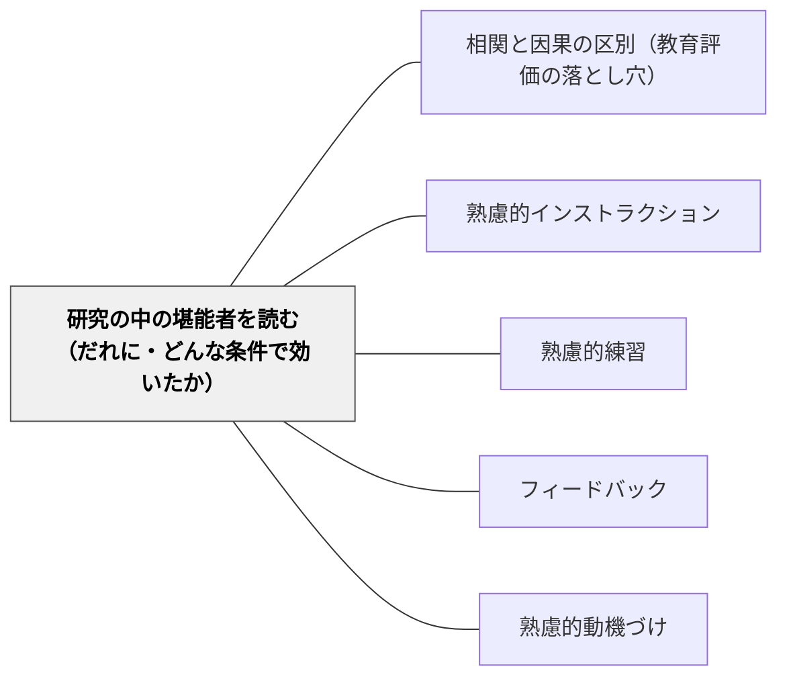

# 研究の中の堪能者を読む（だれに・どんな条件で効いたか）

**一文でいうと**：量的な研究の平均の陰にある「とくによく効いた相手と条件」を拾い、根拠の強さで分けて、次の実践で確かめる仮説にする。

## 使いどころ・使いすぎ注意

| 観点 | 内容 |
| --- | --- |
| 使いどころ | 研究を読んで「効く」「効かない」で終わりそうなとき。自分の教室の子どもに当てはまるかを考えたいとき。 |
| 使いすぎ注意 | 効いた条件の一覧を処方箋にしない。小さな研究の大きな効果は、まず研究の作りを疑う。 |

> 平均の効果量は、効く相手と効かない相手を混ぜた数である。

## 背景（Context）

牧口常三郎は『創価教育学体系Ⅰ』で、帰納の研究の源泉として、自分の偶然の成功に加えて、もう一つを挙げた。

> 「（B）同様の成功を齎らしたる所謂堪能者の成功の事実の観察と、之を生じたる特殊の原因の考察。」（p. 89）

卓越した実践者（堪能者）の成功を比べて観察し、その成功を生んだ特殊な原因を取り出す方法である。牧口は研究の段階として、自分の経験だけを信じて独断に陥る第二期を越え、衆人の経験を比べ統合する第三期へ進むことを説いた（[[文献/創価教育学体系 1（牧口常三郎）]]、[[メタパタン/アブダクション（仮説形成）]]）。

いまの量的な教育研究には、何千人分の実践の記録がある。そこにも「同様の成功」が眠っている。メタ分析の平均の中で、ある相手、ある条件のときにとくによく効いた事実である。Tipton ほか（2023）は、社会科学のメタ分析は「効果があるかないか」ではなく、効果がどれだけばらつき、それを何で説明できるかを主に問うべきだと論じた（[[文献/成長マインドセットのメタ分析を効果のばらつきから読み直す（Tiptonほか2023）]]）。本パタンは、牧口の（B）を研究の論文に当てはめるものである。

## 問題（Problem）

研究を平均だけで読むと、「効かない」か「全員に効く」かの二択になる。教室で知りたいのは「この子に、この条件で」の情報なのに、それは論文の下位群の結果、調整要因の分析、限界の節に埋もれている。一方で、飛び抜けて大きな効果をそのまま信じると、研究の作りが生んだ見かけの効果に振り回される。

## 力のかたち（Forces）

- 平均は、効く相手と効かない相手を混ぜる。効く相手だけを見れば小さくない効果も、全体では小さく見える（Tipton ほか 2023）
- 飛び抜けた効果は、研究の作りから出やすい。2,000人を超える研究の効果量の中央値は 0.03、100人以下の研究は 0.24 で、研究者が作った狭いテストでも大きく出る（[[文献/教育の介入の効果量を読む物差しを作り直す（Kraft2020）]]）
- 研究どうしの比較（メタ分析の調整要因）は、ほかの違いと混ざる。同じ研究の中で条件だけを変えた比較のほうが強い（Tipton ほか 2023）
- 大きな効果が、追試で消えることがある。大規模な無作為化比較の40%は、効果があるともないとも言えない幅で終わる（[[文献/大規模な無作為化比較の多くが結論を出せないことを確かめる（LortieForguesとInglis2019）]]）
- それでも、条件の情報がなければ、教室で使う手がかりにならない

## 解決（Solution）

**論文の中の「とくに効いた相手と条件」を拾い、根拠の強さで四つの段に分けて集め、教室で確かめる仮説にせよ。**

### 四つの段

| 段 | どんな根拠か | 読み方 |
| --- | --- | --- |
| 強 | 同じ研究の中で、条件や相手だけが違う群を比べて差が出た | いちばん信頼できる。それでも対象の年齢・教科・国を確かめる |
| 中 | メタ分析の調整要因など、研究どうしの比較で差が出た | ほかの違いと混ざっている。仮説として強め |
| 仮説 | 一つの小さな研究で飛び抜けた効果が出た | 次の実践で確かめる仮説として置く |
| 再現されず | 追試や別の分析で消えた・読み方が分かれた | 失敗の記録も残す。何が違ったかが手がかりになる |

### 読む場所

- 下位群の結果（成績の高低・学年・事前の知識で分けた結果）
- 調整要因の分析（メタ分析の表の後半）
- 同じ研究の中の条件の比較（何と何を比べたか）
- 著者自身の限界の節と、追試の論文

### 収集表

本 Wiki の文献ページで原典を確かめた知見から集めた。「関連する親パタン」は図解の親パタン。

| 段 | 手立て | だれに | どんな条件で | 結果 | 出典 | 関連する親パタン |
| --- | --- | --- | --- | --- | --- | --- |
| 強 | 成長マインドセットの短い介入 | 米国の9年生のうち、成績が学校の中で中央値以下の生徒 | 仲間が実際に難しい課題を選ぶ雰囲気の学校で効果が続いた | 成績の効果量 0.11。上位の生徒には有意な効果なし | [[文献/A National Experiment Reveals Where a Growth Mindset Improves Achievement（Yeager et al., 2019）]] | [[パタン/熟慮的動機づけ]] |
| 強 | 二つのものを比べる | 中学1・2年生162人 | 同じ問題を二つの解き方で比べる（同じ型の問題どうし・違う型の問題どうしではなく） | 概念の理解がほかの二つの比べ方より高い | [[文献/何と何を比べると学びが伸びるかを確かめる（RittleJohnsonとStar2009）]] | [[パタン/類推的学習①]] |
| 強 | まぜる練習 | 中学1年生126人 | 習った日に少し、残りを後の宿題に散らす | 30日後のテスト 74% 対 42% | [[文献/練習問題をまぜると算数の学びが残る（Rohrerほか2015）]] | [[パタン/熟慮的練習]] |
| 強 | 思い出すテスト | 大学生 | 1週間後に測る（5分後では読み直しが上） | 1週間後の再生 56〜61% 対 40% | [[文献/想起テストによる長期保持（RoedigerとKarpicke2006）]] | [[パタン/熟慮的練習]] |
| 強 | 思い出す練習 | 9〜11歳 | 白紙からではなく、質問マップで支える | 直後の再生 40% 対 28%（白紙からの自由再生は平均7%で差が出なかった） | [[文献/小学生の想起練習を支える手がかり（Karpickeほか2014）]] | [[パタン/熟慮的練習]] |
| 強 | コメントだけで返す | イスラエルの小学5・6年生 | 評点を付けない | 評点を含む二群より興味と成績が高い | [[文献/評点とコメントが向ける注意を確かめる（Butler1988）]] | [[パタン/フィードバック]] |
| 強 | 背景知識 | 7・8年生64人 | 文章の題材（野球）をよく知っている | すべての測定で知識の効果。読解力の効果は有意でない | [[文献/背景知識と文章の記憶を確かめる（RechtとLeslie1988）]] | [[パタン/精緻化]] |
| 中 | 見積もりの方法を比べる | 小学5・6年生 | 事前に少し見積もれた子（正答20%以上） | その子たちでだけ、概念の理解が2週間後によく残った（事後に分けた分析） | [[文献/見積もりの方法を比べると柔軟になる（StarとRittleJohnson2009）]] | [[パタン/類推的学習①]] |
| 中 | 先に問題に取り組み、あとで教える | 6〜10年生でとくに大きい（0.50）。大学生 0.28 | 子どもの解き方をもとに教えるなど、生産的失敗の設計の要素を多く満たすほど差が大きい | 概念の理解と転移で全体 g = 0.36。2〜5年生は −0.09（わずかに先に教えるほうが上） | [[文献/先に問題に取り組み、あとで教える授業を比べる（SinhaとKapur2021）]] | [[パタン/熟慮的インストラクション]] |
| 中 | 発見を支える | 子どもから大人 | 足場やフィードバックがある（自分で生み出すだけではない） | d = 0.50。生み出すだけは −0.15。手助けのない発見がいちばん不利なのは中高生（−0.53） | [[文献/発見学習の支援条件を見分ける（Alfieriほか2011）]] | [[パタン/熟慮的インストラクション]] |
| 中 | フィードバック | さまざま | 注意を課題に向け、自分自身に向けない | 平均 0.41 だが38%超が負。ほめ言葉を含む研究群 0.09、含まない群 0.34 | [[文献/フィードバックの効果を注意の向きから捉える（KlugerとDeNisi1996）]] | [[パタン/フィードバック]] |
| 中 | 能動的な学び | 大学の理系の学生 | 50人以下の授業 | 効果が最も大きかった（全体で 0.47 SD） | [[文献/講義だけの授業と能動的な学びを比べる（Freemanほか2014）]] | [[パタン/能動的関与]] |
| 中 | 明示的な指導と問題解決の方略 | 学習障害のある子ども（算数） | ほかの要素を考慮しても | 大きな効果量と関連（多くは要素の組み合わせ） | [[文献/算数の困難に応じて指導を組み合わせる（Gerstenほか2009）]] | [[パタン/個別化]] |
| 中 | 教師へのコーチング | 現職の教師（主に小学校の読み書き） | 規模の小さいプログラム | 大きいプログラムより効果が大きい（全体で授業 0.49・学力 0.18） | [[文献/教師へのコーチングの効果と条件を確かめる（Kraftほか2018）]] | [[パタン/熟慮的練習]] |
| 中 | 書く活動で読む力を支える | 成績の低い子ども | 書き方を明示的に教える | 条件として示唆（研究数は少ない） | [[文献/書く活動で読む力を支える（GrahamとHebert2010）]] | [[パタン/作ることで学ぶ]] |
| 仮説 | 相互教授法 | 読解の困難な中学生（研究1は24人） | 要約・質問・明確化・予測の進行役を交替する | 新しい文章を一人で読む成績が改善し、8週後も保たれた | [[文献/対話で読解を育てる相互教授法（PalincsarとBrown1984）]] | [[パタン/熟慮的問い]] |
| 仮説 | 話し合いの約束を教える | 英国の9〜10歳（4学級ずつ・無作為でない） | 理由を求める・異論を受け止める約束を学級の言葉にする | 個人の推論の伸びが大きい（片側 p = .04）。グループの得点は有意差なし | [[文献/話し合いの約束と個人の推論を確かめる（Mercerほか1999）]] | [[パタン/ソーシャル]] |
| 再現されず | 分数の手引きを使った授業研究 | 米国の教師と子ども | 第三者による追試 | 子どもへの効果 0.49（2017年の研究）は再現されず。授業の質は手引きで上がった | [[文献/授業研究と分数の手引きの効果を追試で分けて確かめる（Schoenほか2023）]] | [[パタン/熟慮的教材教具]] |
| 再現されず | 成長マインドセットの介入 | 63研究の全体 | 研究の質で絞る | 有意でない（d = 0.05→0.02）。効く相手で読み直すと困難のある群で 0.15（探索的）と反論があり、読み方が分かれる | [[文献/成長マインドセットの介入の効果を研究の質で絞って確かめる（MacnamaraとBurgoyne2023）]] | [[パタン/熟慮的動機づけ]] |

## 結果（Consequences）

- 研究の知見が、「効く・効かない」から「だれに・どんな条件で」の手がかりに変わる
- 自分の教室の子どもに近い条件の研究を選んで読めるようになる
- 根拠の段を分けることで、強い知見と仮説を混同しなくなる
- 再現されなかった知見も残すことで、何が効果を左右したかを考える材料になる
- ただし、どの段の知見も、自分の教室では仮説である。次の実践で確かめ、自分の「驚くべき良い結果」（牧口の（A））と突き合わせる

## クラスター図

## Actionable Insight

- 研究を一本読んだら、平均の効果量の次に「下位群」「調整要因」の表を探し、だれに・どんな条件でとくに効いたかを一行書き出す
- 書き出した一行に、上の四つの段のどれかを付ける。研究の中の比較か、研究どうしの比較か、一つの小さな研究か
- 自分の学級の子どもに近い条件の行を一つ選び、次の単元で試す仮説にする。試した結果は、実践の記録に「効いた／効かなかった／条件が違った」で残す

## 出典

- 牧口常三郎『創価教育学体系Ⅰ』p. 89（帰納の源泉（B）：堪能者の成功の事実の観察と、それを生じた特殊の原因の考察）→ [[文献/創価教育学体系 1（牧口常三郎）]]
- Tipton, E., et al. (2023). Why meta-analyses of growth mindset and other interventions should follow best practices for examining heterogeneity. *Psychological Bulletin, 149*(3–4), 229–241.
- Kraft, M. A. (2020). Interpreting effect sizes of education interventions. *Educational Researcher, 49*(4), 241–253.
- 収集表の各行の出典は、表の中の文献ページを参照

## 関連パタン

- [[メタパタン/アブダクション（仮説形成）]] — 牧口の「驚くべき良い結果の吟味」と、帰納の源泉（B）堪能者の観察
- [[パタン/相関と因果の区別（教育評価の落とし穴）]] — 研究どうしの比較は因果を言い切れない
- [[文献/A National Experiment Reveals Where a Growth Mindset Improves Achievement（Yeager et al., 2019）]] — 収集表・力のかたちで引く
- [[文献/フィードバックの効果を注意の向きから捉える（KlugerとDeNisi1996）]] — 収集表・力のかたちで引く
- [[文献/何と何を比べると学びが伸びるかを確かめる（RittleJohnsonとStar2009）]] — 収集表・力のかたちで引く
- [[文献/先に問題に取り組み、あとで教える授業を比べる（SinhaとKapur2021）]] — 収集表・力のかたちで引く
- [[文献/創価教育学体系 1（牧口常三郎）]] — 収集表・力のかたちで引く
- [[文献/大規模な無作為化比較の多くが結論を出せないことを確かめる（LortieForguesとInglis2019）]] — 収集表・力のかたちで引く
- [[文献/対話で読解を育てる相互教授法（PalincsarとBrown1984）]] — 収集表・力のかたちで引く
- [[文献/小学生の想起練習を支える手がかり（Karpickeほか2014）]] — 収集表・力のかたちで引く
- [[文献/想起テストによる長期保持（RoedigerとKarpicke2006）]] — 収集表・力のかたちで引く
- [[文献/成長マインドセットのメタ分析を効果のばらつきから読み直す（Tiptonほか2023）]] — 収集表・力のかたちで引く
- [[文献/成長マインドセットの介入の効果を研究の質で絞って確かめる（MacnamaraとBurgoyne2023）]] — 収集表・力のかたちで引く
- [[文献/授業研究と分数の手引きの効果を追試で分けて確かめる（Schoenほか2023）]] — 収集表・力のかたちで引く
- [[文献/教師へのコーチングの効果と条件を確かめる（Kraftほか2018）]] — 収集表・力のかたちで引く
- [[文献/教育の介入の効果量を読む物差しを作り直す（Kraft2020）]] — 収集表・力のかたちで引く
- [[文献/書く活動で読む力を支える（GrahamとHebert2010）]] — 収集表・力のかたちで引く
- [[文献/発見学習の支援条件を見分ける（Alfieriほか2011）]] — 収集表・力のかたちで引く
- [[文献/算数の困難に応じて指導を組み合わせる（Gerstenほか2009）]] — 収集表・力のかたちで引く
- [[文献/練習問題をまぜると算数の学びが残る（Rohrerほか2015）]] — 収集表・力のかたちで引く
- [[文献/背景知識と文章の記憶を確かめる（RechtとLeslie1988）]] — 収集表・力のかたちで引く
- [[文献/見積もりの方法を比べると柔軟になる（StarとRittleJohnson2009）]] — 収集表・力のかたちで引く
- [[文献/評点とコメントが向ける注意を確かめる（Butler1988）]] — 収集表・力のかたちで引く
- [[文献/話し合いの約束と個人の推論を確かめる（Mercerほか1999）]] — 収集表・力のかたちで引く
- [[文献/講義だけの授業と能動的な学びを比べる（Freemanほか2014）]] — 収集表・力のかたちで引く
- [[パタン/熟慮的インストラクション]] — 収集表の行：支えの種類・学年で効き方が分かれる（Alfieri・Sinha と Kapur）
- [[パタン/熟慮的練習]] — 収集表の行：直後と後日の逆転、子どもの想起の支え
- [[パタン/フィードバック]] — 収集表の行：コメントだけ・注意の向き
- [[パタン/熟慮的動機づけ]] — 収集表の行：成長マインドセットが効く相手と条件
