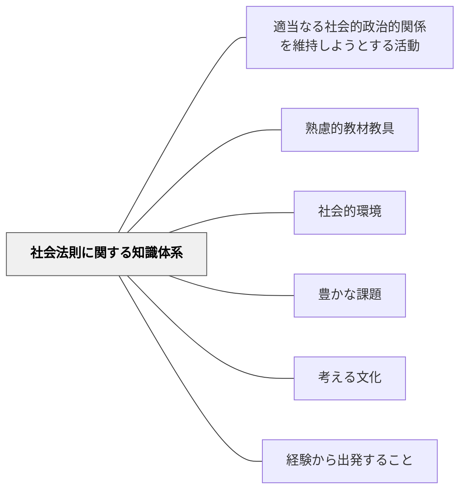

# 社会法則に関する知識体系

> 社会科学が明らかにした社会の構造・法則が教育材料の重要な柱。

## 背景（Context）

牧口常三郎の知識体系分類の一つ。本Wikiでは、経済学・社会学・政治学・歴史学など、社会の仕組みや変化を支配する法則・原理に関する知識体系。社会科・公民・歴史・家庭科などの教科内容がここに含まれる。

**原典では**：牧口が「二、社会法則に関する知識体系」に当てた教科は修身・歴史・地理で、使命は「社会法則の理解並びに其の応用技術及びその知識の涵養」とされる（『創価教育学体系』第4巻 第二章第五節）。経済学や政治学への広げ方は、本Wikiの読み方である。（牧口の分類全体は [[文献/創価教育学体系 4（牧口常三郎）]] の「2-2」にまとめた。）

## 問題（Problem）

社会の法則・構造を「暗記すべき事実」として扱うと、社会を批判的に読む力が育たない。

## 力のかたち（Forces）

- 社会法則は文化・時代によって変わる可能性がある
- 統計・調査・フィールドワークで体験的に学べる

## 解決（Solution）

**近いパタンとの見分け**：教材・教具の表では、本パタンの見分けの問いは「社会の法則（社会科学）を体系として学ぶ教材か」。全体の表は [[パタン/熟慮的教材教具#近いパタンとの見分け|熟慮的教材教具]] にある。

**社会科学の知識を「社会の仕組みを理解し批判的に考えるための道具」として教材化し、実社会の現象との接続を重視する。**

**例：お店がそこにある理由**（社会・3年）
地域の商店街で、お店の並び方・売っている物・お客さんの動きを調べ、「なぜこの場所にこの店があるのか」のきまりを考える。見つけたきまりが、別の通りや隣の町でも成り立つかを確かめる。

---

**例：学級のきまりを見直す**（学級活動・高学年）
学級会で決めたきまりを一か月後に振り返り、守られた理由と守られなかった理由を出し合う。そこから、社会のきまりが働く条件（分かりやすさ・納得・見える場所）を考える。

## 結果（Consequences）

- 社会リテラシーと批判的思考が育つ
- 社会参加への動機が高まる

- 注意点：牧口の時代の「修身」は今の道徳とは同じではない。社会のきまりを「守るもの」としてだけ扱うと、きまりを理解し作り直す力（応用技術）が育たない

## 関連パタン
- [[パタン/適当なる社会的政治的関係を維持しようとする活動]]

- [[パタン/熟慮的教材教具]] — 親パタン
- [[パタン/社会的環境]] — 社会的環境との接続

- [[パタン/豊かな課題]] — 社会法則を核にした問いが豊かな課題の構造を生む
- [[パタン/考える文化]] — 社会的法則への批判的考察が「考える文化」の基盤となる
- [[パタン/経験から出発すること]] — 社会法則を社会体験・フィールドワークから帰納する
- [[概念/理論の構成と運用]] — 社会科学の法則を理論として運用する認識論的背景

## クラスター図

## Actionable Insight

- 社会科学の概念を教えるとき「今起きているニュース・社会問題」の1つと結びつける——抽象的な法則が現実社会の読み解き道具になることへの実感が学習の意義を生む
- 「なぜこの社会構造はこうなっているのか？ 別の可能性はあるか？」と批判的な問いを授業に入れる——事実を暗記するだけでなく社会を批判的に読む力が育つ
- 統計・調査・フィールドワークの経験を1単元に1度組み込む——実証的なアプローチが社会科学の知識を体験的に理解させる

## 出典

- 牧口常三郎（1972）『牧口常三郎全集第4巻 創価教育学体系 上』聖教新聞社

- 牧口常三郎（2007）『創価教育学体系』第4巻（聖教文庫、第8刷のデジタル版）第二章「教科構造論」— 2026-11-13 に該当箇所の原文を確認。[[文献/創価教育学体系 4（牧口常三郎）]]
