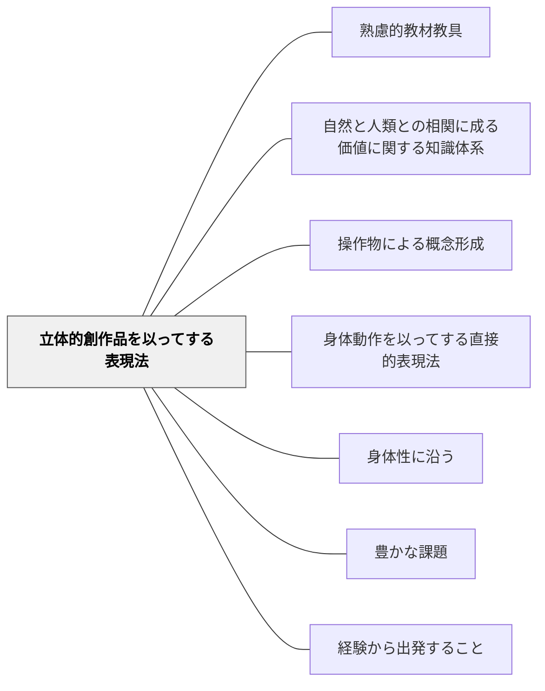

# 立体的創作品を以ってする表現法

**このパタンが完成を助ける大きなパタン**：[[パタン/熟慮的教材教具]]

> 工芸・工作・彫刻——立体的な創作を通じて価値を表現し学ぶ。

## 背景（Context）

牧口常三郎の表現法分類の第二項目。粘土・木工・陶芸・彫刻・工作など、立体的な物を作ることで価値を表現する活動。図工・美術・家庭科・技術科の生産的教科がここに含まれる。作ることによる学びは「構成主義」的な学習とも一致する。

**原典では**：「2、立体的創作品を以てする表現法。手工等の生産的教科＝技能と其の知識」（『創価教育学体系』第4巻 第二章第五節）。牧口は手工を、利的価値の創造を指導する教科の代表にも挙げている。（牧口の分類全体は [[文献/創価教育学体系 4（牧口常三郎）]] の「2-2」にまとめた。）

## 問題（Problem）

立体的な創作活動が「工作の時間」として学習から切り離されると、作ることを通じた深い理解が育たない。

## 力のかたち（Forces）

- 作ることが理解を外化し、思考を可視化する
- 素材の制約が創造性を引き出す
- 完成した作品が達成感と自己効力感を生む

## 解決（Solution）

**立体的な制作活動（工作・陶芸・彫刻など）を学習内容と結びついた教育材料として設計し、作る過程に学びを組み込む。**

**近いパタンとの見分け**：教材・教具の表では、本パタンの見分けの問いは「工芸・工作など、立体の作品で表す教材か」。全体の表は [[パタン/熟慮的教材教具#近いパタンとの見分け|熟慮的教材教具]] にある。

**例：段ボールの立体地図**（社会・4年）
地域の地形を、等高線ごとに切った段ボールを重ねて立体にする。水がどこへ流れるか、どこに集落があるかを、立体を見ながら説明する。

---

**例：展開図から箱へ**（算数・4〜5年）
自分で考えた展開図から箱を作り、組み立たない展開図はどこを直せばよいかを考える。作った箱で、体積を量る学習につなげる。

## 結果（Consequences）

- 創造性・問題解決能力・手先の巧みさが育つ
- 完成品への達成感が動機付けを高める

- 注意点：完成品の出来ばえだけを評価すると、作る過程の試行錯誤が学びとして残らない

## 関連パタン

- [[パタン/熟慮的教材教具]] — 親パタン
- [[パタン/自然と人類との相関に成る価値に関する知識体系]] — 上位分類
- [[パタン/操作物による概念形成]] — 同じ活動を一般語彙で記述。本パタンは牧口の表現法四分類（教育材料論）の一部
- [[パタン/身体動作を以ってする直接的表現法]] — 牧口の表現法分類の第一項目（並列パタン）

- [[パタン/身体性に沿う]] — 立体的に作る身体的操作が概念理解を深める
- [[パタン/豊かな課題]] — 立体創作を核にした豊かな課題設計
- [[パタン/経験から出発すること]] — 立体制作の体験が学びの起点になる

## クラスター図

## Actionable Insight

- 単元で学んだ内容を「形にする」活動（粘土・工作・組み立て）を1回設計に組み込む——手で作ることが概念を身体化し理解を外化する
- 完成した作品を「どこに工夫があるか」を1点説明させてから展示する——説明の言語化が製作中の思考を振り返らせる
- 素材の制約（使える材料はこれだけ）を意図的に設けて設計に組み込む——制約が創造性を引き出し問題解決を促す

## 出典

- 牧口常三郎（1972）『牧口常三郎全集第4巻 創価教育学体系 上』聖教新聞社

- 牧口常三郎（2007）『創価教育学体系』第4巻（聖教文庫、第8刷のデジタル版）第二章「教科構造論」— 2026-11-13 に該当箇所の原文を確認。[[文献/創価教育学体系 4（牧口常三郎）]]
