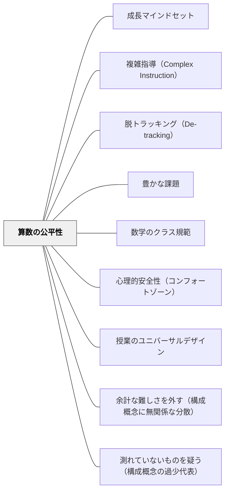

# 算数の公平性

**このパタンが完成を助ける大きなパタン**：[[パタン/数学ワークショップ]]

> 「算数は才能のある子のもの」——この信念そのものが、最も大きな学習の壁である。

## [Pattern Connection]

Boaler（2016）Ch.6「Mathematics and the Path to Equity」が一次資料。Leslie et al.（2015）のギフテッド信仰研究・Steele のステレオタイプ脅威・Beilock et al.（2009）の女性教師の数学不安研究を基盤とする。

- **既存パタンとの関連**: [[パタン/成長マインドセット]] の「誰でも伸びられる」という信念を、構造的・社会的な障壁の除去として具体化する。個人のマインドセット変革だけでは不十分——教室設計・評価・グループ編成まで変える必要がある
- **補強された点**: 特別支援学級での実践において「支援の子に高い数学的思考は期待できない」という無意識の偏見が、教師の課題設計に直接影響することへの警戒
- **他のパタンへの波及**: [[パタン/複雑指導（Complex Instruction）]]・[[パタン/脱トラッキング（De-tracking）]]・[[パタン/豊かな課題]] と組み合わさって初めて機能する

---

## 背景（Context）

大学教員が「だれが学べるか」について抱く考えを調べた研究では、数学は、教員が最も固定的な考えをもつ分野だった（Leslie et al., 2015。Boaler, 2016, Ch.1 で紹介）。また、才能（giftedness）を重んじる分野ほど女性の博士号取得者が少なく、分野ごとの信念は、調べた30分野すべてで女性の割合と相関していた。この信仰は教師にも保護者にも子どもにも浸透しており、無意識に教室の設計・発言・評価に織り込まれていく。

日本の小学校でも「算数が得意な子・苦手な子」という二項対立は普遍的に存在し、特別支援学級では「高い数学的思考よりも計算の定着」というバイアスが特に強く働きやすい。

## 問題（Problem）

「算数は才能のある子のもの」という信念が教室文化に埋め込まれると、教師の期待・課題設計・声かけ・評価がすべてその信念を強化する方向に動く。子どもたちは「自分は算数をやる人かどうか」を小学校の早い段階で決めてしまい、その後の学習機会が大きく分岐する。

## 力のかたち（Forces）

- **ステレオタイプ脅威**（Claude Steele）: 数学のテストで男女差が出ると告げられた女子は成績が下がり、告げられなかった女子は男子と同じ水準だった。告げなくても、受験前に性別の欄に印をつけるだけで、女性の成績はつけない人より低かった。ステレオタイプはいつも「空気の中に」（"in the air"）あり、機会を大きく減らす。ほかのグループが優れているとされる分野では、どのグループもこの脅威を受けうる（Steele, 2011。Boaler, 2016, Ch.6）。意図的な差別がなくても、文化的な文脈が成績差を生む
- **女性教師の数学不安の伝染**（Beilock et al., 2009）: 女性の小学校教師が抱く数学への不安の強さが、そのクラスの女子の成績を予測し、男子の成績は予測しなかった。女子は女性教師を見上げ、自分を重ねる。そこへ教師が「数学は自分には難しい」「自分は数学の人ではない」という考えを、しばしば慰めのつもりで伝えてしまう——教師自身の数学観が学習者に伝わる
- **女子は深い理解を欲する**: 女子は男子より、方法がなぜ成り立ち、どこから来て、どうつながるかを深く理解したい傾向が強い（すべての女子・男子がそうだという意味ではない）。手順中心の授業で深い理解が得られないと、女子は成績が伸びず、数学から離れ、不安を抱きやすい（Boaler, 2016, Ch.6）。「なぜそうなるのか」を理解したい欲求と「とにかく計算を練習する」文化の衝突
- **「支援の子には簡単な算数」という誤信念**: 特別支援の文脈でも、抽象的・創造的な数学的思考を楽しむ子どもは多い。課題のフロアが高いと参加できないだけで、フロアを下げれば深く探究できる

## 解決（Solution）

**算数の教室から「誰が数学をする人か」というラベルを除去し、すべての子どもが深い数学的思考に参加できる環境を設計する。**

**近いパタンとの見分け**：算数・数学の表では、本パタンの見分けの問いは「「算数は才能のある子のもの」というラベルを、教室から取り除いているか」。全体の表は [[教科/算数・数学で使うパタン#近いパタンとの見分け|算数・数学で使うパタン]] にある。

---

### ステレオタイプ脅威への対応

- テスト・課題から性別欄・得意/苦手の自己申告欄を削除する
- 「女の子だから」「支援級だから」という文脈でのハードル下げ表現を自己点検する（「できなくていいから」より「どう考えた？」）
- 「数学は才能ではなく、経験と努力で伸びる」というメッセージを年度初めに明示する

### 女子・特別支援の生徒への追加的な励まし

- 「私はあなたにはできると思っている」を普段発言が少ない子に個別に伝える
- 女性数学者・科学者のロールモデル（例：Maryam Mirzakhani、フィールズ賞受賞者）を算数の授業で紹介する
- 女子が求めるもの（女子向けの学校外 STEM プログラム123のメタ分析）：女子が、関与と前向きなアイデンティティにつながると評価した上位4つは、実地体験・プロジェクト型・実生活応用・共同作業の機会——ロールモデルも挙がったが、女子はこれらより重要でないと考えていた

### 多次元性の確保

- 「算数で得意なこと」を一次元（計算の速さ）でなく多次元で定義する：空間的思考・パターン発見・直観的推論・図解・説明・関係の発見
- 授業で「空間的思考が得意な人は？」「図で考えるのが好きな人は？」と多次元の得意を引き出す問いを週1回入れる
- 特別支援の子が「このクラスで一番よく気づく人」「図で考えるのが一番うまい人」として認められる場を作る

### Boalerの6つの公平性戦略

Boaler（2016, Ch.6）が挙げる6つ。

1. **全員に高い水準の内容を**（Offer all students high-level content）: 高い水準の数学を学ぶ機会を得る生徒を広げる（方法は Ch.7 の能力別の議論へ。[[パタン/脱トラッキング（De-tracking）]] 参照）
2. **だれが数学で達成できるかの考えを変える**（Work to change ideas about who can achieve in mathematics）: 教師のマインドセットが生徒の道を開きも閉ざしもする。成長マインドセットのメッセージをできるだけ早く、何度も伝える
3. **数学を深く考えるよう励ます**（Encourage students to think deeply about mathematics）: 深い理解を求める生徒（多くは女子）が手順中心の授業で締め出されないよう、つながりと探究のある数学を教える
4. **一緒に取り組む方法を教える**（Teach students to work together）: グループワークのスキルを明示的に指導する（Treisman の研究を根拠に挙げる。[[パタン/複雑指導（Complex Instruction）]] 参照）
5. **女子と有色人種の生徒に、数学と科学を学ぶ励ましを上乗せする**（Give girls and students of color additional encouragement to learn math and science）: 社会にあるステレオタイプのメッセージがあるので、ほかの生徒以上に、数学の中に居場所があるという前向きなメッセージが要る。ステレオタイプに対抗する一つの方法として、女性や少数派の人々の業績を取り上げる（本Wikiでは、特別支援の生徒にも同じ考えを広げて読む）
6. **宿題をなくす（少なくとも宿題の性質を変える）**（Eliminate (or at least change the nature of) homework）: 恵まれない家庭の生徒は静かに勉強する場所がめったになく、夜に宿題をせねばならず、本やインターネットにつながる機器も家にないことが多い。残すなら、授業の大きな考えを振り返る問いに変える

ロールモデルは6つの戦略には入っていない。女子向けの STEM プログラム123のメタ分析では、ロールモデルも挙がったが、女子は協働的・探究的な活動の機会より重要でない（less important）と考えていた（GSUSA, 2008）。

---

具体例：Uri Treismanの研究（カリフォルニア大学バークレー校）

バークレーで、アフリカ系アメリカ人学生の60%が微積分で落第していた（多くにとって大学を去ることを意味した）。成功率の高い中国系アメリカ人学生と比べて調べると、教授たちの説（準備が弱い・入学時の成績が低い・家庭が貧しい）はどれも当たらず、はっきりした違いは一つだった——中国系アメリカ人学生は夜に集まって一緒に問題に取り組み、アフリカ系アメリカ人学生は一人で取り組み、行き詰まると「自分には数学はできない」と判断していた。Treisman が、一緒に数学に取り組み、自分の可能性について前向きなメッセージを受け取れる協働のワークショップを設けると、2年以内に落第率はゼロになり、参加したアフリカ系アメリカ人学生は、参加しなかった中国系アメリカ人学生を上回った（Treisman, 1992。Boaler, 2016, Ch.6）。「才能の差」ではなく「学習環境の差」が格差を生んでいた。

---

### 研究の裏づけ

> **研究の裏づけ**：英国の Education Endowment Foundation の算数の指針（2017、7〜14歳）は、習熟度で学級を分けること（セッティング）について、多くのメタ分析が一貫して上下の組の差を広げると示すとまとめる。平均では成績を上げず、下の組の子にわずかに負の影響があり、上の組の子はわずかに得をする。恵まれない家庭の子は下の組に入りやすいので、差を広げやすい（pp. 28–29）。出典：[[文献/7〜14歳の算数の指導を研究から整える（英国EEF2017）]]。

> **研究の裏づけ**：ステレオタイプ脅威に対する、大切な価値を書く短い作文（自己肯定化）は、元の研究（Cohen ほか 2006）では人種の成績の差を縮めたが、同じ学区・同じ手順で2年続けた大規模な追試（Hanselman ほか 2017）では、1年目に効果が出て、翌年は出なかった。理論が挙げる条件のどれも差を説明しなかった。短い介入一つで公平性が確保できるとは考えず、性別欄の削除やメッセージの見直しのような環境の側の手立てと、日々の関わりを重ねる。出典：[[文献/価値を書く短い作文の効果が、同じ学区の翌年に消えたことを確かめる（Hanselmanほか2017）]]。

## 結果（Consequences）

- 「算数が得意な子・苦手な子」の二分法が教室から薄れる
- 普段発言しない子が「自分には得意な見方がある」と気づく場面が生まれる
- 特別支援の子が深い数学的思考に参加できる瞬間が増える
- 女子生徒の算数への参加率・発言率が上がる
- ただし、一人の教師の努力だけでは変えにくい構造的問題も多い——学校全体の設計として考える必要がある

## 関連パタン
- [[実践/カエルの算数：勝ちやすさを表で考えよう]]
- [[教科/LowFloorHighCeilingタスク集]]
- [[教科/算数・数学で使うパタン]]
- [[文献/7〜14歳の算数の指導を研究から整える（英国EEF2017）]] — 習熟度で学級を分けると差が広がりやすい

- [[パタン/成長マインドセット]] — 公平性の根底にある信念。個人のマインドセットから教室文化へ
- [[パタン/複雑指導（Complex Instruction）]] — 格差解消の最も実証された具体的実践
- [[パタン/脱トラッキング（De-tracking）]] — 能力別グループは格差を固定化する構造
- [[パタン/豊かな課題]] — LFHC課題設計が多様な参加を保証する
- [[パタン/数学のクラス規範]] — 「誰でも最高レベルへ」という規範の設定
- [[パタン/心理的安全性（コンフォートゾーン）]] — 安全な環境があってこそ公平な参加が生まれる
- [[パタン/授業のユニバーサルデザイン]] — UDLとの接続：設計段階からの公平性
- [[文献/Mathematical Mindsets（Boaler）]] — 一次資料
- [[パタン/余計な難しさを外す（構成概念に無関係な分散）]] — 公平性を測定の言葉で扱う枠組み。ルビや読み上げが「甘やかし」ではなく妥当性の回復である理由
- [[概念/帰結的妥当性（評価がもたらす結果まで問う）]] — 不公平が「妥当な差の記述」に由来するのか「評価の無効性」に由来するのかを切り分ける
- [[文献/価値を書く短い作文の効果が、同じ学区の翌年に消えたことを確かめる（Hanselmanほか2017）]] — ステレオタイプ脅威への短い作文の介入の大規模な追試

---
- [[パタン/測れていないものを疑う（構成概念の過少代表）]] — 評価が狭いことによって、その子ができることが評価の外に置かれる不公平

## クラスター図

## Actionable Insight

- 今週の算数テストから「名前の横に好きな算数のジャンルを書く欄」を外し、代わりに「今日どんなことを考えたか」を書く欄を作る
- 「〇〇は算数が苦手だから」という文脈での課題の調整を自己点検する——フロアを下げた同じ課題で参加できるか確認する
- 算数の授業で「今日誰かの気づきが一番よかった？」という質問で授業を終わる——計算の速さでなく気づきを評価する文化をつくる
- 「あなたにはできると思っている」の一言を、今週1人だけでも普段発言の少ない子に伝える

---

## 出典

Boaler, J. (2016). *Mathematical Mindsets: Unleashing Students' Potential Through Creative Math, Inspiring Messages and Innovative Teaching*. Jossey-Bass.

Beilock, S. L., Gunderson, E. A., Ramirez, G., & Levine, S. C. (2009). Female teachers' math anxiety affects girls' math achievement. *PNAS*, 107(5), 1860–1863.

Leslie, S. J., Cimpian, A., Meyer, M., & Freeland, E. (2015). Expectations of brilliance underlie gender distributions across academic disciplines. *Science*, 347(6219), 262–265.

Steele, C. M. (2010). *Whistling Vivaldi: How Stereotypes Affect Us and What We Can Do*. Norton.

[[文献/Mathematical Mindsets（Boaler）]]
