# 算数シンキング・タスク

**このパタンが完成を助ける大きなパタン**：[[パタン/作ることで学ぶ]]

> タスクの設計と使い方を変えることで、子どもが「手順を思い出す作業」ではなく「本当に考え続ける」算数の時間をつくる。

---

## Pattern Connection

> **守備範囲**: 本パタンは設計＋3段階運用（立ち上げ・探究・集約）を扱う。課題設計の原則は [[パタン/豊かな課題]] を参照。

**出典**: Liljedahl, P. & Giroux, M.（2024）*Mathematics Tasks for the Thinking Classroom, Grades K-5.* Corwin.（初回統合：2026-05-14 / 再統合：2026-05-17）

- **既存パタンとの関連**: [[パタン/数学ワークショップ]] の「問題解決フェーズ」に対応する。BTCのシンキング・タスクは、数学ワークショップのミニレッスン後に使う問題として機能し、収束（Consolidation）が数学ワークショップの「共有・振り返り」フェーズと対応する。[[パタン/ナンバートーク]] は非カリキュラムタスクの一種として機能することが本書で明確に位置づけられている。
- **補強された点**: [[パタン/心理的安全性（コンフォートゾーン）]] と組み合わさるとき、「低い床（Mild）」の設計が全員参加の入口になる。算数においても、安心して試し・失敗できる場の設計がタスクの効果を支える。
- **修正・拡張された点**: 日本の「まとめ」「振り返り」にあたる段階がBTCでは「Consolidation（収束）」として体系化されており、「教師が結論を言う」のではなく「子どもの発見を順番に並べて数学の構造を引き出す」という点が明確になった。本書はPart 2に20本の非カリキュラムタスク（Task 1〜20）・Part 3に30本のカリキュラムタスク（Task 21〜50）を具体的な問いとして収録している。
- **他のパタンへの波及**: [[パタン/キーコンセプト（胚細胞的概念）]] がConsolidationで「数学的構造を名づける」ことに対応する。[[文献/Mathematical Mindsets（Boaler）]] の「低い床・高い天井（LFHC）」概念が本書の良いタスクの条件に直接対応する。本書の統合により、[[パタン/Launch Script（タスクの渡し方）]]・[[パタン/Consolidation（収束の時間）]]・[[パタン/非カリキュラムタスク（考える文化をつくる問い）]] の3パタンが新規作成（2026-05-17）。さらに再統合Phase3（2026-05-17）でOCR全文照合を経て、[[パタン/Thin-Slicing設計（薄切り問題の作り方）]]・[[パタン/同一文脈・複数概念の展開]]・[[パタン/逆算・双方向思考]] の3パタンが新規作成された。

---

## 背景（Context）

Peter Liljedahl（2021）の *Building Thinking Classrooms (BTC)* は、10年以上にわたって数千の教室を観察した研究から生まれた実践体系である。Liljedahl が発見した最も重要な問いは「どんな教師の行動が、子どもが考えることを止めるか」であり、その答えの一つが「タスクの選び方」だった。

良くないタスクの特徴は明確だ——子どもが問題を見た瞬間に「これ、前にやった」と感じ、手順を思い出そうとする問題である。この状態では子どもは考えているのではなく、「どの操作を使うかを識別している」だけになる。

Liljedahl & Giroux（2024）は、BTCが示した14の最適実践をK-5のすべての学習内容に渡る50のタスクとして具体化した実践書で、「どんな問題を使えば子どもが考え続けるか」という問いに、設計原理と使い方ガイドで答えている。

## 問題（Problem）

教師が教科書の問題を使うと、子どもが「手順を思い出す作業」をするだけになりやすい。既視感のある問題は考えることへの誘いにならない。かといって「難しい問題」を出せばよいわけでもない——入口が狭い問題は一部の子しか参加できず、「算数は才能がある人がやるもの」という文化を強化する。

一方で、「楽しい問題」「活動的な問題」を出すだけでは、子どもは経験を積んでも、それが数学の概念とつながらない断片的な活動になる。

## 力のかたち（Forces）

- 問題に既視感があると、子どもは「考える」より「思い出す」に向かう
- 入口が狭い問題は、最初からあきらめる子を生む
- 出口のない問題は、できる子が退屈する
- 探究させっぱなしでは、発見が概念として定着しない
- 収束（まとめ）がないと、活動は楽しかったが何を学んだかが残らない
- タスクだけよいものにしても、環境（立って書く場所・ランダムグループ等）が揃わないと思考が生まれにくい

## 解決（Solution）

**近いパタンとの見分け**：課題を渡す→探究→収束の三段で使う授業の型が本パタン（Liljedahl）。課題そのものを設計・改造する原則は [[パタン/豊かな課題]]。探究・課題の系列の全体の表は [[パタン/作ることで学ぶ#近いパタンとの見分け|作ることで学ぶ]] にある。

**低い床・高い天井（LFHC）・新しさ・好奇心と粘り強さを満たすタスクを選び、Launch→探究→Consolidationの3段階で使う。**

---

### 良いタスクの3条件（OCR照合・修正済み）

Liljedahl & Giroux（2024）が原典で定義する3条件（Chapter 1）：

| 条件 | 内容 |
|------|------|
| **低い床（Low Floor）** | 誰でも入れる——学習歴・能力に関わらず全員が取り組める入口がある |
| **高い天井（High Ceiling）** | どこまでも深く探究できる——早く終わった子が退屈せずに続けられる |
| **新しさ（Novelty）** | 教科書や宿題で似た問題を見たことがない——既視感のある問題は「手順を思い出す作業」になる |

---

### 2種類のタスク

| 種類 | 目的 | 使う時 |
|------|------|--------|
| **非カリキュラムタスク** | 考えることそのものを目的とする | 年度初め1〜2週・週1回の文化づくり |
| **カリキュラムタスク** | 特定の学習内容に対応する | 通常の授業内で使う |

非カリキュラムタスクは特定の学習内容に紐づかず、「算数は答えを出すだけでなく、試して・失敗して・続けて考えるものだ」という教室文化を作る。[[パタン/ナンバートーク]] もこの意味で非カリキュラムタスクの一種として機能する。

---

### 3段階の授業の流れ

**Launch（導入）→ 探究 → Consolidation（収束）**

**Launch（導入）**：タスクを口頭で渡す。授業が始まってから5分以内に、子どもが考え始めているようにする。全員の理解を待たず、渡したあとで困っているところに応じる。

**探究**：個人→ペア→グループで考える。立って書ける場所（ホワイトボード等）があると思考が外に出やすい。教師は「正解」を教えない——「どうやって考えた？」「次は何を試す？」を問う。

Mild/Medium/Spicyの足場を用意しておく：

| 段階 | 役割 |
|------|------|
| **Mild（マイルド）** | 全員が「できた」を経験できる入口。特別支援の子も確実に参加できる |
| **Medium（ミディアム）** | 考え続けられる課題。大半の子が取り組む |
| **Spicy（スパイシー）** | 「なぜ？」「いつも？」という数学的一般化に向かう |

**Consolidation（収束）**：探究の後に、教師が主導して授業を閉じる活動の一つ。探究中の生まれたばかりの考えを、整理し・構造化し・形式化する。Closingは最大で授業の最後の1/3が目安で、収束・ノート作成・CYU Questionsのうち少なくとも一つを、この順で行う。

**CYU Questions（理解の確認問題）**：各タスクの末尾にMild・Medium・Spicyの3水準で設定された自己確認問題。子どもが「どれをやるか」を選ぶのではなく、「どこから始めるか（WHERE-ing）」を問う。「あなたはどのレベルの人ですか？（WHO-ing）」という問い方では、子どもは自分にラベルを貼る。「どこから始めたい？（WHERE-ing）」という問い方では、3問はひとつながりの道であり、出発地点は通過点に過ぎない——誰でも先へ進める。

収束の3方法：
1. **対話（Conversation）**——Gallery walk後に全体対話。発散型タスク向け
2. **Teacher-scribe（教師スクライブ）**——子どもの言葉を板書しながら概念に整理。収束型タスク向け
3. **Guided Gallery walk**——選択（Selecting）・配列（Sequencing）して全体共有

「底から上へ（Consolidation from the Bottom）」が原則：最もシンプルな解法→複雑、具体的→抽象的の順。

**Banner（バナー）**：ホワイトボード上部の6〜8インチのゾーンに現在のタスクを書き、早く終わったグループはそこから次のタスクを「盗む」（自分でタスクを作らない）。自律的な探究が続く仕組み。

---

### 収束（Consolidation）がなぜ必要か

> "Consolidation is not about telling; it is about asking."
> — Liljedahl & Giroux（2024）第5章 FAQ

探究中の子どもの考えは「力強いが、生まれたばかりで移ろいやすい」。整理・構造化・形式化する機会がないまま教室を出ると、次の授業までに薄れてしまう、と著者は書く（第5章冒頭）。日本の授業研究でいう「まとめ」に対応するが、BTCの収束は「教師が結論を言う」のではなく、「子どもの発見を順番に並べ、数学の構造を引き出す」点が異なる（本Wikiの読み）。

> **研究の裏づけ（2026-10-31）**：形をまねても授業の台本は変わらない、という警告がある。日独米の数学の授業をビデオで比べた研究（Stigler ほか 1999）で、「撮影した授業は最新の考え方に沿っている」と答えたアメリカの教師（70％）が根拠に挙げたのは、身近な題材・具体物（38％）や協同学習（31％）といった表面の特徴だった。そう答えた教師と答えなかった教師の授業を比べると、差は座って取り組む時間の割合と教科書の使用くらいしかなかった。報告書は、表面の特徴が変わっても、授業の奥にある文化的な台本（教師が解き方を示し、生徒が練習する）は変わっていなかったと結論する。BTC のホワイトボード・ランダムなグループも特徴であり、「何を先に出し、子どもが何に苦労し、何を比べてまとめるか」という台本が変わったかで確かめる。また同じ研究の日本の授業（JP-012）では、教師がヒントカードを前に置き、行き詰まった生徒が自分で取りに行けるようにしていた。出典：[[文献/日独米の数学の授業をビデオで比べる（Stiglerほか1999）]]。

---

> **研究の裏づけ（2026-10-31）**：発見学習の164研究のメタ分析（Alfieri ほか 2011）は、手助けのない発見（学習中に手引きもフィードバックもない条件）は、説明する指導より学びが少ないとした（d = −0.38）。一方、足場やフィードバックのある発見は他の指導より学びが多かった（d = 0.50）（著者稿 pp. 20, 25）。子どもが自分で取り組む課題でも、見回りの中のヒント・問い返し・つまずいたときの部分的な例のような支えを組んでおくことが、この結果と一致する。ただし、算数・数の領域では、手助けのない発見と説明する指導の差は小さかった（d = −0.16、表4）。また、この分析は課題中心の授業の型そのものを比べたものではない。出典：[[文献/発見学習の支援条件を見分ける（Alfieriほか2011）]]。

## 結果（Consequences）

- 全員が入れる問いで、算数への参加障壁が下がる
- 「考えることを楽しむ」文化が教室に育つ
- 収束で発見が概念として定着し、断片的な活動で終わらない
- Mild→Spicyの段階が、特別支援・通常学級どちらでも「全員がどこかに着く」設計になる
- ただし、タスクだけよくしても、環境（立って書く場所・ランダムグループ等）が揃わないと効果が半減する
- 年度初めに非カリキュラムタスクで文化を作らないと、カリキュラムタスクも「解き方を探す問題」になる

## 関連パタン
- [[実践/分数のたし算とひき算を、既知の段から最後の一段へ並べて学ぶ（5年）]] — BTC の形で進めた5年の分数単元
- [[パタン/問題の系列が足場を担う（一変数変化の連鎖）]] — タスクの中身だけでなく、タスクの並びを設計する
- [[パタン/既知から未知へ]] — 1時間の中の問題を既知→未知の階段に並べると、詰まる場所とヒントの置き場所が決まる（5年・分数の単元の実践）
- [[実践/10や100を単位にして計算しよう]]
- [[文献/日独米の数学の授業をビデオで比べる（Stiglerほか1999）]] — 具体物やグループという表面の特徴を取り入れても、授業の台本は変わらなかったという警告
- [[教科/LowFloorHighCeilingタスク集]]
- [[教科/算数・数学で使うパタン]]
- [[教科/算数]]
- [[パタン/4象限ノートテンプレート（意味のあるノート）]]
- [[パタン/インターリービング]]
- [[パタン/数学的モデリング]]
- [[文献/発見学習の支援条件を見分ける（Alfieriほか2011）]] — 手助けのない発見は不利、支えのある発見は有利（発見学習のメタ分析）

- [[パタン/豊かな課題]] — LFHC課題の設計原則（Low Floor, High Ceiling）。本パタンが実装する課題設計の元理論
- [[パタン/数学ワークショップ]] — シンキング・タスクが機能する授業構造（問題解決フェーズに対応）
- [[パタン/Launch Script（タスクの渡し方）]] — タスクをどう口頭で渡すか。渡しすぎない設計原則
- [[パタン/Consolidation（収束の時間）]] — 探究後の全体まとめ。三つのやり方と「底から上へ」の順序
- [[パタン/非カリキュラムタスク（考える文化をつくる問い）]] — 年度初めに文化をつくる問いの設計
- [[パタン/Thin-Slicing設計（薄切り問題の作り方）]] — カリキュラムタスク設計の核心原理。1要素ずつ変え、不変の構造を浮かび上がらせる
- [[パタン/同一文脈・複数概念の展開]] — 同じストーリーで複数の数学的概念を連続して扱う設計
- [[パタン/逆算・双方向思考]] — 同じ数字・文脈で問いの方向を逆にし、乗除・加減の関係を体験させる
- [[パタン/数学のクラス規範]] — Youcubed 7規範の定着には非カリキュラムタスクとの組み合わせが必要——規範を「言葉」でなく「体験」として根付かせる
- [[パタン/ナンバートーク]] — BTCのウォームアップとして機能する非カリキュラムタスクの一種
- [[パタン/心理的安全性（コンフォートゾーン）]] — 「試して・失敗して・続ける」文化の前提
- [[パタン/能動的関与]] — 子どもが自分から考え続ける状態をつくる
- [[パタン/キーコンセプト（胚細胞的概念）]] — Consolidationで「数学的構造を名づける」に対応
- [[パタン/可視化]] — 立って書く探究で考えが外に出る
- [[パタン/アドベンチャー]] — 「もう少し先へ」という探究の冒険感
- [[教材/算数シンキング・タスク集]] — このパタンを具体化した日本語版タスク136問
- [[文献/Mathematics Tasks for the Thinking Classroom（Liljedahl & Giroux）]] — 一次資料

---

## クラスター図

```mermaid
flowchart LR
    ne7ae97e695b0e382b7e383b3e382ade383b3e382b0e383bbe382bfe382b9e382af["算数シンキング・タスク"]
    ne5958fe9a18ce381aee7b3bbe58897e3818ce8b6b3e5a0b4e38292e68b85e38186efbc88e4b880e5a489e695b0e5a489e58c96e381aee980a3e98e96efbc89["問題の系列が足場を担う（一変数変化の連鎖）"]
    ne697a2e79fa5e3818be38289e69caae79fa5e381b8["既知から未知へ"]
    n34e8b1a1e99990e3838ee383bce38388e38386e383b3e38397e383ace383bce38388efbc88e6848fe591b3e381aee38182e3828be3838ee383bce38388efbc89["4象限ノートテンプレート（意味のあるノート）"]
    ne382a4e383b3e382bfe383bce383aae383bce38393e383b3e382b0["インターリービング"]
    ne695b0e5ada6e79a84e383a2e38387e383aae383b3e382b0["数学的モデリング"]
    ne8b18ae3818be381aae8aab2e9a18c["豊かな課題"]
    ne695b0e5ada6e383afe383bce382afe382b7e383a7e38383e38397["数学ワークショップ"]
    n4c61756e636820536372697074efbc88e382bfe382b9e382afe381aee6b8a1e38197e696b9efbc89["Launch Script（タスクの渡し方）"]
    n436f6e736f6c69646174696f6eefbc88e58f8ee69d9fe381aee69982e99693efbc89["Consolidation（収束の時間）"]
    ne99d9ee382abe383aae382ade383a5e383a9e383a0e382bfe382b9e382afefbc88e88083e38188e3828be69687e58c96e38292e381a4e3818fe3828be5958fe38184efbc89["非カリキュラムタスク（考える文化をつくる問い）"]
    n5468696e2d536c6963696e67e8a8ade8a888efbc88e89684e58887e3828ae5958fe9a18ce381aee4bd9ce3828ae696b9efbc89["Thin-Slicing設計（薄切り問題の作り方）"]
    ne5908ce4b880e69687e88488e383bbe8a487e695b0e6a682e5bfb5e381aee5b195e9968b["同一文脈・複数概念の展開"]
    ne98086e7ae97e383bbe58f8ce696b9e59091e6809de88083["逆算・双方向思考"]
    ne695b0e5ada6e381aee382afe383a9e382b9e8a68fe7af84["数学のクラス規範"]

    ne7ae97e695b0e382b7e383b3e382ade383b3e382b0e383bbe382bfe382b9e382af --- ne5958fe9a18ce381aee7b3bbe58897e3818ce8b6b3e5a0b4e38292e68b85e38186efbc88e4b880e5a489e695b0e5a489e58c96e381aee980a3e98e96efbc89
    ne7ae97e695b0e382b7e383b3e382ade383b3e382b0e383bbe382bfe382b9e382af --- ne697a2e79fa5e3818be38289e69caae79fa5e381b8
    ne7ae97e695b0e382b7e383b3e382ade383b3e382b0e383bbe382bfe382b9e382af --- n34e8b1a1e99990e3838ee383bce38388e38386e383b3e38397e383ace383bce38388efbc88e6848fe591b3e381aee38182e3828be3838ee383bce38388efbc89
    ne7ae97e695b0e382b7e383b3e382ade383b3e382b0e383bbe382bfe382b9e382af --- ne382a4e383b3e382bfe383bce383aae383bce38393e383b3e382b0
    ne7ae97e695b0e382b7e383b3e382ade383b3e382b0e383bbe382bfe382b9e382af --- ne695b0e5ada6e79a84e383a2e38387e383aae383b3e382b0
    ne7ae97e695b0e382b7e383b3e382ade383b3e382b0e383bbe382bfe382b9e382af --- ne8b18ae3818be381aae8aab2e9a18c
    ne7ae97e695b0e382b7e383b3e382ade383b3e382b0e383bbe382bfe382b9e382af --- ne695b0e5ada6e383afe383bce382afe382b7e383a7e38383e38397
    ne7ae97e695b0e382b7e383b3e382ade383b3e382b0e383bbe382bfe382b9e382af --- n4c61756e636820536372697074efbc88e382bfe382b9e382afe381aee6b8a1e38197e696b9efbc89
    ne7ae97e695b0e382b7e383b3e382ade383b3e382b0e383bbe382bfe382b9e382af --- n436f6e736f6c69646174696f6eefbc88e58f8ee69d9fe381aee69982e99693efbc89
    ne7ae97e695b0e382b7e383b3e382ade383b3e382b0e383bbe382bfe382b9e382af --- ne99d9ee382abe383aae382ade383a5e383a9e383a0e382bfe382b9e382afefbc88e88083e38188e3828be69687e58c96e38292e381a4e3818fe3828be5958fe38184efbc89
    ne7ae97e695b0e382b7e383b3e382ade383b3e382b0e383bbe382bfe382b9e382af --- n5468696e2d536c6963696e67e8a8ade8a888efbc88e89684e58887e3828ae5958fe9a18ce381aee4bd9ce3828ae696b9efbc89
    ne7ae97e695b0e382b7e383b3e382ade383b3e382b0e383bbe382bfe382b9e382af --- ne5908ce4b880e69687e88488e383bbe8a487e695b0e6a682e5bfb5e381aee5b195e9968b
    ne7ae97e695b0e382b7e383b3e382ade383b3e382b0e383bbe382bfe382b9e382af --- ne98086e7ae97e383bbe58f8ce696b9e59091e6809de88083
    ne7ae97e695b0e382b7e383b3e382ade383b3e382b0e383bbe382bfe382b9e382af --- ne695b0e5ada6e381aee382afe383a9e382b9e8a68fe7af84

    classDef hub fill:#f0f0f0,stroke:#555,color:#000,font-weight:bold
    class ne7ae97e695b0e382b7e383b3e382ade383b3e382b0e383bbe382bfe382b9e382af hub
```

## Actionable Insight

- **年度最初の算数の時間に非カリキュラムタスクを使う**——「おはじきを2つの山に分ける方法は何通りある？」のような問いを出す。「答えは何通りです」とは言わない。「全部見つけよう」という問いにすることで、「算数は考える教科だ」という文化が始まる
- **Consolidationを5分確保する**——探究の後、「どんな方法が出た？」「一番シンプルな方法は？」「なぜそれが成り立つの？」の3問を持ち寄る時間を授業に組み込む。この5分がないとタスクは活動で終わる
- **「マイルド」の問いを先に準備する**——授業前に「最初の5分でつまずいた子に渡す問い」を用意しておく。Mildは「入口を広げる」ための設計であり、「簡単な別問題」ではない
- **CYU Questionsで「どこから始める？」と問う（WHERE-ing）**——「Mildをやる人？Spicyをやる人？」と聞くと、子どもは自分のレベルを自己申告させられていると感じる（WHO-ing）。代わりに「3つの問いはひとつながりの道です。どこから始めたい？」と伝える。出発地点は個人のアイデンティティではなく、「今いる場所」に過ぎない。どの子も次の問いへ進める構造になっているため、「Mildを選ぶ＝できない子」という図式が崩れる
- **ヒントは2種類を区別して使う**——行き詰まったグループへの介入には「チャレンジを下げるヒント」と「能力を上げるヒント」の2種類がある。「まずテーブルが3つの場合だけ考えてみて」（入口を下げる）と「表に整理すると見えてくるかも」（新しい道具を与える）は根本的に違う。前者は「今の問いを解かせる」、後者は「子どもの力を引き上げる」。困っているグループには後者を優先する——前者ばかり使うと「ヒントを待てばOK」という文化になる

---

## 出典

Liljedahl, P., & Giroux, M.（2024）. *Mathematics Tasks for the Thinking Classroom, Grades K-5*. Corwin（Corwin Mathematics Series）.

Liljedahl, P.（2021）. *Building Thinking Classrooms in Mathematics*. Corwin.

> "One of the key things to getting students to think is to get out of their way. To stop assuming that they can't and start assuming that they can."
> — Liljedahl & Giroux（2024）第2章 When to Give a Thinking Task

> "Closing out the lesson through consolidation, meaningful notes, or check-your-understanding questions helps transfer that collective knowing and doing into individual knowing and doing."
> — Liljedahl & Giroux（2024）第5章 FAQ
