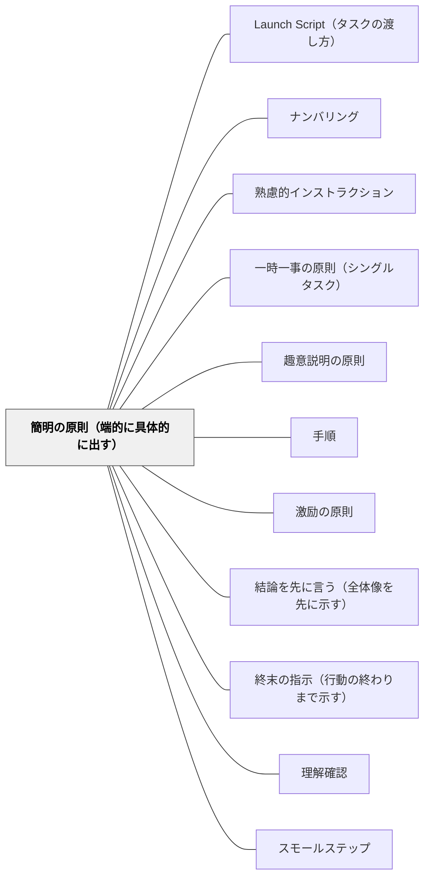

# 簡明の原則（端的に具体的に出す）

> 指示は短く、具体的に。30秒で言えないなら再整理が必要だ。

## 背景（Context）
簡明の原則は向山洋一（1985）『授業の腕をあげる法則』明治図書に示される10原則の一つである。端的に・具体的に・短く指示を出すことが、受け手への伝達効率を決定的に左右する。長く曖昧な指示は伝わらないだけでなく、受け手の集中力を奪い、活動開始を遅らせる。
土居正博も、指示の核心は受け手を動かすことにあるとし、「考えましょう」ではなく「ノートに3つ書きましょう」と、具体的な動詞と量で出す指示を「動かす指示」と呼ぶ。

※旧パタン「動かす指示」を本ページに統合（2026-11-12）。どちらも、動詞・対象のはっきりした具体的な指示を求める同じ手だったため一枚にした。量・場所・時間まで入れる言い方と、指示のあとの確かめ方は、解決に移した。

## 問題（Problem）
説明好きな教師ほど、指示に前置き・理由・補足を重ねて長くなりがちである。受け手は何をすれば良いのかが埋もれ、指示が終わる頃には最初の内容を忘れている。「丁寧に説明した」と教師が感じるとき、受け手はむしろ混乱していることがある。

## 力のかたち（Forces）
- 短い指示は記憶に残りやすく、行動を起こしやすい
- 具体性のない指示（「しっかり」「きちんと」）は人によって解釈が異なる
- 説明を削ると趣意が伝わらなくなる場合があり、バランスが必要
- 「何を・どこに・いくつ・どのくらい」が示されると動きやすく、動きが目に見えるので確かめやすい

## 解決（Solution）
**近いパタンとの見分け**：動詞・量・対象のはっきりした短い指示が本パタン（旧「動かす指示」を統合）。目的を一文添えるのは [[パタン/趣意説明の原則]]、一度に一つずつ出すのは [[パタン/一時一事の原則（シングルタスク）]]。指示の系列の全体の表は [[パタン/熟慮的インストラクション#近いパタンとの見分け|熟慮的インストラクション]] にある。

**指示は「〇〇してください」という動詞・対象が明確な短文で出す。30秒以内に言えない指示は、分けるか削るかして再整理する。**

「丁寧に書きましょう」ではなく「1マス1文字で書きましょう」、「がんばりましょう」ではなく「3問全部解きましょう」のように、行動が見える言葉を選ぶ。趣意は別途一文で添えるが、指示そのものは短く保つ。

**動詞に、量・場所・対象・時間を添える**（旧「動かす指示」）：「書く・読む・話す・並ぶ・〇個する」のような動詞に、量・場所・対象を入れる。「ノートに3つ書きましょう」「隣の人に1分で話してください」「教科書の〇ページを開いてください」のように、聞いた瞬間に体が動ける具体さを目指す。指示のあとに「今から何をするか、隣の人に言ってみて」と確かめると、迷いが減る（[[パタン/理解確認]]）。[[パタン/スモールステップ]]と組み合わせると、段階的に動ける。

## 結果（Consequences）
- 受け手がすぐに行動に移れるようになる
- 指示の解釈のばらつきが減り、全員が同じ動きをしやすくなる
- 教師自身が「何を求めているか」を明確化する思考習慣が育つ
- 指示のあとの「どうすればいいですか？」が減り、行動が見えるので確かめやすくなる

## クラスター図

## Actionable Insight

- 「丁寧に書きましょう」ではなく「1マス1文字で書きましょう」のように行動が見える言葉を選ぶ——受け手がすぐに行動に移れる
- 指示を30秒以内に言えるか自分で確認する——30秒以上かかる場合は分けるか削るか再整理が必要
- 「がんばりましょう」ではなく「3問全部解きましょう」と言い換える習慣を持つ——具体的な指示が解釈のばらつきを減らし全員が同じ動きをしやすくなる

## 出典

- 一つの教育のパタン・ランゲージ（岩井輝久）

## 関連パタン
- [[特別支援/特別支援で使えるパタン]]
- [[パタン/Launch Script（タスクの渡し方）]]
- [[パタン/ナンバリング]]
- [[パタン/熟慮的インストラクション]] — 親パタン
- [[パタン/一時一事の原則（シングルタスク）]] — 簡明さを支えるシングルタスク
- [[パタン/趣意説明の原則]] — 簡明な指示に添える目的の説明
- [[パタン/手順]] — 具体的な行動内容の構成
- [[パタン/激励の原則]]
- [[パタン/結論を先に言う（全体像を先に示す）]]
- [[パタン/終末の指示（行動の終わりまで示す）]] — 行動の始まりから終わりまで設計する
- [[パタン/理解確認]] — 指示後に行動で確かめる
- [[パタン/スモールステップ]] — 段階的に動ける設計

