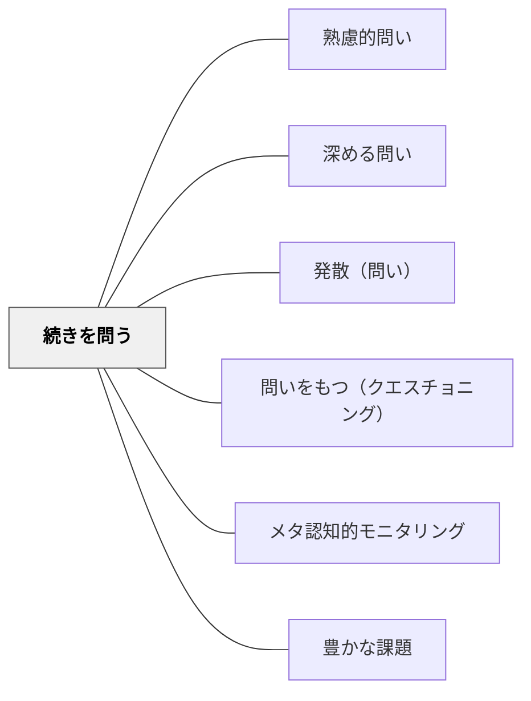

# 続きを問う

**このパタンが完成を助ける大きなパタン**：[[パタン/熟慮的問い]]

> 「この続きはどう説明できる？」と問い、途中で止まった思考を前に進める。

## 背景（Context）
学習者が思考の途中で止まってしまったり、説明を尻切れとんぼに終わらせてしまうことがある。教師がすぐに補ってしまうと、学習者は自力で思考を続ける経験を得られない。「続き」を問うことで、学習者自身が思考を完成させる機会を与える。

**岩井の講話では**：問い返すことを、子どもが言ったことに対して問いを返すことだと説明し、問い返すことによって「考えが深まっていったりとか詳しくなったりすることがあります」と述べたうえで、問い返しの一つとして「続きを問う」を「意味を問う」と並べて挙げている（講話 17:38〜18:09）。講話で示されているのは名前までで、続きを問う具体的な言い方や場面は語られていない。

（土居正博『自分で考え、学べる子を育てる！ 発問の技術』は、子どもの発言の続きを問う問い返しを扱っていないため、「原典では」は書かない。）

## 問題（Problem）
思考が途中で止まった状態を放置すると、理解が不完全なまま先に進む。逆に教師が続きを全部話してしまうと、学習者の思考は受動的なままになる。思考の続きを引き出す問いがなければ、学習者は「途中まで考えれば十分」と感じてしまう。

## 力のかたち（Forces）
- 「続きは？」という問いはシンプルで敷居が低い
- 続きを考えることで思考の全体像が整理される
- 途中まで出た考えを肯定しつつ先を促す
- 沈黙を恐れず待つ姿勢が思考の深まりを支える

## 解決（Solution）
**近いパタンとの見分け**：問い返しのうち、途中で止まった説明の先を求めるのが本パタン。意味を求めるのは [[パタン/意味を問う（それはどういうことかな）]]、理由を求めるのは [[パタン/理由・根拠を問う]]。系列の全体の表は [[パタン/問い返し（リヴォイシング）#近いパタンとの見分け|問い返し（リヴォイシング）]] にある。

「そこから、続きはどう考える？」「もう少し言えそう？」「次はどうなるかな？」と問い、学習者に思考の続きを語らせる。たとえば植物の成長を説明しかけた学習者に「根の次は？茎はどうなる？」と続きを引き出す。説明が完結しなくても「ここまで言えたね、あとはどこが難しそう？」と足場をかけてもよい。

---

**例：止まった説明を、その子の最後の言葉から続ける**（算数・3年「かけ算の筆算」など、手順を説明し合う場面）
1. 子どもが「まず一の位をかけて、それで……」と止まったら、すぐに補わず、その子の最後の言葉を「それで？」とそのまま返す。
2. 続きが出なければ、「ここまでで、どこまで書けた？ノートを指してみて」と、言葉ではなく指で続きを示してよいことにする。
3. 指した所から、「次は、その数をどこに書く？」と一歩だけ先を問う。
4. 最後まで言えたら、本人にもう一度はじめから通して言い直す時間をとる。
（講話 17:38〜18:09 の「続きを問う」を授業に移した Wiki 側の手順）

---

**例：友だちの説明の続きを、別の子が受け取る**（国語・物語文、中学年）
1. ある子が「ごんは、くりを持っていったのは……」と途中で止まったら、本人に「続きを言える？」と一度だけ聞く。
2. 本人が首をふったら、「今の話の続き、だれか言える人？」と学級に開く。
3. 続きを言った子の説明のあと、最初の子に「あなたが言いたかったことと同じ？ちがうところはある？」と戻す。
4. 最初の子が自分の言葉で最後まで言えたところで終える。
（Wiki 側の手順。講話・原典に具体例はない）

## 結果（Consequences）
- 思考を途中で諦めない粘り強さが育つ
- 説明の流れを整理することで理解が深まる
- 「続き」を問われる習慣が、自分で問い続ける力を育てる

- 注意点：続きを急かすと、子どもは「途中で止まったら代わりに言われる」と受け取り、話し始めなくなる。続きを他の子に開いたときは、必ず最初の子に話を戻して終える。

## 関連パタン
- [[パタン/熟慮的問い]] — 親パタン
- [[パタン/深める問い]] — 表面から核心へ掘り下げる
- [[パタン/発散（問い）]] — さらに追加・拡張を促す

- [[パタン/問いをもつ（クエスチョニング）]] — 続きを問う力を育てる上位パタン
- [[パタン/メタ認知的モニタリング]] — 続きを問うことが自己の理解状態をモニタリングする
- [[パタン/豊かな課題]] — 続きへの問いが探究課題を豊かに広げる

## クラスター図

## Actionable Insight

- 学習者が説明を途中で止めたとき、すぐ補わずに「もう少し言えそう？」と言って10秒待つ——その沈黙が自力で思考を続ける経験を積む場になる
- 「そこから続きはどう考える？」を授業中の口癖にする——続きを問われる習慣が学習者自身が問い続ける力を育てる
- 「ここまで言えたね、あとはどこが難しそう？」と足場をかけながら思考を前に進める——肯定から始まる問いが学習者の粘り強さを引き出す

## 出典
- [[文献/熟慮的問いのパターンリスト（動画記録）]]

- 岩井輝久（年不明）『熟慮的問いのパターンリスト』［動画］ https://youtu.be/WivskVtxG34 — 2026-11-13 に文字起こしで確認（17:38〜18:09）
