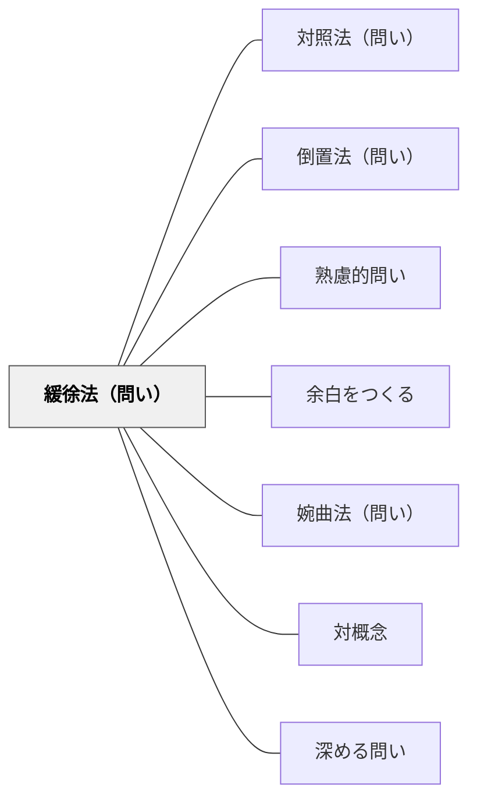

# 緩徐法（問い）

> 二重否定を使って直接表現の印象を操作する問い

## 背景（Context）
緩叙法（リトーテス）は、直接的な言い方をせず、その逆の意味の否定形を使う修辞技法である（「嫌い」を「好きではない」と言う）。否定を重ねて肯定を表す二重否定もこれに含まれる。出典の安斎（2021）でも「緩叙法」と書く。「悪くはない」は「良い」を、「不可能ではない」は「可能だ」を含意する。問いに二重否定を用いることで、断定を避けながら可能性を問いかける柔らかな圧力を作り出すことができる。慎重な検討や控えめな見解を引き出したいときに有効である。

**原典では**：本パタンのもとになった安斎（2021）では、技法名は「緩叙法」と書かれる。言葉のニュアンスをぼやかす「光を和らげる」タイプのレトリックの一つで、見出しは「二重否定を使って、直接表現の印象を操作する」である（第5章 MANNERS 19、Kindle版 85%）。緩叙法は「直接的な表現するのではなく、その逆の意味の否定形を使うテクニック」で、「嫌い」を「好きではない」と言う方法がその例とされる（同）。効果は二つあるという。第一は直接的な表現をオブラートに包む効果で、「何か良いアイデアはありますか？」は直接的すぎて相手が萎縮してしまうかもしれないが、「検討の余地がありそうなボツネタはありますか？」と言い換えると印象が変わる（同）。第二は、かえって言葉のニュアンスを強調する効果で、「私たちが取り組むべきミッションとは？」を「取り組まないわけにはいかないミッション」と二重否定で言うと、ニュアンスが強められる（同、85%）。つまり緩叙法は、問いを和らげるためにも、強めるためにも使える。

**岩井の講話では**：安斎の本の一覧として「二重否定を使って直接の印象を操作する」と読み上げている（30:14〜30:25）。

## 問題（Problem）
直接的な問いは、学習者に「答えなければならない」という緊張感を与えることがある。特に不確実な状況や、まだ考えが固まっていない段階では、明確な回答を求める問いが思考を止めてしまう。また、肯定的な断言を求める問いは、慎重な見解や留保を含む複雑な思考を排除しがちである。

## 力のかたち（Forces）
- 断定の求め vs 留保の許容
- 問いの明確さ vs 曖昧さへの耐性
- 肯定的回答の促進 vs 批判的思考の尊重
- 問いの柔らかさ vs 鋭さ

## 解決（Solution）
**近いパタンとの見分け**：問いの型の表では、本パタンの見分けの問いは「二重否定で、言い方の強さを調整しているか」。全体の表は [[パタン/熟慮的問い#近いパタンとの見分け|熟慮的問い]] にある。

「〇〇でないとはいえないのでは？」「この可能性を無視できるとは言いにくいのでは？」「そうではないとも言い切れないのではないか？」のように、二重否定の形で問う。特に仮説を慎重に検討させたいとき、あるいは学習者の発言を尊重しつつ揺さぶりをかけたいときに使う。

---

**例：「良い考え」を求める問いを和らげる**（総合的な学習・5年）
1. 地域の課題について考える時間に、「何か良い解決策はありますか？」と問う代わりに、「完ぺきではないけれど、試してみる価値がなくはない、という考えはありますか？」と問う。
2. 子どもは「試してみる価値がなくはない考え」を付箋に一つずつ書き、出来の良し悪しを気にせず模造紙に貼る。
3. 貼られた考えの中から、グループで一つ選び、「どうすれば試せるか」を次の問いにする。

---

**例：二重否定で、問いの重みを強める**（道徳・6年）
1. 規則やきまりについて考える時間の終わりに、「わたしたちが守るべききまりは何だろう？」を、「わたしたちが守らないわけにはいかない、と思えるきまりは何だろう？」と言い換えて出す。
2. 子どもは、自分が「守らないわけにはいかない」と思うきまりを一つ選び、そう思う理由をワークシートに書く。
3. 同じきまりを選んだ子どうしで理由を比べ、「言われたから守る」ではなく「自分から守りたい」と思える理由がどこにあるかを話し合う。

## 結果（Consequences）
- 学習者が断言を避けながら複雑な考えを表現しやすくなる
- 慎重な検討や留保のある思考が議論に持ち込まれる
- 断定的な二項対立を超えた微妙なニュアンスの探究が促される

- 注意点：緩叙法は問いを和らげるだけでなく、二重否定によってかえって重みを強めることもある（安斎 2021、第5章 MANNERS 19）。和らげたいのか、強めたいのかを決めてから使う。否定を重ねすぎると問いの意味がとりにくくなるので、低学年では一つの否定にとどめる。
- 二重否定で、問いの重みをかえって強めることもできる（「取り組まないわけにはいかないミッション」、安斎 2021）

## 関連パタン
- [[パタン/対照法（問い）]]
- [[パタン/倒置法（問い）]]
- [[パタン/熟慮的問い]] — 親パタン
- [[パタン/余白をつくる]] — 断定を手放す余白が二重否定の問いを成立させる
- [[パタン/婉曲法（問い）]] — ネガティブな内容を柔らかく問う兄弟パタン
- [[パタン/対概念]] — 二項対立を超えた微妙なニュアンスへの問いかけ
- [[パタン/深める問い]] — 留保ある思考を引き出す問いの上位グループ

## クラスター図

## Actionable Insight

- 仮説を慎重に検討させたいとき、「○○でないとはいえないのでは？」という二重否定の形で問う——断定を避けながら可能性を問いかける柔らかな問いが留保ある思考を引き出す
- 「この可能性を無視できるとは言いにくいのではないか？」と問うことで、強い主張をしにくい学習者も発言しやすくなる——留保を許容する問いが慎重な見解を議論に持ち込む
- 断定的な二項対立になりやすい議論で意図的に二重否定の問いを挿入する——複雑なニュアンスへの気づきが生まれる

## 出典
- [[文献/熟慮的問いのパターンリスト（動画記録）]]

- 安斎勇樹（2021）『問いかけの作法 チームの魅力と才能を引き出す技術』ディスカヴァー・トゥエンティワン 第5章 MANNERS 19「レトリック（C-1）緩叙法」 — Kindle版 85% で確認。[[文献/問いかけの作法（安斎勇樹）]]
- 岩井輝久（年不明）『熟慮的問いのパターンリスト』［動画］ https://youtu.be/WivskVtxG34 — 2026-11-13 に文字起こしで確認（30:14〜30:25）
