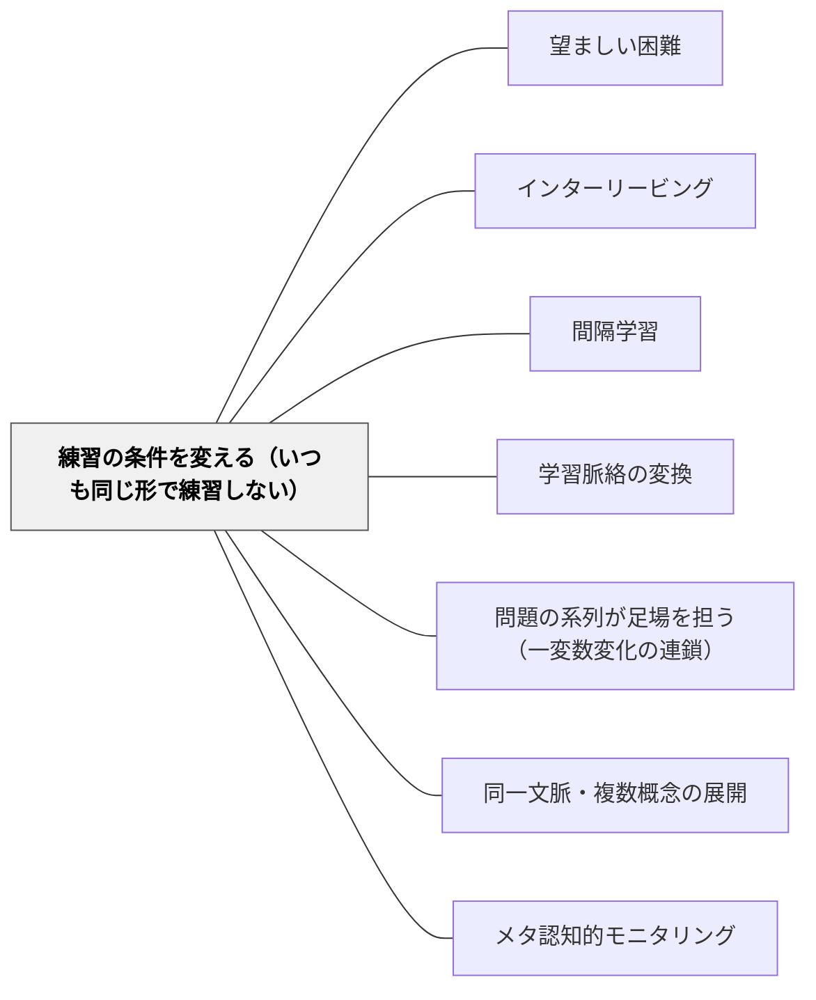

# 練習の条件を変える（いつも同じ形で練習しない）

> テストと同じ距離だけでお手玉を投げる練習をした子より、近い距離と遠い距離で練習した子のほうが、テストの距離でうまく投げた。いつも同じ形・同じ場所・同じ並びで練習すると、その条件では思い出せても、条件が変わると使えなくなる。

## [Pattern Connection]

[[文献/Making Things Hard on Yourself, But in a Good Way（Bjork & Bjork, 2011）]] は、望ましい困難を**四つ**挙げた。練習の条件を変える、交互に混ぜる、間隔をあける、テストする（p. 58）。このWikiの [[パタン/望ましい困難]] は、このうち三つ（[[パタン/間隔学習]]・[[パタン/インターリービング]]・[[パタン/テストを繰り返す]]）を形式として整理していたが、**「練習の条件を変える」が抜けていた**。本パタンはその抜けを埋める。

- **[[パタン/インターリービング]] との差分**：あちらは**別々のトピック**の練習を混ぜる。本パタンは、**同じトピック**の練習の条件（場所・形・数値・向き・距離）を変える
- **[[パタン/学習脈絡の変換]] との差分**：あちらは、変化のある繰り返しで**注意と意欲を保つ**ことをねらう。本パタンは、条件を変えることで**長期の保持と、新しい条件への転移**をねらう。同じ「変化をつける」でも理由が違う
- **根拠の強さについて**：本章は一般向けのエッセイで、条件を変える効果の例として二つの研究（部屋を変える・距離を変える）を挙げている。お手玉の実験は運動技能の研究であり、教科の学習にどこまで当てはまるかは、教室で確かめる

---

## 背景（Context）

練習は、同じ条件で繰り返すのがよいと考えられやすい。同じ教室の同じ席で、同じ形式のプリントを、同じ順序で解く。テストと同じ形で練習すれば、テストでよくできるはずだ、という考えである。勉強の仕方の助言でも「静かで決まった場所で勉強しよう」がよく言われる。

## 問題（Problem）

**練習の条件が一定で予測できると、学んだことがその条件に結びつく。その条件ではよく思い出せるが、時間がたったとき、条件が変わったときに使えない。**

> When instruction occurs under conditions that are constrained and predictable, learning tends to become contextualized. Material is easily retrieved in that context, but the learning does not support later performance if tested at a delay, in a different context, or both. (Bjork & Bjork, 2011, p. 58)
>
> 指導が制約された予測できる条件で行われると、学習はその文脈に結びつきやすい。その文脈では教材が簡単に思い出されるが、時間をおいて、あるいは違う文脈でテストされると、その学習はあとのできを支えない。

算数でいえば、いつも横書きの式で練習した子が縦書きの筆算で戸惑う、いつも「9＋□」の形で練習した子が「□＋9」で止まる、教科書と同じ数値の文章題は解けるが場面が変わると解けない、ということが起きる。

## 力のかたち（Forces）

- **同じ条件の練習は、その場のできを上げる**：同じ形の繰り返しは早く上手になり、子どもも教師も「身についた」と感じる。しかしその場のできは、長く残る学習の当てにならない指標である（p. 57）
- **常識に反する**：テストと同じ条件で練習したほうがよいと思える。お手玉の実験では、その逆になった（p. 59）
- **変えすぎると別の課題になる**：条件を変えるのは、同じことを違う条件で練習することである。変えすぎて別の内容になると、ただの混乱になる
- **応える力がないと望ましくない**：条件の変化に応える基礎がない子には、変化は望ましくない困難になる（p. 58）

## 解決（Solution）

**基礎ができたら、同じ内容の練習の条件を少しずつ変える。形式・数値・向き・場面・場所を一つずつ変え、子どもが条件が変わっても同じことができるようにする。**

手順は三つ。

1. **変えてよい条件と、変えない中身を分ける**：何を身につけたいのか（中身）と、たまたま一定になっている条件（形・数値・向き・場所）を書き出す
2. **基礎ができてから変える**：最初の数回は同じ条件で練習してよい。手順が分かってきたら条件を変える
3. **一度に一つずつ変える**：形式を変えたら数値はそろえる、というように、変える条件を一つに絞る（[[パタン/問題の系列が足場を担う（一変数変化の連鎖）]]）

---

### 具体例①：お手玉の実験（Kerr & Booth, 1978）

8歳と12歳の子どもが、目隠しをして床の的にお手玉を投げる練習をした（p. 59）。

- 半分の子は、テストと同じ一つの距離（8歳なら約90cm）だけで練習した
- 残りの子は、それより近い距離と遠い距離で練習した——**テストの距離では一度も練習しなかった**

しばらくたってから、全員をテストの距離で試すと、どちらの年齢でも、**近い・遠い距離で練習した子のほうがうまかった**。著者らは、投げる動きの強さや角度を調整することを学んだ利点が、テストの距離で練習した利点を上回ったのだろう、と述べる。

---

### 具体例②：算数の練習——形と数値を変える

くり上がりのある足し算の練習で：

- **同じ条件**：「8＋5＝」「7＋6＝」……と、横書きで、大きい数が先、答えを右に書く形を20問
- **条件を変える**：「5＋8＝」（順序を逆に）、縦書き、「8＋□＝13」（答えでなく途中を問う）、「8円と5円で何円？」（場面）を混ぜる。中身（10のまとまりをつくる）は変えない

同じ条件の練習は、その時間のプリントの正答率が高くなる。条件を変えた練習は、その時間は時間がかかるが、形が変わっても同じ考え方で解けるようになることをねらう。

---

### 具体例③：漢字や語句——使う文脈を変える

新しい漢字を、ドリルの同じ枠に10回書くだけでなく、短い文を作る、別の言葉と組み合わせる、日記で使う、と使う条件を変える。本章が挙げる「同じ教材を二つの違う部屋で学ぶとよく思い出せた」（Smith, Glenberg, & Bjork, 1978）という結果は、学ぶ場所という条件でも同じことが起きうることを示している。

---

### 特別支援の視点

条件の変化に戸惑いやすい子には、変化そのものが大きな負担になりうる。最初は同じ条件で、手順が安定してから一つずつ変える。変えるときは「今日は数の順番だけ変えるよ」と、何が変わるかを先に伝える。条件が変わっても中身は同じだと分かるように、同じ問題の二つの形を並べて見せる。予測できることが安心につながる子では、変化の予告そのものが支えになる。

## 結果（Consequences）

**利点**

- 学んだことが、練習したときと違う形・場面・時間でも使えるようになる
- 「この形なら解ける」という狭い身につき方を防げる
- 子どもが、形が変わっても中身は同じだと気づく経験を積める

**注意点・リスク**

- **その場のできは下がる**：条件を変えた練習は、その時間の正答率が下がり、時間もかかる。それを失敗と読まない
- **基礎がないと混乱になる**：手順が分かる前に条件を変えると、望ましくない困難になる
- **教科の学習での証拠は限られる**：本章が条件を変える効果の例に挙げるのは、場所を変える実験と運動技能の実験である。教科の練習でどこまで効くかは、教室で確かめる

## 関連パタン

- [[パタン/望ましい困難]] — 四つの望ましい困難のうち、wiki に抜けていた「練習の条件を変える」
- [[パタン/インターリービング]] — 別々のトピックを混ぜるのがあちら、同じトピックの条件を変えるのが本パタン
- [[パタン/間隔学習]] — 時間という条件を変える。条件を変える練習と組み合わせられる
- [[パタン/学習脈絡の変換]] — 変化のある繰り返しで注意を保つのがあちら、転移と保持をねらうのが本パタン
- [[パタン/問題の系列が足場を担う（一変数変化の連鎖）]] — 条件を一度に一つずつ変える並べ方
- [[パタン/同一文脈・複数概念の展開]] — 文脈を変えずに概念を変えるのがあちら。収束のあとで文脈を変えて練習する、という点で本パタンとつながる
- [[パタン/メタ認知的モニタリング]] — 同じ条件の練習で生まれる「できた感」は、学習の当てにならない指標

## クラスター図

## Actionable Insight

- 次の練習プリントを作るとき、変えずに続けている条件（式の向き・数の順番・答えを書く場所）を一つ見つけ、後半の数問だけそれを変えてみる
- 子どもが同じ形の問題をすらすら解けるようになったら、「では、こういう形ならどう？」と形だけ変えた一問を出す
- 練習の時間の正答率が少し下がっても、1週間後に同じ中身を違う形で確かめてみる

## 出典

Bjork, E. L., & Bjork, R. A. (2011). Making things hard on yourself, but in a good way: Creating desirable difficulties to enhance learning. In M. A. Gernsbacher, R. W. Pew, L. M. Hough, & J. R. Pomerantz (Eds.), *Psychology and the real world* (pp. 56–64). Worth Publishers.

> "When instruction occurs under conditions that are constrained and predictable, learning tends to become contextualized. Material is easily retrieved in that context, but the learning does not support later performance if tested at a delay, in a different context, or both." (p. 58)

Kerr, R., & Booth, B. (1978). Specific and varied practice of a motor skill. *Perceptual and Motor Skills, 46*, 395–401.（Bjork & Bjork, 2011 による引用）

Smith, S. M., Glenberg, A. M., & Bjork, R. A. (1978). Environmental context and human memory. *Memory & Cognition, 6*, 342–353.（Bjork & Bjork, 2011 による引用）
