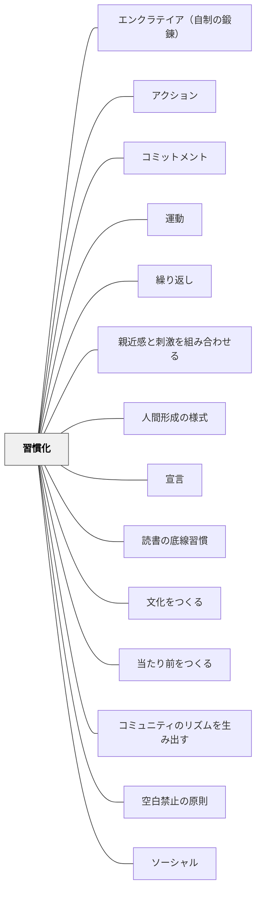

# 習慣化

**このパタンが完成を助ける大きなパタン**：[[パタン/文化をつくる]]・[[パタン/熟慮的練習]]

> 習慣は第二の天性である。— アリストテレス

## Pattern Connection

---

**ショーペンハウアー（1851/2018）「幸福について」統合（2026-05-31）：**

ショーペンハウアーの訓話と金言（第五章）は、日常的な習慣の設計に関する実践的知恵の集積だ。特に「引き出し管理の習慣」と「感謝の技法」は、本パタンの具体的な実装として読める。

- **既存パタンとの関連**：「ひとつのことを企てたら、他の一切を度外視し、払いのけねばならない。いわば思考の引き出しのひとつを開けたら、その間は他の引き出しを閉めたままにしておきなさい」——これは「注意の分散を防ぐ習慣」であり、習慣化のトリガー設計として実装できる
- **補強された点**：「感謝の技法（持っているものを『なかったら』という視点で見直す）」は、日常の習慣として定着させることで幸福の主観的条件を整える実践になる。習慣化の対象は行動だけでなく「見方の習慣」も含む
- **波及するパタン**：[[パタン/精神の平穏]] — 日々の習慣的実践（引き出し管理・感謝の技法）が精神の平穏を育てる；[[パタン/エンクラテイア（自制の鍛錬）]] — 「節制と忍耐」は習慣化によって自動化される

---

## 背景（Context）

認知資源は有限である。意識的に行う行動は認知負荷を消費するが、習慣化された行動は自動的に実行され、認知資源を解放する。学習のための良いルーティン（ノートを開く、問いを書く、振り返りをする）が習慣化されると、学習者はその行動自体ではなく、学習の内容に意識を向けられるようになる。

岩井は次のように書いている。「よくも悪くも習慣は、教育と人生を決定的に左右する要素である。習慣は、一つの学校も学級も人生を大きく左右する大きな原因。習慣が今のその人と言っても過言ではないかもしれない。」

※旧パタン「習慣化（脱習慣）」（岩井の原稿から作ったページ）を本ページに統合（2026-11-12）。どちらも、きっかけを決めて繰り返し、目に見える形にして習慣をつくるという同じ解決だった。岩井の記述（中田敦彦の動画から学んだ習慣化の手順と、悪い習慣をやめる「知識化」）は、解決の小節「習慣をつくる四つの手順と、やめる手順」に移した。

## 問題（Problem）

毎回意識的に「さあやろう」と促さなければ動かないルーティンは、教師の労力を消耗させ、学習者にとっても「させられること」になる。

## 力のかたち（Forces）

- 習慣形成には一定の反復期間（数週間〜数ヶ月）が必要
- 習慣は報酬・環境・トリガーのセットで形成される
- 習慣化しすぎると「慣れ」となり、活気や意味が失われることもある
- 悪い習慣をやめようとすると、大きな抵抗に会う

## 解決（Solution）

**近いパタンとの見分け**：学習のルーティンを自動化するのが本パタン（旧「習慣化（脱習慣）」を統合）。育てたい性向（徳）を行為として繰り返すのは [[パタン/エソスと習慣形成]]。練習と記憶の系列の全体の表は [[パタン/熟慮的練習#近いパタンとの見分け|熟慮的練習]] にある。

**学習を支えるルーティンを特定し、一貫したトリガー・環境・フィードバックのセットで反復し、自動化する。**

設計の要素：
- **トリガー**：何がそのルーティンを始めさせるか（チャイム・特定の場所・開始の言葉）
- **反復**：同じ形で繰り返す（形を変えない期間を設ける）
- **フィードバック**：できたことを確認・賞賛する
- **コミュニティへの統合**：クラス全体の「当たり前」として位置づける

### 習慣をつくる四つの手順と、やめる手順（旧「習慣化（脱習慣）」・岩井の記述）

三日坊主。

さまざまな習慣論があるが、最も影響を受けたのが中田敦彦のYouTube大学の「【がんばらない戦略①②】習慣の力でがんばらずに成果を出す（Strategies To Achieve Your Goals Without Any Extra Effort）」だ。この動画は、川下和彦、たむらようこ『がんばらない戦略』を中田敦彦が再構成したものだ。

この習慣論が優れているのは、習慣化することをパタン化、スキル化しているところだ。世の中の習慣論の多くは習慣とは何か、何を習慣をするのが良いのかということを論じているものが多い。しかし、中田は習慣化する方法を説明している。

中田は、三つの順序で習慣化の方法（パタン）をまとめている。

①固定化（トリガー化）
②無意識化（反復化／ゲーム化）
③可視化（宣言化／記録化／分業化）

習慣にはよくも悪くも大きな影響力がある。悪い習慣を止める時には、大きな抵抗に会う。

中田の「【お酒をやめる①】酒は百薬の長ではない？アルコール依存の危険性とは？」を見ると飲酒という習慣を止めるために二つの段階について説明している。一つは知識の段階で、もう一つの段階は、習慣化と同じで可視化についてだ。悪習慣を止めるには、その悪習慣について、どのような悪影響があるのか知るということが効果的だ。これは習慣化を目指す時にも効果的である。習慣化することによって、どのような効果があるのか知るということだ。従って習慣化（脱習慣）のスキル（パタン）として知識化があると考えられる。

④知識化

教育の歴史で、習慣化が大きな力を発揮した例について無数に思い浮かべることができますが、いくつか事例として紹介します。

**考えて行うこと、行って考えること**

「（最も大事なものは何だろうというヴィルヘルムの問いに対し）それを言うのは簡単だ。考えて行うこと、行って考えること、これがあらゆる知恵の結論だ、昔から知られ、昔から実践されてきたが、誰でも理解できたわけじゃない。（中略）人間悟性の守護神は生まれてくるものすべての耳に『行いを思考によって、思考を行いによって吟味せよ』と囁きかけるが、これを原則とする人は迷うことがないし、たとえ迷ったとしてもすぐに正道に戻ることができるものだ。」『ヴィルヘルム・マイスター遍歴時代』第２巻９章、ゲーテ

ゲーテにこのような言葉がありますが、コルブの体験学習サイクルを回していくことを習慣化した教育として、甲斐崎博史先生の実践を思い出します。目的や目標、目標を達成するには、どうすればいいか考えてやってみる体験、振り返り、一般化、適用というサイクルを子どもたちは、国語のリーディング・ワークショップやライティング・ワークショップでも、社会科や総合の探究学習でも、算数の学習でも、宿泊学習でも、ありとあらゆる場面、学習活動で、子どもたちは回していました。考えてやってみる、やってみて考えることが子どもたちの中に習慣化し、身体化していました。私は、ゲーテが指摘するような最も大事なことを子どもたちは習慣化し、甲斐崎博史先生から離れた後にも人生で本当に役立つ宝（習慣）を得たのだろうと考えています。

リーディング・ワークショップでは、規則的に読みたい本を読む時間がある必要があるとされています（固定化）。例えば、水曜日と金曜日の１時間目には、読む時間が繰り返しあれば、見通しをもって読書に取り組むことができます。さらに読書日記または読書ノートに記録化（可視化）したり、子どもたち同士が本と人を繋げ合うようなソーシャルな活動を取りれたりさまざまな工夫を重ねることによって、読書習慣を形成できるように助けることができます。

**何を習慣化すると良いか考えて習慣化せよ。また悪い習慣から脱せよ。**

習慣化することによって、大きな力や成長を得ることができる。また悪い習慣から脱することによって、たくさんの不幸を退けることができる。

（以上、岩井の原稿「教育のパタン・ランゲージ 集約」の「習慣化（脱習慣）」から。wiki の旧ページは引用の途中で切れていたため、2026-11-12 に原稿から補った。改行だけをつないでいる。）

## 自己教育での適用例

**数学デイリー（岩井の実践）：** 朝の「コーヒーを入れる → ネットサーフィン → 数学デイリー」というチェーンを平日の習慣として確立。既存の習慣（コーヒー）に新しいルーティン（数学）を接続したことで、意志力に頼らず継続できている。

- **子どもとの共通点**：一貫したトリガーが行動の自動化を支えるという仕組みは同じ
- **大人ならではの差**：チャイム・教師の声など外部トリガーがない。自分でトリガーを設計・維持する必要があり、既存の習慣へのアンカリング（行動チェーン化）が特に有効。また子どもよりも長期間継続する意志と自己管理が求められる

---

## 結果（Consequences）

- ルーティンが自動化され、学習者の注意が内容に向けられる
- 一貫したリズムが安心感を生む（→[[パタン/親近感と刺激を組み合わせる]]）
- 学習時間の密度が上がる

## クラスター図

## Actionable Insight

- 新しい習慣は「いつ・どこで・何のあとに」というトリガーとセットで設計する——習慣化の成否はトリガーの明確さで決まる
- 悪い習慣をやめるには「なぜやめたいのか」を紙に1行書く——知識化（悪影響の言語化）が動機の持続を支える（旧「習慣化（脱習慣）」）
- 定着させたいルーティンを1つ選び、同じトリガー（チャイム・特定の言葉・場所）で3週間繰り返す——トリガーの一貫性が習慣の自動化を最も効果的に支える
- ルーティンの目的を学習者に伝え「クラスの当たり前」として位置づける——コミュニティとしての習慣化が個人の意志力に頼らない自動的な行動を生む
- 学習者が誰に言われるでもなくルーティンを始めたとき、そのことを称賛・共有する——「もう当たり前になっている」という承認が習慣の定着を強化する

## 出典

- 岩井輝久『一つの教育のパタン・ランゲージ』（2026-04-29 vault収録）の「習慣化（脱習慣）」（旧ページ）
- 川下和彦、たむらようこ（2021）『がんばらない戦略』アスコム
- 垣渕洋一（2020）『「そろそろ、お酒やめようかな」と思った時に読む本』青春出版社
- ゲーテ『ヴィルヘルム・マイスター遍歴時代』第2巻9章
- 一つの教育のパタン・ランゲージ（岩井輝久）

## 関連パタン
- [[パタン/エンクラテイア（自制の鍛錬）]]
- [[学級経営/学級経営で使えるパタン]]
- [[実践/デイリー5の起動]]
- [[実践/リテラシー・ワークステーションの起動]]
- [[学級経営/文化をつくる]]
- [[パタン/アクション]]
- [[パタン/コミットメント]]
- [[パタン/運動]]
- [[パタン/繰り返し]]
- [[パタン/親近感と刺激を組み合わせる]]
- [[パタン/人間形成の様式]]
- [[パタン/宣言]]
- [[パタン/読書の底線習慣]]

- [[パタン/文化をつくる]] — 親パタン
- [[パタン/当たり前をつくる]] — 習慣化の目的
- [[パタン/コミュニティのリズムを生み出す]] — リズムが習慣化を支える
- [[概念/自己調整学習の内側（成長の道とウェルビーイングの道）]] — 意志的方略（volition）の実装。意志力に頼らず粘りを設計する
- [[パタン/空白禁止の原則]]
- [[パタン/ソーシャル]]
- [[パタン/スキル化]]
- [[パタン/可視化]] — 習慣の三つめの手順（宣言・記録・分業）
- [[パタン/アドベンチャー]] — 甲斐崎博史の実践（体験学習サイクルの習慣化）

